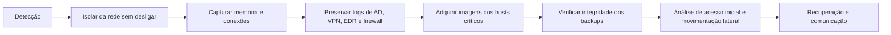

# Casos de Uso Corporativos de Forense Digital

> **Objetivo pedagógico:** aplicar os fundamentos (princípios, ordem de volatilidade, fases, ética e abertura de caso) a cenários corporativos realistas, mostrando decisões, evidências prioritárias, riscos legais e entregáveis.

Todos os casos são fictícios e servem para treinamento.

## 1. Como ler cada caso

Cada caso apresenta contexto, perguntas investigativas, evidências priorizadas pela volatilidade, procedimento, riscos legais e de privacidade, entregáveis e normas aplicáveis.

## 2. Caso 1: ameaça interna com exfiltração para nuvem pessoal

**Contexto:** o DLP alertou o envio de arquivos de projetos para serviço de nuvem pessoal por um colaborador em processo de desligamento.

**Perguntas investigativas:**

1. Quais arquivos foram enviados, quando e por qual conta e dispositivo?
2. Houve uso de mídia removível?
3. Há indício de acesso a dados fora da função do colaborador?

**Evidências por prioridade:**

| Prioridade | Fonte |
|---|---|
| 1 | Logs de proxy, DLP e M365 com retenção curta |
| 2 | Memória e conexões do notebook, se estiver ligado |
| 3 | Imagem do disco e artefatos de USB e de navegador |
| 4 | Logs de autenticação, VPN e de acesso a repositórios |

**Procedimento:** abrir o caso, obter autorização do Jurídico e do DPO, preservar logs, capturar a memória, adquirir a imagem com bloqueio de escrita, extrair artefatos de dispositivos USB e de navegação, correlacionar com os logs de nuvem e construir a linha do tempo.

**Riscos legais e de privacidade:** conteúdo pessoal do colaborador; necessidade de política de uso aceitável comunicada; limitação ao escopo corporativo.

**Entregáveis:** relatório técnico, sumário para Jurídico e RH, lista de arquivos e de horários, cadeia de custódia.

**Técnicas ATT&CK relacionadas:** Exfiltration Over Web Service (T1567) e Exfiltration over Removable Media (T1052).

## 3. Caso 2: Business Email Compromise em conta de diretoria financeira

**Contexto:** fornecedor relata mudança de dados bancários solicitada por e-mail aparentemente da diretora financeira, e a empresa identifica pagamento desviado.

**Perguntas investigativas:**

1. A conta de e-mail da diretora foi comprometida ou houve spoofing?
2. Existem regras de caixa de entrada e encaminhamentos ocultos?
3. Qual foi o primeiro acesso indevido e por qual origem?

**Evidências por prioridade:**

| Prioridade | Fonte |
|---|---|
| 1 | Unified Audit Log e logs de entrada (retenção limitada) |
| 2 | Regras de caixa, encaminhamentos e consentimentos de aplicativos |
| 3 | Cabeçalhos das mensagens fraudulentas (SPF, DKIM e DMARC) |
| 4 | Logs do gateway de e-mail e de proxy |

**Procedimento:** exportar logs antes da expiração, revogar sessões após a coleta, analisar regras e consentimentos, validar cabeçalhos e rastrear a origem do acesso.

**Riscos legais e de privacidade:** conteúdo de e-mails com dados de terceiros; comunicação ao banco para tentativa de recall do pagamento; avaliação de notificação à ANPD se houver dados pessoais envolvidos.

**Entregáveis:** linha do tempo do ataque, lista de IOCs, evidências para boletim de ocorrência e para o banco.

**Técnicas ATT&CK relacionadas:** Phishing (T1566), Email Forwarding Rule (T1114.003) e Valid Accounts (T1078).

## 4. Caso 3: ransomware em servidor de arquivos

**Contexto:** usuários relatam arquivos com extensão alterada e notas de resgate em compartilhamentos.

**Perguntas investigativas:**

1. Qual foi o acesso inicial e o paciente zero?
2. Qual o escopo: hosts, contas e dados exfiltrados?
3. Os backups estão íntegros e fora do alcance do atacante?

**Evidências por prioridade:** memória e conexões do servidor; logs de autenticação do AD e de VPN; telemetria de EDR; imagem do disco; backups; amostra do binário e nota de resgate.

**Riscos legais e de privacidade:** vazamento de dados (dupla extorsão); comunicação à ANPD e a titulares (LGPD, art. 48, e Resolução CD/ANPD nº 15/2024); não pagamento de resgate sem análise do Jurídico.

**Entregáveis:** relatório de escopo e impacto, linha do tempo, IOCs, plano de recuperação e lições aprendidas.

**Técnicas ATT&CK relacionadas:** Data Encrypted for Impact (T1486), Inhibit System Recovery (T1490) e Lateral Movement (TA0008).

## 5. Caso 4: fraude interna e preservação para litígio

**Contexto:** a auditoria interna identifica desvios em contratos de fornecedores; a empresa antevê ação judicial.

**Perguntas investigativas:**

1. Quem criou, aprovou e alterou os cadastros e os pagamentos envolvidos?
2. Existem comunicações que indiquem combinação entre as partes?
3. Os registros foram alterados após o fato?

**Evidências por prioridade:** logs de auditoria do ERP; e-mails e mensagens corporativas do período; arquivos de trabalho e metadados; backups históricos.

**Procedimento:** emitir legal hold; preservar mailboxes e logs; coletar com ferramenta de e-discovery com trilha de auditoria; manter cadeia de custódia; analisar o histórico de alterações e os metadados.

**Riscos legais e de privacidade:** direitos trabalhistas; sigilo; privilégio advogado-cliente; minimização de dados pessoais.

**Entregáveis:** relatório de análise de transações, linha do tempo de alterações, pacote de produção de documentos e relatório de conformidade da coleta.

**Frameworks:** EDRM, ISO/IEC 27050-1.

## 6. Caso 5: vazamento de informação por uso de IA generativa

**Contexto:** colaborador cola código-fonte e dados de clientes em assistente de IA generativa não autorizado.

**Perguntas investigativas:**

1. Que dados foram expostos, a quem pertencem e quando?
2. O serviço utiliza os dados para treinamento ou os retém?
3. Houve repetição por outros colaboradores?

**Evidências por prioridade:** logs de proxy e CASB; histórico do navegador; registros do próprio serviço (quando contratado); tíquetes e comunicações internas; DLP.

**Procedimento:** preservar logs de acesso ao serviço; identificar usuários e volumes; acionar o fornecedor para retenção e exclusão; avaliar impacto de privacidade e de propriedade intelectual.

**Riscos legais e de privacidade:** exposição de dados pessoais (LGPD) e segredos comerciais; avaliação contratual com o fornecedor; comunicação à ANPD, se aplicável.

**Entregáveis:** relatório de exposição, lista de dados e titulares afetados, plano de contenção e atualização da política de IA.

**Relação com o laboratório:** aprofundado nas pastas de forense de IA, de prompts e de incidentes com LLM.

## 7. Comparativo dos casos

| Caso | Fonte mais volátil | Principal risco legal | Framework de apoio |
|---|---|---|---|
| Ameaça interna | Logs de proxy e DLP | Privacidade do colaborador | ISO/IEC 27037, LGPD |
| BEC | Logs de entrada e auditoria M365 | Dados de terceiros e recall bancário | MITRE ATT&CK, RFC 7208, 6376 e 7489 |
| Ransomware | Memória e conexões | Notificação à ANPD | NIST SP 800-61 Rev. 3, CISA #StopRansomware |
| Fraude interna | Logs de ERP e e-mail | Privilégio e litígio | EDRM, ISO/IEC 27050-1 |
| IA generativa | Logs de proxy e CASB | Dados pessoais e segredo comercial | LGPD, ISO/IEC 42001 |

## 8. Exercício sugerido

Escolha um caso e, usando o modelo de abertura de caso e o checklist operacional, elabore: a ficha de abertura, a lista de evidências por volatilidade, o plano de preservação em 24 horas, três perguntas investigativas neutras e a estrutura do relatório final.

## 9. Normas e frameworks relevantes

- ISO/IEC 27037, 27042 e 27043
- ISO/IEC 27035-1:2023
- NIST SP 800-86 e NIST SP 800-61 Rev. 3
- MITRE ATT&CK
- CIS Controls v8.1, controles 8 e 17
- EDRM e ISO/IEC 27050-1
- LGPD e Resolução CD/ANPD nº 15/2024

## 10. Referências

- ISO/IEC 27037:2012; ISO/IEC 27042:2015; ISO/IEC 27043:2015.
- NIST SP 800-86 (2006); SP 800-61 Rev. 3 (2025).
- CISA. #StopRansomware Guide. 2023.
- MITRE ATT&CK. https://attack.mitre.org
- RFC 7208 (SPF), RFC 6376 (DKIM), RFC 7489 (DMARC).
- EDRM Reference Model. https://edrm.net
- Brasil. Lei nº 13.709/2018 (LGPD).
- Brasil. Resolução CD/ANPD nº 15/2024.
- Mandiant. M-Trends (edições anuais).
- Verizon. Data Breach Investigations Report (edições anuais).
