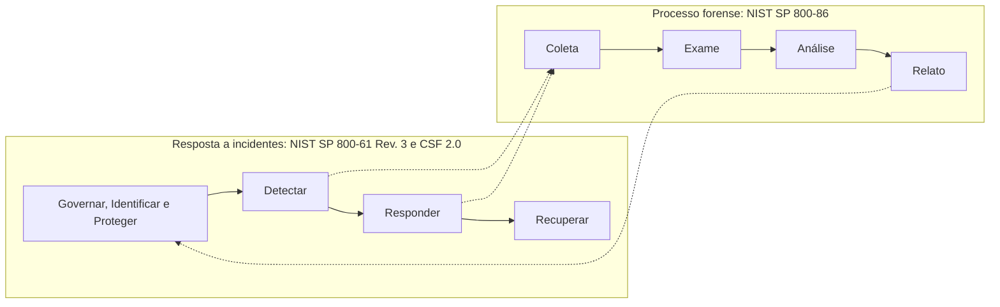
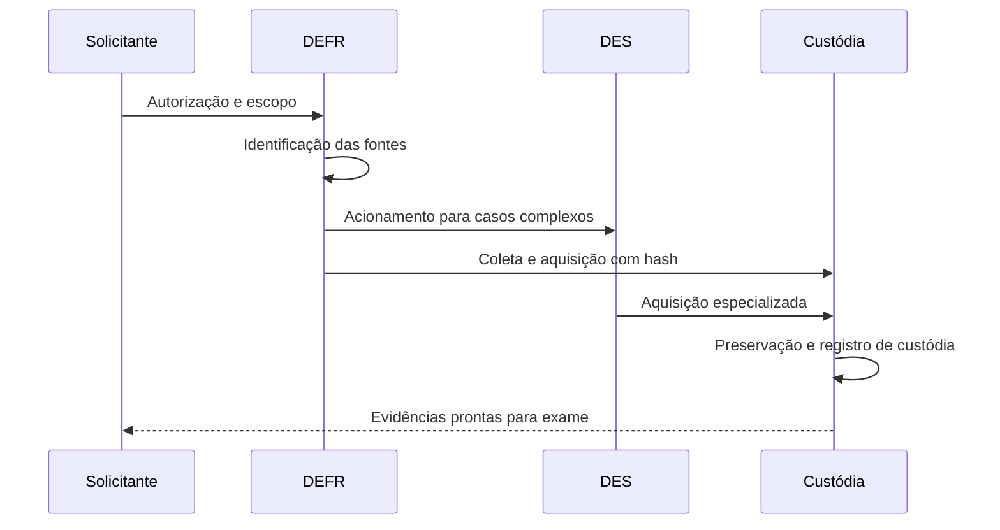

# Fases do Processo Forense

> **Objetivo pedagógico:** apresentar o processo forense de ponta a ponta, relacionando os modelos do NIST e da ISO/IEC à resposta a incidentes, e definir entradas, saídas e critérios de qualidade de cada fase.

## 1. Visão geral

O NIST SP 800-86 organiza o processo forense em quatro fases: coleta, exame, análise e relato. A ISO/IEC 27037 detalha a parte inicial (identificação, coleta, aquisição e preservação), a ISO/IEC 27042 trata da análise e interpretação, a ISO/IEC 27041 trata da adequação e validade do método e a ISO/IEC 27043 define os processos de investigação, incluindo a preparação (readiness).

## 2. Relação com a resposta a incidentes

Pontos de integração:

- A detecção aciona a coleta: o alerta define o escopo inicial de evidências.
- A contenção e a coleta competem: o isolamento de rede deve preservar a evidência volátil.
- O relato alimenta a melhoria: as lições aprendidas atualizam controles, detecções e playbooks.

O NIST SP 800-61 Rev. 3 alinha a resposta a incidentes às funções do NIST CSF 2.0 (Govern, Identify, Protect, Detect, Respond e Recover), com melhoria contínua em todas elas. O SANS Incident Handler's Handbook usa o modelo PICERL (Preparação, Identificação, Contenção, Erradicação, Recuperação e Lições aprendidas).

## 3. Fase 0: Preparação e prontidão (readiness)

| Item | Descrição |
|---|---|
| Objetivo | Estar apto a investigar antes que o incidente ocorra |
| Atividades | Política de resposta e de forense; inventário de ativos e fontes de log; sincronização de tempo (NTP); retenção de logs; kit de resposta; laboratório validado; treinamento; contatos e autorizações prévias |
| Entradas | Análise de riscos, requisitos legais, arquitetura |
| Saídas | Plano de resposta, playbooks, kit validado, matriz de fontes de evidência |
| Qualidade | Exercícios periódicos (CIS 17.7) e ferramentas validadas |
| Normas | ISO/IEC 27043 (processos de readiness), ISO/IEC 27002:2022 (5.24, 8.15, 8.17), CIS Controls 8 e 17 |

## 4. Fase 1: Identificação

| Item | Descrição |
|---|---|
| Objetivo | Reconhecer e documentar as fontes potenciais de evidência |
| Atividades | Definir escopo; listar sistemas, contas, dispositivos e logs; avaliar volatilidade; registrar o estado inicial |
| Entradas | Alerta, relato, ordem judicial ou solicitação formal |
| Saídas | Lista priorizada de fontes e plano de coleta |
| Qualidade | Escopo aprovado e base legal registrada |
| Normas | ISO/IEC 27037 (identificação) |

## 5. Fase 2: Coleta e aquisição

| Item | Descrição |
|---|---|
| Objetivo | Obter as evidências preservando a integridade |
| Atividades | Coleta ao vivo na ordem de volatilidade; aquisição de imagens com bloqueio de escrita; coleta de logs; cálculo de hash; início da cadeia de custódia |
| Entradas | Plano de coleta e autorização |
| Saídas | Imagens, capturas de memória, exportações de logs, registro de aquisição e hashes |
| Qualidade | Hash da fonte igual ao hash da imagem; documentação completa de ferramentas e versões |
| Normas | ISO/IEC 27037 (coleta e aquisição), RFC 3227, NIST SP 800-86 |

## 6. Fase 3: Preservação

| Item | Descrição |
|---|---|
| Objetivo | Manter a integridade e a autenticidade até o descarte |
| Atividades | Armazenamento seguro; controle de acesso; cópias de trabalho; verificação periódica de hash; registro de cada movimentação |
| Entradas | Evidências adquiridas |
| Saídas | Cadeia de custódia completa e evidências protegidas |
| Qualidade | Nenhuma lacuna de posse; acessos registrados |
| Normas | ISO/IEC 27037 (preservação), NIST IR 8387, CPP arts. 158-A a 158-F |

## 7. Fase 4: Exame

| Item | Descrição |
|---|---|
| Objetivo | Extrair e tornar visíveis os dados relevantes |
| Atividades | Montar imagens em modo somente leitura; processar artefatos; indexar; filtrar com listas de hashes conhecidos; recuperar arquivos excluídos |
| Entradas | Cópias de trabalho |
| Saídas | Conjuntos de dados processados e artefatos extraídos |
| Qualidade | Ferramentas validadas (NIST CFTT) e parâmetros registrados |
| Normas | NIST SP 800-86, ISO/IEC 27041 (adequação do método) |

## 8. Fase 5: Análise e interpretação

| Item | Descrição |
|---|---|
| Objetivo | Transformar dados em conclusões fundamentadas |
| Atividades | Linha do tempo; correlação entre fontes; formulação e teste de hipóteses; mapeamento para MITRE ATT&CK; avaliação de hipóteses alternativas |
| Entradas | Dados examinados e perguntas investigativas |
| Saídas | Achados, linha do tempo e conclusões com grau de confiança |
| Qualidade | Conclusões corroboradas por ao menos duas fontes independentes; limitações declaradas |
| Normas | ISO/IEC 27042 (análise e interpretação), MITRE ATT&CK |

## 9. Fase 6: Relato

| Item | Descrição |
|---|---|
| Objetivo | Comunicar achados de forma clara, objetiva e reproduzível |
| Atividades | Relatório técnico; sumário executivo; laudo quando aplicável; anexos com hashes e cadeia de custódia; revisão por pares |
| Entradas | Achados e quesitos |
| Saídas | Relatório ou laudo e apresentação |
| Qualidade | Cada afirmação ligada a uma evidência; linguagem imparcial |
| Normas | ISO/IEC 27042, CPC art. 473, NIST SP 800-86 |

## 10. Fase 7: Revisão e lições aprendidas

| Item | Descrição |
|---|---|
| Objetivo | Melhorar o processo, os controles e as detecções |
| Atividades | Revisão pós-incidente; causa raiz; ações corretivas; atualização de playbooks e de fontes de log |
| Saídas | Plano de ação e atualização da base de conhecimento |
| Normas | NIST SP 800-61 Rev. 3, ISO/IEC 27035-1, ISO/IEC 27002:2022 (5.27), CIS 17.8 |

## 11. Modelo de referência: ISO/IEC 27037 e ISO/IEC 27043

## 12. Exemplo prático: estação com suspeita de infostealer

| Fase | Ação |
|---|---|
| Preparação | O SOC já possui kit de resposta, NTP configurado e logs de proxy retidos |
| Identificação | Alerta do EDR; escopo: estação, conta do usuário, proxy, M365 |
| Coleta e aquisição | Captura de memória, coleta de artefatos por triagem, imagem do disco, exportação de logs de proxy e de autenticação |
| Preservação | Hash, lacre, formulário de custódia e armazenamento no cofre |
| Exame | Processamento de artefatos de execução, navegadores e persistência |
| Análise | Correlação do download inicial, execução e conexões de saída; mapeamento para ATT&CK (por exemplo, T1555, T1041) |
| Relato | Relatório técnico, sumário executivo, lista de IOCs e recomendações |
| Lições aprendidas | Nova regra de detecção e ajuste de bloqueio de domínios |

## 13. Critérios de saída por fase (resumo)

| Fase | Pode avançar quando |
|---|---|
| Identificação | Escopo e autorização registrados |
| Coleta e aquisição | Hash verificado e custódia iniciada |
| Preservação | Evidências armazenadas com acesso controlado |
| Exame | Dados processados com ferramentas validadas |
| Análise | Hipóteses testadas e limitações declaradas |
| Relato | Revisão por pares concluída |
| Lições aprendidas | Ações com responsável e prazo |

## 14. Casos de uso corporativos

- Resposta a ransomware com integração entre SOC, TI, Jurídico e DPO.
- Investigação de fraude interna com preservação para eventual litígio.
- Apuração de vazamento de dados com notificação regulatória à ANPD.

## 15. Normas e frameworks relevantes

- NIST SP 800-86 (Coleta, Exame, Análise e Relato)
- NIST SP 800-61 Rev. 3 (resposta a incidentes alinhada ao CSF 2.0)
- ISO/IEC 27037, 27041, 27042 e 27043
- ISO/IEC 27035-1:2023
- MITRE ATT&CK
- CIS Controls v8.1, controle 17
- SANS Incident Handler's Handbook (PICERL)
- EDRM Reference Model (e-discovery)

## 16. Referências

- Kent, K. et al. NIST SP 800-86. 2006.
- NIST SP 800-61 Rev. 3: Incident Response Recommendations and Considerations for Cybersecurity Risk Management. 2025.
- ISO/IEC 27041:2015, 27042:2015 e 27043:2015.
- Palmer, G. A Road Map for Digital Forensic Research. DFRWS Technical Report, 2001.
- Reith, M.; Carr, C.; Gunsch, G. An Examination of Digital Forensic Models. International Journal of Digital Evidence, v. 1, n. 3, 2002.
- Carrier, B.; Spafford, E. Getting Physical with the Digital Investigation Process. International Journal of Digital Evidence, v. 2, n. 2, 2003.
- Beebe, N.; Clark, J. A hierarchical, objectives-based framework for the digital investigations process. Digital Investigation, v. 2, n. 2, 2005.
- Kral, P. The Incident Handler's Handbook. SANS Institute, 2011.
