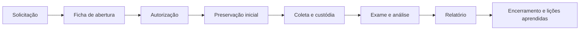

# Modelo de Abertura de Caso Forense

> **Objetivo pedagógico:** ensinar a formalizar o início de uma investigação com autoridade legal, escopo, perguntas investigativas, restrições e plano de preservação, evitando coletas sem base e conclusões sem método.

## 1. Quando usar

Use este modelo em toda investigação forense, corporativa ou pericial, antes de qualquer coleta. Para incidentes urgentes, registre a abertura em até 24 horas, mantendo a justificativa da ação imediata.

## 2. Convenção de identificação

Formato do identificador do caso: `DFL-AAAA-NNN` (exemplo: `DFL-2026-001`).
Estrutura de pastas do caso sugerida:

```
DFL-2026-001/
  00-abertura/
  01-autorizacoes/
  02-custodia/
  03-evidencias-originais-referencias/
  04-copias-de-trabalho/
  05-analise/
  06-relatorios/
  07-comunicacoes/
```

## 3. Ficha de abertura

| Campo | Preenchimento |
|---|---|
| Identificador do caso | DFL-AAAA-NNN |
| Data e hora de abertura (UTC) | |
| Solicitante e área | |
| Líder da investigação | |
| Equipe designada | |
| Classificação de confidencialidade | Restrita / Confidencial / Interna |
| Tipo do caso | Incidente, ameaça interna, fraude, litígio, auditoria, perícia, outro |
| Descrição resumida dos fatos | |
| Origem da demanda (alerta, denúncia, ordem judicial, auditoria) | |
| Autoridade e base legal | |
| Política interna aplicável (uso aceitável, monitoramento) | |
| Existência de dados pessoais e sensíveis | Sim / Não; descrição |
| Necessidade de RIPD | Sim / Não |
| Existência de legal hold | Sim / Não; referência |
| Prazo ou urgência | |
| Possíveis implicações legais ou regulatórias | |

## 4. Escopo

| Item | Descrição |
|---|---|
| Sistemas e ativos incluídos | |
| Contas e identidades incluídas | |
| Período de interesse (UTC) | De ___ a ___ |
| Fontes de evidência previstas | Disco, memória, logs, e-mail, nuvem, rede, móvel |
| Exclusões explícitas | |
| Restrições (jurisdição, contratos, acesso) | |

## 5. Perguntas investigativas

Formule perguntas neutras, verificáveis e ligadas a fatos.

| ID | Pergunta | Evidências que podem responder |
|---|---|---|
| Q1 | | |
| Q2 | | |
| Q3 | | |

Exemplos de formulação correta:

| Inadequada | Adequada |
|---|---|
| "Provar que o colaborador roubou dados." | "Houve cópia de arquivos do repositório X para mídia ou serviço externo entre as datas A e B? Por qual conta e dispositivo?" |
| "Encontrar o vírus." | "Qual processo originou a conexão de saída para o IP Y e como foi iniciado?" |

## 6. Plano inicial de preservação

| Ação | Responsável | Prazo | Status |
|---|---|---|---|
| Emitir legal hold ou suspender descarte | Jurídico | | |
| Preservar logs com retenção curta (proxy, M365, nuvem) | TI e SOC | | |
| Isolar equipamentos preservando o estado | SOC | | |
| Coletar dados voláteis | DFIR | | |
| Adquirir imagens | DFIR | | |
| Iniciar a cadeia de custódia | Custodiante | | |

## 7. Termo de autorização

```
TERMO DE AUTORIZAÇÃO DE INVESTIGAÇÃO FORENSE

Caso: DFL-AAAA-NNN
Autorizo a equipe de resposta e forense digital a coletar, preservar e analisar as evidências
abaixo identificadas, no escopo e período definidos neste termo, observadas a legislação
aplicável, a política de uso aceitável e a política de privacidade da organização.

Ativos e fontes autorizados: ______________________________
Período: ______________________________
Restrições: ______________________________
Base legal: ______________________________

Aprovações:
Jurídico: ____________________  Data: ____/____/______
DPO: ____________________      Data: ____/____/______
CISO: ____________________     Data: ____/____/______
```

## 8. Exemplo preenchido (fictício)

| Campo | Preenchimento |
|---|---|
| Identificador | DFL-2026-001 |
| Data e hora de abertura (UTC) | 2026-10-30T13:20:00Z |
| Solicitante | Gerência de Compliance, Empresa Exemplo S.A. |
| Líder | Analista Sênior de DFIR |
| Tipo | Ameaça interna: possível exfiltração de dados |
| Descrição | O DLP gerou alertas de envio de arquivos de pasta de projetos para serviço de nuvem pessoal por colaborador em desligamento |
| Base legal | Política de uso aceitável; legítimo interesse e exercício regular de direitos (LGPD, art. 7º, VI e IX), conforme parecer do Jurídico |
| Dados pessoais | Sim; sem dados sensíveis previstos; RIPD não exigido pelo DPO nesta fase |
| Legal hold | Sim; referência LH-2026-014 |
| Escopo | Notebook corporativo, conta M365, logs de proxy e de DLP |
| Período | 2026-09-01 a 2026-10-30 (UTC) |
| Exclusões | Dispositivos pessoais e contas pessoais |
| Q1 | Quais arquivos foram enviados a serviços externos e quando? |
| Q2 | O envio ocorreu por conta e dispositivo do colaborador? |
| Q3 | Há indícios de uso de mídia removível? |
| Preservação inicial | Retenção ampliada de logs de proxy e M365; captura de memória e imagem do notebook; formulário de custódia |

## 9. Fluxo do caso



## 10. Casos de uso corporativos

- Abertura de caso padronizada entre SOC, Jurídico, RH e Compliance.
- Resposta a ordem judicial com preservação por legal hold e relatório ao juízo.
- Investigação de fraude em que o escopo e as perguntas orientam a coleta mínima necessária.

## 11. Normas e frameworks relevantes

- ISO/IEC 27037 e 27043 (autorização, escopo e documentação)
- ISO/IEC 27035-1 (registro e classificação de incidentes)
- ISO/IEC 27002:2022, controles 5.25 e 5.26
- LGPD, arts. 6º, 7º e 38
- CPC, art. 369; CPP, arts. 158-A a 158-F

## 12. Referências

- ISO/IEC 27043:2015.
- ISO/IEC 27035-1:2023.
- Brasil. Lei nº 13.709/2018 (LGPD).
- NIST SP 800-86. 2006.
- Casey, E. Digital Evidence and Computer Crime. 3. ed. 2011.
