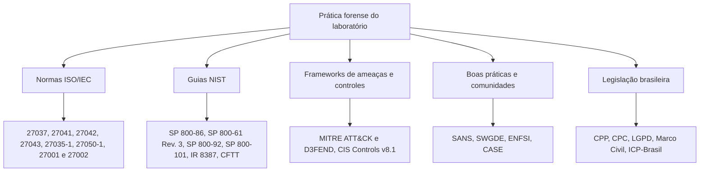

# Normas e Frameworks Aplicáveis à Forense Digital

> **Objetivo pedagógico:** identificar as normas, os frameworks e a legislação que sustentam a prática forense, relacionando cada um às atividades do laboratório e à tomada de decisão em um caso.

## 1. Mapa de referências

## 2. Normas ISO/IEC

| Norma | Escopo | Aplicação no laboratório |
|---|---|---|
| ISO/IEC 27037:2012 (ABNT NBR ISO/IEC 27037:2013) | Identificação, coleta, aquisição e preservação de evidência digital; papéis DEFR e DES | Base dos procedimentos de coleta, aquisição e preservação |
| ISO/IEC 27041:2015 | Garantia de adequação e validade do método investigativo | Validação de ferramentas e procedimentos antes do uso em casos |
| ISO/IEC 27042:2015 | Análise e interpretação de evidência digital | Estrutura da análise, hipóteses e relatório |
| ISO/IEC 27043:2015 | Princípios e processos de investigação de incidentes, incluindo prontidão | Modelo do processo e da preparação |
| ISO/IEC 27035-1:2023 | Gestão de incidentes de segurança da informação | Integração entre incidentes e forense |
| ISO/IEC 27050-1:2019 | e-Discovery: visão geral e conceitos | Preservação e coleta para litígios |
| ISO/IEC 27001:2022 e 27002:2022 | Sistema de gestão e controles de segurança da informação | Controles 5.24 a 5.28 (incidentes e coleta de evidências), 8.15 (registro de eventos), 8.16 (monitoramento) e 8.17 (sincronização de relógios) |
| ISO/IEC 17025:2017 | Competência de laboratórios de ensaio e calibração | Referência de qualidade, imparcialidade e rastreabilidade |
| ISO/IEC 42001:2023 | Sistema de gestão de IA | Contexto de forense de IA, em pastas posteriores |

## 3. Guias do NIST

| Documento | Escopo | Aplicação |
|---|---|---|
| NIST SP 800-86 (2006) | Integração de técnicas forenses à resposta a incidentes | Fases de coleta, exame, análise e relato |
| NIST SP 800-61 Rev. 3 (2025) | Resposta a incidentes alinhada ao CSF 2.0 | Ciclo de resposta e melhoria |
| NIST SP 800-92 (2006) | Gestão de logs de segurança | Política de logs e retenção |
| NIST SP 800-101 Rev. 1 (2014) | Forense em dispositivos móveis | Pasta de forense mobile |
| NIST IR 8387 (2022) | Preservação de evidência digital | Manuseio e armazenamento |
| NIST CFTT | Testes de ferramentas forenses | Validação de ferramentas |
| NIST CFReDS | Conjuntos de dados de referência forense | Treinamento e testes |
| NIST CSF 2.0 | Funções Govern, Identify, Protect, Detect, Respond e Recover | Alinhamento estratégico |

## 4. MITRE ATT&CK e MITRE D3FEND

O ATT&CK descreve táticas e técnicas de adversários. Em forense, ele orienta onde buscar evidências para cada comportamento e padroniza o relato.

| Tática (ID) | Fontes forenses típicas |
|---|---|
| Initial Access (TA0001) | Logs de e-mail, proxy, VPN e autenticação; artefatos de download |
| Execution (TA0002) | Prefetch, Amcache, logs de PowerShell, histórico de shell, memória |
| Persistence (TA0003) | Chaves Run, tarefas agendadas, serviços, cron, systemd, contas criadas |
| Privilege Escalation (TA0004) | Eventos de privilégio, sudoers, mudanças de papéis na nuvem |
| Defense Evasion (TA0005) | Limpeza de logs, timestomping, desativação de EDR |
| Credential Access (TA0006) | Memória (LSASS), logs de autenticação, acessos a cofres |
| Discovery (TA0007) | Comandos de enumeração em logs de processo e histórico |
| Lateral Movement (TA0008) | Logons de rede, SMB, RDP, WinRM e SSH |
| Collection (TA0009) | Arquivos compactados, staging, acessos a repositórios |
| Command and Control (TA0011) | DNS, proxy, fluxos de rede, beaconing |
| Exfiltration (TA0010) | Volume de saída, uploads para nuvem, USB |
| Impact (TA0040) | Criptografia de arquivos, destruição de dados, notas de resgate |

O MITRE D3FEND complementa o ATT&CK com técnicas defensivas, úteis para recomendar controles no relatório.

## 5. CIS Controls v8.1

| Controle | Relação com a forense |
|---|---|
| Controle 1: Inventário de ativos corporativos | Identificar o que investigar e onde estão as fontes |
| Controle 8: Gestão de logs de auditoria (8.1 processo, 8.2 coleta, 8.4 sincronização de tempo, 8.10 retenção) | Disponibilidade e qualidade dos logs |
| Controle 10: Defesas contra malware | Fontes de alerta e artefatos |
| Controle 11: Recuperação de dados | Backups como fonte e como risco de contaminação |
| Controle 13: Monitoramento e defesa de rede | Capturas, fluxos e alertas |
| Controle 17: Gestão de resposta a incidentes (17.4 processo, 17.7 exercícios, 17.8 revisões pós-incidente) | Processo, exercícios e lições aprendidas |

## 6. SANS e comunidade técnica

| Fonte | Contribuição |
|---|---|
| SANS Incident Handler's Handbook | Modelo PICERL |
| Cursos e pôsteres SANS DFIR (FOR500, FOR508, FOR572, FOR585, FOR610) | Referências de artefatos e técnicas |
| SANS SIFT Workstation | Estação de análise de referência |
| SWGDE | Boas práticas para aquisição e controle de qualidade |
| ENFSI | Manual de boas práticas para exame forense de tecnologia digital |
| CASE (Cyber-investigation Analysis Standard Expression) | Formato de interoperabilidade para informação investigativa |

## 7. Legislação brasileira relevante

| Norma | Relevância |
|---|---|
| Código de Processo Penal, arts. 158-A a 158-F | Cadeia de custódia |
| Código de Processo Penal, art. 159 | Perícia por perito oficial |
| Código de Processo Civil, arts. 369 a 384 e 465 a 473 | Provas, ata notarial, perícia e laudo |
| Lei nº 12.965/2014 (Marco Civil da Internet) | Guarda de registros (arts. 13 e 15) e sigilo das comunicações |
| Lei nº 13.709/2018 (LGPD) | Tratamento de dados pessoais e comunicação de incidentes (art. 48) |
| Resolução CD/ANPD nº 15/2024 | Comunicação de incidente de segurança |
| Lei nº 12.737/2012 | Crimes informáticos |
| Medida Provisória nº 2.200-2/2001 | Validade jurídica de documentos eletrônicos e ICP-Brasil |
| Constituição Federal, art. 5º, X e XII | Intimidade e sigilo das comunicações |
| Lei nº 9.296/1996 | Interceptação de comunicações |

## 8. Exemplo prático: matriz de normas em um caso de ameaça interna

| Atividade | Norma ou framework | Evidência de conformidade |
|---|---|---|
| Autorização da coleta | LGPD, política interna, orientação do Jurídico | Termo de autorização assinado |
| Coleta do laptop | ISO/IEC 27037, RFC 3227 | Registro de aquisição com hash |
| Custódia | CPP 158-A a 158-F, NIST IR 8387 | Formulário de cadeia de custódia |
| Análise | ISO/IEC 27042, MITRE ATT&CK | Relatório com técnicas mapeadas |
| Validação de ferramentas | ISO/IEC 27041, NIST CFTT | Registro de validação |
| Retenção e descarte | LGPD, política de retenção | Termo de descarte |

## 9. Casos de uso corporativos

- Auditoria interna que verifica a aderência do processo forense ao controle 5.28 da ISO/IEC 27002.
- Fornecedor de DFIR contratado: exigência contratual de conformidade com ISO/IEC 27037 e com a cadeia de custódia.
- Preparação para certificação ISO/IEC 27001 com evidências de gestão de incidentes e de registros.

## 10. Referências

- ISO/IEC 27037:2012, 27041:2015, 27042:2015, 27043:2015, 27035-1:2023, 27050-1:2019, 27001:2022, 27002:2022 e 17025:2017.
- NIST SP 800-86 (2006); SP 800-61 Rev. 3 (2025); SP 800-92 (2006); SP 800-101 Rev. 1 (2014); IR 8387 (2022).
- NIST Cybersecurity Framework 2.0 (2024).
- MITRE ATT&CK. https://attack.mitre.org; MITRE D3FEND. https://d3fend.mitre.org
- Center for Internet Security. CIS Critical Security Controls v8.1. 2024.
- SANS Institute. Incident Handler's Handbook. 2011.
- SWGDE. Best Practices for Computer Forensic Acquisitions.
- ENFSI. Best Practice Manual for the Forensic Examination of Digital Technology (ENFSI-BPM-FIT-01).
- Casey, E. et al. Advancing coordinated cyber-investigations and tool interoperability using a community developed specification language. Digital Investigation, v. 22, 2017.
- Brasil. Legislação citada na seção 7.
