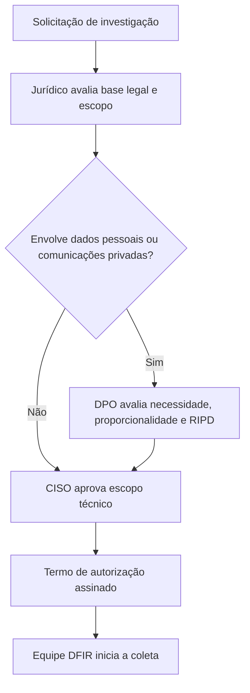

# Papéis, Responsabilidades e Ética do Investigador

> **Objetivo pedagógico:** definir quem faz o quê em uma investigação forense corporativa ou pericial e estabelecer os princípios éticos, a imparcialidade e os limites de atuação do analista.

## 1. Papéis

| Papel | Descrição | Origem |
|---|---|---|
| DEFR (Digital Evidence First Responder) | Atua no primeiro contato com a evidência; identifica, coleta e adquire | ISO/IEC 27037 |
| DES (Digital Evidence Specialist) | Trata situações técnicas complexas (memória, nuvem, criptografia, dispositivos específicos) | ISO/IEC 27037 |
| Analista de DFIR | Conduz exame, análise e relato; apoia a resposta a incidentes | Prática corporativa |
| Líder da investigação | Responde pelo caso, pela legalidade e pela observância dos princípios | ACPO, princípio 4 |
| Custodiante de evidências | Controla o armazenamento, o acesso e o registro da cadeia de custódia | CPP 158-A a 158-F |
| Perito oficial | Realiza perícias designado pelo Estado | CPP, art. 159 |
| Perito judicial | Nomeado pelo juiz em processo cível | CPC, art. 465 |
| Assistente técnico | Indicado pela parte para acompanhar a perícia | CPC, arts. 465 e 466 |
| Jurídico | Define base legal, privilégio, escopo e comunicação com autoridades | Governança |
| DPO (Encarregado) | Orienta sobre tratamento de dados pessoais, RIPD e comunicação à ANPD | LGPD, art. 41 |
| RH | Participa de investigações envolvendo colaboradores, com limites de sigilo | Governança |
| CISO e gestão executiva | Patrocinam, decidem sobre contenção e comunicação | Governança |

## 2. Matriz RACI de uma investigação corporativa

R = Responsável, A = Aprova, C = Consultado, I = Informado.

| Atividade | Líder | Analista DFIR | Custodiante | Jurídico | DPO | RH | CISO |
|---|---|---|---|---|---|---|---|
| Abertura e escopo do caso | R | C | I | A | C | C | A |
| Autorização de coleta | C | I | I | A | C | C | A |
| Coleta e aquisição | A | R | C | C | I | I | I |
| Custódia e armazenamento | A | C | R | I | I | I | I |
| Análise | A | R | I | C | C | I | I |
| Comunicação com autoridades e ANPD | C | I | I | R | A | I | A |
| Relatório técnico | A | R | I | C | C | I | I |
| Decisão disciplinar | I | I | I | C | I | R | A |
| Descarte das evidências | A | C | R | A | C | I | I |

## 3. Fluxo de autorização



## 4. Competências esperadas

| Área | Competências |
|---|---|
| Técnica | Sistemas de arquivos, artefatos de sistemas operacionais, redes, memória, logs, nuvem, scripting |
| Metodológica | Cadeia de custódia, documentação, hipóteses, validação, reprodutibilidade |
| Jurídica | Noções de prova, privacidade, sigilo e competência para depor |
| Comunicação | Relatórios para públicos técnicos, jurídicos e executivos |
| Ética | Independência, confidencialidade, prudência e transparência sobre limitações |

## 5. Princípios éticos

| Princípio | Aplicação |
|---|---|
| Imparcialidade | Relatar fatos favoráveis e desfavoráveis; evitar viés de confirmação |
| Independência | Declarar conflitos de interesse; não investigar casos em que haja vínculo pessoal |
| Confidencialidade | Compartilhar informações apenas com quem precisa conhecer (need to know) |
| Legalidade | Agir somente com autorização e base legal; respeitar o sigilo das comunicações |
| Proporcionalidade e necessidade | Coletar somente o necessário (LGPD, art. 6º, III) |
| Competência | Atuar dentro das habilidades; acionar um DES quando necessário |
| Transparência técnica | Declarar métodos, limitações e grau de confiança |
| Integridade profissional | Nunca alterar, ocultar ou criar evidências |

Referências éticas profissionais: Código de Ética do ISC2, Código de Ética e Conduta Profissional da ACM e a norma ISO/IEC 17025 (imparcialidade e confidencialidade em laboratórios).

## 6. Limites de atuação

| Situação | Conduta correta |
|---|---|
| Descoberta de conteúdo ilícito fora do escopo | Interromper a análise daquele conteúdo, preservar e comunicar ao Jurídico |
| Acesso a comunicações privadas de colaboradores | Somente com base legal, política de uso aceitável comunicada e escopo definido |
| Pedido para "achar algo" contra uma pessoa | Recusar; reformular em perguntas investigativas neutras |
| Pressão para concluir antes da evidência | Registrar o impasse e comunicar a limitação ao líder e ao Jurídico |
| Informação pessoal sensível encontrada | Restringir o acesso e registrar o tratamento (LGPD, art. 5º, II) |
| Evidência que contraria a hipótese do solicitante | Reportar integralmente |

## 7. Modelo de declaração de imparcialidade e confidencialidade

```
DECLARAÇÃO DE IMPARCIALIDADE E CONFIDENCIALIDADE

Caso: DFL-AAAA-NNN
Nome: ______________________________
Função no caso: ______________________________

Declaro que:
1. Não possuo conflito de interesse com as pessoas, áreas ou fatos objeto da investigação.
2. Atuarei de forma imparcial, relatando fatos favoráveis e desfavoráveis.
3. Manterei sigilo sobre as informações do caso e as utilizarei somente para esta finalidade.
4. Acessarei apenas os dados necessários ao escopo autorizado.
5. Registrarei todas as ações realizadas sobre as evidências.
6. Comunicarei imediatamente ao líder qualquer situação que possa comprometer a independência ou a integridade da investigação.

Local e data: ______________________________
Assinatura: ______________________________
```

## 8. Exemplo prático: investigação de colaborador

| Etapa | Ação |
|---|---|
| Solicitação | RH solicita apuração de possível exfiltração por colaborador |
| Triagem de conflito | Analista designado declara ausência de vínculo com o colaborador |
| Autorização | Jurídico confirma base legal; DPO avalia necessidade; CISO aprova escopo |
| Execução | Coleta limitada a ativos corporativos e a logs relacionados ao período |
| Achado fora do escopo | E-mails pessoais identificados: interrompe, restringe e consulta o Jurídico |
| Comunicação | Relatório ao Jurídico e ao RH, sem exposição de dados além do necessário |

## 9. Casos de uso corporativos

- Comitê de ética e investigações internas com fluxo de autorização padronizado.
- Terceirização de DFIR com cláusulas de imparcialidade, confidencialidade e cadeia de custódia.
- Perícia judicial com assistente técnico acompanhando a produção da prova.

## 10. Normas e frameworks relevantes

- ISO/IEC 27037:2012 (papéis DEFR e DES)
- ISO/IEC 17025:2017 (imparcialidade e confidencialidade)
- ACPO Good Practice Guide for Digital Evidence (princípios)
- LGPD, arts. 5º, 6º, 7º e 41
- CPP, arts. 158-A a 158-F e 159; CPC, arts. 465, 466 e 473
- Constituição Federal, art. 5º, X e XII

## 11. Referências

- ISO/IEC 27037:2012.
- ISO/IEC 17025:2017.
- ACPO. Good Practice Guide for Digital Evidence, versão 5. 2012.
- ISC2. Code of Ethics.
- ACM. Code of Ethics and Professional Conduct. 2018.
- Brasil. Lei nº 13.709/2018 (LGPD).
- Brasil. Lei nº 13.105/2015 (CPC) e Decreto-Lei nº 3.689/1941 (CPP).
- Casey, E. Digital Evidence and Computer Crime. 3. ed. Academic Press, 2011.
