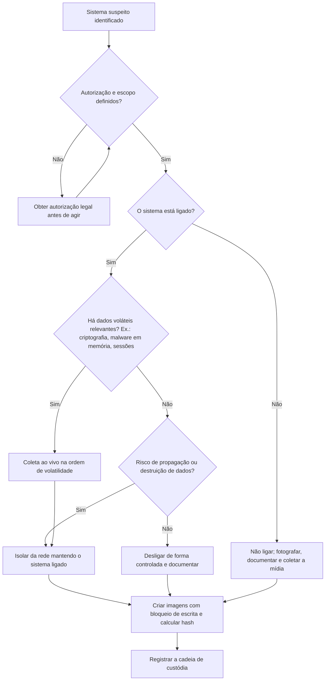

# Princípios Forenses e Ordem de Volatilidade

> **Objetivo pedagógico:** ensinar os princípios que orientam toda ação forense e capacitar o analista a decidir, com base na ordem de volatilidade, o que coletar primeiro e como documentar o impacto de cada ação.

## 1. Princípios fundamentais

### 1.1 Princípio da troca de Locard

Formulado por Edmond Locard, estabelece que todo contato deixa vestígios. No meio digital, qualquer interação entre um usuário, um sistema e uma rede gera artefatos (logs, arquivos temporários, entradas de registro, cache). Consequência prática: toda ação do investigador também altera o sistema e deve ser registrada.

### 1.2 Os quatro princípios do ACPO

O Good Practice Guide for Digital Evidence (ACPO, versão 5, 2012) resume o tratamento de evidência digital em quatro princípios:

1. Nenhuma ação deve alterar os dados que possam ser usados posteriormente como prova.
2. Quando for necessário acessar dados originais, a pessoa deve ser competente para isso e capaz de explicar a relevância e as implicações de suas ações.
3. Deve ser criada e preservada uma trilha de auditoria de todos os processos aplicados à evidência, de modo que um terceiro independente possa repeti-los e chegar ao mesmo resultado.
4. O responsável pela investigação responde pela observância da lei e desses princípios.

### 1.3 Princípios complementares

| Princípio | Descrição | Aplicação prática |
|---|---|---|
| Integridade | Demonstrar que a evidência não foi alterada | Hash da fonte e da imagem, verificado a cada cópia |
| Repetibilidade | Outro especialista deve reproduzir o resultado | Registrar ferramentas, versões, parâmetros e comandos |
| Documentação contínua | Tudo é registrado no momento em que ocorre | Diário do caso com data e hora em UTC |
| Minimização de manuseio | Reduzir o número de acessos à evidência original | Trabalhar sobre cópias de trabalho |
| Proporcionalidade e necessidade | Coletar somente o necessário à finalidade | LGPD, art. 6º, III |
| Imparcialidade | O analista relata fatos, inclusive os que contrariam a hipótese | Registrar achados exculpatórios |
| Licitude | Obter a evidência com autorização e base legal | Autorização formal antes da coleta |

### 1.4 Diretrizes da RFC 3227

A RFC 3227 (Guidelines for Evidence Collection and Archiving) recomenda, entre outras práticas:

- Capturar o retrato mais fiel possível do sistema.
- Manter notas detalhadas com data e hora, indicando o fuso e a diferença entre o relógio do sistema e o UTC.
- Garantir que as ações sejam repetíveis e proceder do mais volátil ao menos volátil.
- Não desligar o sistema antes de coletar as evidências voláteis.
- Não executar no sistema afetado programas que dependam de seus próprios binários; usar ferramentas confiáveis.
- Reduzir ao mínimo as alterações no sistema ao coletar.

## 2. Ordem de volatilidade

A RFC 3227 define a ordem de coleta, do mais volátil ao menos volátil:

| Prioridade | Fonte | Volatilidade | Exemplos de coleta | Risco de perda |
|---|---|---|---|---|
| 1 | Registradores e cache de CPU | Nanossegundos a milissegundos | Em geral inviável de coletar na prática | Imediato |
| 2 | Tabela de roteamento, cache ARP, tabela de processos, estatísticas do kernel e memória | Segundos a minutos; perdida no desligamento ou reinício | Captura de memória RAM; conexões; processos; cache DNS | Desligar, reiniciar ou suspender |
| 3 | Sistemas de arquivos temporários | Perdida no desligamento | Diretórios temporários, tmpfs, swap | Reinício |
| 4 | Disco | Persistente, mas sujeito a sobrescrita | Imagem forense do disco | Sobrescrita, TRIM, criptografia |
| 5 | Dados de log e monitoramento remotos | Depende da retenção | Syslog central, SIEM, proxy, firewall, logs de nuvem | Rotação e expiração |
| 6 | Configuração física e topologia de rede | Estável, mas pode mudar | Diagramas, inventário, fotos | Mudanças de infraestrutura |
| 7 | Mídia de arquivamento | Longa duração | Backups e fitas | Ciclo de reuso |

Em ambientes modernos, acrescente: sessões de nuvem e tokens (minutos a horas), recursos efêmeros (contêineres e instâncias com vida curta) e logs de SaaS com retenção limitada por licença.

## 3. Decisão entre aquisição ao vivo e com sistema desligado



Critérios de decisão:

| Fator | Favorece coleta ao vivo | Favorece sistema desligado |
|---|---|---|
| Malware residente em memória | Sim | Não |
| Disco criptografado e sistema desbloqueado | Sim (captura de chaves e imagem lógica) | Não (risco de perder acesso) |
| Servidor crítico que não pode parar | Sim, com isolamento de rede | Não |
| Dispositivo sem indício de atividade ativa | Não | Sim |
| Risco de destruição remota de dados | Isolar imediatamente | Isolar imediatamente |

Toda decisão deve ser registrada com a justificativa e o impacto esperado.

## 4. Exemplo prático: coleta de dados voláteis em ordem

Regras: capture a memória antes dos demais comandos quando houver ferramenta disponível; use binários confiáveis a partir de mídia externa; grave a saída em mídia externa; calcule o hash dos resultados.

### 4.1 Windows (PowerShell, a partir de mídia confiável)

```powershell
# 1) Horário do sistema e fuso (registrar a diferença para UTC)
Get-Date -Format "o"
[System.TimeZoneInfo]::Local | Format-List Id, BaseUtcOffset

# 2) Estado de rede
Get-NetTCPConnection | Select-Object LocalAddress,LocalPort,RemoteAddress,RemotePort,State,OwningProcess | Export-Csv E:\caso\tcp.csv -NoTypeInformation
Get-NetNeighbor | Export-Csv E:\caso\arp.csv -NoTypeInformation
ipconfig /displaydns > E:\caso\dns_cache.txt

# 3) Processos com linha de comando
Get-CimInstance Win32_Process | Select-Object ProcessId,ParentProcessId,Name,CommandLine,CreationDate | Export-Csv E:\caso\processos.csv -NoTypeInformation

# 4) Hash dos resultados
$h = Get-FileHash E:\caso\* -Algorithm SHA256
$h | Export-Csv E:\hashes_caso.csv -NoTypeInformation
```

### 4.2 Linux (bash, com binários confiáveis)

```bash
# Mídia externa montada em /mnt/evidencias
{ date -u; date; uname -a; uptime; } > /mnt/evidencias/caso/sistema.txt
ps auxww        > /mnt/evidencias/caso/ps.txt
ss -tunap       > /mnt/evidencias/caso/sockets.txt
ip neigh        > /mnt/evidencias/caso/arp.txt
ip route        > /mnt/evidencias/caso/rotas.txt
lsof -nP        > /mnt/evidencias/caso/lsof.txt
mount           > /mnt/evidencias/caso/mounts.txt

# Hash dos resultados, gravado fora da pasta do caso
cd /mnt/evidencias/caso && sha256sum * > ../hashes_caso.sha256
```

### 4.3 Registro mínimo de cada comando

| Campo | Exemplo |
|---|---|
| Data e hora (UTC) | 2026-10-30T14:05:12Z |
| Responsável | Analista DFIR 01 |
| Comando ou ferramenta e versão | ss (iproute2), versão registrada |
| Origem do binário | Mídia somente leitura do kit de resposta |
| Destino da saída | /mnt/evidencias/caso/sockets.txt |
| Hash SHA-256 da saída | Registrado em hashes_caso.sha256 |

## 5. Erros comuns e como evitá-los

| Erro | Consequência | Prevenção |
|---|---|---|
| Desligar o sistema antes de coletar a memória | Perda de chaves, processos e conexões | Decisão documentada e captura prévia |
| Executar ferramentas a partir do disco do sistema | Binários adulterados e alteração de artefatos | Usar mídia confiável e somente leitura |
| Gravar resultados no disco investigado | Sobrescrita de evidências | Usar mídia externa dedicada |
| Ignorar o fuso horário | Linha do tempo inconsistente | Registrar fuso e deslocamento do relógio |
| Navegar nos arquivos do usuário sem registro | Perda de autenticidade e violação de privacidade | Trabalhar em cópias e registrar acessos |
| Coletar além do necessário | Violação da necessidade e do sigilo | Escopo e minimização definidos na abertura do caso |

## 6. Casos de uso corporativos

- Servidor de arquivos com ransomware em execução: capturar memória e conexões, isolar a rede e preservar discos antes de reiniciar.
- Estação de executivo com suspeita de infostealer: capturar memória e sessões ativas antes de desligar o equipamento.
- Instância em nuvem comprometida: criar snapshot do disco e exportar logs de API antes que a instância seja encerrada pela automação.

## 7. Normas e frameworks relevantes

- RFC 3227 (coleta e arquivamento de evidências, ordem de volatilidade)
- ISO/IEC 27037:2012 (identificação, coleta, aquisição e preservação)
- NIST SP 800-86 (integração de técnicas forenses à resposta a incidentes)
- ISO/IEC 27002:2022, controle 5.28 (coleta de evidências)
- CIS Controls v8.1, controles 8 (gestão de logs) e 17 (gestão de resposta a incidentes)
- LGPD, art. 6º, III (necessidade)

## 8. Referências

- Brezinski, D.; Killalea, T. RFC 3227: Guidelines for Evidence Collection and Archiving. IETF, 2002.
- ACPO. Good Practice Guide for Digital Evidence, versão 5. 2012.
- Locard, E. L'enquête criminelle et les méthodes scientifiques. Paris: Flammarion, 1920.
- Kent, K. et al. NIST SP 800-86: Guide to Integrating Forensic Techniques into Incident Response. 2006.
- Casey, E. Digital Evidence and Computer Crime. 3. ed. Academic Press, 2011.
- Ligh, M. et al. The Art of Memory Forensics. Wiley, 2014.
