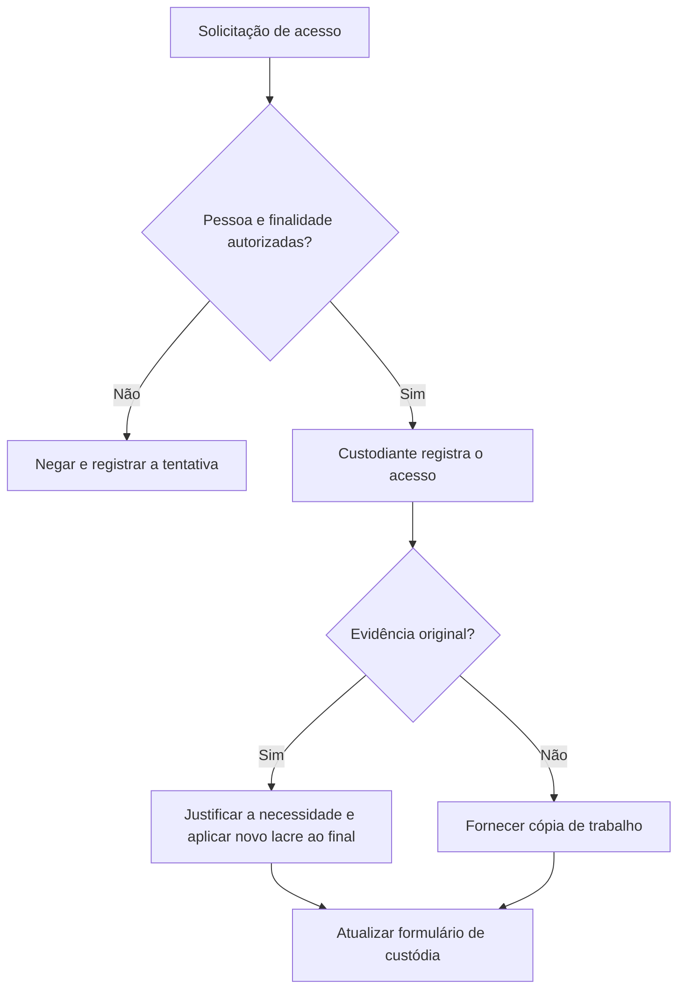

# Armazenamento, Controle de Acesso e Descarte

> **Objetivo pedagógico:** definir como guardar, proteger, controlar o acesso, verificar a integridade e descartar com segurança evidências físicas e digitais, mantendo a custódia até o fim do ciclo de vida.

## 1. Armazenamento físico

| Requisito | Descrição |
|---|---|
| Local | Cofre ou sala de custódia com acesso restrito, separada do ambiente de análise |
| Controle de acesso | Credencial individual, lista de autorizados e registro de entradas e saídas |
| Monitoramento | CFTV e alarmes, com retenção de imagens compatível com a necessidade |
| Condições ambientais | Temperatura, umidade e proteção contra incêndio, água e magnetismo conforme as especificações dos fabricantes |
| Organização | Prateleiras identificadas e inventário atualizado por identificador |
| Separação | Itens de casos diferentes mantidos separados; originais separados das cópias |
| Inventário periódico | Conferência de lacres e itens em intervalos definidos |

## 2. Armazenamento digital

| Requisito | Descrição | Exemplo de implementação |
|---|---|---|
| Controle de acesso | Mínimo privilégio, autenticação forte e aprovação por caso | Grupos por caso, MFA |
| Criptografia | Em repouso e em trânsito | Volumes criptografados, TLS |
| Imutabilidade | Impedir alteração e exclusão durante a retenção | Armazenamento com WORM, como S3 Object Lock ou blobs imutáveis do Azure |
| Integridade | Hash registrado no ingresso e verificado periodicamente | Manifesto SHA-256 e verificação agendada |
| Registro de acessos | Logs imutáveis de leitura e escrita | Logs enviados ao SIEM |
| Backup | Cópia separada, com os mesmos controles | Réplica em outro local com chave distinta |
| Segregação | Original, cópia de trabalho e resultados em locais distintos | Pastas e permissões diferentes |
| Classificação | Níveis de confidencialidade com regras de acesso | Restrita, Confidencial e Interna |

Estrutura de diretórios sugerida para um caso digital:

```
DFL-2026-001/
  originais-e-imagens/      (somente leitura, imutável)
  copias-de-trabalho/       (escrita restrita aos analistas)
  resultados-e-relatorios/
  custodia/                 (formulários, termos e hashes)
  logs-de-acesso/
```

## 3. Verificação periódica de integridade

| Atividade | Frequência de referência |
|---|---|
| Verificação de hash de imagens e capturas | A cada transferência e, no mínimo, semestralmente |
| Conferência de lacres e inventário físico | Trimestral |
| Revisão de acessos e permissões | Trimestral |
| Teste de restauração de backup | Semestral |
| Revisão de logs de acesso à evidência | Mensal, ou por alerta |

Exemplo de verificação em lote:

```bash
cd /evidencias/DFL-2026-001/originais-e-imagens
sha256sum -c ../custodia/manifesto_sha256.txt | tee ../custodia/verificacao_$(date -u +%Y%m%dT%H%MZ).log
```

Qualquer divergência deve ser tratada como incidente de integridade: isolar o item, comunicar o líder e o Jurídico, restaurar a partir do backup verificado e registrar a ocorrência.

## 4. Fluxo de acesso à evidência



## 5. Retenção e descarte

### 5.1 Retenção

| Fator | Orientação |
|---|---|
| Processos em andamento ou previsíveis | Manter até o término, inclusive recursos e prazos de contraperícia |
| Legal hold | Suspende o descarte até a liberação formal do Jurídico |
| Dados pessoais | Reter pelo menor prazo necessário (LGPD, arts. 6º, III, 15 e 16) |
| Obrigações regulatórias e contratuais | Respeitar o maior prazo exigível |
| Política interna de retenção | Definir prazos por tipo de caso e classificação |

### 5.2 Descarte seguro

| Mídia | Método | Registro |
|---|---|---|
| HDD | Apagamento seguro conforme as orientações do fabricante ou destruição física | Certificado e Formulário F |
| SSD e NVMe | Sanitização criptográfica ou comando de apagamento seguro do dispositivo e, se necessário, destruição física | Certificado e Formulário F |
| Mídia óptica e cartões | Destruição física | Formulário F e fotos |
| Arquivos e imagens em repositório | Destruição das chaves de criptografia (destruição criptográfica) e exclusão após o fim da retenção | Registro de data, responsável e evidência da exclusão |
| Papéis | Trituração | Formulário F |

A sanitização deve seguir o NIST SP 800-88 Rev. 1 (Guidelines for Media Sanitization), nos níveis Clear, Purge ou Destroy, conforme a sensibilidade.

### 5.3 Condições prévias ao descarte

- [ ] Encerramento do caso e dos prazos de recurso e contraperícia
- [ ] Inexistência de legal hold, ordem judicial ou obrigação regulatória
- [ ] Aprovação do Jurídico e do líder do caso
- [ ] Verificação de que o relatório final contém as referências necessárias
- [ ] Registro do descarte no Formulário F

## 6. Segregação de funções

| Função | Pode | Não pode |
|---|---|---|
| Custodiante | Controlar o acesso, registrar a movimentação e conferir lacres | Analisar o conteúdo sem designação |
| Analista | Trabalhar em cópias e registrar análise | Alterar originais ou aprovar o descarte |
| Líder do caso | Autorizar acessos e conclusões | Apagar registros de custódia |
| Jurídico | Autorizar descarte e legal hold | Alterar evidências |
| Auditoria | Verificar a conformidade | Operar a custódia |

## 7. Exemplo prático: auditoria trimestral de custódia

| Verificação | Resultado esperado |
|---|---|
| Amostra de 10 itens físicos | Lacres íntegros e coincidentes com o registro |
| Amostra de 20 imagens digitais | Hash coincidente com o manifesto |
| Revisão de acessos | Todos com motivo e autorização |
| Revisão de descartes | Todos com termo e aprovação do Jurídico |
| Resultado | Achados registrados com ação corretiva e prazo |

## 8. Casos de uso corporativos

- Laboratório de DFIR interno com sala de custódia e repositório imutável.
- Provedor de DFIR terceirizado com cláusulas de custódia, retenção e descarte em contrato.
- Programa de retenção e descarte alinhado à LGPD e a legal holds.

## 9. Normas e frameworks relevantes

- ISO/IEC 27037:2012 (preservação)
- NIST IR 8387
- NIST SP 800-88 Rev. 1 (sanitização de mídias)
- ISO/IEC 27002:2022, controles 5.33 (proteção de registros), 7.10 (mídias de armazenamento), 7.14 (descarte seguro de equipamentos) e 8.13 (cópia de segurança)
- CIS Controls v8.1, controles 3 (proteção de dados) e 11 (recuperação de dados)
- LGPD, arts. 6º, 15 e 16
- CPP, arts. 158-E e 158-F (central de custódia e armazenamento)

## 10. Referências

- Kissel, R. et al. NIST SP 800-88 Rev. 1: Guidelines for Media Sanitization. 2014.
- NIST IR 8387. 2022.
- ABNT NBR ISO/IEC 27037:2013.
- ISO/IEC 27002:2022.
- Center for Internet Security. CIS Controls v8.1. 2024.
- Brasil. Lei nº 13.709/2018 (LGPD).
- Brasil. CPP, arts. 158-E e 158-F.
