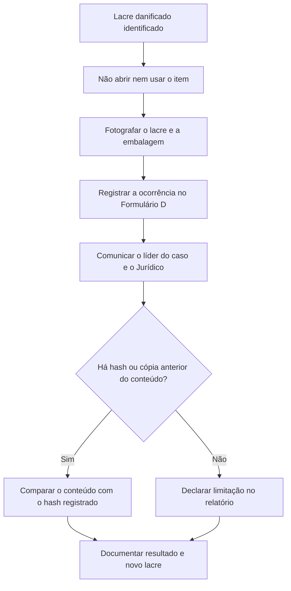

# Casos de Uso e Erros Comuns de Custódia

> **Objetivo pedagógico:** consolidar o aprendizado por meio de cenários corporativos, dos erros mais frequentes de custódia, de suas consequências e das medidas preventivas.

Os casos são fictícios e destinados ao treinamento.

## 1. Caso 1: transferência de evidências para perito externo

**Contexto:** a empresa contrata perito externo para analisar o notebook de um colaborador, em disputa trabalhista.

| Etapa | Ação |
|---|---|
| Contratação | Contrato com cláusulas de confidencialidade, imparcialidade, custódia, retenção e descarte |
| Preparação | Formulários A, B e E preenchidos; lacre numerado aplicado |
| Transporte | Transportadora com rastreamento ou entrega por analista designado |
| Recebimento | Perito confere lacre e registra o estado, assinando o Formulário E |
| Análise | Realizada em cópia de trabalho; relatório entregue com anexos de hash |
| Devolução | Itens devolvidos lacrados; novo registro de custódia |

**Lição:** a custódia deve ser contínua mesmo quando a posse muda de organização.

## 2. Caso 2: evidência em nuvem (logs exportados)

**Contexto:** logs do Microsoft 365 e do provedor de nuvem são exportados por analista para investigação de BEC.

| Etapa | Ação |
|---|---|
| Identificação | Definir tenant, período, tipos de log e conta de exportação |
| Coleta | Exportar por API ou console com conta nominal e registro do horário |
| Integridade | Calcular SHA-256 dos arquivos e gravar manifesto |
| Armazenamento | Enviar a repositório imutável com controle de acesso |
| Custódia | Registrar o Formulário B para o arquivo exportado (item `L001`) |
| Documentação | Anexar o comando, o escopo, os filtros e as limitações de retenção |

**Lição:** a "evidência" é a exportação com seu hash e seu contexto; registre quem exportou, como e quando.

## 3. Caso 3: lacre rompido acidentalmente

**Contexto:** ao receber um pen drive, o custodiante percebe que o lacre foi danificado no transporte.

**Lição:** a omissão do incidente é mais grave do que o incidente em si; registrar, avaliar e declarar a limitação preserva a credibilidade.

## 4. Caso 4: smartphone de colaborador em desligamento

**Contexto:** o colaborador devolve o smartphone corporativo desbloqueado e o RH solicita que a TI "limpe" o aparelho.

| Decisão | Procedimento |
|---|---|
| Interromper a limpeza | Comunicar RH e Jurídico, pois pode haver necessidade de preservar dados |
| Isolar | Bolsa Faraday com bateria externa |
| Fixar | Fotografias, número de série e estado da tela |
| Lacrar | Lacre numerado e Formulário A |
| Autorizar | Jurídico e DPO definem a base legal e o escopo da aquisição |

**Lição:** rotinas de TI (limpeza, reimagem, reciclagem) devem ser suspensas quando houver investigação ou legal hold.

## 5. Caso 5: contestação da autenticidade de prova digital

**Contexto:** em ação judicial, a parte contrária impugna a autenticidade de capturas de tela e de arquivos apresentados pela empresa.

| Medida | Descrição |
|---|---|
| Base processual | O CPC, art. 422, permite impugnar reproduções digitais; se impugnadas, exige-se autenticação eletrônica ou perícia |
| Defesa técnica | Apresentar a cadeia de custódia, hashes, logs de acesso, metadados e laudo do assistente técnico |
| Reforço | Ata notarial para conteúdos da web (CPC, art. 384) e, quando possível, assinatura com ICP-Brasil |
| Preparação | Dossiê com formulários, fotos, registros de aquisição e manifesto de hashes |

**Lição:** a defesa da prova começa na coleta, e não na audiência.

## 6. Erros comuns, consequências e prevenção

| Erro | Consequência provável | Prevenção |
|---|---|---|
| Não registrar quem teve acesso à evidência | Lacuna de custódia e questionamento da autenticidade | Formulário B preenchido na hora da ação |
| Aplicar lacre sem registrar o número | Impossibilidade de comprovar a inviolabilidade | Registrar o número antes da aplicação |
| Preencher formulários depois, de memória | Registros imprecisos e perda de credibilidade | Preencher no momento do evento |
| Analisar o original em vez da cópia | Alteração de metadados e contaminação | Cópias de trabalho obrigatórias |
| Armazenar imagens em compartilhamentos comuns | Acesso indevido e alteração | Repositório com imutabilidade e acesso restrito |
| Não conferir o hash na chegada | Corrupção ou troca não detectada | Verificação em cada transferência |
| Misturar itens de casos diferentes | Contaminação e confusão | Segregação e identificadores únicos |
| Descartar sem verificar legal hold | Destruição de prova e responsabilização | Checklist de pré-descarte |
| Enviar evidência por e-mail ou mensageria comum | Vazamento e perda de controle | Canal seguro e criptografado |
| Deixar o dispositivo móvel conectado à rede | Alteração remota, bloqueio ou apagamento | Bolsa Faraday e isolamento |

## 7. Exercícios práticos

1. Escolha um dos casos acima e elabore o conjunto de formulários A, B e E.
2. Para o caso 2, escreva o roteiro de exportação e o manifesto de hashes.
3. Para o caso 3, redija o registro de ocorrência e o parágrafo de limitação para o relatório.
4. Simule uma auditoria de custódia com cinco itens e identifique lacunas.

## 8. Normas e frameworks relevantes

- ISO/IEC 27037:2012; NIST IR 8387
- CPP, arts. 158-A a 158-F; CPC, arts. 384 e 422
- ISO/IEC 27002:2022, controles 5.28 e 5.33
- NIST SP 800-86 e NIST SP 800-88 Rev. 1
- LGPD, arts. 6º, 46 e 48

## 9. Referências

- ABNT NBR ISO/IEC 27037:2013.
- NIST IR 8387. 2022.
- NIST SP 800-86. 2006; NIST SP 800-88 Rev. 1. 2014.
- Brasil. CPP e CPC.
- Brasil. Lei nº 13.709/2018 (LGPD).
- Medida Provisória nº 2.200-2/2001 (ICP-Brasil).
- Casey, E. Digital Evidence and Computer Crime. 3. ed. Academic Press, 2011.
