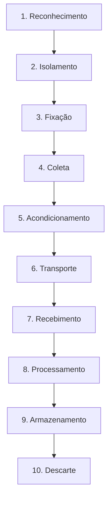
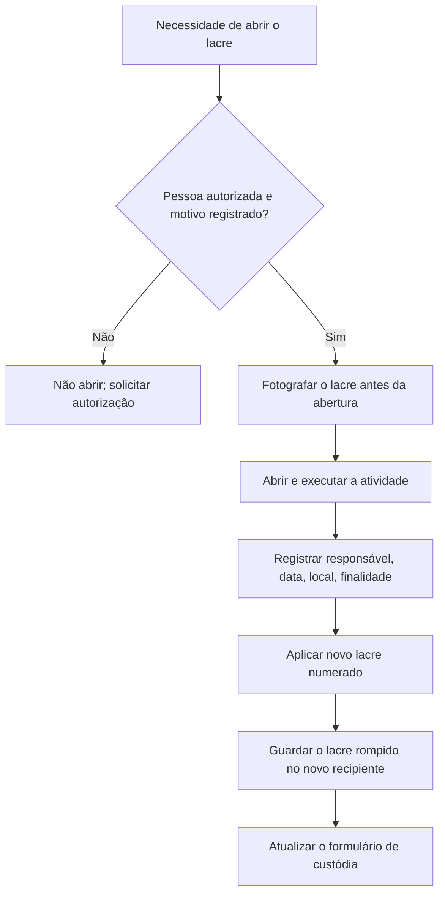

# Etapas Legais do CPP e Equivalência Digital

> **Objetivo pedagógico:** traduzir as dez etapas da cadeia de custódia previstas no art. 158-B do CPP para procedimentos concretos em investigações digitais, indicando em cada etapa o registro mínimo e o controle de qualidade.

## 1. Escopo e ressalva

O art. 158-B do CPP define dez etapas para o rastreamento do vestígio em procedimentos penais. Em investigações corporativas, essas etapas não são obrigatórias por lei, mas constituem o padrão mais defensável de custódia. Adote-as por equivalência e adapte os procedimentos à natureza digital do vestígio. Em procedimentos penais, siga as instruções da perícia oficial e da autoridade competente.

## 2. Visão geral das dez etapas

## 3. Etapas e equivalência digital

### 3.1 Reconhecimento

Ato de distinguir um elemento como de potencial interesse para a prova.

| Aspecto | Prática digital |
|---|---|
| Ação | Identificar dispositivos, contas, logs e repositórios relevantes |
| Registro mínimo | Lista de fontes, justificativa de relevância, data e hora, responsável |
| Qualidade | Quem reconhece o elemento responde por sua preservação (CPP, art. 158-A, §2º) |
| Exemplo | Alerta de DLP aponta notebook e conta de nuvem como fontes potenciais |

### 3.2 Isolamento

Evitar alterações no estado do ambiente e dos vestígios.

| Aspecto | Prática digital |
|---|---|
| Ação | Isolar o equipamento da rede mantendo o estado; restringir acesso físico; suspender rotinas de exclusão |
| Registro mínimo | Medidas aplicadas, hora, responsável, impacto esperado |
| Qualidade | Isolamento sem desligar quando houver dados voláteis relevantes |
| Exemplo | Desabilitar a interface de rede do notebook, sem desligá-lo, e bloquear a conta |

### 3.3 Fixação

Descrição detalhada do vestígio como foi encontrado.

| Aspecto | Prática digital |
|---|---|
| Ação | Fotografar e descrever o equipamento, conexões, telas, etiquetas, números de série e estado (ligado, desligado, bloqueado) |
| Registro mínimo | Fotos com data e hora, descrição, horário do relógio do sistema e diferença para UTC |
| Qualidade | Fotos de todos os ângulos relevantes e do local; registro do que não foi alterado |
| Exemplo | Foto da tela com data e hora visíveis e do relógio de referência |

### 3.4 Coleta

Recolher o vestígio respeitando suas características e natureza.

| Aspecto | Prática digital |
|---|---|
| Ação | Coletar dados voláteis, adquirir imagens, exportar logs, apreender mídias |
| Registro mínimo | Ferramenta, versão, parâmetros, hora, hash da fonte e do resultado, responsável |
| Qualidade | Ordem de volatilidade; bloqueio de escrita; binários confiáveis |
| Observação | O CPP, art. 158-C, indica que a coleta seja realizada preferencialmente por perito oficial em procedimentos penais |

### 3.5 Acondicionamento

Embalar cada vestígio de forma individualizada.

| Aspecto | Prática digital |
|---|---|
| Ação | Embalar cada item separadamente, em embalagem adequada, com lacre numerado |
| Registro mínimo | Identificador, número do lacre, data, hora e nome de quem acondicionou |
| Qualidade | Embalagem antiestática para mídias; bolsa Faraday para dispositivos móveis; lacre inviolável |
| Exemplo | SSD em saco antiestático, lacre nº 000123, etiqueta com DFL-2026-001-E001 |

### 3.6 Transporte

Transferência de um local para outro com controle da posse.

| Aspecto | Prática digital |
|---|---|
| Ação | Transportar com proteção contra choque, umidade, calor e campo magnético; manter o lacre |
| Registro mínimo | Origem, destino, transportador, data e hora de saída, rota, código de rastreamento |
| Qualidade | Transporte direto, sem paradas, com acompanhamento; transferência digital por canal criptografado com verificação de hash |
| Exemplo | Imagem E01 enviada por transferência segura; hash conferido na chegada |

### 3.7 Recebimento

Ato formal de transferência da posse.

| Aspecto | Prática digital |
|---|---|
| Ação | Conferir lacre, identificador, hash e estado; assinar o recebimento |
| Registro mínimo | Número do caso, origem, destinatário, transportador, tipo e natureza do exame, data e hora, assinaturas |
| Qualidade | Divergência ou lacre rompido deve ser registrado, comunicado e tratado antes de qualquer análise |
| Exemplo | Recebimento no laboratório com fotos do lacre intacto |

### 3.8 Processamento

Exame do vestígio com metodologia adequada.

| Aspecto | Prática digital |
|---|---|
| Ação | Trabalhar em cópias de trabalho; montar imagens somente leitura; executar ferramentas validadas |
| Registro mínimo | Item, cópia utilizada, ferramentas, versões, parâmetros, horários, analista |
| Qualidade | Resultado formalizado em laudo ou relatório; original preservado |
| Exemplo | Processamento da imagem IMG01 com a cópia de trabalho IMG01-W1 |

### 3.9 Armazenamento

Guarda em condições adequadas, inclusive para contraperícia.

| Aspecto | Prática digital |
|---|---|
| Ação | Guardar em cofre ou central de custódia; manter repositório digital com controle de acesso, criptografia e imutabilidade |
| Registro mínimo | Local, responsável, acessos e vínculo com o número do laudo |
| Qualidade | Verificação periódica de hash; backup; acesso por mínimo privilégio |
| Observação | O CPP, art. 158-F, determina que o material retorne à central de custódia após a perícia, em procedimentos penais |

### 3.10 Descarte

Liberação do vestígio respeitando a legislação e, quando pertinente, a autorização judicial.

| Aspecto | Prática digital |
|---|---|
| Ação | Devolver ou destruir com método seguro, após autorização de Jurídico, do líder do caso e, quando aplicável, da autoridade |
| Registro mínimo | Autorização, método de descarte, data, responsável, testemunha e certificado de destruição |
| Qualidade | Descarte somente após fim de prazos legais, legal hold e contraperícia |
| Exemplo | Destruição criptográfica de imagens e certificado, após encerramento do litígio |

## 4. Rompimento de lacre

O art. 158-D do CPP prevê que o recipiente só pode ser aberto pelo perito que fará a análise ou, de forma motivada, por pessoa autorizada. A cada rompimento, registra-se o responsável, a data, o local, a finalidade e o novo lacre, e o lacre rompido é guardado no novo recipiente.

## 5. Exemplo prático: rastreamento de um notebook

| Etapa | Registro do caso DFL-2026-001 |
|---|---|
| Reconhecimento | 2026-10-30T13:35Z: notebook patrimônio 123456 identificado pelo DLP |
| Isolamento | 13:40Z: interface de rede desativada sem desligar o equipamento |
| Fixação | 13:42Z: 12 fotos, relógio do sistema com diferença de +2 s para UTC |
| Coleta | 13:50Z: memória capturada; 14:10Z: imagem do SSD adquirida, SHA-256 da fonte igual ao da imagem |
| Acondicionamento | 14:55Z: notebook em embalagem antiestática, lacre nº 000123 |
| Transporte | 15:20Z: transporte direto ao laboratório pelo analista A |
| Recebimento | 15:50Z: lacre conferido e recebido pelo custodiante B |
| Processamento | 2026-10-31: análise da cópia de trabalho IMG01-W1 |
| Armazenamento | Cofre do laboratório, prateleira C2; imagem em repositório com imutabilidade |
| Descarte | Previsto após encerramento do processo e do legal hold |

## 6. Casos de uso corporativos

- Padronização do processo de custódia entre filiais e fornecedores de DFIR.
- Preparação de pacote probatório para ação trabalhista ou cível.
- Auditoria da cadeia de custódia por Compliance ou auditor externo.

## 7. Normas e frameworks relevantes

- CPP, arts. 158-A a 158-F
- ISO/IEC 27037:2012, seções de identificação, coleta, aquisição e preservação
- NIST IR 8387
- Portaria SENASP/MJ nº 82/2014
- ISO/IEC 27002:2022, controles 5.28 e 7.10 (mídias de armazenamento)

## 8. Referências

- Brasil. CPP, arts. 158-A a 158-F (Lei nº 13.964/2019).
- Brasil. Código Penal, art. 347.
- Brasil. Ministério da Justiça. SENASP. Portaria nº 82/2014.
- ABNT NBR ISO/IEC 27037:2013.
- NIST IR 8387: Digital Evidence Preservation. 2022.
- NIST SP 800-86: Guide to Integrating Forensic Techniques into Incident Response. 2006.
- Casey, E. Digital Evidence and Computer Crime. 3. ed. Academic Press, 2011.
