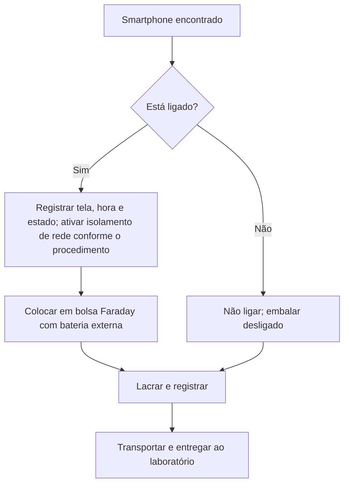

# Lacre, Embalagem e Transporte de Evidências

> **Objetivo pedagógico:** ensinar como identificar, embalar, lacrar e transportar cada tipo de evidência digital preservando sua integridade, seu estado e a continuidade da custódia.

## 1. Material do kit de custódia

| Item | Finalidade |
|---|---|
| Lacres numerados de segurança (série única) | Inviolabilidade e rastreabilidade |
| Sacos antiestáticos | Proteção de discos, SSDs, placas e mídias |
| Bolsas Faraday (e caixa Faraday) | Isolar dispositivos móveis e dispositivos sem fio de redes |
| Baterias externas (power banks) e cabos | Manter dispositivos ligados quando necessário |
| Etiquetas, canetas permanentes e formulários | Identificação e registro |
| Câmera ou smartphone dedicado ao registro | Fixação fotográfica com data e hora |
| Luvas, fita, caixas rígidas e espuma | Proteção física |
| Mídias de destino limpas e criptografadas | Armazenamento de imagens e dados |
| Bloqueadores de escrita | Aquisição sem alteração |

## 2. Procedimento por tipo de evidência

| Tipo | Embalagem e cuidados | Pontos de atenção |
|---|---|---|
| HDD | Saco antiestático, caixa rígida com amortecimento; evitar choques | Cabeças sensíveis a impacto; evitar campos magnéticos intensos |
| SSD e NVMe | Saco antiestático, caixa rígida | Mesmo sem energia, o controlador pode executar rotinas quando ligado; usar bloqueio e minimizar o tempo de energização |
| Notebook | Desligar apenas conforme decisão documentada; embalagem rígida; lacrar o equipamento e as portas (lacre sobre a tampa) | Anotar estado, bateria e criptografia de disco (por exemplo, recuperar chave antes de desligar, se a política permitir) |
| Smartphone e tablet | Bolsa Faraday; manter carga com bateria externa quando necessário; registrar o modo (avião ou não) | Dispositivos em bolsa Faraday podem consumir bateria mais rápido ao procurar rede; risco de bloqueio por inatividade |
| Pen drive e cartão de memória | Saco antiestático individual, lacre numerado | Não conectar a computadores sem bloqueio de escrita |
| Mídia óptica | Envelope ou caixa própria, sem rótulos adesivos sobre a face de dados | Evitar riscos e luz solar |
| Servidor | Preferir aquisição no local; transportar apenas se necessário e autorizado | Documentar RAID, controladora e configuração |
| Dispositivos de rede e IoT | Isolar da rede; registrar configuração e conexões | Pode haver armazenamento volátil |
| Token e chaves de segurança | Embalagem individual com lacre | Registrar o vínculo com contas e acessos |
| Documentos impressos | Envelope lacrado | Vinculá-los ao item digital correspondente |

## 3. Aplicação do lacre

1. Fotografe o item e a embalagem antes de lacrar.
2. Registre o número do lacre no formulário antes da aplicação.
3. Aplique o lacre de modo que qualquer abertura destrua a embalagem ou o lacre.
4. Escreva sobre o lacre e a embalagem a data, a hora, o identificador e a rubrica de quem lacrou, atravessando o lacre e a borda da embalagem.
5. Fotografe o lacre aplicado.
6. Registre a movimentação no Formulário B.

## 4. Mobile: bolsa Faraday e energia



Pontos de atenção: não digitar senhas de tentativa; não reiniciar; não conectar a computadores sem procedimento aprovado; registrar se o aparelho estava bloqueado.

## 5. Transporte

| Medida | Descrição |
|---|---|
| Responsável | Transporte por pessoa designada, mantendo o item sob guarda direta |
| Veículo | Compartimento fechado, sem paradas desnecessárias |
| Proteção | Caixa rígida, amortecimento, proteção contra calor, umidade e magnetismo |
| Registro | Saída, chegada, trajeto e transportador no Formulário E |
| Terceiros | Uso de transportadora apenas com contrato, rastreamento e lacre numerado |
| Transferência digital | Canal criptografado, controle de acesso e verificação de hash na origem e no destino |

## 6. Transferência digital de imagens e arquivos

| Etapa | Ação |
|---|---|
| 1 | Calcular o hash SHA-256 do arquivo na origem |
| 2 | Enviar por canal criptografado (por exemplo, SFTP ou armazenamento corporativo com chave dedicada) |
| 3 | Calcular o hash no destino e comparar |
| 4 | Registrar no Formulário B e no Formulário E |
| 5 | Manter o arquivo na origem até a confirmação do hash no destino |

Exemplo de verificação:

```bash
# Origem
sha256sum DFL-2026-001-E001-IMG01.E01 > DFL-2026-001-E001-IMG01.sha256

# Destino (após a transferência)
sha256sum -c DFL-2026-001-E001-IMG01.sha256
```

```powershell
# Windows
Get-FileHash .\DFL-2026-001-E001-IMG01.E01 -Algorithm SHA256
```

## 7. Situações especiais

| Situação | Conduta |
|---|---|
| Lacre danificado no transporte | Não abrir; fotografar; comunicar o líder e o Jurídico; registrar a ocorrência; seguir o procedimento do Formulário D |
| Equipamento muito grande ou fixo | Adquirir no local e lacrar o equipamento |
| Evidência em outra cidade ou país | Verificar jurisdição, privacidade e exigências de exportação de dados; usar cooperação ou fornecedor local autorizado |
| Equipamento com bateria inchada ou risco físico | Priorizar segurança, registrar e consultar a equipe de segurança do trabalho |
| Dispositivo criptografado e desbloqueado | Registrar a decisão e priorizar a coleta de dados voláteis e chaves, conforme autorização |

## 8. Checklist de embalagem e transporte

- [ ] Item fotografado antes da embalagem
- [ ] Embalagem adequada ao tipo de item
- [ ] Bolsa Faraday e energia, quando se tratar de dispositivo móvel
- [ ] Número do lacre registrado antes da aplicação
- [ ] Lacre aplicado e fotografado
- [ ] Etiqueta com identificador, data, hora e rubrica
- [ ] Formulário B atualizado
- [ ] Transportador e rota definidos
- [ ] Termo de Transferência e Recebimento preenchido
- [ ] Hash conferido no recebimento, quando aplicável

## 9. Exemplo prático: apreensão de smartphone em desligamento de colaborador

| Etapa | Registro |
|---|---|
| Reconhecimento | RH informa que o colaborador possui smartphone corporativo |
| Fixação | Foto do aparelho, número de série, tela bloqueada |
| Acondicionamento | Bolsa Faraday com bateria externa; lacre nº 000127 |
| Transporte | Entrega direta ao laboratório pelo analista A, 40 minutos |
| Recebimento | Custodiante B confere o lacre e registra o nível de bateria |
| Processamento | Aquisição conforme procedimento de forense mobile, após autorização do Jurídico |

## 10. Casos de uso corporativos

- Coleta de equipamentos de colaboradores em unidades remotas.
- Envio de dispositivos para perícia externa com transportadora.
- Preparação de itens para ação judicial com necessidade de contraperícia.

## 11. Normas e frameworks relevantes

- ISO/IEC 27037:2012 (preservação e transporte)
- NIST IR 8387
- NIST SP 800-101 Rev. 1 (dispositivos móveis)
- CPP, art. 158-B, V e VI, e art. 158-D (acondicionamento, transporte e lacre)
- ISO/IEC 27002:2022, controle 7.10 (mídias de armazenamento)

## 12. Referências

- ABNT NBR ISO/IEC 27037:2013.
- NIST IR 8387. 2022.
- Ayers, R. et al. NIST SP 800-101 Rev. 1: Guidelines on Mobile Device Forensics. 2014.
- Brasil. CPP, arts. 158-B e 158-D.
- SWGDE. Best Practices for Mobile Device Evidence Collection and Preservation, Handling, and Acquisition.
- Hoog, A. Android Forensics. Syngress, 2011.
