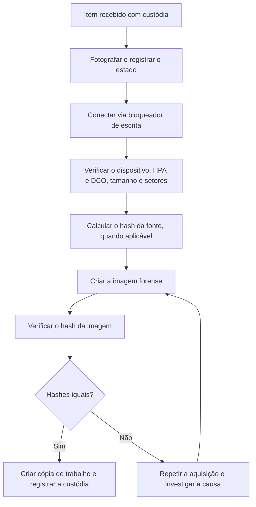

# Aquisição de Discos e Mídias

> **Objetivo pedagógico:** ensinar a adquirir imagens forenses íntegras de discos e mídias, com bloqueio de escrita, verificação de hash, tratamento de criptografia e cuidados com tecnologias modernas (SSD, NVMe, RAID e máquinas virtuais).

## 1. Tipos de aquisição

| Tipo | Descrição | Quando usar | Limitações |
|---|---|---|---|
| Física (bit a bit) | Cópia de todos os setores do dispositivo, inclusive espaço não alocado | Padrão quando possível e permitido | Exige acesso ao dispositivo ou volume bruto |
| Lógica | Cópia de arquivos e pastas visíveis | Volumes criptografados desbloqueados; escopo restrito; grandes volumes | Não preserva espaço não alocado nem arquivos excluídos |
| Seletiva (targeted) | Coleta de artefatos específicos (por exemplo, KAPE) | Triagem e coleta remota | Depende da definição correta dos alvos |
| Máquina virtual | Cópia do disco virtual e de arquivos de configuração e snapshots | Ambientes virtualizados | Preservar metadados e snapshots do hipervisor |
| Nuvem | Snapshot do volume e exportação de logs | Instâncias e discos em provedores | Dependência de permissões e de retenção |

## 2. Equipamentos e formatos

| Item | Orientação |
|---|---|
| Bloqueador de escrita de hardware | Preferível para discos físicos; registrar modelo, série e firmware; verificar o funcionamento com teste periódico |
| Bloqueio por software | Aceitável quando o hardware não está disponível; documentar a configuração e validar |
| Adaptadores | Usar adaptadores compatíveis com SATA, NVMe e USB, preferindo bloqueadores certificados |
| Formato RAW (dd) | Simples e universal; sem compressão nem metadados |
| Formato E01 (EWF) | Compressão, metadados do caso e verificação por hash integrada; amplamente suportado |
| Formato AFF4 | Formato moderno com suporte a múltiplos fluxos e metadados |
| Mídia de destino | Criptografada, com capacidade superior à da origem e dedicada ao caso |

## 3. Procedimento geral de aquisição



## 4. Exemplos práticos

### 4.1 Windows: FTK Imager (interface gráfica)

1. Conecte o disco de origem pelo bloqueador de escrita.
2. Abra o FTK Imager e escolha **File** > **Create Disk Image**.
3. Selecione **Physical Drive** e o disco correto (confira modelo e tamanho).
4. Clique em **Add**, escolha o formato **E01** e preencha os dados do caso (número do caso, número da evidência, descrição, examinador).
5. Escolha a pasta de destino na mídia externa e o nome `DFL-2026-001-E001-IMG01`.
6. Marque **Verify images after they are created** e inicie.
7. Ao final, salve o relatório de verificação com os hashes e anexe-o ao Registro de Aquisição.

Para listar os discos do sistema de análise:

```powershell
Get-Disk | Format-Table Number,FriendlyName,SerialNumber,Size,PartitionStyle -AutoSize
```

### 4.2 Linux: identificação, bloqueio e imagem

```bash
# Identificar os discos (confira modelo, série e tamanho antes de imprimir qualquer comando de escrita)
lsblk -o NAME,SIZE,TYPE,MODEL,SERIAL,MOUNTPOINT

# Verificar HPA e DCO (discos ATA)
sudo hdparm -N /dev/sdb
sudo hdparm --dco-identify /dev/sdb

# Imagem bruta com hash e log (dc3dd)
sudo dc3dd if=/dev/sdb hash=sha256 log=/mnt/evidencias/DFL-2026-001/E001-IMG01.log of=/mnt/evidencias/DFL-2026-001/E001-IMG01.dd

# Imagem E01 (libewf). O ewfacquire solicita interativamente os dados do caso
sudo ewfacquire -t /mnt/evidencias/DFL-2026-001/E001-IMG01 -d sha256 -f encase6 /dev/sdb

# Verificação da imagem E01
ewfverify /mnt/evidencias/DFL-2026-001/E001-IMG01.E01
```

Observações:

- Use `of=` apenas em mídia de destino; confira o dispositivo de origem (`if=`) antes de executar.
- Para discos com falhas de leitura, considere o GNU ddrescue e registre os setores com erro no relatório.
- Verifique a sintaxe e as opções na versão instalada da ferramenta.

### 4.3 Montagem da imagem em modo somente leitura para análise

```bash
# Imagem E01
mkdir -p /mnt/ewf /mnt/analise
ewfmount /mnt/evidencias/DFL-2026-001/E001-IMG01.E01 /mnt/ewf
mount -o ro,loop,noexec,nodev /mnt/ewf/ewf1 /mnt/analise

# Para ext4, adicione noload para não reproduzir o journal
# mount -o ro,loop,noload,noexec,nodev ...
```

## 5. Situações especiais

### 5.1 Discos criptografados

| Situação | Conduta |
|---|---|
| BitLocker, volume desbloqueado e sistema ligado | Registrar o status, capturar a memória, obter a chave de recuperação (conforme a política) e considerar aquisição lógica ou física do volume desbloqueado antes do desligamento |
| BitLocker, sistema desligado | Obter a chave de recuperação por meio do administrador (por exemplo, Entra ID ou Active Directory) |
| FileVault (macOS) | Obter a chave de recuperação ou o acesso autorizado; limitações de T2 e Apple Silicon exigem procedimento específico |
| LUKS (Linux) | Obter a senha ou a chave; coletar a memória se o volume estiver aberto |
| Criptografia de aplicativos | Coletar os contêineres e as chaves, quando legalmente autorizado |

Verifique o status no Windows:

```powershell
manage-bde -status
Get-BitLockerVolume | Format-List MountPoint,VolumeStatus,ProtectionStatus,EncryptionMethod
```

### 5.2 SSD e NVMe

- O controlador do SSD executa rotinas internas (garbage collection e TRIM) que podem alterar dados não alocados, mesmo com bloqueio de escrita; minimize o tempo de energização e documente.
- Use bloqueadores e adaptadores compatíveis com NVMe e confirme o tamanho lido.
- O espaço não alocado de SSDs pode ter menos dados recuperáveis; declare essa limitação.

### 5.3 RAID e volumes lógicos

- Documente o tipo de RAID, a controladora e a ordem dos discos antes de remover qualquer disco.
- Prefira adquirir o volume lógico apresentado pela controladora ou todos os discos membros, com registro da configuração.

### 5.4 Máquinas virtuais

- Preserve os arquivos do disco virtual (VMDK, VHD e VHDX), as configurações e os snapshots.
- Calcule o hash dos arquivos copiados e registre o hipervisor, a versão e o armazenamento de origem.

### 5.5 Mídias removíveis

- Pen drives e cartões: use bloqueador de escrita e imagem completa; registre fabricante, capacidade e número de série.
- Mídia óptica: crie a imagem ISO com ferramenta apropriada e registre a sessão.

## 6. Verificação e cópias

| Etapa | Procedimento |
|---|---|
| Hash da imagem | SHA-256 calculado e comparado com o da fonte, quando aplicável |
| Relatório de verificação | Arquivado junto à imagem |
| Cópia de trabalho | Criada a partir da imagem verificada; hash comparado |
| Imagem original | Armazenada em repositório com acesso restrito e imutabilidade |
| Custódia | Formulários B e C preenchidos (ver pasta 02) |

## 7. Casos de uso corporativos

- Aquisição do disco de notebook de executivo com BitLocker e chave no Active Directory.
- Cópia de volumes de servidor virtualizado sem interrupção do serviço.
- Aquisição de pen drives encontrados em investigação de ameaça interna.

## 8. Normas e frameworks relevantes

- ISO/IEC 27037:2012 (aquisição de evidência digital)
- NIST SP 800-86, seção 3
- NIST CFTT (testes de bloqueadores de escrita e ferramentas de imagem)
- SWGDE Best Practices for Computer Forensic Acquisitions
- ENFSI Best Practice Manual for the Forensic Examination of Digital Technology (ENFSI-BPM-FIT-01)
- ISO/IEC 27002:2022, controle 5.28

## 9. Referências

- ABNT NBR ISO/IEC 27037:2013.
- Kent, K. et al. NIST SP 800-86. 2006.
- NIST. Computer Forensic Tool Testing (CFTT) Program.
- SWGDE. Best Practices for Computer Forensic Acquisitions.
- Carrier, B. File System Forensic Analysis. Addison-Wesley, 2005.
- Casey, E. Digital Evidence and Computer Crime. 3. ed. Academic Press, 2011.
- Documentação do libewf (ewfacquire, ewfverify, ewfmount) e do dc3dd.
