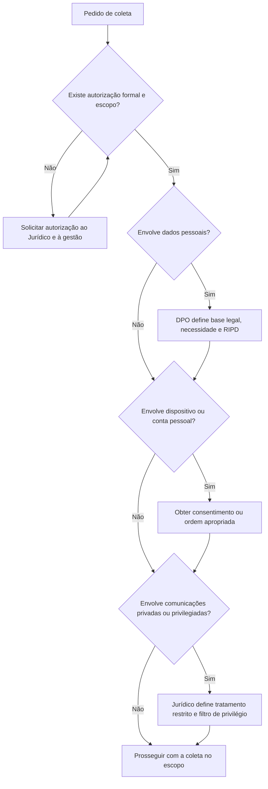

# Aspectos Legais e de Privacidade da Coleta

> **Objetivo pedagógico:** garantir que toda coleta seja lícita, autorizada, proporcional e respeitosa à privacidade, identificando as bases legais, os limites e os cuidados específicos em ambiente corporativo, dispositivos pessoais e dados em nuvem.

> **Aviso:** este material é técnico-educacional e não substitui parecer jurídico. Valide cada caso com o Jurídico e com o DPO.

## 1. Pressupostos

| Pressuposto | Descrição |
|---|---|
| Autorização | Toda coleta exige autorização formal de quem tem poder para concedê-la |
| Base legal | O tratamento de dados pessoais exige base legal definida (LGPD, art. 7º) |
| Necessidade | Coletar somente o necessário à finalidade (LGPD, art. 6º, III) |
| Transparência | Políticas de uso aceitável e de monitoramento comunicadas previamente |
| Licitude da prova | Provas obtidas em violação a normas constitucionais ou legais são inadmissíveis (CPP, art. 157) |
| Registro | Autorização, escopo e decisões documentados |

## 2. Legislação e normas relevantes

| Norma | Relevância para a coleta |
|---|---|
| Constituição Federal, art. 5º, X e XII | Intimidade, vida privada e sigilo das comunicações |
| Lei nº 12.965/2014 (Marco Civil da Internet) | Inviolabilidade e sigilo das comunicações (art. 7º) e guarda de registros (arts. 13 e 15) |
| Lei nº 13.709/2018 (LGPD) | Bases legais (art. 7º), necessidade (art. 6º, III), segurança (art. 46) e incidentes (art. 48) |
| Lei nº 9.296/1996 | Interceptação de comunicações em investigação criminal depende de ordem judicial |
| Código Penal, art. 154-A (Lei nº 12.737/2012) | Invasão de dispositivo informático sem autorização |
| Código de Processo Penal, arts. 157 e 158-A a 158-F | Licitude da prova e cadeia de custódia |
| Código de Processo Civil, arts. 369 e 384 | Meios de prova e ata notarial |
| Lei nº 8.906/1994 (Estatuto da Advocacia), art. 7º | Sigilo e inviolabilidade das comunicações entre advogado e cliente |
| Regulamento (UE) 2016/679 (GDPR) | Aplicável a dados de pessoas na União Europeia e a transferências internacionais |
| LGPD, arts. 33 a 36 | Transferência internacional de dados pessoais |

## 3. Fluxo de decisão legal antes da coleta



## 4. Situações típicas

| Situação | Orientação |
|---|---|
| Equipamento corporativo | Coleta permitida conforme política de uso aceitável comunicada e escopo definido; limitar ao necessário |
| E-mail e mensagens corporativas | Verificar a política de monitoramento e a base legal; restringir o acesso ao conteúdo ao necessário |
| Dispositivo pessoal (BYOD) | Exige consentimento explícito ou cláusula prévia clara; coleta mínima; evitar conteúdo pessoal |
| Contas e nuvem pessoais | Acesso somente com consentimento do titular ou ordem; não usar credenciais obtidas fora do escopo |
| Comunicações de advogados | Tratamento restrito; filtro de privilégio definido pelo Jurídico |
| Dados de terceiros e clientes | Observar contratos e a LGPD; minimizar |
| Dados em outra jurisdição | Avaliar transferência internacional e leis locais antes de exportar |
| Conteúdo ilícito encontrado fora do escopo | Interromper o exame daquele conteúdo, preservar e comunicar ao Jurídico |
| Ordem judicial ou requisição | Seguir estritamente o escopo, os prazos e as instruções da autoridade |

## 5. Cláusulas recomendadas para políticas internas

- Equipamentos e contas corporativas são ferramentas de trabalho sujeitas a monitoramento e a auditoria, nos termos da política.
- Finalidades do monitoramento, tipos de dados coletados e prazos de retenção.
- Procedimento de acesso do investigador, com autorização e registro.
- Regras para uso de dispositivos pessoais (BYOD), com consentimento e escopo.
- Tratamento de dados pessoais e sensíveis encontrados durante investigações.
- Comunicação aos titulares e às autoridades, quando aplicável.

## 6. Termo de ciência e consentimento para coleta em dispositivo pessoal (modelo)

```
TERMO DE CIÊNCIA E CONSENTIMENTO PARA COLETA EM DISPOSITIVO PESSOAL

Caso: DFL-AAAA-NNN
Titular: ______________________________   Documento: ______________________________
Dispositivo: ______________________________   Número de série: ______________________

Declaro que fui informado(a) de que:
1. A coleta visa à finalidade: ______________________________
2. Serão coletados somente os seguintes dados: ______________________________
3. Os dados serão tratados por ____________________ e mantidos por ____________________.
4. Posso solicitar informações sobre o tratamento e revogar o consentimento, ressalvadas
   as hipóteses legais de retenção.
5. O conteúdo pessoal não relacionado à finalidade será excluído do escopo de análise.

( ) Consinto com a coleta nos termos acima.

Local e data: ______________________________
Assinatura do titular: ______________________________
Responsável pela coleta: ______________________________
```

Observação: o consentimento é uma das bases legais; avalie com o Jurídico se é a mais adequada (a relação de trabalho pode afetar a liberdade do consentimento).

## 7. Minimização e proteção durante a coleta

| Medida | Descrição |
|---|---|
| Escopo por período e por fonte | Coletar apenas o intervalo relevante |
| Filtros | Excluir pastas pessoais e conteúdos privilegiados quando possível |
| Acesso restrito | Somente a pessoas designadas, com registro |
| Criptografia | Em trânsito e em repouso |
| Revisão por DPO | Avaliar a necessidade de RIPD e o tratamento de dados sensíveis |
| Retenção | Definir prazo e descarte seguro (pasta 02) |

## 8. Exemplo prático: investigação de ameaça interna

| Pergunta | Decisão |
|---|---|
| O notebook é corporativo? | Sim; coleta autorizada pela política de uso aceitável |
| A conta de e-mail é corporativa? | Sim; acesso aos logs e metadados primeiro; conteúdo apenas se necessário e autorizado |
| Há indício de uso de nuvem pessoal? | Coletar apenas os logs corporativos de envio; sem acessar a conta pessoal |
| Há comunicações com advogado? | Filtro de privilégio definido pelo Jurídico |
| Os dados serão enviados ao exterior? | Não; análise no Brasil |
| Retenção | Até o encerramento do caso e do prazo de recurso, com legal hold |

## 9. Casos de uso corporativos

- Elaboração da política de monitoramento e de resposta a incidentes alinhada à LGPD.
- Investigação com envolvimento de dados de clientes europeus.
- Coleta em BYOD de executivo, com consentimento e escopo restrito.

## 10. Normas e frameworks relevantes

- LGPD (arts. 6º, 7º, 33 a 36, 46 e 48)
- Marco Civil da Internet (arts. 7º, 13 e 15)
- CPP, arts. 157 e 158-A a 158-F
- ISO/IEC 27037:2012
- ISO/IEC 27701:2019 (extensão de privacidade da ISO/IEC 27001)
- ISO/IEC 27002:2022, controles 5.34 (privacidade e proteção de dados pessoais) e 5.28

## 11. Referências

- Brasil. Constituição da República Federativa do Brasil de 1988, art. 5º.
- Brasil. Lei nº 13.709/2018 (LGPD).
- Brasil. Lei nº 12.965/2014 (Marco Civil da Internet).
- Brasil. Lei nº 9.296/1996; Lei nº 12.737/2012; Lei nº 8.906/1994.
- Brasil. Decreto-Lei nº 3.689/1941 (CPP) e Lei nº 13.105/2015 (CPC).
- União Europeia. Regulamento (UE) 2016/679 (GDPR).
- ANPD. Guias orientativos de segurança da informação e de tratamento de dados.
- ISO/IEC 27701:2019.
