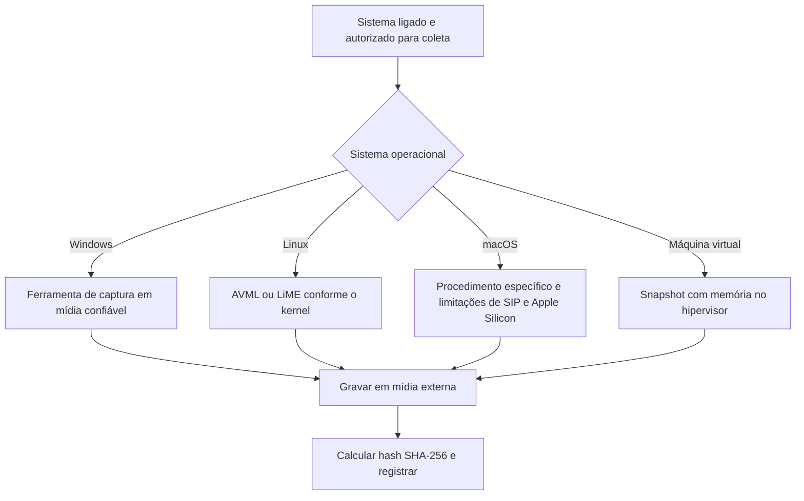
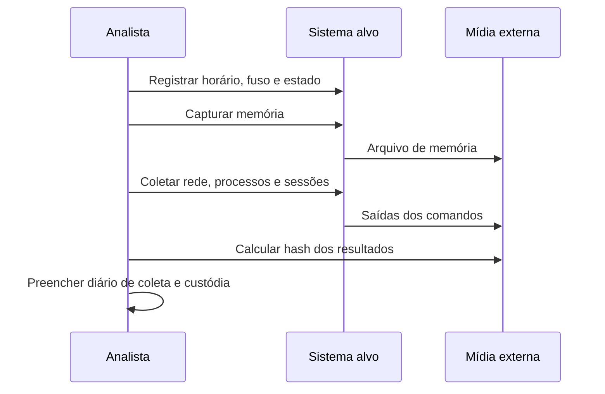

# Coleta de Dados Voláteis

> **Objetivo pedagógico:** capacitar o analista a executar a coleta ao vivo (live response) com o menor impacto possível sobre o sistema, na ordem de volatilidade, com ferramentas confiáveis e registro completo de cada ação.

## 1. O que é volátil

| Dado | Perda típica | Importância forense |
|---|---|---|
| Memória RAM | Desligamento, reinício, hibernação | Processos, injeção de código, chaves de criptografia, credenciais, conexões, malware sem arquivo |
| Conexões de rede e tabelas (ARP, roteamento, cache DNS) | Segundos a minutos | Comunicação com C2, movimentação lateral |
| Processos e módulos carregados | Encerramento do processo | Execução e persistência em andamento |
| Sessões de usuários e logons | Logoff e reinício | Quem estava conectado e de onde |
| Arquivos temporários e áreas tmpfs | Reinício | Artefatos de execução recentes |
| Chaves e tokens em memória | Reinício | Acesso a discos criptografados e serviços |
| Estado de dispositivos removíveis e montagens | Remoção ou reinício | Exfiltração e ingestão de arquivos |

## 2. Preparação do kit de resposta

- Mídia externa confiável, preferencialmente somente leitura, com as ferramentas necessárias já validadas.
- Mídia de destino com espaço suficiente para a memória e os resultados, criptografada e dedicada ao caso.
- Binários das ferramentas versionados, com hashes conhecidos e documentados.
- Formulários de custódia, relógio de referência e dispositivo de registro fotográfico.
- Autorização escrita e o plano de coleta aprovado.

## 3. Impacto da ferramenta (footprint)

Toda ação no sistema ao vivo o altera: carregar uma ferramenta usa memória, cria processos, gera artefatos de execução e altera carimbos de data e hora. A prática profissional não elimina esse efeito, mas o reduz e o documenta.

| Medida | Descrição |
|---|---|
| Menor alteração possível | Preferir ferramentas leves, executadas a partir de mídia externa |
| Ordem correta | Capturar a memória antes das demais ações, quando houver ferramenta disponível |
| Registro | Anotar cada comando, horário (UTC), usuário e destino da saída |
| Declaração | Informar no relatório o impacto conhecido da coleta ao vivo |

## 4. Captura de memória



| Plataforma | Opções | Observações |
|---|---|---|
| Windows | WinPmem, DumpIt, Magnet RAM Capture, FTK Imager (Capture Memory) | Seguir a documentação da versão utilizada; registrar a versão e os parâmetros |
| Linux | AVML (Microsoft), LiME | O LiME exige módulo compatível com o kernel; o AVML dispensa módulo de kernel |
| macOS | Soluções comerciais e procedimentos específicos | SIP, T2 e Apple Silicon limitam a captura completa; documentar as restrições |
| Máquinas virtuais | Snapshot com memória (VMware .vmem, Hyper-V, KVM) | Preserva a memória sem executar ferramenta no convidado |
| Nuvem | Snapshot de disco e, quando suportado, captura via agente | Recursos efêmeros podem ser encerrados por automação |

Cuidados:

- Se houver criptografia de disco (por exemplo, BitLocker), recupere as chaves e o status antes de qualquer desligamento.
- Hibernação e arquivos de paginação (hiberfil.sys e pagefile.sys) contêm fragmentos de memória; colete-os na imagem do disco.
- Registre o tamanho da RAM e confira o tamanho do arquivo de memória gerado.

## 5. Coleta após a memória

### 5.1 Windows (PowerShell, a partir de mídia confiável)

```powershell
# Destino: mídia externa E:\DFL-2026-001\E001\
$d = "E:\DFL-2026-001\E001"
New-Item -ItemType Directory -Force $d | Out-Null

# 1) Horário e fuso
Get-Date -Format "o" | Out-File "$d\00_horario.txt"
[System.TimeZoneInfo]::Local | Format-List Id,BaseUtcOffset | Out-File "$d\00_fuso.txt"

# 2) Rede
Get-NetTCPConnection | Select-Object LocalAddress,LocalPort,RemoteAddress,RemotePort,State,OwningProcess | Export-Csv "$d\10_tcp.csv" -NoTypeInformation
Get-NetNeighbor | Export-Csv "$d\11_arp.csv" -NoTypeInformation
Get-DnsClientCache | Export-Csv "$d\12_dns_cache.csv" -NoTypeInformation

# 3) Processos, serviços e tarefas
Get-CimInstance Win32_Process | Select-Object ProcessId,ParentProcessId,Name,CommandLine,CreationDate | Export-Csv "$d\20_processos.csv" -NoTypeInformation
Get-CimInstance Win32_Service | Select-Object Name,State,StartMode,PathName,StartName | Export-Csv "$d\21_servicos.csv" -NoTypeInformation
Get-ScheduledTask | Select-Object TaskPath,TaskName,State | Export-Csv "$d\22_tarefas.csv" -NoTypeInformation

# 4) Usuários e sessões
query user > "$d\30_sessoes.txt"
Get-LocalUser | Export-Csv "$d\31_usuarios.csv" -NoTypeInformation

# 5) Exportar logs de eventos principais
wevtutil epl Security "$d\40_Security.evtx"
wevtutil epl System "$d\41_System.evtx"
wevtutil epl "Microsoft-Windows-PowerShell/Operational" "$d\42_PowerShell.evtx"

# 6) Hash de tudo o que foi gerado
Get-FileHash "$d\*" -Algorithm SHA256 | Export-Csv "E:\DFL-2026-001\E001_hashes.csv" -NoTypeInformation
```

### 5.2 Linux (bash, com binários confiáveis)

```bash
D=/mnt/evidencias/DFL-2026-001/E003
mkdir -p "$D"

{ date -u; date; uname -a; uptime; } > "$D/00_sistema.txt"
who -a            > "$D/10_sessoes.txt"
last -Faiw        > "$D/11_last.txt"
ps auxww          > "$D/20_processos.txt"
ss -tunap         > "$D/30_sockets.txt"
ip neigh          > "$D/31_arp.txt"
ip route          > "$D/32_rotas.txt"
lsof -nP          > "$D/33_lsof.txt"
mount             > "$D/40_mounts.txt"
systemctl list-units --type=service --all > "$D/50_servicos.txt"
crontab -l        > "$D/51_cron_usuario.txt" 2>&1
ls -la /etc/cron* > "$D/52_cron_sistema.txt" 2>&1

# Hash dos resultados, gravado fora da pasta do caso
( cd "$D" && sha256sum * > ../E003_hashes.sha256 )
```

### 5.3 Captura de memória no Linux

```bash
# AVML (userland, sem módulo de kernel)
sudo ./avml /mnt/evidencias/DFL-2026-001/E003-MEM01.lime

# LiME (módulo compatível com o kernel em execução)
sudo insmod lime-$(uname -r).ko "path=/mnt/evidencias/DFL-2026-001/E003-MEM01.lime format=lime"

sha256sum /mnt/evidencias/DFL-2026-001/E003-MEM01.lime > /mnt/evidencias/DFL-2026-001/E003-MEM01.sha256
```

## 6. Sequência da coleta ao vivo



## 7. Exemplo prático de diário de coleta ao vivo

| Hora (UTC) | Ação | Ferramenta e versão | Resultado | Hash |
|---|---|---|---|---|
| 13:50:10 | Registro de horário e fuso | PowerShell 5.1 | Relógio com +2 s em relação ao UTC | Arquivo 00_horario.txt |
| 13:52:40 | Captura de memória | Ferramenta e versão registradas | 16 GB, sem erros | SHA-256 registrado |
| 14:03:05 | Rede e processos | PowerShell 5.1 | 4 conexões externas ativas | Manifesto |
| 14:08:30 | Exportação de logs de eventos | wevtutil | Security, System e PowerShell | Manifesto |

## 8. Erros a evitar

| Erro | Consequência | Prevenção |
|---|---|---|
| Executar ferramentas do disco do sistema | Binários adulterados e alteração de artefatos | Mídia externa confiável |
| Gravar saídas no disco investigado | Sobrescrita de dados | Mídia de destino dedicada |
| Desligar antes de capturar a memória | Perda de chaves, processos e conexões | Decisão documentada e captura prévia |
| Ignorar o fuso e o desvio do relógio | Linha do tempo inconsistente | Registrar sempre o horário e a diferença para UTC |
| Não registrar os comandos | Coleta irreprodutível | Diário de coleta e transcrição de sessão |

## 9. Casos de uso corporativos

- Servidor Linux com suspeita de shell reverso, sem possibilidade de parada imediata.
- Estação de executivo com suspeita de infostealer.
- Instância em nuvem que será encerrada por automação em poucas horas.

## 10. Normas e frameworks relevantes

- RFC 3227 (ordem de volatilidade e diretrizes de coleta)
- NIST SP 800-86, seção 3 (coleta de dados voláteis)
- ISO/IEC 27037:2012
- ISO/IEC 27002:2022, controle 5.28
- MITRE ATT&CK: T1055 (Process Injection) e T1059 (Command and Scripting Interpreter) como alvos típicos de busca

## 11. Referências

- Brezinski, D.; Killalea, T. RFC 3227. 2002.
- Ligh, M. et al. The Art of Memory Forensics. Wiley, 2014.
- Kent, K. et al. NIST SP 800-86. 2006.
- SANS Institute. FOR508: Advanced Incident Response, Threat Hunting and Digital Forensics.
- Microsoft. Documentação do AVML (Azure Virtual Machine Memory Acquisition).
- Documentação do LiME (Linux Memory Extractor).
- Microsoft Learn. Documentação do wevtutil.
