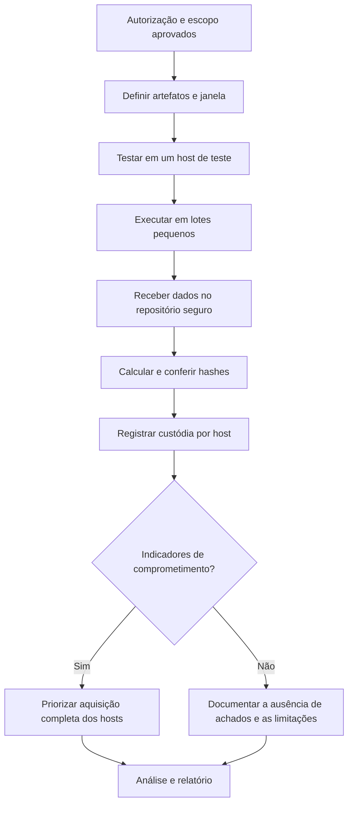

# Coleta Remota e Triagem em Escala

> **Objetivo pedagógico:** capacitar o analista a planejar e executar coletas remotas e triagens em muitos endpoints, usando EDR, Velociraptor e KAPE, com integridade, custódia, privacidade e baixo impacto operacional.

## 1. Quando usar

| Cenário | Justificativa |
|---|---|
| Incidente com muitos endpoints potencialmente afetados | Priorizar os sistemas comprometidos |
| Equipes e dispositivos geograficamente dispersos | Evitar deslocamento e perda de tempo |
| Trabalho remoto | Dispositivos fora da rede corporativa |
| Caça a ameaças em escala | Consulta de artefatos em todo o parque |

## 2. Abordagens

| Abordagem | Descrição | Pontos de atenção |
|---|---|---|
| Live response via EDR | Sessão remota com comandos e download de arquivos pela plataforma | Registros da plataforma como parte da custódia; limites de tamanho |
| Velociraptor | Coletas por artefatos (VQL), em cliente conectado ou por coletor offline | Definir artefatos, escopo e permissões; proteger o servidor |
| KAPE | Coleta direcionada por alvos e módulos de processamento | Rodar a partir de mídia ou compartilhamento controlado; verificar os termos de licença |
| Scripts próprios | PowerShell ou bash controlados e versionados | Assinatura de scripts e revisão por pares |
| Coleta de logs centralizados | SIEM, proxy, DNS, identidade e nuvem | Retenção e exportação dentro do prazo |

## 3. Planejamento

| Item | Definição |
|---|---|
| Autorização | Termo assinado e comunicação aos responsáveis de TI |
| Escopo | Lista de hosts, grupos e janela de tempo |
| Artefatos | Conjunto mínimo necessário ao caso (princípio da necessidade) |
| Janela operacional | Horário de menor impacto, com plano de contingência |
| Impacto na rede | Limite de taxa e de tamanho por endpoint |
| Risco de alerta ao atacante | Considerar o canal de comando e comunicações para não alertar quem está dentro do ambiente |
| Armazenamento | Repositório criptografado, com acesso restrito e imutabilidade |
| Nomeação | Padrão `DFL-AAAA-NNN-HOSTNAME-TRIAGE-AAAAMMDDThhmmZ` |

## 4. Fluxo de coleta remota



## 5. Artefatos de triagem (Windows)

| Categoria | Exemplos de alvos |
|---|---|
| Execução | Prefetch, Amcache, ShimCache, BAM |
| Persistência | Chaves Run, tarefas agendadas, serviços, WMI |
| Atividade do usuário | Jump Lists, LNK, ShellBags, histórico de navegadores |
| Sistema de arquivos | $MFT, $UsnJrnl |
| Logs | Security, System, PowerShell, Sysmon (se presente) |
| Rede e autenticação | Cache DNS, conexões, sessões, logs de VPN |

Exemplo de coleta com KAPE (verifique a sintaxe na versão instalada):

```powershell
.\kape.exe --tsource C: --tdest E:\DFL-2026-001\HOST-A\triage --target !SANS_Triage --vhdx HOST-A
```

Após a coleta, calcule o hash e registre:

```powershell
Get-FileHash E:\DFL-2026-001\HOST-A\triage\* -Algorithm SHA256 | Export-Csv E:\DFL-2026-001\HOST-A_hashes.csv -NoTypeInformation
```

## 6. Custódia da coleta remota

| Elemento | Prática |
|---|---|
| Identificação | Um identificador por host e por coleta |
| Integridade | Hash gerado no endpoint, quando possível, e conferido no repositório |
| Registro | Logs do servidor de coleta e do EDR preservados como evidência |
| Autoria | Contas nominais, sem credenciais compartilhadas |
| Transferência | Canal criptografado; credenciais com privilégio mínimo e temporário |
| Armazenamento | Repositório imutável com controle de acesso por caso |

## 7. Riscos e mitigação

| Risco | Mitigação |
|---|---|
| Atacante monitora ou reage à coleta | Operar por canais fora de banda e controlar a comunicação |
| Sobrecarga de rede ou do endpoint | Limites de taxa, lotes e janelas |
| Coleta excessiva e dados pessoais | Artefatos mínimos e filtragem; DPO consultado |
| Credenciais privilegiadas expostas | Contas dedicadas, rotação após o caso |
| Integridade comprometida | Hashes, logs e armazenamento imutável |
| Falsa sensação de cobertura | Declarar no relatório hosts não coletados e as limitações |

## 8. Exemplo prático: triagem de 200 endpoints

| Etapa | Ação |
|---|---|
| 1 | Aprovar o escopo (200 hosts) e os artefatos mínimos |
| 2 | Testar o coletor em 3 hosts e ajustar |
| 3 | Executar em lotes de 20 hosts por hora, monitorando a rede |
| 4 | Consolidar os resultados em repositório com manifesto de hashes |
| 5 | Executar consultas de indicadores (hashes, domínios, chaves de registro) |
| 6 | Identificar 6 hosts com indícios e priorizar a imagem completa |
| 7 | Relatar: 194 sem indícios dentro da cobertura coletada; 6 em investigação |

## 9. Casos de uso corporativos

- Resposta a ransomware com verificação de movimentação lateral em centenas de hosts.
- Caça a ameaças após alerta de inteligência de ameaças com IOCs de hash e domínio.
- Coleta de laptops de equipes remotas em um incidente de credenciais comprometidas.

## 10. Normas e frameworks relevantes

- NIST SP 800-86 e NIST SP 800-61 Rev. 3
- ISO/IEC 27037:2012
- MITRE ATT&CK (táticas Execution, Persistence, Lateral Movement e Command and Control)
- CIS Controls v8.1: controles 8 (logs) e 17 (resposta a incidentes)
- LGPD, art. 6º, III (necessidade)

## 11. Referências

- Kent, K. et al. NIST SP 800-86. 2006.
- NIST SP 800-61 Rev. 3. 2025.
- Documentação do Velociraptor (Velocidex).
- Documentação do KAPE (Kroll), de autoria de Eric Zimmerman.
- SANS Institute. FOR508 e FOR498.
- MITRE ATT&CK. https://attack.mitre.org
