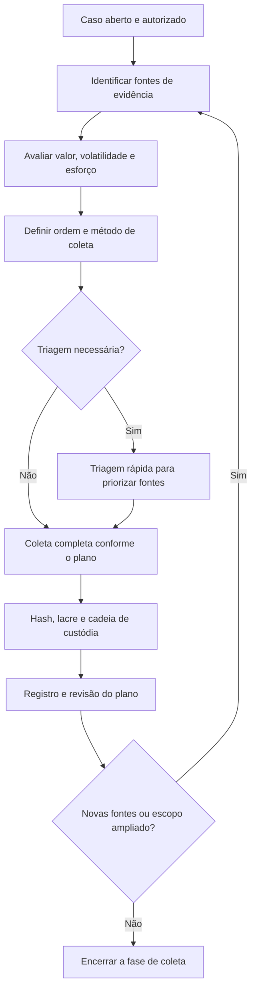

# Estratégia de Coleta e Triagem de Evidências

> **Objetivo pedagógico:** ensinar a planejar a coleta de evidências digitais, priorizar as fontes por valor, volatilidade e esforço e usar a triagem (triage) para decidir o que coletar primeiro, sem comprometer a integridade nem exceder o escopo autorizado.

## 1. Princípios da coleta

O NIST SP 800-86 orienta que, após identificar as fontes possíveis de dados, o investigador desenvolva um plano de aquisição priorizando as fontes segundo três critérios:

| Critério | Pergunta orientadora |
|---|---|
| Valor provável | Qual a chance de a fonte conter dados relevantes para as perguntas investigativas? |
| Volatilidade | Em quanto tempo o dado será perdido ou sobrescrito? |
| Esforço | Quanto tempo, custo e risco a coleta exige? |

Princípios complementares:

- Coletar sob autorização, dentro do escopo e com base legal (ver arquivo de aspectos legais).
- Respeitar a ordem de volatilidade da RFC 3227 (ver pasta 01).
- Documentar cada ação no momento em que ocorre, com horário em UTC.
- Coletar o necessário à finalidade, evitando excesso (LGPD, art. 6º, III).
- Preservar o original e trabalhar em cópias verificadas por hash.

## 2. Fluxo de planejamento e coleta

## 3. Matriz de priorização de fontes

### 3.1 Método de pontuação (exemplo didático)

Pontue cada fonte de 1 (baixo) a 5 (alto) em valor e volatilidade, e de 1 (baixo esforço) a 5 (alto esforço) em esforço. Calcule:

`Prioridade = (Valor × 2) + (Volatilidade × 2) − Esforço`

Quanto maior o resultado, mais cedo a fonte deve ser coletada. O método é uma ajuda à decisão e não substitui o julgamento do líder do caso; ajuste os pesos à realidade da organização.

### 3.2 Exemplo aplicado: suspeita de infostealer em estação de trabalho

| Fonte | Valor | Volatilidade | Esforço | Prioridade | Ordem |
|---|---|---|---|---|---|
| Memória do notebook | 5 | 5 | 2 | 18 | 1 |
| Logs de proxy e DNS | 5 | 4 | 1 | 17 | 2 |
| Logs de e-mail e autenticação (M365 e AD) | 3 | 3 | 1 | 11 | 3 |
| Imagem do disco do notebook | 4 | 2 | 3 | 9 | 4 |
| Backups | 2 | 1 | 2 | 4 | 5 |

## 4. Triagem (triage)

Triagem é o exame rápido e direcionado para decidir o que coletar primeiro, especialmente quando há muitos dispositivos, pouco tempo ou risco de perda.

| Aspecto | Orientação |
|---|---|
| Quando usar | Muitos ativos; incidente em andamento; indisponibilidade limitada do equipamento; coleta remota |
| Objetivo | Identificar sistemas comprometidos ou relevantes e priorizar aquisições completas |
| Método | Coleta de artefatos-chave (execução, persistência, autenticação, rede, navegação) e consulta de indicadores |
| Limitação | A triagem não substitui a imagem forense completa; declare no relatório o que foi e o que não foi coletado |
| Registro | Documentar ferramenta, alvos, horários, hashes e resultados, como em qualquer coleta |

### 4.1 Artefatos de triagem por tipo de caso

| Tipo de caso | Coletar primeiro |
|---|---|
| Malware ou infostealer | Memória, processos, conexões, Prefetch e Amcache, persistência, histórico de navegadores, logs de proxy |
| Ransomware | Memória, conexões, logs de autenticação do AD e de VPN, telemetria de EDR, amostra do binário e nota de resgate |
| Ameaça interna | Logs de DLP e proxy, artefatos de USB e de nuvem pessoal, arquivos recentes, logs de e-mail e de repositórios |
| BEC e conta comprometida | Logs de entrada, auditoria do M365, regras de caixa, consentimentos de aplicativos, cabeçalhos das mensagens |
| Acesso indevido a servidor | Memória, logs de autenticação, histórico de comandos, sessões ativas, tarefas agendadas |
| Incidente em nuvem | Logs de API e de identidade, snapshots de discos, configuração de rede e de permissões |

## 5. Decisão entre coleta ao vivo e com o sistema desligado

A decisão deve seguir o fluxo da pasta 01 (princípios e ordem de volatilidade) e ser registrada com a justificativa. Em síntese:

| Fator | Favorece coleta ao vivo | Favorece sistema desligado |
|---|---|---|
| Malware em memória ou sessão ativa do atacante | Sim | Não |
| Disco criptografado desbloqueado | Sim | Não, risco de perder o acesso |
| Servidor crítico sem possibilidade de parada | Sim, com isolamento de rede | Não |
| Dispositivo inativo, sem indício de atividade | Não | Sim |

## 6. Documentos do planejamento

Use os modelos do arquivo "modelos-de-plano-e-registro-de-coleta.md": plano de coleta, registro de triagem, diário de coleta ao vivo e relatório de coleta. A abertura do caso e os formulários de custódia seguem as pastas 01 e 02.

## 7. Exemplo prático: plano de coleta de 24 horas

| Janela | Ação | Responsável |
|---|---|---|
| 0 a 1 h | Autorização, isolamento de rede, preservação de logs de retenção curta | Líder e SOC |
| 1 a 2 h | Captura de memória e coleta de dados voláteis | Analista DFIR |
| 2 a 6 h | Triagem de artefatos e aquisição da imagem do disco | Analista DFIR |
| 6 a 12 h | Exportação de logs de proxy, DNS, autenticação, EDR e M365 | SOC e TI |
| 12 a 24 h | Lacre, custódia, verificação de hashes, relatório de coleta | Custodiante |

## 8. Casos de uso corporativos

- Triagem de dezenas de estações após a descoberta de um indicador de comprometimento.
- Priorização de fontes em investigação de fraude com muitos repositórios e contas.
- Coleta planejada em desligamento de colaborador com acesso privilegiado.

## 9. Normas e frameworks relevantes

- NIST SP 800-86, seção 3 (coleta: identificação, priorização e aquisição)
- ISO/IEC 27037:2012 (identificação, coleta e aquisição)
- RFC 3227 (ordem de volatilidade)
- ISO/IEC 27002:2022, controle 5.28 (coleta de evidências)
- CIS Controls v8.1, controles 8 (logs) e 17 (resposta a incidentes)
- MITRE ATT&CK (data sources para orientar a coleta por técnica)

## 10. Referências

- Kent, K. et al. NIST SP 800-86: Guide to Integrating Forensic Techniques into Incident Response. 2006.
- Brezinski, D.; Killalea, T. RFC 3227. IETF, 2002.
- ABNT NBR ISO/IEC 27037:2013.
- SANS Institute. FOR498: Digital Acquisition and Rapid Triage.
- SWGDE. Best Practices for Computer Forensic Acquisitions.
- Casey, E. Digital Evidence and Computer Crime. 3. ed. Academic Press, 2011.
- Brasil. Lei nº 13.709/2018 (LGPD), art. 6º.
