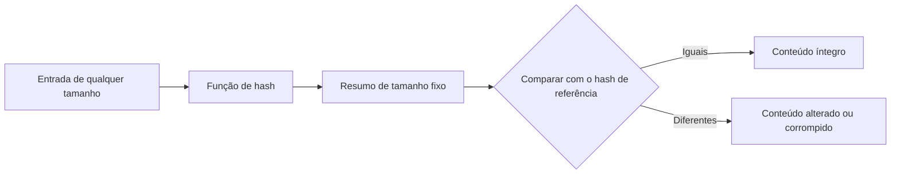

# Fundamentos de Hash e Funções Criptográficas

> **Objetivo pedagógico:** compreender o que é uma função de hash criptográfica, quais propriedades a tornam adequada à prova de integridade, quais algoritmos usar e evitar na prática forense e como argumentar tecnicamente sobre sua confiabilidade.

## 1. Conceito

Uma função de hash criptográfica transforma uma entrada de qualquer tamanho (arquivo, imagem de disco, texto) em uma saída de tamanho fixo, chamada resumo (digest) ou hash. Na forense digital, o hash funciona como uma "impressão digital" do conteúdo: se um único bit mudar, o hash muda.



## 2. Propriedades esperadas

| Propriedade | Significado | Importância forense |
|---|---|---|
| Determinismo | A mesma entrada gera sempre o mesmo hash | Permite reproduzir e verificar |
| Resistência à pré-imagem | A partir do hash, não é viável encontrar uma entrada que o produza | Impede reconstruir ou forjar conteúdo a partir do hash |
| Resistência à segunda pré-imagem | Dada uma entrada, não é viável achar outra com o mesmo hash | Impede substituir uma evidência por outra com o mesmo hash |
| Resistência a colisões | Não é viável encontrar duas entradas distintas com o mesmo hash | Impede que um atacante crie dois arquivos com o mesmo hash |
| Efeito avalanche | Uma pequena mudança na entrada altera drasticamente o hash | Qualquer alteração é detectada |
| Eficiência | Cálculo rápido, mesmo para discos inteiros | Viabiliza uso rotineiro |

Pelo paradoxo do aniversário, encontrar colisões em uma função ideal de n bits exige em torno de 2 elevado a n/2 operações. Por isso, resumos mais longos oferecem mais margem de segurança.

## 3. Algoritmos

| Algoritmo | Tamanho do resumo | Caracteres hexadecimais | Situação | Uso forense recomendado |
|---|---|---|---|---|
| MD5 (RFC 1321) | 128 bits | 32 | Quebrado quanto a colisões | Apenas compatibilidade (listas legadas, ferramentas antigas), nunca como único hash |
| SHA-1 | 160 bits | 40 | Colisões práticas demonstradas | Compatibilidade; NIST definiu a aposentadoria até 2030 |
| SHA-256 (SHA-2, FIPS 180-4) | 256 bits | 64 | Considerado seguro | **Padrão recomendado** |
| SHA-512 (SHA-2, FIPS 180-4) | 512 bits | 128 | Considerado seguro | Alternativa ou segundo hash |
| SHA-3 (FIPS 202) | 224 a 512 bits | 56 a 128 | Considerado seguro | Alternativa de família distinta |
| BLAKE2 e BLAKE3 | Variável | Variável | Seguros e muito rápidos, fora do conjunto padronizado pelo NIST | Úteis em processamento de grandes volumes; registre em paralelo o SHA-256 |

### 3.1 Histórico das quebras

- **MD5:** Wang e Yu (2005) demonstraram colisões. Hoje é possível gerar pares de arquivos distintos com o mesmo MD5, inclusive com prefixos escolhidos.
- **SHA-1:** a primeira colisão completa foi publicada por Stevens et al. (2017, projeto SHAttered). Leurent e Peyrin (2020) demonstraram colisão com prefixo escolhido.
- **O que não foi quebrado:** não há ataque prático de pré-imagem contra MD5 ou SHA-1. Ou seja, mesmo com MD5, substituir uma evidência existente por outra com o mesmo hash continua inviável na prática. O risco real das colisões está em cenários em que o próprio atacante cria os dois arquivos.

### 3.2 Como responder ao argumento "MD5 é quebrado"

| Argumento da contraparte | Resposta técnica |
|---|---|
| "MD5 não é confiável" | A prática do laboratório usa SHA-256 como padrão; o MD5 aparece apenas como segundo registro, por compatibilidade |
| "Poderiam ter trocado o arquivo" | A troca exigiria um ataque de segunda pré-imagem, para o qual não há método prático; além disso, há hashes duplos, cadeia de custódia e lacre |
| "As colisões existem" | As colisões exigem que o atacante controle a criação dos dois arquivos; a evidência original foi coletada por terceiros, antes de qualquer hash |

## 4. Funções relacionadas

| Mecanismo | Descrição | Uso |
|---|---|---|
| HMAC (RFC 2104, FIPS 198-1) | Hash com chave secreta, que garante integridade e autenticidade | Verificação de integridade entre partes que compartilham uma chave |
| Assinatura digital | Hash assinado com chave privada | Prova de origem e de integridade (ver arquivo de manifestos) |
| Carimbo do tempo (RFC 3161) | Hash vinculado a uma data e hora certificadas por terceiro | Prova de existência em determinado momento |
| Checksum (CRC e Adler-32) | Detecção de erros acidentais | Não oferece segurança criptográfica; não use como prova de integridade |

## 5. Exemplos práticos

### 5.1 Efeito avalanche (hashes reais)

Entrada `forense` (minúscula) e `Forense` (maiúscula inicial), sem quebra de linha:

| Algoritmo | `forense` | `Forense` |
|---|---|---|
| MD5 | `e1576f172c3b126ae7a6026e8995da85` | `f0128cf087fa49732bf066306d5f4a6f` |
| SHA-1 | `12fce1fcce8913c12c37e925500af2e03016289a` | `da984d2a2eaa8acf2289ccbc388c812ef21c97ed` |
| SHA-256 | `936eadf290e12e795165cae5486a24a97b9009303287704f4f6242d439d1e0ea` | `d83dbbd04ed9d7272cd8548206794df45403fbfc7246f16273ae09c38152196a` |

Uma mudança de um único caractere produz resumos totalmente diferentes.

### 5.2 Calcular hashes nos principais sistemas

```bash
# Linux
sha256sum arquivo.bin
sha512sum arquivo.bin
md5sum arquivo.bin
printf %s "forense" | sha256sum       # hash de texto, sem quebra de linha

# macOS
shasum -a 256 arquivo.bin

# OpenSSL (multiplataforma)
openssl dgst -sha256 arquivo.bin
openssl dgst -sha256 -hmac "chave-secreta" arquivo.bin
```

```powershell
# Windows PowerShell
Get-FileHash .\arquivo.bin -Algorithm SHA256
Get-FileHash .\arquivo.bin -Algorithm SHA512

# Windows (prompt de comando)
certutil -hashfile arquivo.bin SHA256
```

### 5.3 Padrão de registro

Registre sempre o algoritmo junto com o valor, o arquivo, a data e hora (UTC) e o responsável:

| Campo | Exemplo |
|---|---|
| Arquivo | DFL-2026-001-E001-IMG01.E01 |
| Algoritmo | SHA-256 |
| Valor | Resumo em hexadecimal minúsculo |
| Data e hora (UTC) | 2026-10-31T10:12:00Z |
| Responsável | Analista A |
| Ferramenta e versão | Registrar o nome e a versão exatos |

## 6. Boas práticas

- Use SHA-256 como padrão e registre um segundo algoritmo (SHA-512, SHA-3 ou, por compatibilidade, MD5 ou SHA-1) nos casos de maior risco.
- Escreva o algoritmo ao lado do valor, em hexadecimal minúsculo.
- Calcule o hash do conteúdo exato (bytes), e não de uma representação convertida.
- Armazene os hashes em local separado do objeto e com proteção contra alteração.
- Documente a ferramenta e a versão utilizadas.

## 7. Casos de uso corporativos

- Demonstrar que uma imagem forense apresentada ao juízo é idêntica à adquirida meses antes.
- Responder a questionamento de auditoria sobre o algoritmo adotado pelo laboratório.
- Definir a política de algoritmos aceitos para fornecedores de DFIR.

## 8. Normas e frameworks relevantes

- NIST FIPS 180-4 (SHA-1 e SHA-2) e FIPS 202 (SHA-3)
- NIST SP 800-131A Rev. 2 (transição de algoritmos criptográficos)
- NIST FIPS 198-1 e RFC 2104 (HMAC)
- RFC 3161 (carimbo do tempo)
- ISO/IEC 27037:2012 (integridade na aquisição e preservação)
- ISO/IEC 27002:2022, controle 8.24 (uso de criptografia)

## 9. Referências

- NIST. FIPS 180-4: Secure Hash Standard (SHS). 2015.
- NIST. FIPS 202: SHA-3 Standard. 2015.
- NIST. SP 800-131A Rev. 2: Transitioning the Use of Cryptographic Algorithms and Key Lengths. 2019.
- Rivest, R. RFC 1321: The MD5 Message-Digest Algorithm. 1992.
- Wang, X.; Yu, H. How to Break MD5 and Other Hash Functions. EUROCRYPT 2005.
- Stevens, M. et al. The First Collision for Full SHA-1. CRYPTO 2017.
- Leurent, G.; Peyrin, T. SHA-1 is a Shambles. USENIX Security 2020.
- Krawczyk, H. et al. RFC 2104: HMAC. 1997.
- Menezes, A.; van Oorschot, P.; Vanstone, S. Handbook of Applied Cryptography. CRC Press, 1996.
