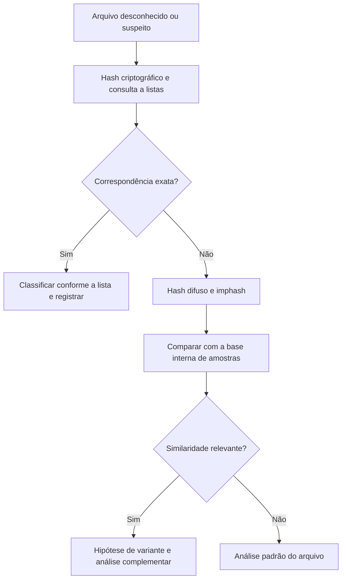

# Hash Difuso e Similaridade

> **Objetivo pedagógico:** identificar arquivos semelhantes, e não apenas idênticos, por meio de hash difuso, imphash e hashes perceptuais, compreendendo as aplicações, os limites e a interpretação dos escores.

## 1. Por que hash criptográfico não basta

O hash criptográfico confirma identidade exata. Se um malware é recompilado, um documento recebe uma linha nova ou uma imagem é recomprimida, o hash muda por completo e a relação entre as versões se perde. Os hashes de similaridade tentam preservar essa relação.

| Necessidade | Técnica |
|---|---|
| Identidade exata | SHA-256 e outras funções criptográficas |
| Similaridade de conteúdo binário ou textual | Hash difuso (CTPH, sdhash, TLSH) |
| Similaridade de executáveis PE | Imphash e hashes de seções |
| Similaridade visual de imagens | Hashes perceptuais (aHash, dHash e pHash) |
| Similaridade de tráfego TLS | Impressões digitais como JA3 e JA4 |

## 2. Principais algoritmos de hash difuso

| Algoritmo | Método | Saída e comparação | Pontos fortes e limites |
|---|---|---|---|
| ssdeep (CTPH, Kornblum, 2006) | Hash fragmentado e acionado por contexto, em blocos | Texto com tamanho de bloco; escore de 0 a 100 | Simples e difundido; sensível ao tamanho dos arquivos e pouco eficaz em arquivos muito pequenos |
| sdhash (Roussev, 2010) | Impressão digital por características estatisticamente improváveis | Filtros de Bloom; escore de 0 a 100 | Boa para fragmentos e arquivos grandes; custo maior |
| TLSH (Oliver, Cheng e Chen, 2013) | Hash sensível à localidade (LSH) | Distância numérica (menor significa mais semelhante) | Adequado a grandes bases e agrupamento; exige tamanho mínimo da entrada |

## 3. Exemplos práticos

### 3.1 ssdeep

```bash
# Gerar o hash difuso de arquivos de um diretório (formato com cabeçalho)
ssdeep -r -b /mnt/analise/amostras > amostras.ssdeep

# Comparar um arquivo contra a base (exibe os escores acima do limite)
ssdeep -m amostras.ssdeep -b arquivo_novo.exe

# Mostrar todas as correspondências, inclusive com escore baixo
ssdeep -a -m amostras.ssdeep -b arquivo_novo.exe
```

### 3.2 TLSH

```bash
# Calcular o hash de um arquivo e comparar por distância
tlsh -f arquivo_a.bin
tlsh -f arquivo_a.bin -c arquivo_b.bin
```

### 3.3 Imphash de executáveis PE (Python com pefile)

```python
import pefile
pe = pefile.PE("amostra.exe")
print(pe.get_imphash())
```

O imphash é o hash da tabela de importações. Binários da mesma família, compilados com o mesmo conjunto de importações, tendem a compartilhar o mesmo valor. Seu uso foi popularizado pela Mandiant (2014). Pode produzir falsos positivos entre programas legítimos que usam bibliotecas semelhantes.

### 3.4 Hashes perceptuais de imagens (Python com imagehash)

```python
from PIL import Image
import imagehash
h1 = imagehash.phash(Image.open("foto_a.jpg"))
h2 = imagehash.phash(Image.open("foto_b.jpg"))
print(h1 - h2)   # distância de Hamming: menor significa mais semelhante
```

## 4. Interpretação dos resultados

| Técnica | Como interpretar | Cuidados |
|---|---|---|
| ssdeep | Escore alto indica grande semelhança; 0 não prova que os arquivos sejam diferentes | Não use como prova de identidade; use como indício |
| sdhash | Escore indica a proporção de características em comum | Limiares dependem da aplicação |
| TLSH | Distância baixa (por exemplo, abaixo de dezenas de pontos) sugere similaridade | Calibrar limiares por tipo de arquivo |
| Imphash | Igualdade sugere relação entre amostras | Confirmar por outras evidências |
| Hash perceptual | Distância pequena sugere a mesma imagem com recompressão, redimensionamento ou ajustes | Não distingue edições sutis; combinar com metadados |

Regra: hash difuso gera hipóteses; a confirmação exige análise adicional (estática, dinâmica ou comparação de conteúdo).

## 5. Aplicações forenses

| Aplicação | Descrição |
|---|---|
| Famílias e variantes de malware | Agrupar amostras e ligar novos achados a campanhas conhecidas |
| Versões de documentos | Identificar cópias parciais, versões editadas e vazamento de documento alterado |
| Arquivos fragmentados ou parcialmente recuperados | Associar fragmentos ao original |
| Deduplicação em grandes volumes | Reduzir a análise de arquivos quase idênticos |
| Imagens e mídias | Encontrar versões recomprimidas ou redimensionadas |
| Investigações de deepfake | Apoiar a busca de mídia original e a comparação de versões (ver pasta de deepfake) |

## 6. Fluxo de uso



## 7. Cuidados e limitações

- Defina e documente limiares e a base de comparação usada.
- Arquivos muito pequenos geram resultados pouco confiáveis.
- Empacotadores, criptografia e ofuscação reduzem a similaridade mesmo entre arquivos relacionados.
- Evite apresentar o escore como "probabilidade" de identidade.
- Hashes difusos são úteis para triagem e agrupamento, e não substituem o hash criptográfico como prova de integridade.

## 8. Exemplo prático: variantes de um documento vazado

| Etapa | Resultado |
|---|---|
| Documento original | Hash SHA-256 e hash difuso calculados e arquivados |
| Cópia encontrada na estação | SHA-256 diferente; ssdeep com escore alto |
| Interpretação | Cópia com pequenas alterações (por exemplo, metadados ou formatação) |
| Confirmação | Comparação de conteúdo e de metadados |
| Relatório | Escore, método e conclusão com grau de confiança |

## 9. Casos de uso corporativos

- Análise de campanhas de phishing com anexos ligeiramente diferentes a cada envio.
- Detecção de documentos confidenciais parcialmente copiados para repositórios externos.
- Triagem de grandes volumes de imagens e documentos em fraude interna.

## 10. Normas e frameworks relevantes

- NIST SP 800-86 (exame e análise de dados)
- MITRE ATT&CK (inteligência de ameaças e agrupamento de famílias)
- ISO/IEC 27042:2015 (análise e interpretação, incluindo declaração de incertezas)

## 11. Referências

- Kornblum, J. Identifying almost identical files using context triggered piecewise hashing. Digital Investigation, v. 3S, 2006.
- Roussev, V. Data Fingerprinting with Similarity Digests. IFIP Advances in Information and Communication Technology, 2010.
- Oliver, J.; Cheng, C.; Chen, Y. TLSH: A Locality Sensitive Hash. 4th Cybercrime and Trustworthy Computing Workshop, 2013.
- Mandiant. Tracking Malware with Import Hashing. 2014.
- Salesforce. JA3 e JA4+: fingerprints de TLS (documentação dos projetos).
- Documentação do ssdeep, do TLSH e das bibliotecas pefile e imagehash.
