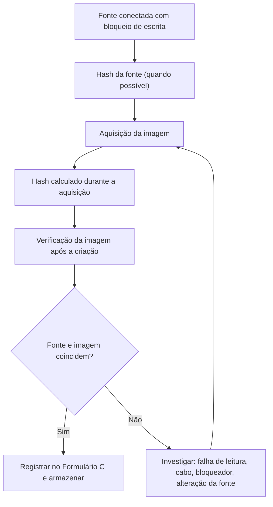
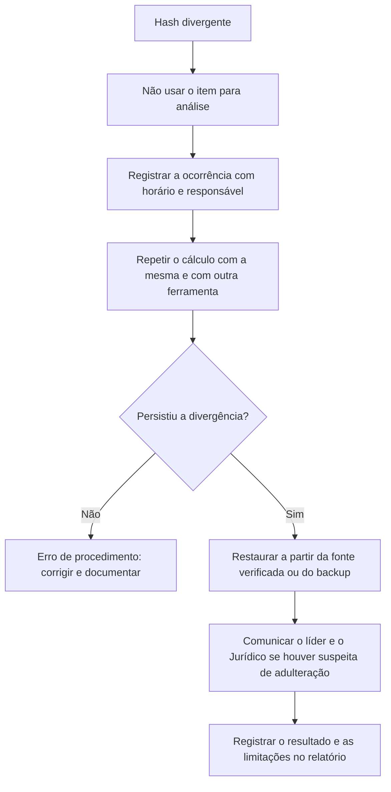

# Hash em Aquisição, Cópia e Verificação

> **Objetivo pedagógico:** aplicar o hash em cada ponto do ciclo de vida da evidência (aquisição, cópia, transferência, análise e relato), com procedimentos reproduzíveis, registro adequado e tratamento de divergências.

## 1. Quando calcular hash

| Momento | O que calcular | Finalidade |
|---|---|---|
| Antes da aquisição | Hash da fonte (disco ou volume), quando o método permite | Base de comparação com a imagem |
| Durante e após a aquisição | Hash da imagem e verificação final | Provar que a imagem corresponde à fonte |
| Após a criação de cópias de trabalho | Hash de cada cópia | Provar identidade com a imagem |
| Em cada transferência | Hash na origem e no destino | Detectar corrupção ou troca |
| Em verificações periódicas | Hash do armazenado contra o manifesto | Detectar degradação ou adulteração |
| Na geração de resultados | Hash de exportações, saídas e relatórios | Integridade dos produtos da análise |
| No relatório | Hashes das evidências relevantes | Rastreabilidade e reprodução |

## 2. Hash na aquisição de imagens



### 2.1 Ferramentas e comandos

```bash
# dc3dd: hash durante a imagem e log
sudo dc3dd if=/dev/sdb hash=sha256 hash=md5 log=E001-IMG01.log of=E001-IMG01.dd

# ewfacquire: imagem E01 com hash adicional (digest) e verificação
sudo ewfacquire -t E001-IMG01 -d sha256 -f encase6 /dev/sdb
ewfverify E001-IMG01.E01

# Hash independente da imagem RAW
sha256sum E001-IMG01.dd > E001-IMG01.dd.sha256
```

No FTK Imager, marque **Verify images after they are created** e salve o relatório de verificação, que traz os hashes da fonte e da imagem.

### 2.2 O que o formato E01 já guarda

O formato E01 (EWF) inclui verificações de integridade por bloco e armazena internamente resumos do conteúdo (MD5 e, conforme a versão e a ferramenta, SHA-1). Ferramentas como o ewfacquire permitem calcular um digest adicional, como SHA-256. Registre também esses valores no Registro de Aquisição e em arquivo separado, pois o resumo armazenado dentro da própria imagem não substitui um registro externo.

## 3. Hash de cópias e transferências

```bash
# Origem
sha256sum E001-IMG01.E01 > E001-IMG01.E01.sha256

# Transferência (exemplo com rsync e verificação por checksum)
rsync -av --progress E001-IMG01.E01 usuario@destino:/evidencias/DFL-2026-001/

# Destino: conferir contra o arquivo de hash recebido por canal separado
sha256sum -c E001-IMG01.E01.sha256
```

```powershell
# Windows: comparar o hash calculado com o valor registrado
$esperado = "<hash registrado no Formulário C>"
$obtido = (Get-FileHash .\E001-IMG01.E01 -Algorithm SHA256).Hash.ToLower()
if ($obtido -eq $esperado) { "OK: hash confere" } else { "DIVERGENTE" }
```

Boas práticas: envie o arquivo de hash por canal ou meio distinto do arquivo; mantenha o original na origem até a conferência no destino; registre a verificação no Formulário B.

## 4. Verificação da cópia de trabalho

| Passo | Ação |
|---|---|
| 1 | Verificar o hash da imagem armazenada antes de copiar |
| 2 | Criar a cópia de trabalho |
| 3 | Calcular o hash da cópia e comparar |
| 4 | Registrar o identificador `DFL-AAAA-NNN-ENNN-IMGNN-WN` e o hash |
| 5 | Montar a cópia em modo somente leitura e iniciar a análise |

## 5. Hash de resultados e de produtos da análise

| Produto | Procedimento |
|---|---|
| Exportação de logs | Hash ao exportar e registro do comando e do filtro |
| Extração de arquivos | Hash dos arquivos extraídos e do caminho de origem na imagem |
| Relatórios e anexos | Hash do relatório final e do pacote de anexos |
| Capturas de tela | Hash de cada arquivo e registro de data e hora |

## 6. Tratamento de divergências

| Possível causa | Verificação | Ação |
|---|---|---|
| Erro de leitura da fonte (setores defeituosos) | Log da ferramenta e SMART do disco | Repetir com outra ferramenta (por exemplo, ddrescue) e documentar os setores com falha |
| Falha de cabo, porta ou bloqueador | Trocar o cabo e a porta | Repetir a aquisição |
| Fonte alterada durante a aquisição (disco em uso) | Estado do sistema | Aquisição lógica ou nova coleta, e declaração da limitação |
| Corrupção na transferência | Comparar partes, reenviar | Retransmitir e verificar |
| Erro de procedimento (arquivo diferente, versão errada) | Conferir nomes e datas | Corrigir e registrar |
| Adulteração suspeita | Revisar logs de acesso e a custódia | Tratar como incidente de integridade, comunicar o líder e o Jurídico |



## 7. Exemplo prático: modelo de registro de verificação

| Item | Fonte | Imagem | Cópia de trabalho | Resultado |
|---|---|---|---|---|
| Algoritmo | SHA-256 | SHA-256 | SHA-256 | |
| Valor | Hash da fonte | Hash da imagem | Hash da cópia | |
| Data e hora (UTC) | 2026-10-31T09:40Z | 2026-10-31T10:12Z | 2026-10-31T10:50Z | |
| Responsável | Analista A | Analista A | Analista C | |
| Conferência | | Igual à fonte | Igual à imagem | Conforme |

## 8. Casos de uso corporativos

- Aquisição de imagem de servidor para litígio, com verificação duplicada por analista independente.
- Transferência de imagem forense a perito externo, com hash conferido nas duas pontas.
- Auditoria interna que reexecuta hashes de uma amostra de casos.

## 9. Normas e frameworks relevantes

- ISO/IEC 27037:2012 (aquisição e preservação com verificação de integridade)
- NIST SP 800-86, seção 3 (preservação da integridade dos dados coletados)
- NIST IR 8387 (preservação de evidência digital)
- SWGDE Best Practices for Computer Forensic Acquisitions
- NIST CFTT (testes de ferramentas de imagem e de bloqueadores)

## 10. Referências

- ABNT NBR ISO/IEC 27037:2013.
- Kent, K. et al. NIST SP 800-86. 2006.
- NIST IR 8387. 2022.
- SWGDE. Best Practices for Computer Forensic Acquisitions.
- Documentação do libewf (ewfacquire, ewfverify) e do dc3dd.
- Carrier, B. File System Forensic Analysis. Addison-Wesley, 2005.
