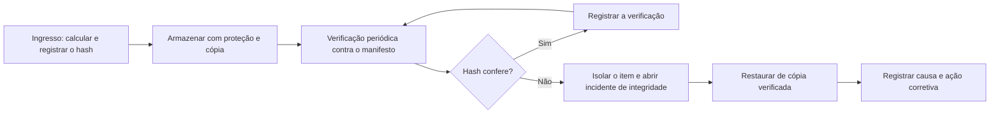

# Integridade em Armazenamento, Transferência e Nuvem

> **Objetivo pedagógico:** manter e comprovar a integridade das evidências ao longo do tempo, em armazenamentos locais, em transferências e em serviços de nuvem, com verificações periódicas (fixity), imutabilidade e tratamento de incidentes de integridade.

## 1. Ameaças à integridade

| Ameaça | Descrição | Exemplo |
|---|---|---|
| Degradação de mídia (bit rot) | Corrupção silenciosa de bits ao longo do tempo | Setores ilegíveis em disco antigo |
| Erros de transferência | Pacotes corrompidos, interrupções e cópias incompletas | Download truncado |
| Falhas de hardware e software | Controladoras, memória, bugs de sistema de arquivos | Escrita parcial após queda de energia |
| Alteração acidental | Edição ou exclusão por usuários | Arquivo aberto e salvo por engano |
| Adulteração deliberada | Interna ou externa | Substituição de arquivo por insider |
| Ransomware e destruição | Criptografia ou apagamento do repositório | Ataque ao servidor de arquivos |
| Perda de chaves | Impossibilidade de acessar dados criptografados | Chave de volume perdida |

## 2. Verificação periódica (fixity)

Em preservação digital, "fixity" é a verificação de que um objeto permanece inalterado. Os níveis de preservação da NDSA (National Digital Stewardship Alliance) tratam a verificação de fixity e a proteção contra alteração como áreas centrais da integridade.



| Item | Orientação |
|---|---|
| Frequência | A cada transferência e, no mínimo, semestral; mais frequente para casos críticos |
| Escopo | Todas as imagens, pacotes e manifestos |
| Registro | Data, responsável, resultado e versão do manifesto |
| Alertas | Notificação ao custodiante e ao líder em qualquer divergência |
| Cópias | Pelo menos duas cópias independentes, em locais e domínios de falha distintos |

Exemplo de rotina agendada no Linux:

```bash
#!/bin/bash
# /usr/local/bin/verificar_evidencias.sh
BASE=/evidencias
LOG=/var/log/verificacao_evidencias_$(date -u +%Y%m%dT%H%MZ).log
for caso in "$BASE"/DFL-*; do
  m="$BASE/manifestos/$(basename "$caso")_manifesto.sha256"
  ( cd "$caso" && sha256sum -c --quiet "$m" ) >> "$LOG" 2>&1 || echo "FALHA: $caso" >> "$LOG"
done
grep -q FALHA "$LOG" && mail -s "Falha de integridade de evidências" custodia@exemplo.com < "$LOG"
```

```cron
# Executa no primeiro dia de cada mês, às 02:00
0 2 1 * * /usr/local/bin/verificar_evidencias.sh
```

## 3. Armazenamento local

| Controle | Descrição |
|---|---|
| Sistemas de arquivos com checksum | ZFS e Btrfs verificam checksums de blocos e detectam corrupção silenciosa; com redundância, podem repará-la |
| RAID e réplicas | Redundância contra falhas de disco; não substituem a verificação de hash nem o backup |
| Memória com ECC | Reduz erros de memória durante o cálculo e a cópia |
| Permissões e imutabilidade | Somente leitura para imagens; atributo imutável quando disponível (`chattr +i` em Linux) |
| Backup | Cópia verificada, com versões e isolamento contra ransomware |
| Monitoramento | Alertas de alteração (por exemplo, auditoria de arquivos) |

```bash
# Tornar uma imagem imutável (Linux, requer privilégio)
sudo chattr +i /evidencias/DFL-2026-001/E001-IMG01.E01
lsattr /evidencias/DFL-2026-001/E001-IMG01.E01
```

## 4. Transferência

| Medida | Descrição |
|---|---|
| Canal seguro | TLS e SFTP protegem contra interceptação e adulteração em trânsito, mas não provam a origem do conteúdo |
| Hash fim a fim | Calcular na origem e conferir no destino, com o valor enviado por canal distinto |
| Assinatura | Assinar o manifesto para provar a origem (ver arquivo de manifestos) |
| Retomada de transferências | Verificar o arquivo inteiro após retomadas e reenvios |
| Mídia física | Hash antes e depois do transporte, com lacre e custódia |

```bash
# rsync com verificação por checksum e reexecução para confirmar que não há diferenças
rsync -av --checksum origem/ usuario@destino:/evidencias/DFL-2026-001/
rsync -avn --checksum origem/ usuario@destino:/evidencias/DFL-2026-001/   # -n: simulação; sem saída de arquivos = sincronizado
```

## 5. Nuvem

| Tema | Orientação |
|---|---|
| Imutabilidade | Usar recursos de retenção imutável (WORM), como S3 Object Lock e armazenamento imutável de blobs do Azure |
| Checksums de objetos | Usar checksums adicionais (por exemplo, SHA-256) no envio e conferir após o envio |
| ETag do S3 | O ETag nem sempre é um MD5 do conteúdo (por exemplo, em envios multipart ou com criptografia no servidor); não o use como prova de integridade |
| Versionamento | Habilitar versionamento para detectar substituições |
| Registros de acesso | Habilitar e proteger logs de acesso e de auditoria (por exemplo, CloudTrail, logs de armazenamento) |
| Criptografia e chaves | Chaves gerenciadas com controle de acesso, rotação e cópia de segurança |
| Segregação | Contas ou assinaturas dedicadas às evidências, com permissões mínimas |
| Exportações | Registrar a requisição, o identificador e o horário da exportação; calcular o hash do arquivo exportado |

```bash
# Exemplo conceitual: envio ao S3 com checksum SHA-256 e conferência de metadados
aws s3api put-object --bucket evidencias-dfl --key DFL-2026-001/E001-IMG01.E01 \
  --body E001-IMG01.E01 --checksum-algorithm SHA256
aws s3api head-object --bucket evidencias-dfl --key DFL-2026-001/E001-IMG01.E01 --checksum-mode ENABLED
```

Confirme a sintaxe e as opções na documentação vigente do provedor.

## 6. Incidente de integridade

| Etapa | Ação |
|---|---|
| 1 | Isolar o item e impedir novos acessos |
| 2 | Registrar a ocorrência (hora, detecção, hash esperado e obtido) |
| 3 | Revisar logs de acesso e de alteração |
| 4 | Restaurar a partir da cópia verificada e conferir o hash |
| 5 | Comunicar o líder e o Jurídico e avaliar o impacto em relatórios e prazos |
| 6 | Corrigir a causa e atualizar controles |
| 7 | Declarar a ocorrência e a resolução no relatório, se afetar o caso |

## 7. Exemplo prático: auditoria semestral

| Verificação | Resultado esperado |
|---|---|
| Amostra de 30 imagens contra o manifesto | 100% com hash igual |
| Amostra de 10 manifestos assinados e carimbados | Assinaturas e carimbos válidos |
| Teste de restauração de backup | Arquivo restaurado com hash igual |
| Revisão de logs de acesso do repositório | Todos os acessos justificados |
| Resultado | Achados registrados com ação e prazo |

## 8. Casos de uso corporativos

- Repositório central de imagens forenses com imutabilidade e verificação mensal.
- Entrega de evidências ao Jurídico por plataforma de compartilhamento com registro de acessos.
- Migração de repositório antigo para nuvem, com verificação de hash em todos os objetos.

## 9. Normas e frameworks relevantes

- NIST IR 8387 (preservação de evidência digital)
- NDSA Levels of Digital Preservation (fixity e integridade)
- ISO/IEC 27002:2022, controles 5.33 (proteção de registros), 8.13 (cópia de segurança) e 8.24 (criptografia)
- CIS Controls v8.1, controles 3 (proteção de dados) e 11 (recuperação de dados)
- ISO/IEC 27037:2012

## 10. Referências

- NIST IR 8387: Digital Evidence Preservation. 2022.
- NDSA. Levels of Digital Preservation (versão 2.0).
- ISO/IEC 27002:2022.
- Center for Internet Security. CIS Controls v8.1. 2024.
- Amazon Web Services. Documentação do Amazon S3: Object Lock e checksums.
- Microsoft. Documentação do Azure Blob Storage: armazenamento imutável.
- OpenZFS e Btrfs. Documentação de checksums e scrub.
