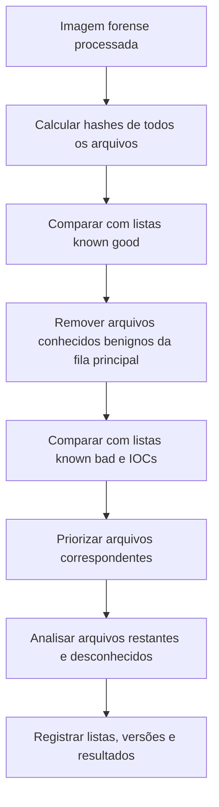

# Listas de Hash, NSRL e Filtragem

> **Objetivo pedagógico:** usar listas de hashes conhecidos para reduzir o volume de análise, identificar arquivos suspeitos e gerenciar IOCs baseados em hash, compreendendo os limites da técnica e os cuidados de privacidade.

## 1. Tipos de listas

| Tipo | Descrição | Uso |
|---|---|---|
| Known good | Hashes de arquivos legítimos (sistema operacional e aplicações) | Excluir da análise arquivos sabidamente benignos |
| Known bad | Hashes de malware, ferramentas de ataque ou conteúdo proibido | Localizar arquivos relevantes |
| Known ignorable | Arquivos comuns sem relevância para o caso | Reduzir ruído |
| Hashes de caso | Hashes de documentos específicos do caso (por exemplo, arquivos confidenciais) | Detectar vazamento e cópias |

## 2. NSRL (National Software Reference Library)

O NSRL, mantido pelo NIST, publica o Reference Data Set (RDS) com hashes de software comercial conhecido. Em forense, é a base mais usada para filtragem de arquivos conhecidos (de-NISTing).

| Aspecto | Orientação |
|---|---|
| Conteúdo | Hashes (incluindo SHA-256 nas versões atuais) de arquivos de software e metadados |
| Formato | As versões recentes usam formato baseado em banco de dados SQLite; verifique a documentação vigente |
| Limitação | Contém arquivos de software conhecido, sem garantir ausência de abuso (ferramentas legítimas podem ser usadas por atacantes) |
| Uso correto | Reduzir volume; não concluir que um arquivo "conhecido" é inofensivo no contexto |
| Atualização | Baixar a versão atual e registrar a versão usada no relatório |

## 3. Fluxo de filtragem



## 4. Ferramentas e exemplos

### 4.1 Autopsy e The Sleuth Kit

No Autopsy, o módulo de **Hash Lookup** permite importar bases de hashes conhecidos e de hashes notáveis. Registre a base e a versão usadas e os arquivos sinalizados.

### 4.2 Linha de comando

```bash
# Hashes de todos os arquivos de uma montagem somente leitura
find /mnt/analise -type f -print0 | xargs -0 sha256sum > /mnt/saida/hashes_arquivos.txt

# Buscar hashes de uma lista de IOCs (um hash por linha em iocs_sha256.txt)
awk '{print $1}' /mnt/saida/hashes_arquivos.txt | sort -u | comm -12 - <(sort -u iocs_sha256.txt)

# Mostrar os caminhos dos arquivos que correspondem aos IOCs
grep -F -f iocs_sha256.txt /mnt/saida/hashes_arquivos.txt
```

```powershell
# Windows: hashes de uma pasta exportada da imagem
Get-ChildItem E:\analise -Recurse -File | Get-FileHash -Algorithm SHA256 |
  Where-Object { $iocs -contains $_.Hash.ToLower() }
```

### 4.3 Consulta a serviços de reputação

| Prática | Orientação |
|---|---|
| Consulta por hash | Consultar o hash em serviços como o VirusTotal revela apenas o hash |
| Envio de arquivo | Não envie arquivos da evidência a serviços públicos: o conteúdo passa a ser acessível a terceiros e viola sigilo e privacidade |
| Registro | Anotar serviço, data e resultado da consulta no relatório |
| Dados internos | Para arquivos internos, use sandbox e inteligência de ameaças privadas |

## 5. IOCs baseados em hash

| Aspecto | Observação |
|---|---|
| Vantagem | Identificação exata de um arquivo conhecido, com baixo índice de falsos positivos |
| Limitação | Qualquer alteração de um byte muda o hash; atacantes recompilam, reempacotam e alteram binários com facilidade |
| Pirâmide da Dor (D. Bianco) | Valores de hash estão na base: úteis, mas de pouca durabilidade e de baixo custo para o adversário contornar |
| Complemento | Combinar com IOCs mais duráveis: hash difuso, imphash, nomes de mutex, domínios, padrões de comportamento e técnicas do MITRE ATT&CK |

Manutenção de IOCs:

| Campo | Descrição |
|---|---|
| Hash e algoritmo | SHA-256 preferencialmente |
| Origem | Caso, relatório ou fonte de inteligência |
| Data de observação | Primeira e última |
| Confiança e contexto | Família, campanha e técnica relacionada |
| Validade | Revisão periódica e retirada de IOCs obsoletos |

Para compartilhamento estruturado, utilize padrões como STIX e plataformas como o MISP, observando as regras de classificação e de privacidade.

## 6. Cuidados

- Registre a versão de cada lista utilizada, pois o resultado depende dela.
- Não trate "conhecido" como "benigno" sem considerar o contexto (por exemplo, ferramentas de administração usadas indevidamente).
- Verifique falsos positivos antes de relatar.
- Proteja listas de hashes de casos sensíveis, pois podem revelar a existência de documentos.
- Tratamento de conteúdo ilícito: bases de hashes de conteúdo proibido são restritas a órgãos e processos autorizados e exigem protocolos legais específicos.

## 7. Exemplo prático: filtragem em estação com 600 mil arquivos

| Etapa | Resultado |
|---|---|
| Hashes calculados | 600.000 arquivos |
| Removidos pelo NSRL (known good) | 410.000 arquivos |
| Correspondência com IOCs da campanha | 2 arquivos em pastas temporárias |
| Arquivos restantes para análise | 190.000, priorizados por local e data |
| Registro | Versão do NSRL, versão da lista de IOCs e comandos utilizados |

Os números são ilustrativos.

## 8. Casos de uso corporativos

- Busca de um documento confidencial vazado em estações e servidores, por meio de hash do arquivo original.
- Varredura de parque de endpoints com lista de hashes de malware de um alerta de inteligência.
- Redução de volume de análise em auditoria de grande repositório de arquivos.

## 9. Normas e frameworks relevantes

- NIST NSRL (Reference Data Set)
- NIST SP 800-86 (exame e filtragem de dados)
- MITRE ATT&CK (Indicator of Compromise e técnicas associadas)
- STIX e TAXII (OASIS) para compartilhamento de inteligência
- ISO/IEC 27002:2022, controle 5.7 (inteligência de ameaças)

## 10. Referências

- NIST. National Software Reference Library (NSRL) Reference Data Set.
- Bianco, D. The Pyramid of Pain. 2013.
- OASIS. STIX 2.1 e TAXII 2.1.
- MISP Project. Documentação da plataforma.
- Carrier, B. The Sleuth Kit e Autopsy (documentação de Hash Lookup).
- Kent, K. et al. NIST SP 800-86. 2006.
