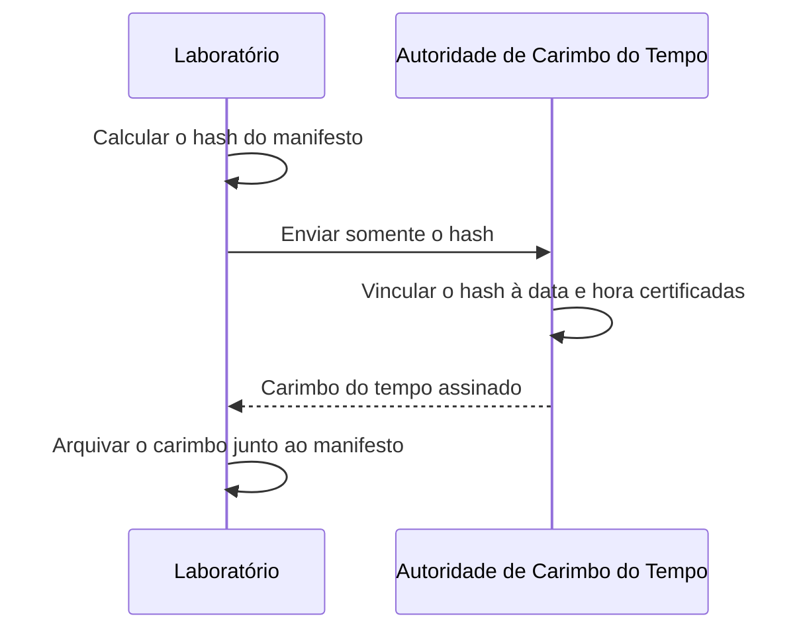
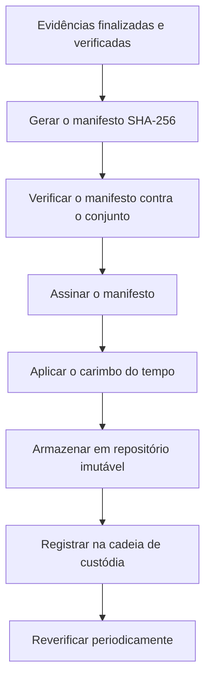

# Manifestos de Hash, Assinatura e Carimbo do Tempo

> **Objetivo pedagógico:** criar manifestos de hash para conjuntos de arquivos, verificá-los em lote e reforçar sua autenticidade com assinatura digital e carimbo do tempo, de modo a sustentar a prova de integridade ao longo do tempo.

## 1. O que é um manifesto

Manifesto é um arquivo que lista os caminhos e os hashes de todos os arquivos de um conjunto (caso, pacote de evidências, exportação de logs). Ele permite verificar a integridade de todo o conjunto de uma vez e detectar arquivos alterados, ausentes ou acrescentados.

| Característica | Orientação |
|---|---|
| Conteúdo | Hash, algoritmo e caminho relativo de cada arquivo |
| Formato | Texto simples (`sha256sum`), CSV ou formato do hashdeep |
| Local | Fora da pasta verificada, ou em pasta protegida e separada |
| Proteção | Assinatura digital, armazenamento imutável e carimbo do tempo |
| Versão | Cada atualização gera nova versão, sem sobrescrever a anterior |

## 2. Criação e verificação (Linux e macOS)

```bash
# Criar o manifesto (ordem determinística, caminhos relativos)
cd /evidencias/DFL-2026-001
find . -type f -print0 | sort -z | xargs -0 sha256sum > ../DFL-2026-001_manifesto_v1.sha256

# Verificar tudo (exibe apenas falhas)
cd /evidencias/DFL-2026-001
sha256sum -c --quiet ../DFL-2026-001_manifesto_v1.sha256

# Detectar arquivos novos que não constam do manifesto
find . -type f | sort > /tmp/atual.txt
awk '{ $1=""; sub(/^ /,""); print }' ../DFL-2026-001_manifesto_v1.sha256 | sort > /tmp/manifesto.txt
comm -13 /tmp/manifesto.txt /tmp/atual.txt
```

No macOS, use `shasum -a 256` no lugar de `sha256sum`.

## 3. Criação e verificação (Windows PowerShell)

```powershell
# Criar o manifesto em CSV
Set-Location E:\DFL-2026-001
Get-ChildItem -Recurse -File |
  Get-FileHash -Algorithm SHA256 |
  Select-Object Hash,Path |
  Export-Csv ..\DFL-2026-001_manifesto_v1.csv -NoTypeInformation

# Verificar
Import-Csv ..\DFL-2026-001_manifesto_v1.csv | ForEach-Object {
  $h = (Get-FileHash $_.Path -Algorithm SHA256).Hash
  if ($h -ne $_.Hash) { "DIVERGENTE: $($_.Path)" }
}
```

## 4. Hashdeep: auditoria de conjunto

O hashdeep calcula hashes recursivamente e possui modo de auditoria, que informa arquivos iguais, movidos, alterados, novos e ausentes.

```bash
# Gerar a lista de referência
hashdeep -c sha256 -r -l DFL-2026-001 > DFL-2026-001_ref.txt

# Auditar contra a lista de referência
hashdeep -c sha256 -r -l -a -vv -k DFL-2026-001_ref.txt DFL-2026-001
```

Confira as opções na versão instalada (`hashdeep -h`).

## 5. Assinatura do manifesto

A assinatura digital prova que o manifesto foi produzido por determinada pessoa ou sistema e não foi alterado depois.

```bash
# Assinatura destacada com GPG (ASCII)
gpg --armor --detach-sign DFL-2026-001_manifesto_v1.sha256

# Verificação
gpg --verify DFL-2026-001_manifesto_v1.sha256.asc DFL-2026-001_manifesto_v1.sha256
```

| Opção | Característica |
|---|---|
| GPG (OpenPGP) | Simples e amplamente suportado; gestão de chaves sob responsabilidade do laboratório |
| Assinatura ICP-Brasil | Presunção legal de autenticidade e integridade de documentos eletrônicos (Medida Provisória nº 2.200-2/2001) |
| HMAC | Integridade e autenticidade entre partes que compartilham uma chave; sem não repúdio |

Proteja as chaves privadas (cofre, token ou HSM), defina responsáveis e registre a emissão e a revogação.

## 6. Carimbo do tempo

O carimbo do tempo (RFC 3161) vincula o hash a uma data e hora certificadas por uma Autoridade de Carimbo do Tempo (ACT), comprovando que o conteúdo existia naquele momento. No Brasil, as ACTs operam no âmbito da ICP-Brasil.



| Aspecto | Observação |
|---|---|
| Privacidade | Somente o hash é enviado; o conteúdo não é exposto |
| Valor | Evidencia que o manifesto existia, no estado verificado, na data do carimbo |
| Uso recomendado | Casos de maior sensibilidade e potencial litígio |

## 7. Fluxo recomendado para o pacote de evidências



## 8. Exemplo prático: pacote de entrega a perito externo

| Etapa | Ação |
|---|---|
| 1 | Reunir imagens, relatórios e formulários em uma pasta de entrega |
| 2 | Gerar o manifesto SHA-256 e o arquivo de assinatura |
| 3 | Enviar o pacote por canal criptografado e o manifesto por canal distinto |
| 4 | O perito verifica o manifesto e a assinatura e devolve o termo de recebimento |
| 5 | Registrar a verificação e o resultado no Formulário B |

## 9. Casos de uso corporativos

- Entrega de pacote probatório ao Jurídico, com manifesto assinado e carimbado.
- Atualização de manifesto após acréscimo de novos relatórios, sem sobrescrever versões anteriores.
- Verificação anual de casos arquivados.

## 10. Normas e frameworks relevantes

- RFC 3161 (Time-Stamp Protocol)
- NIST FIPS 186-5 (assinaturas digitais) e FIPS 180-4
- Medida Provisória nº 2.200-2/2001 (ICP-Brasil)
- ISO/IEC 27037:2012 e NIST IR 8387
- ISO/IEC 27002:2022, controles 5.33 (proteção de registros) e 8.24 (uso de criptografia)

## 11. Referências

- Adams, C. et al. RFC 3161: Internet X.509 PKI Time-Stamp Protocol (TSP). 2001.
- NIST. FIPS 186-5: Digital Signature Standard (DSS). 2023.
- Brasil. Medida Provisória nº 2.200-2/2001.
- NIST IR 8387. 2022.
- Documentação do hashdeep e do GnuPG.
