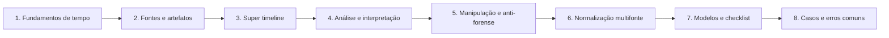

# 05 Análise de Linha do Tempo (Timeline Analysis)

## Objetivo

Reconstruir, com método e rigor, a sequência de eventos de um incidente ou investigação a partir de múltiplas fontes, interpretando corretamente os carimbos de data e hora, normalizando fusos e relógios, detectando manipulações e corroborando as conclusões.

## Trilha de estudo recomendada

## Conteúdo da pasta

| Ordem | Arquivo | Objetivo |
|---|---|---|
| 1 | [fundamentos-de-timeline-e-carimbos-de-tempo.md](fundamentos-de-timeline-e-carimbos-de-tempo.md) | MACB, sistemas de arquivos, épocas, fusos e conversões |
| 2 | [fontes-de-dados-e-artefatos-para-timeline.md](fontes-de-dados-e-artefatos-para-timeline.md) | Fontes de tempo em Windows, Linux, macOS, rede e nuvem |
| 3 | [super-timeline-com-plaso-e-ferramentas.md](super-timeline-com-plaso-e-ferramentas.md) | Plaso, TSK, ferramentas EZ, Hayabusa e Timesketch |
| 4 | [analise-e-interpretacao-da-linha-do-tempo.md](analise-e-interpretacao-da-linha-do-tempo.md) | Método, padrões, ruído, hipóteses e corroboração |
| 5 | [deteccao-de-manipulacao-de-tempo-e-anti-forense.md](deteccao-de-manipulacao-de-tempo-e-anti-forense.md) | Timestomping, alteração de relógio e limpeza de logs |
| 6 | [normalizacao-e-correlacao-multifonte.md](normalizacao-e-correlacao-multifonte.md) | Esquema unificado, desvio de relógio e correlação por entidades |
| 7 | [modelos-e-checklist-operacional-de-timeline.md](modelos-e-checklist-operacional-de-timeline.md) | Modelos de registro, relatório e checklist |
| 8 | [casos-de-uso-e-erros-comuns-em-timeline.md](casos-de-uso-e-erros-comuns-em-timeline.md) | Seis cenários, erros comuns e exercícios |

## Princípios

- Todos os horários normalizados para UTC, com fuso e margem de erro de cada fonte documentados
- Preservar o valor original e registrar as correções em coluna separada
- Compreender o que cada carimbo representa antes de interpretá-lo
- Corroborar conclusões relevantes com ao menos duas fontes independentes
- Considerar hipóteses alternativas e declarar limitações
- Registrar ferramentas, versões, parâmetros e filtros para reprodutibilidade

## Relação com outras pastas

- 01-fundamentos: fases do processo, princípios e abertura de caso
- 02-cadeia-de-custodia e 04-hash-e-integridade: preservação e verificação dos dados de origem
- 03-coleta-de-evidencias: coleta das fontes que alimentam a timeline
- Pastas de Windows, Linux, memória, disco, logs, rede e nuvem: artefatos e fontes detalhados
- Pastas de relatórios, playbooks e lições aprendidas: apresentação e melhoria contínua

## Referências

- Carrier, B. File System Forensic Analysis (2005)
- Casey, E. Digital Evidence and Computer Crime. 3. ed. (2011)
- Carvey, H. Windows Forensic Analysis Toolkit. 4. ed. (2014)
- Gudjonsson, K. Mastering the Super Timeline With log2timeline. SANS (2010)
- Hargreaves, C.; Patterson, J. An automated timeline reconstruction approach for digital forensic investigations. DFRWS (2012)
- Heuer, R. Psychology of Intelligence Analysis (1999)
- NIST SP 800-86 (2006); NIST SP 800-92 (2006)
- ISO/IEC 27042:2015; ISO/IEC 27002:2022 (controles 8.15 e 8.17)
- MITRE ATT&CK (T1070 e subtécnicas)
- RFC 3339; RFC 5905; ISO 8601
