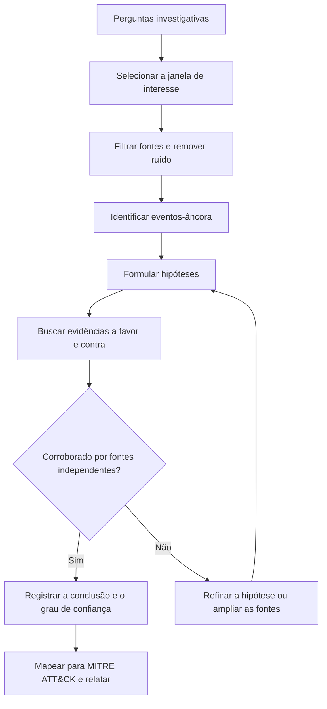

# Análise e Interpretação da Linha do Tempo

> **Objetivo pedagógico:** interpretar uma linha do tempo com método (filtrar, identificar padrões, formular e testar hipóteses, corroborar e documentar), evitando conclusões precipitadas e vieses de confirmação.

## 1. Método geral

## 2. Escolha da janela de interesse

| Estratégia | Descrição |
|---|---|
| A partir do alerta | Centralizar no horário do alerta e expandir (por exemplo, 24 horas antes e depois) |
| A partir do evento conhecido | Ancorar em um fato certo (e-mail enviado, arquivo vazado, conta bloqueada) |
| Retrocesso | Partir do impacto e buscar o acesso inicial |
| Ampliação progressiva | Começar estreito e ampliar conforme surgem indícios |
| Linha de base | Comparar com um período normal do mesmo sistema |

## 3. Eventos-âncora

Eventos-âncora são fatos confiáveis e bem datados, usados para calibrar e orientar a leitura:

| Tipo | Exemplos |
|---|---|
| Logs centralizados | Logon na VPN, evento do proxy, alerta do EDR |
| Eventos de sistema | Instalação de serviço, criação de conta, reinício |
| Eventos externos | E-mail recebido, ticket aberto, ligação do usuário |
| Eventos de nuvem | Consentimento OAuth, mudança de papel, exportação de dados |

## 4. Técnicas de análise

| Técnica | Descrição | Aplicação |
|---|---|---|
| Pivoteamento | Usar um achado (usuário, IP, hash, caminho) para buscar eventos relacionados | Expandir o escopo a partir de um indício |
| Agrupamento por proximidade (clustering) | Eventos próximos no tempo formam um episódio | Identificar rajadas de atividade |
| Análise de rajadas | Muitos arquivos criados ou modificados em segundos | Extração, cópia em lote, criptografia |
| Comparação com a linha de base | Atividade fora do horário, volume ou origem atípicos | Detecção de anomalias |
| Análise de lacunas | Ausência de eventos esperados | Limpeza de logs, desligamento, falha de coleta |
| Sequenciamento | Ordem lógica: acesso, execução, persistência, movimento lateral, exfiltração | Reconstrução da cadeia de ataque |
| Análise de hipóteses concorrentes (ACH) | Comparar hipóteses e priorizar as que resistem às evidências contrárias | Reduzir viés de confirmação |

## 5. Padrões típicos em linhas do tempo

| Padrão | Interpretação provável | Verificação |
|---|---|---|
| Criação de dezenas de arquivos em poucos segundos em pasta temporária | Extração de pacote ou de malware | Prefetch, EDR, origem do download |
| Aparecimento de executável seguido de Prefetch e conexão externa | Execução e comunicação | Proxy, DNS, memória |
| Logon fora do expediente com origem incomum | Uso indevido de credenciais | VPN, Entra ID, dispositivo e geolocalização |
| Muitas leituras de arquivos em sequência e criação de arquivo compactado | Coleta para exfiltração | Volume de saída, uploads |
| Exclusão em massa e criação de notas de resgate | Ransomware | Logs, EDR, `$UsnJrnl` |
| Alteração de hora do sistema | Tentativa de manipular o registro | Eventos de mudança de hora |

## 6. Ruído e falsos positivos

| Fonte de ruído | Efeito na linha do tempo |
|---|---|
| Atualizações do sistema e de aplicativos | Alterações em massa de arquivos e chaves |
| Antivírus e varreduras | Acessos a muitos arquivos |
| Indexação e backup | Atualização de carimbos de acesso e de modificação |
| Sincronização de nuvem | Criação e modificação de arquivos |
| Restauração e reimaginação | Datas de criação uniformes |

Registre os filtros usados para suprimir ruído; qualquer filtro é uma decisão que deve ser justificável.

## 7. Corroboração

Regra: uma conclusão relevante deve se apoiar em pelo menos duas fontes independentes (por exemplo, artefato local e log centralizado).

| Conclusão | Fonte 1 | Fonte 2 |
|---|---|---|
| Programa X foi executado às 13:22:10Z | Prefetch | Evento 4688 ou EDR |
| Usuário acessou o repositório | Log do servidor de arquivos | LNK e Jump List no endpoint |
| Dados saíram para a nuvem | Proxy | Registros do aplicativo e cache |

## 8. Exemplo prático: leitura de uma timeline

| Hora (UTC) | Fonte | Evento |
|---|---|---|
| 13:20:05 | Proxy | Download de `fatura.zip` por usuário U |
| 13:21:48 | $MFT | Criação de `fatura.zip` na pasta Downloads |
| 13:22:10 | Prefetch | Execução de `invoice.exe` (primeira vez) |
| 13:22:12 | Sysmon ou EDR | `invoice.exe` cria tarefa agendada |
| 13:22:42 | Proxy | Conexão de saída ao domínio recém-registrado |
| 13:40:30 | Entra ID | Login do usuário U de IP externo |

**Interpretação:** sequência compatível com download, execução, persistência e comunicação externa, seguida de uso de credenciais. Técnicas ATT&CK candidatas: T1204 (User Execution), T1053.005 (Scheduled Task), T1071 (Application Layer Protocol) e T1078 (Valid Accounts). Para fortalecer a conclusão, buscar o conteúdo do pacote, a persistência no registro e a memória.

## 9. Documentação da análise

| Elemento | Conteúdo |
|---|---|
| Hipótese | Enunciado, evidências a favor, evidências contra, alternativas |
| Eventos-chave | Horário (UTC), fonte, descrição e hash do artefato |
| Confiança | Alta, média ou baixa, com justificativa |
| Limitações | Fontes ausentes, resolução, possíveis manipulações |
| Reprodutibilidade | Consultas, filtros e ferramentas utilizados |

## 10. Casos de uso corporativos

- Reconstrução da cadeia de ataque em incidentes de ransomware.
- Verificação de álibi técnico (por exemplo, acesso do usuário em determinado horário).
- Comprovação do horário de eventos para decisões trabalhistas e jurídicas.

## 11. Normas e frameworks relevantes

- ISO/IEC 27042:2015 (interpretação, hipóteses e incertezas)
- NIST SP 800-86
- MITRE ATT&CK (táticas e técnicas)
- Análise de Hipóteses Concorrentes (Heuer)
- CIS Controls v8.1, controle 17

## 12. Referências

- Heuer, R. Psychology of Intelligence Analysis. Center for the Study of Intelligence, CIA, 1999.
- Hargreaves, C.; Patterson, J. An automated timeline reconstruction approach for digital forensic investigations. DFRWS, 2012.
- Olsson, J.; Boldt, M. Computer forensic timeline visualization tool. Digital Investigation, v. 6, 2009.
- Casey, E. Digital Evidence and Computer Crime. 3. ed. Academic Press, 2011.
- MITRE ATT&CK. https://attack.mitre.org
- SANS Institute. FOR508.
