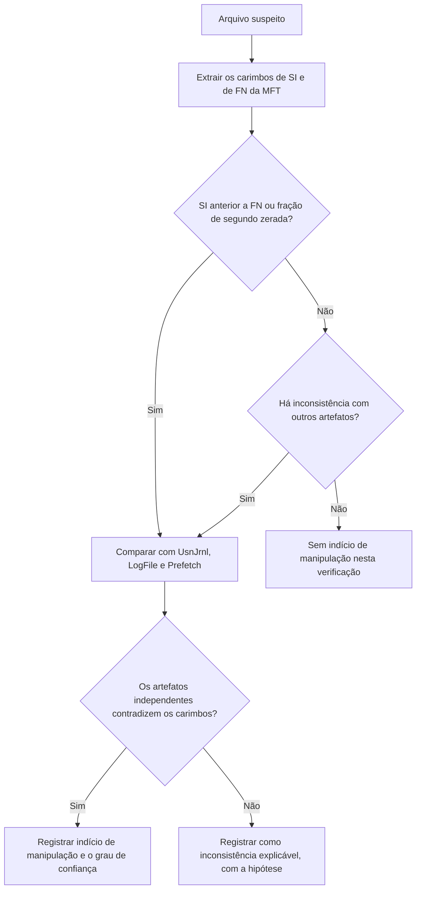

# Detecção de Manipulação de Tempo e Anti-forense

> **Objetivo pedagógico:** reconhecer e documentar indícios de manipulação de carimbos de data e hora, de relógios de sistema e de registros (timestomping, alteração de relógio, limpeza de logs), declarando as limitações da análise.

## 1. Técnicas de manipulação

| Técnica | Descrição | MITRE ATT&CK |
|---|---|---|
| Timestomping | Alterar os carimbos de um arquivo para parecerem antigos ou de outra época | T1070.006 |
| Alteração do relógio do sistema | Mudar a data e a hora para distorcer registros | Relacionada a T1070 |
| Limpeza de logs do Windows | Apagar os registros de eventos | T1070.001 |
| Limpeza de logs do Linux e macOS | Truncar ou remover logs | T1070.002 |
| Apagar histórico de comandos | Remover o histórico do shell | T1070.003 |
| Exclusão de arquivos | Remover ferramentas e artefatos | T1070.004 |
| Reversão de snapshot de VM | Retornar a máquina a um estado anterior | Observação operacional |
| Mudança de fuso horário | Dificultar a correlação | Observação operacional |

## 2. Timestomping em NTFS

O NTFS mantém dois conjuntos de carimbos por arquivo: `$STANDARD_INFORMATION` (que aplicações e ferramentas podem alterar por APIs documentadas) e `$FILE_NAME` (atualizado pelo sistema em certas operações e mais difícil de alterar diretamente). Diferenças entre os dois são um dos principais indícios.

| Indício | O que verificar | Observação |
|---|---|---|
| `$SI` anterior a `$FN` | Criação em `$SI` anterior à de `$FN` | Sinal clássico; ferramentas como o MFTECmd marcam como `SI<FN` |
| Fração de segundo zerada | Carimbos com sub-segundos iguais a zero em `$SI` | Algumas ferramentas gravam apenas segundos; o MFTECmd sinaliza como `uSecZeros` |
| Criação posterior à modificação | Possível cópia legítima; verificar o contexto | Não é suficiente por si só |
| Datas anteriores ao sistema | Arquivo "mais antigo" que a instalação do sistema, sem justificativa | Verificar a origem do arquivo |
| Inconsistência com `$UsnJrnl` | Operações recentes de criação ou alteração sem correspondência com os carimbos | O `$UsnJrnl` registra a atividade real |
| Inconsistência com `$LogFile` | Transações recentes que não batem com os carimbos | Janela curta |
| Ordem de registros MFT | Número de registro MFT incompatível com a data de criação | Use com cautela, pois registros são reutilizados |
| Artefatos de execução | Prefetch ou Amcache com horário posterior à "criação" informada | Corroborar |

Falsos positivos frequentes: cópias, restaurações, extração de arquivos compactados, sincronização de nuvem e atualizações.

## 3. Procedimento de verificação



```powershell
# Extrair a MFT com colunas que sinalizam indícios (SI<FN e uSecZeros)
MFTECmd.exe -f "E:\coleta\$MFT" --csv E:\saida --csvf mft.csv

# Filtrar candidatos no PowerShell
Import-Csv E:\saida\mft.csv | Where-Object { $_.'SI<FN' -eq 'True' } |
  Select-Object EntryNumber,ParentPath,FileName,Created0x10,Created0x30
```

Verifique os nomes das colunas na versão instalada. Os campos `0x10` e `0x30` correspondem a `$STANDARD_INFORMATION` e `$FILE_NAME`, respectivamente.

## 4. Alteração do relógio do sistema

| Fonte | Evento ou sinal |
|---|---|
| Windows: System, Microsoft-Windows-Kernel-General | Evento 1: a hora do sistema foi alterada |
| Windows: Security | Evento 4616 (alteração da hora do sistema), quando a auditoria correspondente estiver habilitada |
| Windows: W32Time | Eventos de sincronização e de ajuste do serviço de hora |
| Linux: journald e systemd | Mensagens de mudança de hora (por exemplo, "Time has been changed") |
| Linux: chrony ou timesyncd | Registros de saltos e de desvio |
| Aplicações e bancos de dados | Sequências de identificadores crescentes com horários que retrocedem |
| Registros centralizados | Comparar com eventos do mesmo período em sistemas independentes |

Indício forte: sequência numérica ou de identificadores (por exemplo, IDs de eventos) contínua, mas com datas fora de ordem.

```bash
# Linux: estado de sincronização e saltos do chrony
timedatectl
chronyc tracking
journalctl --since "2026-10-20" --until "2026-10-31" | grep -i "time has been changed"
```

## 5. Limpeza de logs

| Sistema | Sinal |
|---|---|
| Windows | Security 1102 e System 104; contagem de registros baixa e lacuna de números de registro |
| Linux | Arquivos de log com tamanho zero, `logrotate` fora do padrão, lacunas no journald |
| Aplicações | Falta de registros em período esperado |
| Fonte externa | O SIEM ou o servidor de logs ainda possuem os eventos que sumiram do host |

Mesmo após a limpeza, buscar cópias em SIEM, em encaminhadores de eventos, em Volume Shadow Copies, em arquivos EVTX excluídos e na memória.

## 6. Outras técnicas relacionadas

| Técnica | Indício |
|---|---|
| Apagamento seguro (wiping) | Sobrescrita de áreas, padrões repetitivos, ferramentas de wiping presentes em Prefetch e Amcache |
| Ocultação de dados | Fluxos de dados alternativos (ADS), arquivos com extensões enganosas |
| Criptografia e esteganografia | Contêineres e arquivos de alta entropia |
| Execução sem arquivo (fileless) | Presença apenas em memória e no registro |

## 7. Como relatar

| Elemento | Conteúdo |
|---|---|
| Descrição do indício | Qual carimbo ou registro apresenta inconsistência |
| Evidências | Artefatos comparados, com caminhos e hashes |
| Alternativas | Explicações legítimas consideradas |
| Grau de confiança | Alto, médio ou baixo |
| Limitações | O que não foi possível verificar |
| Impacto na linha do tempo | Quais eventos passam a ter menor confiabilidade |

Evite afirmar "o atacante manipulou" sem corroboração; descreva o indício e a probabilidade.

## 8. Exemplo prático: DLL suspeita com data antiga

| Observação | Resultado |
|---|---|
| Arquivo | `C:\Windows\System32\wbem\x64helper.dll` |
| `$SI` Criação | 2019-03-12 09:00:00 (fração zerada) |
| `$FN` Criação | 2026-10-28 13:21:48 |
| `$UsnJrnl` | Entrada de criação em 2026-10-28 13:21:48 |
| Prefetch | Carregamento posterior a 2026-10-28 13:22 |
| Conclusão | Forte indício de timestomping: carimbos de `$SI` incompatíveis com `$FN`, `$UsnJrnl` e Prefetch; confiança alta, a ser complementada com análise do binário |

## 9. Casos de uso corporativos

- Investigação de comprometimento em que o atacante tentou ocultar a presença de ferramentas.
- Verificação da integridade de logs antes de apresentá-los como prova.
- Auditoria de fornecedores de resposta a incidentes sobre a detecção de anti-forense.

## 10. Normas e frameworks relevantes

- MITRE ATT&CK: T1070 (Indicator Removal) e subtécnicas .001 a .004 e .006
- ISO/IEC 27042:2015 (declaração de incertezas)
- NIST SP 800-86; NIST SP 800-92
- ISO/IEC 27002:2022, controles 8.15 e 8.17

## 11. Referências

- Carrier, B. File System Forensic Analysis. Addison-Wesley, 2005.
- Carvey, H. Windows Forensic Analysis Toolkit. 4. ed. Syngress, 2014.
- Zimmerman, E. Documentação do MFTECmd.
- MITRE ATT&CK. T1070: Indicator Removal. https://attack.mitre.org
- SANS Institute. FOR500 e FOR508.
- Microsoft Learn. Eventos de auditoria 4616, 1102 e 104.
