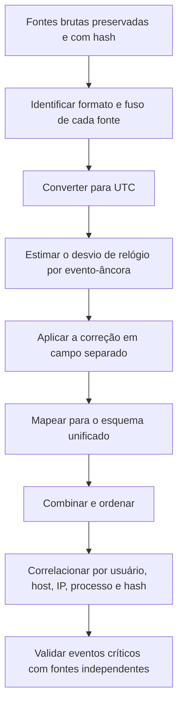

# Normalização e Correlação Multifonte

> **Objetivo pedagógico:** integrar fontes com formatos, fusos horários e relógios diferentes em uma única linha do tempo coerente, estimando e corrigindo o desvio de relógio, preservando o dado original e documentando as premissas.

## 1. Esquema unificado de eventos

Defina um esquema comum para todas as fontes antes de combiná-las.

| Campo | Descrição | Exemplo |
|---|---|---|
| `ts_utc` | Horário normalizado em UTC (ISO 8601) | 2026-10-28T13:22:10Z |
| `ts_original` | Valor e formato originais | 28/10/2026 10:22:10 |
| `fuso_origem` | Fuso e referência da fonte | America/Sao_Paulo |
| `ajuste_desvio_s` | Correção aplicada por desvio de relógio | +2 |
| `fonte` | Origem dos dados | Proxy, Prefetch, EVTX, Entra ID |
| `host` | Sistema que gerou o evento | WKS-0457 |
| `usuario` | Conta associada | usuario.u |
| `tipo_evento` | Categoria | Execução, Autenticação, Rede |
| `descricao` | Descrição objetiva | Execução de invoice.exe |
| `artefato` | Caminho ou identificador do artefato | C:\Windows\Prefetch\INVOICE.EXE-XXXX.pf |
| `hash_fonte` | Hash do arquivo de origem | SHA-256 |
| `confianca` | Alta, média ou baixa | Alta |
| `tecnica_attack` | Técnica MITRE ATT&CK, se aplicável | T1204 |

## 2. Fluxo de normalização e correlação



## 3. Inventário de fontes e fusos

| Fonte | Formato de data | Fuso | Resolução | Observação |
|---|---|---|---|---|
| EVTX do Windows | FILETIME convertido pelas ferramentas | UTC (visualização depende da ferramenta) | 100 ns | Confirmar a exibição na ferramenta |
| Prefetch | FILETIME | UTC | 100 ns | Até 8 execuções recentes |
| Proxy corporativo | Epoch ou texto | Local ou UTC conforme a configuração | 1 s | Verificar a configuração do equipamento |
| Firewall | Texto | Local ou UTC | 1 s | Verificar o relógio do equipamento |
| Entra ID, M365, CloudTrail, Azure e GCP | ISO 8601 | UTC | ms a s | Já normalizado |
| E-mail (cabeçalhos) | RFC 5322 com deslocamento | Informado no cabeçalho | 1 s | Usar o deslocamento declarado |
| Histórico de navegador | WebKit ou PRTime | UTC | μs | Converter |
| Linux (syslog e journald) | Texto ou μs | Local ou UTC | 1 s ou μs | Verificar o fuso do host |
| Mobile (SQLite) | Cocoa, Unix, WebKit | UTC | s a ms | Identificar a época |

## 4. Estimativa e correção de desvio de relógio

Compare o mesmo evento registrado por duas fontes independentes (eventos-âncora), por exemplo, uma conexão de saída vista no proxy e no EDR.

| Evento comum | Horário na fonte A | Horário na fonte B | Diferença |
|---|---|---|---|
| Download de arquivo | 13:20:05 (proxy) | 13:20:07 (EDR) | +2 s |
| Logon do usuário | 13:40:30 (Entra ID) | 13:40:30 (VPN) | 0 s |

| Prática | Orientação |
|---|---|
| Fonte de referência | Escolher a mais confiável (por exemplo, serviço de nuvem com tempo sincronizado) |
| Medição na coleta | Registrar o relógio do dispositivo e a diferença para UTC no momento da coleta |
| Correção | Aplicar em coluna separada (`ajuste_desvio_s`), sem sobrescrever o original |
| Margem de erro | Declarar a incerteza (por exemplo, ±2 s) |
| Eventos curtos e sequenciais | Interpretar a ordem entre fontes com margem de erro conservadora |

## 5. Exemplo de normalização em Python (pandas)

```python
import pandas as pd

# 1) Proxy em horário local de São Paulo (sem horário de verão desde 2019; a base IANA preserva o histórico)
proxy = pd.read_csv("proxy.csv")               # colunas: ts_local, usuario, url
proxy["ts_utc"] = (pd.to_datetime(proxy["ts_local"])
                   .dt.tz_localize("America/Sao_Paulo", ambiguous="NaT", nonexistent="NaT")
                   .dt.tz_convert("UTC"))
proxy["fonte"] = "Proxy"
proxy["descricao"] = proxy["url"]

# 2) EDR já em UTC (ISO 8601)
edr = pd.read_csv("edr.csv")                   # colunas: timestamp, host, processo
edr["ts_utc"] = pd.to_datetime(edr["timestamp"], utc=True)
edr["fonte"] = "EDR"
edr["descricao"] = edr["processo"]

# 3) Correção de desvio de +2 s no proxy (aplicada em coluna separada)
proxy["ajuste_desvio_s"] = 2
proxy["ts_utc_corrigido"] = proxy["ts_utc"] + pd.to_timedelta(proxy["ajuste_desvio_s"], unit="s")
edr["ajuste_desvio_s"] = 0
edr["ts_utc_corrigido"] = edr["ts_utc"]

# 4) Unificar e ordenar
cols = ["ts_utc", "ts_utc_corrigido", "ajuste_desvio_s", "fonte", "descricao"]
timeline = pd.concat([proxy[cols], edr[cols]]).sort_values("ts_utc_corrigido")
timeline.to_csv("timeline_unificada.csv", index=False)
```

Notas: horários ambíguos ou inexistentes (por transição de horário de verão) viram `NaT` e devem ser tratados manualmente. Preserve os arquivos de origem e registre o script e sua versão.

## 6. Correlação por entidades

| Chave de correlação | Fontes típicas | Cuidados |
|---|---|---|
| Usuário | AD, Entra ID, proxy, VPN, EDR | Mapear contas de serviço, alias e e-mail |
| Host | EDR, DNS, DHCP, inventário | Nomes mudam; use identificadores estáveis (por exemplo, MAC e ID do agente) |
| Endereço IP | Proxy, firewall, NetFlow, DHCP | IPs dinâmicos e NAT: correlacionar com a janela de concessão do DHCP |
| Processo e PID | EDR, EVTX, memória | PIDs são reutilizados |
| Hash | EDR, antivírus, sandbox | Hash exato; use similaridade para variantes |
| Sessão ou ID de logon | EVTX (LogonId), VPN | Liga eventos de uma mesma sessão |
| Domínio e URL | DNS, proxy, navegador | Variantes e redirecionamentos |

### 6.1 DHCP e NAT

Para ligar um IP interno a uma máquina em um momento, consulte os logs de DHCP (concessões) e, se houver NAT, os registros do equipamento de tradução. Registre o intervalo de validade da concessão.

## 7. Validação cruzada

| Verificação | Procedimento |
|---|---|
| Duplicidades | Remover eventos repetidos, sem apagar o original |
| Ordem | Eventos de causalidade conhecida (por exemplo, download antes da execução) devem respeitar a ordem após as correções |
| Lacunas | Conferir períodos sem eventos esperados |
| Reprodutibilidade | Registrar scripts, parâmetros, fusos e correções |
| Revisão por pares | Segundo analista revisa as conversões e as premissas |

## 8. Exemplo prático: três fontes, um evento

| Fonte | Horário original | Fuso | UTC | Correção | UTC final |
|---|---|---|---|---|---|
| Proxy | 10:20:05 | America/Sao_Paulo (UTC−3) | 13:20:05 | +2 s | 13:20:07 |
| EDR | 13:20:07 | UTC | 13:20:07 | 0 | 13:20:07 |
| Navegador (WebKit) | 13398000007000000 μs desde 1601 | UTC | Conversão pela fórmula | 0 | 13:20:07 |

Resultado: três fontes independentes concordam em 13:20:07Z (margem de ±1 s), o que permite classificar o evento como âncora de alta confiança.

## 9. Casos de uso corporativos

- Reconstrução de incidente com logs de datacenters em fusos diferentes.
- Investigação de fraude com sistemas legados que registram em hora local.
- Perícia que exige demonstrar as conversões e as margens de erro.

## 10. Normas e frameworks relevantes

- ISO 8601 e RFC 3339 (formatos de data e hora)
- RFC 5424 (Syslog) e RFC 5905 (NTPv4)
- ISO/IEC 27002:2022, controles 8.15 e 8.17
- CIS Controls v8.1, safeguards 8.2 e 8.4
- NIST SP 800-92; ISO/IEC 27042:2015

## 11. Referências

- Klyne, G.; Newman, C. RFC 3339. 2002.
- Gerhards, R. RFC 5424: The Syslog Protocol. 2009.
- Mills, D. et al. RFC 5905. 2010.
- Kent, K.; Souppaya, M. NIST SP 800-92. 2006.
- IANA. Time Zone Database.
- Documentação do pandas (manipulação de datas e fusos).
