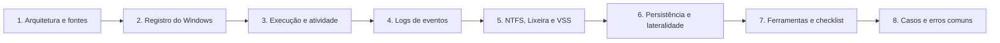

# 07 Forense em Windows

## Objetivo

Investigar sistemas Windows por meio de seus artefatos de registro, execução, atividade do usuário, logs de eventos, sistema de arquivos NTFS e cópias de sombra, reconstruindo acessos, execuções, persistência, movimentação lateral, roubo de credenciais e tentativas de ocultação.

## Trilha de estudo recomendada

## Conteúdo da pasta

| Ordem | Arquivo | Objetivo |
|---|---|---|
| 1 | [arquitetura-e-fontes-de-evidencia-windows.md](arquitetura-e-fontes-de-evidencia-windows.md) | Estrutura do Windows, locais dos artefatos e mapa de perguntas |
| 2 | [registro-do-windows-e-configuracoes.md](registro-do-windows-e-configuracoes.md) | Hives, USB, atividade do usuário, execução e persistência |
| 3 | [artefatos-de-execucao-e-atividade-do-usuario.md](artefatos-de-execucao-e-atividade-do-usuario.md) | Prefetch, Amcache, ShimCache, BAM, SRUM, LNK e navegadores |
| 4 | [logs-de-eventos-e-autenticacao-windows.md](logs-de-eventos-e-autenticacao-windows.md) | Eventos de segurança, tipos de logon, RDP, Sysmon e PowerShell |
| 5 | [ntfs-lixeira-e-volume-shadow-copies.md](ntfs-lixeira-e-volume-shadow-copies.md) | MFT, USN, ADS, Lixeira, VSS e recuperação de exclusões |
| 6 | [persistencia-movimento-lateral-e-credenciais.md](persistencia-movimento-lateral-e-credenciais.md) | Persistência, lateralidade, credenciais e evasão, com ATT&CK |
| 7 | [ferramentas-triagem-modelos-e-checklist-windows.md](ferramentas-triagem-modelos-e-checklist-windows.md) | KAPE, ferramentas EZ, fluxo de triagem, modelos e checklist |
| 8 | [casos-de-uso-e-erros-comuns-em-windows.md](casos-de-uso-e-erros-comuns-em-windows.md) | Seis cenários, erros comuns e exercícios |

## Princípios

- Distinguir presença, execução e acesso, e exigir corroboração por mais de um artefato
- Entender o que cada carimbo e cada evento realmente representam
- Coletar também os logs de transação dos hives e as cópias de sombra
- Verificar a política de auditoria antes de concluir pela ausência de atividade
- Normalizar horários para UTC e declarar o fuso e a margem de erro
- Registrar ferramentas, versões, comandos e hashes para reprodutibilidade
- Mapear os achados para o MITRE ATT&CK e declarar o grau de confiança

## Relação com outras pastas

- 03-coleta-de-evidencias e 04-hash-e-integridade: aquisição e verificação
- 05-timeline-analysis: linha do tempo, normalização e detecção de manipulação
- 06-evidencias-digitais: validade e apresentação das evidências
- Pastas de memória, disco, logs, rede, malware e ransomware: aprofundamentos

## Referências

- Carvey, H. Windows Forensic Analysis Toolkit. 4. ed. (2014)
- Carvey, H. Windows Registry Forensics. 2. ed. (2016)
- Carrier, B. File System Forensic Analysis (2005)
- Russinovich, M.; Solomon, D.; Ionescu, A. Windows Internals. 7. ed. (2017)
- SANS Institute. FOR500: Windows Forensic Analysis; FOR508: Advanced Incident Response, Threat Hunting and Digital Forensics
- MITRE ATT&CK (Enterprise, Windows)
- Microsoft Learn. Eventos de auditoria de segurança do Windows; Sysinternals (Sysmon e Autoruns)
- Documentação do KAPE, das ferramentas de Eric Zimmerman, do RegRipper, do Hayabusa e do Velociraptor
- NIST SP 800-86 (2006); ISO/IEC 27037:2012; ISO/IEC 27042:2015
