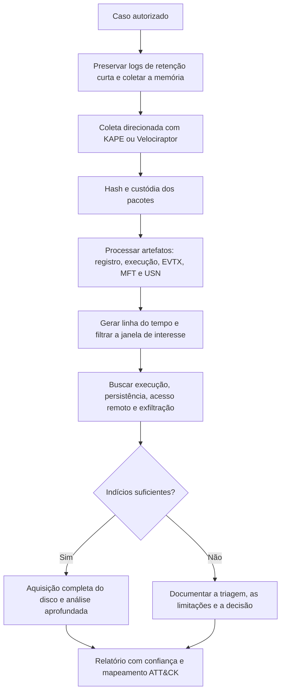

# Ferramentas, Triagem, Modelos e Checklist de Windows

> **Objetivo pedagógico:** executar uma triagem forense de Windows reprodutível com KAPE, ferramentas de Eric Zimmerman, Velociraptor e RegRipper, registrar achados em modelos padronizados e verificar a completude do trabalho com uma lista de verificação.

## 1. Ferramentas por finalidade

| Finalidade | Ferramentas |
|---|---|
| Coleta direcionada | KAPE, Velociraptor, FTK Imager (exportação lógica) |
| Aquisição de disco | FTK Imager, ewfacquire, dc3dd (ver pasta 03) |
| Aquisição de memória | WinPmem, DumpIt, Magnet RAM Capture (ver pasta 03) |
| Registro | Registry Explorer, RECmd, RegRipper, AppCompatCacheParser |
| Sistema de arquivos | MFTECmd, RBCmd, FTK Imager, Autopsy, The Sleuth Kit |
| Execução e atividade | PECmd, AmcacheParser, SrumECmd, LECmd, JLECmd, SBECmd, WxTCmd |
| Logs de eventos | EvtxECmd, Chainsaw, Hayabusa, Get-WinEvent |
| Persistência | Autoruns (autorunsc) |
| Linha do tempo | Plaso, Timesketch, Timeline Explorer |
| Análise de memória | Volatility 3 |
| Validação de resultados | Segunda ferramenta ou verificação manual |

Registre sempre o nome, a versão, a origem do binário e o hash da ferramenta usada. Valide as ferramentas em ambiente de testes (ver NIST CFTT).

## 2. Fluxo de triagem em Windows



## 3. Coleta direcionada

### 3.1 KAPE

```powershell
# Coleta de artefatos de triagem de um volume montado ou do sistema vivo
.\kape.exe --tsource C: --tdest E:\DFL-2026-001\HOST-A\alvos --target !SANS_Triage --vhdx HOST-A

# Processamento com módulos
.\kape.exe --msource E:\DFL-2026-001\HOST-A\alvos --mdest E:\DFL-2026-001\HOST-A\modulos --module !EZParser
```

Verifique a sintaxe, os alvos e os módulos na versão instalada, e os termos de licença do KAPE.

### 3.2 Velociraptor (resumo)

Para coleta em escala, use os artefatos de coleta de arquivos do Windows (alvos equivalentes aos do KAPE) e os artefatos de análise de Prefetch, EVTX, Amcache e persistência. A organização define os artefatos e as permissões, e registra a coleta (ver pasta 03).

## 4. Processamento com as ferramentas de Eric Zimmerman

```powershell
$o = "E:\DFL-2026-001\HOST-A\saida"
PECmd.exe -d "E:\...\Prefetch" --csv $o --csvf prefetch.csv
AmcacheParser.exe -f "E:\...\Amcache.hve" --csv $o
AppCompatCacheParser.exe -f "E:\...\SYSTEM" --csv $o
RECmd.exe -d "E:\...\hives" --bn BatchExamples\Kroll_Batch.reb --csv $o --csvf registro.csv
SBECmd.exe -d "E:\...\UsrClass_dir" --csv $o
LECmd.exe -d "E:\...\Recent" --csv $o --csvf lnk.csv
JLECmd.exe -d "E:\...\AutomaticDestinations" --csv $o
SrumECmd.exe -f "E:\...\SRUDB.dat" -r "E:\...\SOFTWARE" --csv $o
EvtxECmd.exe -d "E:\...\logs" --csv $o --csvf evtx.csv
MFTECmd.exe -f "E:\...\$MFT" --csv $o --csvf mft.csv
MFTECmd.exe -f "E:\...\$J" --csv $o --csvf usn.csv
```

Abra os CSV no Timeline Explorer. Mantenha os arquivos de origem e a saída com hash.

## 5. Dez perguntas e como respondê-las

| Pergunta | Onde responder |
|---|---|
| 1. Qual o sistema, o fuso e a data de instalação? | Registro e informações do sistema |
| 2. Quais contas existem e quais fizeram logon? | SAM, ProfileList e EVTX 4624 |
| 3. O que foi executado no período? | Prefetch, Amcache, BAM, UserAssist, EVTX 4688 |
| 4. Que arquivos foram abertos? | LNK, Jump Lists, ShellBags |
| 5. Houve USB? | USBSTOR, `setupapi.dev.log`, MountPoints2 |
| 6. O que foi baixado e de onde? | Navegadores, Zone.Identifier, proxy |
| 7. Houve acesso remoto? | EVTX 4624 tipos 3 e 10, TerminalServices |
| 8. Como o atacante persistiu? | Autoruns, tarefas, serviços, WMI |
| 9. O que foi apagado ou alterado? | MFT, UsnJrnl, Lixeira, VSS |
| 10. Houve tentativa de ocultar atividade? | 1102, 104, `$SI` versus `$FN`, ADS |

## 6. Modelo A: Inventário do host

| Campo | Preenchimento |
|---|---|
| Caso e host | |
| Nome, domínio e IP | |
| Versão, edição e build | |
| Data de instalação | |
| Fuso horário | |
| Criptografia de disco | |
| Antivírus e EDR | |
| Auditoria habilitada | |
| Contas locais (com RID) | |
| Origem e hash das coletas | |

## 7. Modelo B: Registro de achados por artefato

| ID | Artefato | Caminho e hash | Achado | Horário (UTC) | Usuário | Interpretação | Confiança | Corroboração | Técnica ATT&CK |
|---|---|---|---|---|---|---|---|---|---|
| F-001 | Prefetch | | | | | | | | |
| F-002 | EVTX 4624 | | | | | | | | |

## 8. Modelo C: Mapa de contas e logons

| Conta e SID | Tipo | Último logon | Logons relevantes (horário, tipo, origem) | Observações |
|---|---|---|---|---|
| | | | | |

## 9. Modelo D: Inventário de persistências

| ID | Mecanismo | Local | Entrada | Binário e hash | Assinado? | Criado em (UTC) | Avaliação | Ação |
|---|---|---|---|---|---|---|---|---|
| P-001 | Serviço | | | | | | | |
| P-002 | Tarefa | | | | | | | |

## 10. Checklist operacional de Windows

**Caso:** DFL-AAAA-NNN
**Host:** ____________________
**Analista:** ____________________
**Data e hora (UTC):** ____________________

### 10.1 Preparação e coleta

- [ ] Autorização e escopo registrados
- [ ] Logs de retenção curta preservados
- [ ] Memória capturada (quando aplicável) e hash calculado
- [ ] Hives, logs, Prefetch, Amcache, SRUM, MFT, USN, Lixeira e perfis coletados
- [ ] Arquivos `.LOG1` e `.LOG2` dos hives coletados
- [ ] Cópias de sombra avaliadas
- [ ] Pacotes com hash e custódia registrada

### 10.2 Identificação do sistema

- [ ] Versão, build, data de instalação e fuso
- [ ] Contas, SIDs e perfis
- [ ] Política de auditoria e configuração de logs
- [ ] Antivírus e EDR

### 10.3 Execução e atividade

- [ ] Prefetch, Amcache, BAM, UserAssist, ShimCache e SRUM analisados
- [ ] LNK, Jump Lists, ShellBags e MRUs analisados
- [ ] Navegadores e downloads (Zone.Identifier)
- [ ] USB e mídias removíveis
- [ ] Histórico do PowerShell e sessões RDP

### 10.4 Logs e autenticação

- [ ] EVTX de Security, System, PowerShell, Sysmon, TaskScheduler, RDP e Defender
- [ ] Logons 4624 e 4625 por tipo e origem
- [ ] 4672, 4648, 4688, 4697, 4698, 7045 e criação de contas
- [ ] 1102, 104, 4616 e eventos de desligamento

### 10.5 Persistência, lateralidade e credenciais

- [ ] Autoruns, tarefas, serviços, WMI e registro
- [ ] Indícios de RDP, SMB, WinRM, PsExec e WMI
- [ ] Indícios de dump de LSASS, cópia de SAM e NTDS, Kerberoasting e DCSync

### 10.6 Sistema de arquivos e exclusões

- [ ] MFT e USN analisados
- [ ] Lixeira, ADS e arquivos recuperáveis
- [ ] Comparação com VSS
- [ ] Verificação de timestomping (`$SI` versus `$FN`)

### 10.7 Qualidade e relato

- [ ] Horários normalizados para UTC
- [ ] Conclusões corroboradas por duas fontes independentes
- [ ] Hipóteses alternativas e limitações registradas
- [ ] Ferramentas, versões e comandos documentados
- [ ] Mapeamento para MITRE ATT&CK
- [ ] Revisão por pares realizada

## 11. Resultado da verificação

| Resultado | Condição |
|---|---|
| Conforme | Todos os itens aplicáveis marcados |
| Conforme com ressalvas | Pendências sem impacto nas conclusões, com plano de ação |
| Não conforme | Conclusões sem corroboração, coleta sem hash ou ferramentas sem registro; comunicar o líder |

**Assinatura do analista:** ____________________
**Assinatura do revisor:** ____________________

## 12. Casos de uso corporativos

- Padronização da triagem em todas as estações investigadas pelo SOC.
- Treinamento de novos analistas com checklist e modelos.
- Auditoria da qualidade de investigações por amostragem.

## 13. Normas e frameworks relevantes

- ISO/IEC 27037:2012; ISO/IEC 27041:2015 (validação do método); NIST SP 800-86
- NIST CFTT (validação de ferramentas)
- MITRE ATT&CK
- CIS Controls v8.1, controles 8 e 17

## 14. Referências

- Documentação do KAPE (Kroll) e das ferramentas de Eric Zimmerman.
- Documentação do Velociraptor, do RegRipper, do Hayabusa e do Chainsaw.
- Microsoft Sysinternals. Autoruns.
- Carvey, H. Windows Forensic Analysis Toolkit. 4. ed. 2014.
- SANS Institute. FOR500 e FOR508.
- Kent, K. et al. NIST SP 800-86. 2006.
