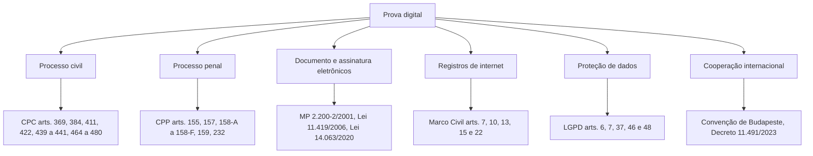

# Fundamentos Jurídicos: Brasil e Direito Comparado

> **Objetivo pedagógico:** conhecer a base normativa brasileira que rege a prova digital (processo civil, penal, documento eletrônico, assinatura, registros de conexão e proteção de dados) e as principais referências do direito comparado e dos tratados.

> **Aviso:** este material é técnico-educacional e não substitui parecer jurídico. Cada caso deve ser validado com o Jurídico e, quando necessário, com advogado especializado.

## 1. Mapa normativo

## 2. Processo civil (Código de Processo Civil, Lei nº 13.105/2015)

| Dispositivo | Conteúdo resumido | Relevância para a evidência digital |
|---|---|---|
| Art. 369 | As partes podem empregar todos os meios legais e moralmente legítimos para provar fatos | Base para a admissão de provas digitais atípicas |
| Art. 384 | Ata notarial: constatação de fato pelo tabelião, inclusive dados em arquivos eletrônicos | Preservação de conteúdo web e de mensagens |
| Art. 411 | Autenticidade do documento (firma reconhecida, certificação eletrônica ou ausência de impugnação) | Autoria por certificação eletrônica |
| Art. 422 | Reproduções mecânicas e digitais fazem prova se não impugnadas; a impugnação exige autenticação ou perícia; aplica-se à forma impressa de mensagem eletrônica | Impressões de e-mails e de mensagens |
| Arts. 439 a 441 | Documento eletrônico: apreciação do valor probante e observância da legislação específica | Valor do documento eletrônico |
| Arts. 464 a 480 | Prova pericial, perito, assistente técnico, quesitos e laudo (art. 473) | Perícia em evidência digital |

## 3. Processo penal (Código de Processo Penal)

| Dispositivo | Conteúdo resumido | Relevância |
|---|---|---|
| Art. 155 | O juiz forma sua convicção pela livre apreciação da prova produzida em contraditório | Valor probatório decidido pela autoridade |
| Art. 157 | Inadmissibilidade das provas ilícitas | Licitude da coleta |
| Arts. 158-A a 158-F | Cadeia de custódia | Preservação e rastreabilidade |
| Art. 159 | Perícia por perito oficial | Quem realiza a perícia penal |
| Art. 232 | Documentos; fotografia de documento autenticada tem o valor do original | Documentos e reproduções |

## 4. Documento eletrônico e assinatura

| Norma | Conteúdo resumido | Relevância |
|---|---|---|
| Medida Provisória nº 2.200-2/2001 | Cria a ICP-Brasil; documentos eletrônicos assinados com certificado ICP-Brasil presumem-se verdadeiros em relação aos signatários; admite outros meios de comprovação de autoria e integridade mediante aceitação das partes | Presunção de autenticidade e integridade |
| Lei nº 11.419/2006 | Informatização do processo judicial; documentos eletrônicos com garantia de origem e signatário são considerados originais | Processo eletrônico |
| Lei nº 14.063/2020 | Define assinaturas eletrônicas simples, avançada e qualificada, e seus usos | Escolha do nível de assinatura |

## 5. Registros de internet e privacidade

| Norma | Conteúdo resumido | Relevância |
|---|---|---|
| Marco Civil da Internet (Lei nº 12.965/2014), art. 7º | Inviolabilidade e sigilo das comunicações | Limites de acesso a conteúdo |
| Arts. 10, 13 e 15 | Guarda e disponibilização de registros de conexão (provedor de conexão, 1 ano) e de acesso a aplicações (provedor de aplicações, 6 meses) | Retenção e prazos para pedir logs |
| Art. 15, §2º | Autoridades podem requerer cautelarmente a guarda de registros por prazo superior | Pedido de preservação |
| Art. 22 | A parte interessada pode requerer ao juiz a ordem de fornecimento de registros | Obtenção de logs de terceiros |
| LGPD (Lei nº 13.709/2018), arts. 6º, 7º, 37, 46 e 48 | Princípios, bases legais, registro das operações, segurança e comunicação de incidentes | Tratamento de dados pessoais em evidências |
| Lei nº 12.737/2012 e Código Penal, art. 154-A | Invasão de dispositivo informático | Necessidade de autorização |
| Lei nº 9.296/1996 | Interceptação de comunicações em investigação criminal depende de ordem judicial | Limite à interceptação |
| Constituição Federal, art. 5º, X e XII | Intimidade e sigilo das comunicações | Fundamento constitucional |

## 6. Cooperação internacional

| Instrumento | Relevância |
|---|---|
| Convenção sobre o Crime Cibernético (Convenção de Budapeste, 2001), promulgada no Brasil pelo Decreto nº 11.491/2023 | Preservação expedita de dados armazenados, busca e apreensão de dados, cooperação entre Estados |
| Acordos de assistência jurídica mútua (MLATs) e cartas rogatórias | Obtenção de dados de provedores sediados no exterior |
| LGPD, arts. 33 a 36 | Transferência internacional de dados pessoais |
| Regulamento (UE) 2016/679 (GDPR) | Dados de pessoas na União Europeia e transferências |

## 7. Direito comparado (referência)

| Referência | Conteúdo | Uso |
|---|---|---|
| Federal Rules of Evidence (EUA), regra 901 | Requisito de autenticação: prova suficiente de que o item é o que se alega | Modelo conceitual de autenticação |
| FRE 902(13) e 902(14) | Autenticação própria de registros eletrônicos e de cópias de dados certificadas por pessoa qualificada, inclusive por processo de identificação digital (hash) | Importância do hash e da certificação técnica |
| Daubert v. Merrell Dow (1993) | Critérios de confiabilidade da prova pericial científica | Qualidade do método pericial |
| ACPO Good Practice Guide for Digital Evidence (Reino Unido) | Quatro princípios de tratamento da evidência | Boas práticas |
| Sedona Conference (EUA) | Princípios de e-discovery e de proporcionalidade | Gestão de grandes volumes |

## 8. Implicações práticas

| Tema | Implicação |
|---|---|
| Valor probatório | Decidido pela autoridade; o laboratório fornece método, integridade e transparência |
| Impugnação | A parte contrária pode impugnar a autenticidade; a defesa técnica depende da qualidade da coleta e da documentação |
| Reprodução impressa | Preserve a fonte eletrônica; a impressão sozinha é frágil |
| Ata notarial | Reforço para conteúdo web, e-mails e mensagens que podem desaparecer |
| Retenção de registros | Provedores guardam registros por períodos limitados; peça a preservação cedo |
| Dados de terceiros | Observe a LGPD e o sigilo das comunicações |
| Cooperação internacional | Planejar prazos e instrumentos jurídicos |

## 9. Exemplo prático: registro de acesso a aplicação de terceiro

| Etapa | Ação |
|---|---|
| 1 | Identificar o provedor de aplicação e o conteúdo (URL, perfil, data e hora) |
| 2 | Preservar o conteúdo com ata notarial e captura técnica |
| 3 | Solicitar cautelarmente a preservação de registros (Marco Civil, art. 15, §2º), pela autoridade legitimada |
| 4 | Requerer ao juiz a ordem de fornecimento dos registros (art. 22) |
| 5 | Receber os registros, calcular o hash, registrar a custódia e correlacionar com outros dados |

## 10. Casos de uso corporativos

- Resposta a ordem judicial de exibição de documentos eletrônicos e de logs.
- Estratégia probatória em disputa contratual com comunicações eletrônicas.
- Estruturação de política de retenção alinhada ao Marco Civil e à LGPD.

## 11. Normas e frameworks relevantes

- ISO/IEC 27037:2012 e ISO/IEC 27050-1:2019 (e-discovery)
- ISO/IEC 27002:2022, controles 5.28, 5.31 (requisitos legais) e 5.34 (privacidade)
- EDRM Reference Model

## 12. Referências

- Brasil. Constituição Federal de 1988.
- Brasil. Lei nº 13.105/2015 (CPC) e Decreto-Lei nº 3.689/1941 (CPP).
- Brasil. Medida Provisória nº 2.200-2/2001; Lei nº 11.419/2006; Lei nº 14.063/2020.
- Brasil. Lei nº 12.965/2014 (Marco Civil da Internet); Lei nº 13.709/2018 (LGPD); Lei nº 12.737/2012; Lei nº 9.296/1996.
- Brasil. Decreto nº 11.491/2023 (Convenção de Budapeste).
- Conselho da Europa. Convention on Cybercrime (ETS nº 185), 2001.
- United States. Federal Rules of Evidence, regras 901 e 902.
- Daubert v. Merrell Dow Pharmaceuticals, 509 U.S. 579 (1993).
- Mason, S.; Seng, D. (eds.). Electronic Evidence. 4. ed. 2017.
