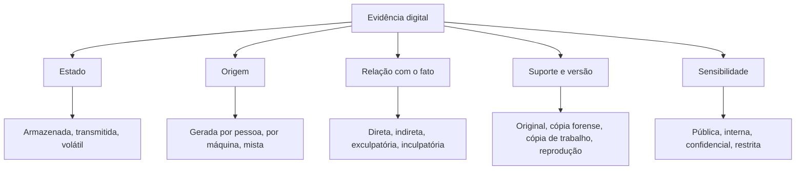

# Natureza e Classificação da Evidência Digital

> **Objetivo pedagógico:** compreender as características que distinguem a evidência digital de outros tipos de prova, saber classificá-la segundo critérios técnicos e jurídicos e usar essa classificação para definir coleta, preservação, análise e apresentação adequadas.

## 1. Definição

A ISO/IEC 27037 define evidência digital como informação ou dado, armazenado ou transmitido em forma binária, que pode ser utilizado como evidência. Em termos jurídicos, a evidência digital é o meio pelo qual fatos relevantes a um procedimento são demonstrados por meio de dados eletrônicos, exigindo a verificação de licitude, autenticidade e integridade para ter valor probatório.

## 2. Características da evidência digital

| Característica | Descrição | Consequência prática |
|---|---|---|
| Imaterialidade | O conteúdo é independente do suporte físico | A prova é o dado, e não apenas o dispositivo |
| Replicabilidade | Cópias bit a bit são idênticas ao original | Trabalhar sempre em cópias verificadas por hash |
| Fragilidade e volatilidade | Podem ser alteradas, apagadas ou perdidas com facilidade | Coleta pela ordem de volatilidade e preservação imediata |
| Grande volume | Dezenas de milhões de arquivos e eventos | Triagem, filtragem e proporcionalidade |
| Dependência de contexto | O significado depende do sistema, do aplicativo e da configuração | Documentar o ambiente e as premissas |
| Metadados | Dados sobre dados (datas, autoria, dispositivo, geolocalização) | Reforçam ou enfraquecem a autenticidade |
| Dispersão e jurisdição | Armazenamento em nuvem e em outros países | Considerar a lei aplicável e os prazos de retenção |
| Interpretação técnica necessária | Exige especialista para extrair e explicar | Linguagem clara e método transparente |
| Facilidade de manipulação e de falsificação | Edição de imagem, áudio e vídeo; falsificação de prints | Verificação de proveniência e de integridade |

## 3. Classificações úteis

### 3.1 Quanto ao estado do dado

| Classe | Descrição | Exemplos |
|---|---|---|
| Armazenada (at rest) | Dado gravado em mídia ou em serviço | Arquivos, bancos de dados, backups |
| Transmitida (in transit) | Dado em tráfego pela rede | Capturas de pacotes, mensagens em trânsito |
| Volátil (in use) | Dado em memória ou em processamento | RAM, sessões ativas, tokens |

### 3.2 Quanto à origem e à geração

| Classe | Descrição | Exemplos | Foco da validação |
|---|---|---|---|
| Gerada por pessoa | Conteúdo criado ou editado por uma pessoa | E-mails, documentos, mensagens | Autoria e integridade do conteúdo |
| Gerada por máquina | Registros automáticos do sistema | Logs, metadados, registros de conexão | Confiabilidade do sistema e do relógio |
| Mista | Conteúdo humano com registros automáticos | Mensagem com carimbo do servidor | Ambas as dimensões |

### 3.3 Quanto à relação com o fato

| Classe | Descrição |
|---|---|
| Direta | Demonstra o fato por si (por exemplo, o arquivo copiado) |
| Indireta ou circunstancial | Permite inferir o fato (por exemplo, o registro de conexão de um dispositivo) |
| Exculpatória | Favorece a pessoa investigada e deve ser relatada |
| Inculpatória | Desfavorece a pessoa investigada |

### 3.4 Quanto ao suporte e à versão

| Classe | Descrição |
|---|---|
| Original | Dado na fonte, no estado em que se encontra |
| Cópia forense | Cópia bit a bit verificada por hash, equivalente ao original |
| Cópia de trabalho | Duplicata usada na análise |
| Reprodução ou impressão | Representação visual do conteúdo (por exemplo, impressão de e-mail) |
| Extração seletiva | Dados coletados de forma direcionada |

### 3.5 Quanto à sensibilidade

| Nível | Exemplos | Tratamento |
|---|---|---|
| Pública | Conteúdo público da web | Registro e hash |
| Interna | Documentos corporativos | Acesso por necessidade |
| Confidencial | Segredos comerciais, dados de clientes | Criptografia, controle de acesso |
| Restrita e sensível | Dados pessoais sensíveis, comunicações privilegiadas | Minimização, DPO e Jurídico envolvidos |

## 4. Mapa de classificação

## 5. Como usar a classificação

| Classificação | Decisão decorrente |
|---|---|
| Volátil | Coletar primeiro; considerar a coleta ao vivo |
| Gerada por máquina | Validar relógios, sincronização e configuração do sistema |
| Gerada por pessoa | Validar autoria (contas, dispositivos, assinaturas) |
| Indireta | Corroborar com outras fontes |
| Reprodução ou impressão | Preservar e obter a fonte original; considerar a ata notarial |
| Confidencial ou restrita | Aplicar minimização, acesso restrito e controle de compartilhamento |
| Exculpatória | Relatar integralmente, sem omissão |

## 6. Exemplos práticos

| Evidência | Classificação | Tratamento recomendado |
|---|---|---|
| Registro de VPN com IP, usuário e horário | Armazenada, gerada por máquina, indireta | Exportar com hash, validar o relógio e correlacionar com outras fontes |
| E-mail com instruções de pagamento | Armazenada, gerada por pessoa, direta | Preservar o original (`.eml` com cabeçalhos), verificar SPF, DKIM e DMARC, coletar do servidor |
| Captura de tela de conversa de mensagens | Reprodução, gerada por pessoa | Obter a extração do dispositivo ou do backup; registrar a origem; considerar ata notarial |
| Memória RAM de servidor comprometido | Volátil, gerada por máquina | Captura imediata com hash e registro do impacto da coleta |
| Imagem de câmera de segurança | Armazenada, gerada por máquina | Exportar no formato nativo com metadados e preservar o equipamento de origem |

## 7. Casos de uso corporativos

- Preparação do dossiê de prova para uma ação trabalhista envolvendo e-mails e mensagens.
- Triagem de evidências em uma investigação de fraude com milhares de documentos.
- Definição de tratamento para evidências de nuvem e SaaS em incidentes de segurança.

## 8. Normas e frameworks relevantes

- ISO/IEC 27037:2012 (identificação, coleta, aquisição e preservação)
- ISO/IEC 27042:2015 (análise e interpretação)
- NIST SP 800-86
- ISO/IEC 27002:2022, controle 5.28 (coleta de evidências)
- LGPD, art. 5º (dado pessoal e dado pessoal sensível) e art. 6º

## 9. Referências

- ABNT NBR ISO/IEC 27037:2013.
- Casey, E. Digital Evidence and Computer Crime. 3. ed. Academic Press, 2011.
- Sammons, J. The Basics of Digital Forensics. 2. ed. Syngress, 2014.
- Kent, K. et al. NIST SP 800-86. 2006.
- Brasil. Lei nº 13.709/2018 (LGPD).
