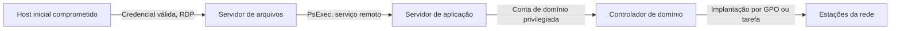

# Persistência, Movimento Lateral e Credenciais

> **Objetivo pedagógico:** localizar mecanismos de persistência, evidências de movimento lateral e sinais de roubo de credenciais em sistemas Windows, ligando os artefatos às técnicas do MITRE ATT&CK e definindo consultas de verificação.

## 1. Persistência

| Mecanismo | ATT&CK | Onde procurar |
|---|---|---|
| Chaves Run e RunOnce; pasta Inicializar | T1547.001 | Registro (HKLM e HKCU); `%AppData%\Microsoft\Windows\Start Menu\Programs\Startup` |
| Winlogon (`Shell`, `Userinit`) | T1547.004 | `HKLM\SOFTWARE\Microsoft\Windows NT\CurrentVersion\Winlogon` |
| Tarefas agendadas | T1053.005 | `C:\Windows\System32\Tasks`, `TaskCache` no registro, EVTX 4698 e 106 |
| Serviços | T1543.003 | `HKLM\SYSTEM\CurrentControlSet\Services`, EVTX 7045 e 4697 |
| Assinatura permanente de WMI | T1546.003 | Repositório WMI (`C:\Windows\System32\wbem\Repository`), WMI-Activity 5861 |
| Image File Execution Options | T1546.012 | `...\Image File Execution Options` (valor `Debugger`) |
| AppInit_DLLs | T1546.010 | `HKLM\SOFTWARE\Microsoft\Windows NT\CurrentVersion\Windows` |
| Recursos de acessibilidade (sethc, utilman) | T1546.008 | Substituição de binários e `Debugger` |
| Sequestro de COM | T1546.015 | `HKCU\Software\Classes\CLSID` |
| Sequestro da ordem de busca de DLL | T1574.001 | DLLs em pastas de aplicativos, assinatura e data de criação |
| Trabalhos BITS | T1197 | Bits-Client/Operational (3 e 59) |
| Suplementos e modelos do Office | T1137 | Pastas de inicialização e de modelos do Office |
| Extensões de navegador | T1176 | Pasta de extensões do perfil do navegador |
| Novas contas e grupos | T1136.001 | EVTX 4720, 4732 |

### 1.1 Consultas e ferramentas

```powershell
# Autoruns de linha de comando (Sysinternals): todas as entradas, CSV, hashes, verificação de assinatura
autorunsc64.exe -accepteula -a * -c -h -s > E:\saida\autoruns.csv

# Tarefas agendadas com detalhes
schtasks /query /fo LIST /v > E:\saida\tarefas.txt
Get-ScheduledTask | Select-Object TaskPath,TaskName,State | Export-Csv E:\saida\tarefas.csv -NoTypeInformation

# Serviços com caminho e conta
Get-CimInstance Win32_Service | Select-Object Name,State,StartMode,PathName,StartName | Export-Csv E:\saida\servicos.csv -NoTypeInformation

# Assinaturas WMI
Get-CimInstance -Namespace root\subscription -ClassName __EventFilter
Get-CimInstance -Namespace root\subscription -ClassName CommandLineEventConsumer
Get-CimInstance -Namespace root\subscription -ClassName __FilterToConsumerBinding
```

### 1.2 Indicadores de persistência suspeita

| Indicador | Interpretação |
|---|---|
| Executável em `%TEMP%`, `%AppData%`, `C:\ProgramData` ou `C:\Users\Public` | Local atípico para serviço ou tarefa |
| Nome parecido com o de um binário legítimo | Masquerading (T1036) |
| Binário sem assinatura ou com assinatura inválida | Revisar o hash e a origem |
| Linha de comando com PowerShell codificado | Execução obfuscada |
| Tarefa criada por conta incomum ou fora do horário | Persistência recente |
| Serviço com `ImagePath` contendo `cmd.exe /c` ou scripts | Execução de comandos arbitrários |

## 2. Movimento lateral

| Técnica | ATT&CK | Evidências |
|---|---|---|
| RDP | T1021.001 | 4624 tipo 10, 1149, 21 e 25; cache de bitmap RDP na origem |
| SMB e compartilhamentos administrativos | T1021.002 | 4624 tipo 3, 5140 e 5145 (`ADMIN$`, `C$`), 7045 no destino |
| Execução remota por serviço (PsExec e similares) | T1569.002 | 7045 com nome do serviço (por exemplo, `PSEXESVC`), Prefetch da ferramenta, arquivos no `ADMIN$` |
| WMI | T1047 | WMI-Activity, processos filhos de `WmiPrvSE.exe` (4688 e Sysmon 1) |
| WinRM e PowerShell Remoting | T1021.006 | 4624 tipo 3, WinRM/Operational, processos `wsmprovhost.exe` |
| DCOM | T1021.003 | Processos filhos de `mmc.exe` ou do Explorer; eventos de DCOM |
| Tarefas agendadas remotas | T1053.005 | 4698 no destino, 4624 tipo 3 |
| Pass-the-Hash e Pass-the-Ticket | T1550.002 e T1550.003 | 4624 tipo 3 com NTLM sem logon interativo prévio; tickets Kerberos incomuns |
| Uso de contas válidas | T1078 | Logons fora do padrão da conta |

Procedimento para reconstruir o movimento lateral:

1. Identifique o logon de rede (4624 tipo 3 ou 10) no destino e a origem pelo IP e pelo nome da estação.
2. Siga o `LogonId` no destino: processos criados, serviços e tarefas.
3. No host de origem, procure 4648, 4624 e as ferramentas executadas (Prefetch e Amcache).
4. Correlacione com logs de VPN, firewall e EDR.
5. Reconstrua o grafo (origem, destino, conta, horário).



## 3. Roubo de credenciais

| Técnica | ATT&CK | Evidências |
|---|---|---|
| Dump da memória do LSASS | T1003.001 | Sysmon 10 (`TargetImage` LSASS com acesso amplo); arquivos `.dmp` criados; `rundll32 comsvcs.dll, MiniDump`; uso de ferramentas de dump; alerta do EDR |
| Cópia de SAM, SYSTEM e SECURITY | T1003.002 | `reg save HKLM\SAM`, cópias de sombra, criação de arquivos de hives |
| NTDS.dit | T1003.003 | `ntdsutil`, cópias de sombra no controlador de domínio, grandes arquivos de saída |
| DCSync | T1003.006 | 4662 com GUIDs de replicação por conta não controladora |
| Kerberoasting | T1558.003 | 4769 com RC4 (`0x17`) para várias contas de serviço |
| Roubo de credenciais de navegadores | T1555.003 | Acesso a `Login Data` e a `Local State` do navegador por processos incomuns |
| DPAPI e cofre de credenciais | T1555 | Acesso a `%AppData%\Microsoft\Protect` e ao Credential Manager |
| Captura de entradas (keylogging) | T1056.001 | Hooks e processos residentes |
| Phishing de credenciais | T1566 e T1556 | E-mails, páginas falsas, mudança de método de MFA |

Boas práticas de resposta: após confirmar o roubo, trate as credenciais como comprometidas, incluindo contas de serviço e a conta `krbtgt` conforme o escopo.

## 4. Evasão de defesas relacionada

| Técnica | ATT&CK | Evidências |
|---|---|---|
| Desabilitar o antivírus ou criar exclusões | T1562.001 | Defender 5001 e 5007, chaves de exclusão no registro, `Set-MpPreference` |
| Limpar logs | T1070.001 | 1102 e 104 |
| Timestomping | T1070.006 | Diferença entre `$SI` e `$FN` (ver pasta 05) |
| Execução codificada e sem arquivo | T1059.001 e T1027 | 4104, 4688, memória |
| Mascaramento de nome | T1036 | Caminho e assinatura incomuns |

## 5. Exemplo prático: persistência por serviço e tarefa

| Evidência | Resultado |
|---|---|
| EVTX 7045 | Serviço `SysHelper` com `ImagePath` `C:\ProgramData\sys\helper.exe`, conta LocalSystem |
| Registro | `HKLM\SYSTEM\CurrentControlSet\Services\SysHelper` criado às 02:17:44Z |
| EVTX 4698 | Tarefa `UpdateCheck` criada por `svc_backup` |
| Autoruns | Mesmo binário referenciado por serviço e por tarefa, sem assinatura |
| Amcache | Entrada de `helper.exe` com SHA-1 para consulta |
| Conclusão | Persistência redundante (serviço e tarefa) com o mesmo binário não assinado; técnicas T1543.003 e T1053.005; confiança alta |

## 6. Casos de uso corporativos

- Caça a persistência em parque de estações após alerta de inteligência de ameaças.
- Reconstrução da cadeia de movimentação lateral em um incidente de ransomware.
- Verificação de comprometimento de contas privilegiadas e definição do escopo de redefinição de credenciais.

## 7. Normas e frameworks relevantes

- MITRE ATT&CK (Persistence, Lateral Movement, Credential Access, Defense Evasion) e MITRE D3FEND
- CIS Controls v8.1, controles 5 (gestão de contas), 6 (controle de acesso) e 8 (logs)
- NIST SP 800-61 Rev. 3 (resposta a incidentes)
- ISO/IEC 27002:2022, controles 5.15 (controle de acesso), 8.2 (acessos privilegiados) e 8.16 (monitoramento)

## 8. Referências

- MITRE ATT&CK. https://attack.mitre.org
- Microsoft Sysinternals. Autoruns e Sysmon. Documentação.
- Carvey, H. Windows Forensic Analysis Toolkit. 4. ed. 2014.
- Metcalf, S. ADSecurity.org: Active Directory Security (referência da comunidade).
- SANS Institute. FOR508: Advanced Incident Response, Threat Hunting and Digital Forensics.
- Microsoft Learn. Eventos de segurança 4624, 4648, 4662, 4697, 4698, 4769 e 7045.
