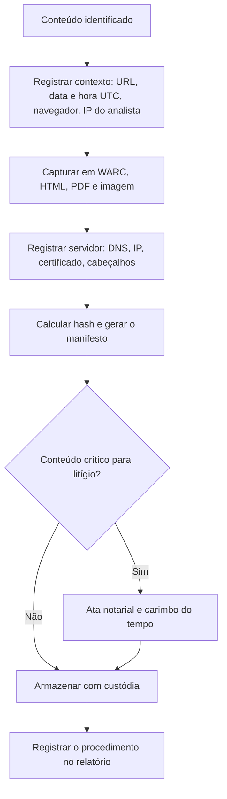

# Preservação de Conteúdo Web, Mensagens e Redes Sociais

> **Objetivo pedagógico:** preservar de forma técnica e juridicamente robusta conteúdo mutável ou efêmero (páginas web, redes sociais, mensagens e e-mails), combinando captura técnica, registro de contexto, hash, carimbo do tempo e ata notarial.

## 1. Princípios

| Princípio | Aplicação |
|---|---|
| Rapidez | Conteúdo online pode ser editado ou removido a qualquer momento |
| Fonte primária | Preferir a captura direta do conteúdo e do servidor a cópias de terceiros |
| Contexto | Registrar URL, data e hora (UTC), identificadores e a navegação até o conteúdo |
| Múltiplas formas | Combinar WARC, HTML, PDF e imagem, e não depender de uma só |
| Integridade | Hash, manifesto e armazenamento imutável |
| Licitude | Capturar apenas conteúdo ao qual se tem acesso legítimo; evitar contornar controles de acesso |
| Reforço | Ata notarial e carimbo do tempo para casos relevantes |

## 2. Fluxo de preservação web



## 3. Captura técnica de página web

```bash
# Registrar o contexto (horário em UTC e ferramentas)
date -u +%Y-%m-%dT%H:%M:%SZ | tee contexto.txt
wget --version | head -n 1 >> contexto.txt

# Captura em formato WARC (inclui requisições, respostas e recursos da página)
wget --page-requisites --warc-file=DFL-2026-001-W001 \
     --warc-header="operator: Analista A" --no-verbose \
     "https://exemplo.com/pagina-de-interesse"

# Informações do servidor e do domínio
dig +noall +answer exemplo.com A
whois exemplo.com > whois_exemplo.txt
openssl s_client -connect exemplo.com:443 -servername exemplo.com </dev/null 2>/dev/null | \
  openssl x509 -noout -subject -issuer -dates > certificado.txt
curl -sI "https://exemplo.com/pagina-de-interesse" > cabecalhos.txt

# Hash de todos os arquivos da captura
sha256sum DFL-2026-001-W001.warc.gz contexto.txt whois_exemplo.txt certificado.txt cabecalhos.txt > manifesto_W001.sha256
```

Complementos:

| Item | Procedimento |
|---|---|
| PDF e imagem da página | Impressão em PDF e captura de tela inteira, com a URL e o relógio visíveis |
| Gravação de tela | Registrar o caminho de navegação até o conteúdo (por exemplo, perfil, publicação e comentários) |
| Ferramentas | Ferramentas de arquivamento (WARC), extensões de captura e serviços de captura certificada, com versão e configuração registradas |
| Páginas dinâmicas | Capturar com navegador real, pois muito conteúdo é gerado por JavaScript |
| Conteúdo atrás de login | Capturar com credenciais legítimas do titular ou autorização expressa; registrar o escopo |

Registre também o que a página mostra para quem acessa de fora, pois alguns conteúdos variam por localização e por conta.

## 4. Redes sociais

| Elemento | O que registrar |
|---|---|
| Perfil | URL, nome de exibição, identificador interno (quando visível), data de criação (se pública), seguidores, biografia |
| Publicação | URL permanente, data e hora exibidas, texto, mídias, reações e comentários |
| Autoria | Conta, imagem do perfil e vínculos públicos; evitar presumir a autoria por nome |
| Mídias | Baixar o arquivo original, e não apenas visualizar |
| Contexto | Conversa, fio de comentários e conteúdo anterior e posterior |

Vias formais para obter dados da plataforma:

| Via | Observação |
|---|---|
| Pedido de preservação por autoridade | Marco Civil, art. 15, §2º |
| Ordem judicial para fornecimento de registros | Marco Civil, art. 22 |
| Canais de requisição legal das plataformas | Seguir as regras e os prazos de cada provedor |
| Cooperação internacional | Quando a plataforma está sediada no exterior |

## 5. Mensagens instantâneas

| Método | Vantagens | Limitações |
|---|---|---|
| Aquisição forense do dispositivo | Máxima riqueza de metadados e mídias | Exige acesso autorizado ao aparelho |
| Backup do aplicativo ou do dispositivo | Pode preservar bancos e mídias | Pode estar criptografado; dependência de chaves |
| Exportação de conversa pelo aplicativo | Simples e legível | Metadados limitados; sem garantia de completude |
| Captura de tela | Rápida, útil para a primeira fixação | Fragilidade alta; usar como apoio |
| Cópia do outro participante | Corroboração independente | Depende de cooperação |

Boas práticas:

- Registre o dispositivo, o número, a conta e a versão do aplicativo.
- Preserve os bancos SQLite e os arquivos de mídia com hash.
- Apresente o recorte completo da conversa no período, indicando os critérios de seleção.
- Para ligação entre mensagens e pessoas, considere dispositivo, número e contexto, e não apenas o nome exibido.
- Quando possível, reforce com ata notarial e com a confirmação de outro participante.

## 6. E-mail

| Etapa | Procedimento |
|---|---|
| 1 | Exportar a mensagem original (`.eml` ou `.msg`) com todos os cabeçalhos, ou exportar a caixa (PST) pelo administrador |
| 2 | Calcular o hash e registrar a conta, o servidor e o horário |
| 3 | Analisar `Received`, `Message-ID`, SPF, DKIM e DMARC |
| 4 | Coletar os registros do gateway e do servidor para corroborar |
| 5 | Preservar os anexos com hash |
| 6 | Se houver risco de perda, reforçar com ata notarial |

## 7. Ata notarial

| Aspecto | Orientação |
|---|---|
| Base | CPC, art. 384 (constatação de fato pelo tabelião; abrange dados em arquivos eletrônicos) |
| Quando usar | Conteúdo mutável, mensagens, e-mails e perfis que serão levados a juízo |
| Preparação | Levar o roteiro: URLs, contas, caminho de navegação, datas e perguntas |
| Complementação | Preservar a captura técnica e o hash; a ata não substitui a custódia técnica |
| Registro | Número, data e cartório da ata no relatório |

## 8. Carimbo do tempo e assinatura

| Mecanismo | Uso |
|---|---|
| Carimbo do tempo (RFC 3161) | Prova de existência do manifesto em uma data certificada |
| Assinatura ICP-Brasil | Autenticidade e integridade do manifesto, com presunção legal (MP 2.200-2/2001) |
| Armazenamento imutável | Proteção contra alteração posterior |

## 9. Registro do procedimento

| Campo | Preenchimento |
|---|---|
| Identificador da captura | DFL-AAAA-NNN-WNNN |
| URL ou identificador do conteúdo | |
| Data e hora (UTC) | |
| Analista e dispositivo | |
| Ferramentas e versões | |
| Navegador e sistema | |
| IP de origem do analista | |
| Itens gerados e hashes | |
| Servidor (IP, certificado) | |
| Ata notarial (número, data, cartório) | |
| Carimbo do tempo | |
| Observações e limitações | |

## 10. Exemplo prático: publicação ofensiva a executivo

| Etapa | Ação |
|---|---|
| 1 | Capturar a publicação, os comentários e o perfil em WARC, PDF e imagem; hash e manifesto |
| 2 | Gravar a navegação até a publicação |
| 3 | Lavrar ata notarial no mesmo dia |
| 4 | Aplicar carimbo do tempo ao manifesto |
| 5 | O Jurídico solicita à plataforma a preservação e a remoção, e requer judicialmente os registros de acesso da conta |
| 6 | Registrar tudo na custódia e manter a evidência imutável |

## 11. Casos de uso corporativos

- Preservação de conteúdo difamatório ou de vazamento em redes sociais.
- Documentação de campanhas de phishing e de sites fraudulentos antes da derrubada.
- Coleta de mensagens de dispositivos corporativos em investigação interna.

## 12. Normas e frameworks relevantes

- ISO/IEC 27037:2012; NIST SP 800-86
- CPC, art. 384 (ata notarial); Marco Civil, arts. 13, 15 e 22
- RFC 3161 (carimbo do tempo); MP 2.200-2/2001 (ICP-Brasil)
- Berkeley Protocol on Digital Open Source Investigations (ONU, 2020)
- LGPD, arts. 6º e 7º

## 13. Referências

- ONU. Berkeley Protocol on Digital Open Source Investigations. 2020.
- International Internet Preservation Consortium. Formato WARC (ISO 28500:2017).
- Brasil. CPC, art. 384; Lei nº 12.965/2014; Lei nº 13.709/2018.
- Documentação do GNU Wget (opções de WARC).
- Adams, C. et al. RFC 3161. 2001.
- Bazzell, M. Open Source Intelligence Techniques (edições atuais).
