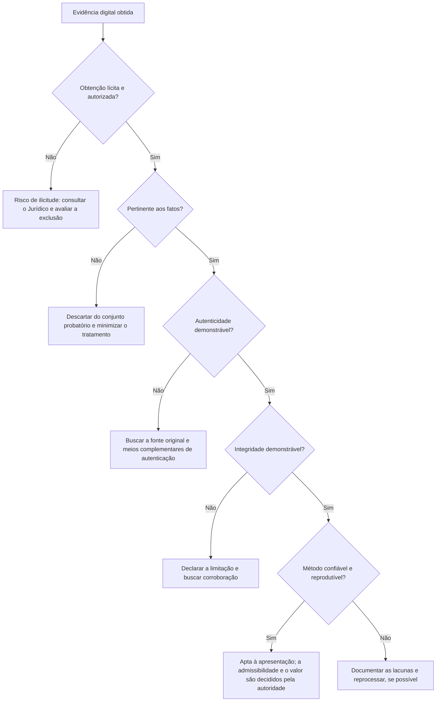

# Requisitos de Validade, Autenticidade e Integridade

> **Objetivo pedagógico:** conhecer os requisitos que sustentam a validade e o valor probatório da evidência digital (licitude, pertinência, autenticidade, integridade, confiabilidade e completude), as técnicas para demonstrá-los e as respostas técnicas às impugnações mais comuns.

## 1. Requisitos

| Requisito | Pergunta | Como demonstrar |
|---|---|---|
| Licitude | A evidência foi obtida de forma legal? | Autorização, base legal, respeito ao sigilo e à privacidade |
| Pertinência (relevância) | Está relacionada aos fatos em discussão? | Perguntas investigativas e matriz de relevância |
| Necessidade e proporcionalidade | Foi coletado apenas o necessário? | Escopo e minimização |
| Autenticidade | É o que se afirma ser, de quem se afirma ser? | Origem, autoria, metadados, assinaturas, logs, testemunhas |
| Integridade | Não foi alterada desde a coleta? | Hash, lacre, cadeia de custódia, armazenamento imutável |
| Confiabilidade | O processo de geração e de extração é confiável? | Ferramentas validadas, método documentado, relógios sincronizados |
| Completude e contexto | O recorte não distorce o significado? | Apresentar o contexto e declarar o que foi omitido |
| Reprodutibilidade | Um terceiro obteria o mesmo resultado? | Registro de comandos, versões e parâmetros |

## 2. Fluxo de avaliação

## 3. Técnicas para demonstrar a autenticidade

| Técnica | O que demonstra | Observação |
|---|---|---|
| Hash criptográfico | Identidade do conteúdo com a versão coletada | Não prova a origem sozinha |
| Metadados | Autor, datas, dispositivo, software | Podem ser editados; corroborar |
| Cadeia de custódia | Continuidade da posse | Base de toda a credibilidade |
| Assinatura digital e certificados | Autoria e integridade | ICP-Brasil confere presunção legal |
| Carimbo do tempo | Existência em determinado momento | Autoridade de Carimbo do Tempo |
| Logs do sistema de origem | Registro independente da criação ou do envio | Verificar relógio e retenção |
| Confirmação do provedor ou do sistema | Atestação pelo operador da plataforma | Requer solicitação formal ou ordem |
| Ata notarial | Constatação por tabelião do conteúdo e da forma de existir | Forte para conteúdo web e mensagens |
| Corroboração por outras fontes | Consistência entre registros independentes | Reduz o risco de falsificação |
| Testemunho | Reconhecimento por quem criou ou recebeu | Complementar, não substitui a técnica |
| Características distintivas | Conteúdo e contexto que só o autor conheceria | Útil em casos de autoria contestada |

## 4. Integridade ao longo do tempo

| Elemento | Prática |
|---|---|
| Registro na coleta | Hash, ferramenta, versão, horário e responsável |
| Armazenamento | Repositório imutável com controle de acesso |
| Verificação periódica | Reverificação do hash e registro |
| Cópias e transferências | Hash na origem e no destino |
| Manifesto | Assinado e carimbado quando de maior risco |

Veja as pastas 02 (cadeia de custódia) e 04 (hash e integridade).

## 5. Impugnações comuns e respostas técnicas

| Impugnação | Resposta técnica |
|---|---|
| "É apenas uma captura de tela, pode ser forjada" | Apresentar a extração da fonte original (dispositivo, backup ou exportação oficial), os metadados e o hash; considerar ata notarial e confirmação do provedor |
| "O arquivo pode ter sido alterado" | Hash da coleta, cadeia de custódia, armazenamento imutável, logs de acesso e comparação com cópias independentes |
| "A data do arquivo foi manipulada" | Corroborar com logs externos, `$UsnJrnl` e artefatos de execução; analisar sinais de manipulação (ver pasta 05) |
| "Não se sabe quem digitou" | Correlacionar contas, dispositivos, sessões, IPs e hábitos; evitar conclusões sobre autoria apenas por conta |
| "O método é desconhecido" | Documentar o método, as ferramentas validadas e os parâmetros; permitir a reprodução |
| "A coleta foi ilícita" | Apresentar a autorização, a base legal e a política de uso aceitável; consultar o Jurídico |
| "O relógio do sistema estava errado" | Demonstrar a sincronização, estimar o desvio e usar fontes independentes |
| "MD5 é quebrado" | Utilizar SHA-256 e demonstrar o conjunto de controles de integridade (ver pasta 04) |
| "Faltou contexto" | Apresentar o recorte completo e a justificativa do critério de seleção |

## 6. Declaração de limitações

Toda apresentação deve explicitar:

- O que foi coletado e o que não foi, com os motivos.
- Premissas técnicas (fusos, relógios, configurações de auditoria).
- Incertezas e explicações alternativas consideradas.
- Intervenções realizadas no sistema ao vivo.

A declaração franca das limitações aumenta, e não diminui, a credibilidade do trabalho.

## 7. Exemplo prático: dossiê de autenticidade de um e-mail

| Elemento | Evidência |
|---|---|
| Original | Arquivo `.eml` exportado do servidor com cabeçalhos completos |
| Integridade | SHA-256 do arquivo e manifesto assinado |
| Origem | Análise de `Received`, SPF, DKIM e DMARC |
| Correlação | Registro do gateway de e-mail com o mesmo identificador de mensagem |
| Contexto | Linha do tempo com a conta e o dispositivo do remetente |
| Reforço | Ata notarial da caixa de entrada do destinatário |
| Limitações | Conteúdo dos anexos não analisado nesta etapa |

## 8. Casos de uso corporativos

- Defesa de provas em ação trabalhista envolvendo mensagens e e-mails.
- Prova de comunicações com fornecedores em disputas contratuais.
- Apresentação de logs de acesso a auditores e reguladores.

## 9. Normas e frameworks relevantes

- ISO/IEC 27037:2012; ISO/IEC 27041:2015 (adequação do método); ISO/IEC 27042:2015
- NIST SP 800-86; NIST IR 8387
- CPP, arts. 157 e 158-A a 158-F; CPC, arts. 369, 384, 411 e 422
- Medida Provisória nº 2.200-2/2001 (ICP-Brasil)
- LGPD, arts. 6º e 7º
- Federal Rules of Evidence (EUA), regras 901 e 902 (como referência comparada)

## 10. Referências

- ABNT NBR ISO/IEC 27037:2013.
- ISO/IEC 27041:2015 e ISO/IEC 27042:2015.
- Brasil. CPC (Lei nº 13.105/2015) e CPP (Decreto-Lei nº 3.689/1941).
- Brasil. Medida Provisória nº 2.200-2/2001.
- Casey, E. Digital Evidence and Computer Crime. 3. ed. Academic Press, 2011.
- Mason, S.; Seng, D. (eds.). Electronic Evidence. 4. ed. University of London Press, 2017.
