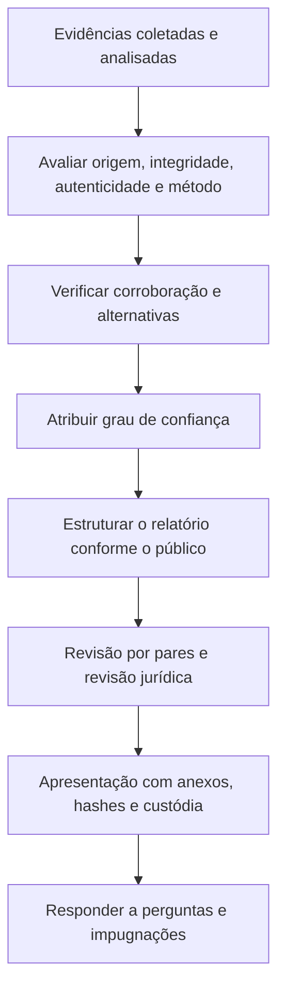

# Valor Probatório e Apresentação da Evidência

> **Objetivo pedagógico:** avaliar o peso de uma evidência digital com critérios explícitos (confiabilidade, corroboração e incerteza) e apresentá-la ao Jurídico, à gestão e à autoridade de forma clara, honesta, objetiva e tecnicamente defensável.

## 1. Papel do técnico e papel da autoridade

| Papel | Responsabilidade |
|---|---|
| Analista ou perito | Obter, preservar, analisar e relatar os fatos técnicos, com método, grau de confiança e limitações |
| Jurídico e advogados | Estratégia probatória, enquadramento legal e apresentação à autoridade |
| Autoridade (juiz, comissão, árbitro) | Decidir sobre a admissibilidade e atribuir o valor probatório |

O analista não decide a culpa, a responsabilidade ou o direito; ele informa o que os dados permitem concluir, e com qual confiança.

## 2. Critérios de avaliação do peso da evidência

| Critério | Pergunta | Aumenta o peso quando |
|---|---|---|
| Origem | Qual a fonte e o seu grau de independência? | Fonte independente e confiável (por exemplo, provedor de nuvem) |
| Integridade | A integridade foi demonstrada? | Hash, custódia e armazenamento imutável |
| Autenticidade | A autoria e a origem foram demonstradas? | Múltiplos meios de autenticação |
| Método | O método é validado e reprodutível? | Ferramentas validadas e registros completos |
| Corroboração | Outras fontes independentes confirmam? | Duas ou mais fontes concordam |
| Completude | O conjunto é suficiente e o contexto está presente? | Contexto integral e explicações de omissões |
| Alternativas | Hipóteses alternativas foram consideradas e testadas? | Alternativas refutadas ou compatíveis e declaradas |
| Manipulação | Há sinais de edição ou de anti-forense? | Sem sinais ou indícios explicados |

## 3. Escala de confiança

| Nível | Critério de referência | Linguagem sugerida |
|---|---|---|
| Alta | Conclusão sustentada por duas ou mais fontes independentes, com integridade e autenticidade demonstradas, sem alternativas plausíveis relevantes | "Os dados demonstram que..." |
| Média | Conclusão consistente com as evidências, mas com limitações relevantes (fonte única, lacunas, hipóteses alternativas plausíveis) | "Os dados indicam que..." |
| Baixa | Indício isolado ou com problemas de integridade ou de contexto | "Os dados são compatíveis com... mas não permitem concluir..." |
| Inconclusiva | Os dados disponíveis não permitem avaliar a hipótese | "Não foi possível determinar..." |

A abordagem de relato avaliativo em ciências forenses (por exemplo, o guia da ENFSI sobre relatórios avaliativos e os padrões para a formulação de opinião pericial avaliativa) recomenda expressar a força da evidência em relação a hipóteses concorrentes, e não a probabilidade de "culpa". Adote a escala acima como convenção interna e documente os critérios.

## 4. Fluxo de avaliação e apresentação

## 5. Estrutura da apresentação por público

| Público | Foco | Formato |
|---|---|---|
| Alta direção | Impacto, conclusões e decisões necessárias | Sumário executivo de uma a duas páginas |
| Jurídico | Fatos técnicos, método, limitações e anexos | Relatório técnico e dossiê |
| RH e Compliance | Fatos relevantes às medidas internas, com minimização de dados | Resumo factual |
| Autoridade ou perito oficial | Método, evidências, hashes e custódia | Laudo ou relatório pericial conforme as normas aplicáveis |
| Equipe técnica | Detalhes técnicos reproduzíveis | Relatório técnico completo |

Elementos do relatório técnico: identificação do caso e das evidências; escopo e perguntas; método e ferramentas (com versões); resultados com referência às evidências; interpretação e grau de confiança; limitações; conclusões; anexos (hashes, custódia, scripts, linha do tempo).

## 6. Boas práticas de redação

| Prática | Exemplo |
|---|---|
| Separar fato, inferência e opinião | "O arquivo foi criado em 2026-10-28T13:21:48Z (fato). Isso é compatível com o download às 13:20:07Z (inferência)." |
| Referenciar cada afirmação à evidência | "Conforme o item DFL-2026-001-E001-IMG01, artefato Prefetch..." |
| Evitar adjetivos e linguagem acusatória | "A conta realizou 120 acessos" em vez de "A conta invadiu o sistema" |
| Declarar incertezas | "A margem de erro dos relógios é de ±2 s." |
| Descrever as alternativas | "Também é compatível com a atividade automática de sincronização." |
| Incluir achados exculpatórios | "Não foram encontradas evidências de cópia para mídia removível." |
| Linguagem acessível | Glossário e explicações para públicos não técnicos |

## 7. Apresentação oral e perguntas

| Cuidado | Orientação |
|---|---|
| Domínio do método | Saber explicar por que a ferramenta e o método são adequados |
| Limites de competência | Reconhecer o que está fora da especialidade |
| Perguntas hostis | Responder com calma, com base nas evidências e nos registros |
| Demonstrações | Preparar demonstrações reprodutíveis (por exemplo, verificação de hash ao vivo) |
| Honestidade | Admitir erros e limitações; corrigir imprecisões imediatamente |

## 8. Exemplo prático: trecho de conclusão

> "Com base nos itens DFL-2026-001-E001-IMG01 (imagem do disco) e DFL-2026-001-L001 (log de proxy), constatou-se o envio de 412 arquivos do diretório de projetos ao serviço de nuvem pessoal X, entre 2026-10-26T17:44Z e 17:51Z, a partir da conta do usuário U e do dispositivo patrimônio 123456. A conclusão tem **confiança alta**, pois é corroborada por três fontes independentes (log de proxy, `$UsnJrnl` e registros do aplicativo de sincronização), com integridade verificada por SHA-256 e margem de erro de relógio de ±2 s. Não foi possível determinar o conteúdo dos arquivos no destino. Não foram encontrados indícios de manipulação dos carimbos de data e hora dos arquivos analisados."

## 9. Casos de uso corporativos

- Relatório ao Comitê de Ética em investigação de conduta.
- Dossiê ao Jurídico para ação trabalhista ou cível.
- Apresentação do incidente à diretoria, ao conselho, a seguradoras e a reguladores.

## 10. Normas e frameworks relevantes

- ISO/IEC 27042:2015 (interpretação, incertezas e relato)
- NIST SP 800-86 (relato)
- CPC, art. 473 (laudo pericial); CPP, arts. 158 e 159
- ENFSI Guideline for Evaluative Reporting in Forensic Science (2015)
- ISO/IEC 17025:2017 (relatórios de resultados de ensaio)

## 11. Referências

- ISO/IEC 27042:2015.
- ENFSI. Guideline for Evaluative Reporting in Forensic Science. 2015.
- Association of Forensic Science Providers. Standards for the formulation of evaluative forensic science expert opinion. Science & Justice, v. 49, 2009.
- Casey, E. Digital Evidence and Computer Crime. 3. ed. Academic Press, 2011.
- Brasil. CPC, art. 473; CPP, arts. 158 e 159.
- Daubert v. Merrell Dow Pharmaceuticals, 509 U.S. 579 (1993).
