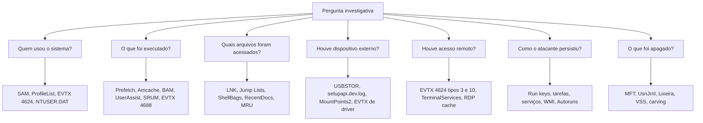

# Arquitetura e Fontes de Evidência do Windows

> **Objetivo pedagógico:** conhecer a organização do Windows relevante à forense, localizar os principais artefatos no sistema de arquivos e saber qual artefato responde a cada pergunta investigativa, incluindo as diferenças entre versões e os cuidados com arquivos bloqueados.

## 1. Estrutura relevante do sistema

| Elemento | Local típico | Conteúdo |
|---|---|---|
| Hives do sistema | `C:\Windows\System32\config\` (SAM, SECURITY, SOFTWARE, SYSTEM, DEFAULT) | Configuração, contas locais, serviços, software |
| Hive do usuário | `C:\Users\<usuário>\NTUSER.DAT` | Atividade e configuração do usuário |
| Hive de classes do usuário | `C:\Users\<usuário>\AppData\Local\Microsoft\Windows\UsrClass.dat` | ShellBags e classes COM do usuário |
| Amcache | `C:\Windows\appcompat\Programs\Amcache.hve` | Inventário de execução e instalação |
| Prefetch | `C:\Windows\Prefetch\` | Execuções de aplicativos |
| Logs de eventos | `C:\Windows\System32\winevt\Logs\` | Arquivos EVTX |
| SRUM | `C:\Windows\System32\sru\SRUDB.dat` | Uso de recursos por aplicativo |
| Tarefas agendadas | `C:\Windows\System32\Tasks\` | Definições em XML |
| Recentes e LNK | `C:\Users\<usuário>\AppData\Roaming\Microsoft\Windows\Recent\` | Atalhos e Jump Lists |
| Lixeira | `C:\$Recycle.Bin\<SID>\` | Arquivos excluídos pelo usuário |
| Volume Shadow Copies | `C:\System Volume Information\` | Estados anteriores do volume |
| Hibernação e paginação | `C:\hiberfil.sys`, `C:\pagefile.sys`, `C:\swapfile.sys` | Fragmentos de memória |
| Perfil de navegadores | `%LocalAppData%` e `%AppData%` | Histórico, cookies, cache |
| Metadados do NTFS | `$MFT`, `$Extend\$UsnJrnl`, `$LogFile` na raiz do volume | Operações e carimbos de arquivos |

## 2. Contas e identificadores

| Elemento | Descrição |
|---|---|
| SID | Identificador de segurança (por exemplo, S-1-5-21-...-RID) |
| RID 500 | Administrador local integrado |
| RID 501 | Convidado (Guest) |
| RID a partir de 1000 | Contas criadas localmente |
| Lista de perfis | `HKLM\SOFTWARE\Microsoft\Windows NT\CurrentVersion\ProfileList` associa SID e pasta do perfil |
| Contas de serviço | `SYSTEM`, `LOCAL SERVICE`, `NETWORK SERVICE` e contas gerenciadas |

Mapeie sempre SID, nome da conta e perfil antes de interpretar artefatos por usuário.

## 3. Diferenças entre versões

| Tema | Observação |
|---|---|
| Windows 7 | Muitos artefatos de execução e de uso mais simples; menos telemetria |
| Windows 8 e posteriores | Prefetch com até oito horários de execução; SRUM; Amcache com formato novo (versões recentes) |
| Windows 10 | BAM e DAM, Windows Timeline (ActivitiesCache.db), compressão do Prefetch |
| Windows 11 | Mantém a maioria dos artefatos; o Windows Timeline foi descontinuado; algumas bases de busca mudam de formato |
| Windows Server | Prefetch frequentemente desabilitado; muitos logs de funções do servidor |

Confirme sempre a versão e a edição (`HKLM\SOFTWARE\Microsoft\Windows NT\CurrentVersion`) e valide o comportamento de cada artefato no seu ambiente de testes.

## 4. Mapa: pergunta investigativa e artefato



## 5. Quadro rápido: pergunta e fonte principal

| Pergunta | Fontes principais | Fontes de corroboração |
|---|---|---|
| Quando o sistema foi instalado e qual o fuso? | `InstallDate`, `TimeZoneInformation` | EVTX, logs de instalação |
| Quem fez logon e quando? | EVTX Security 4624 e 4634 | SAM (último logon), NTUSER.DAT, logs de VPN e AD |
| Um programa foi executado? | Prefetch, Amcache, BAM, UserAssist | EVTX 4688, Sysmon 1, SRUM, EDR |
| Um arquivo foi aberto? | LNK, Jump Lists, ShellBags, RecentDocs | `$UsnJrnl`, logs de aplicativo |
| Um pen drive foi conectado? | USBSTOR, setupapi.dev.log, MountPoints2 | EVTX de DriverFrameworks, LNK em unidades removíveis |
| O arquivo foi baixado da internet? | Zone.Identifier (ADS), histórico do navegador | Logs de proxy, `$UsnJrnl` |
| Houve movimentação lateral? | EVTX 4624 tipo 3 e 10, 4648, 5140 e 5145 | Prefetch e Amcache de ferramentas, logs de rede |
| Há persistência? | Run keys, tarefas, serviços, WMI | Autoruns, EVTX 7045 e 4698 |
| Arquivos foram apagados? | `$MFT`, `$UsnJrnl`, Lixeira | VSS, carving, backups |

## 6. Cuidados com arquivos bloqueados e voláteis

| Situação | Procedimento |
|---|---|
| Hives e logs em uso no sistema ao vivo | Coletar por ferramentas que leem em baixo nível ou por cópia de sombra (por exemplo, KAPE), e não por cópia simples |
| Hives "sujas" com logs de transação | Coletar também os arquivos `.LOG1` e `.LOG2` e reaplicar ao analisar |
| `$MFT` e `$UsnJrnl` | Coletar com ferramentas que acessam o volume bruto |
| Memória | Capturar antes de desligar (ver pasta 03) |
| Chaves criptografadas (BitLocker) | Registrar o estado e obter as chaves conforme a autorização |
| Hive "RegBack" | Desabilitado por padrão a partir do Windows 10 1803; não conte com esse backup |

```powershell
# Exemplo: listar a configuração de sincronização e a versão do sistema
Get-ComputerInfo | Select-Object WindowsProductName,WindowsVersion,OsBuildNumber,OsInstallDate,TimeZone
```

## 7. Exemplo prático: inventário inicial do sistema

| Item | Fonte | Resultado a registrar |
|---|---|---|
| Versão e build | Registro, `Get-ComputerInfo` | Windows 11 22H2 (exemplo) |
| Data de instalação | `InstallDate` | 2025-03-10T14:20Z |
| Fuso horário | `TimeZoneInformation` | E. South America Standard Time |
| Usuários e SIDs | SAM e ProfileList | Lista com RID e perfis |
| Criptografia de disco | `manage-bde -status` | BitLocker ativo, volume C: protegido |
| Antivírus | Defender e EDR | Versão e estado |
| Auditoria habilitada | `auditpol /get /category:*` | Quais eventos de segurança são registrados |

```powershell
auditpol /get /category:*
manage-bde -status
```

## 8. Casos de uso corporativos

- Triagem inicial de uma estação suspeita com mapeamento de perguntas e artefatos.
- Planejamento de coleta para investigações de ameaça interna em Windows.
- Treinamento de analistas de SOC para reconhecer a localização dos artefatos.

## 9. Normas e frameworks relevantes

- ISO/IEC 27037:2012 e NIST SP 800-86 (coleta e exame)
- MITRE ATT&CK (Enterprise, Windows)
- ISO/IEC 27002:2022, controles 8.15 (registro de eventos) e 8.17 (sincronização de relógios)
- CIS Controls v8.1, controle 8 (gestão de logs de auditoria)

## 10. Referências

- Carvey, H. Windows Forensic Analysis Toolkit. 4. ed. Syngress, 2014.
- Carvey, H. Windows Registry Forensics. 2. ed. Syngress, 2016.
- Russinovich, M.; Solomon, D.; Ionescu, A. Windows Internals. 7. ed. Microsoft Press, 2017.
- SANS Institute. FOR500: Windows Forensic Analysis.
- SANS Institute. Pôsteres DFIR: Windows Forensic Analysis.
- Microsoft Learn. Documentação do Windows (auditoria e eventos de segurança).
