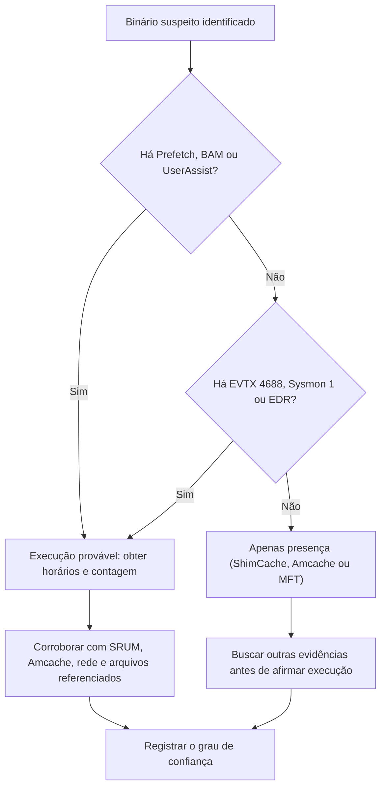

# Artefatos de Execução e Atividade do Usuário

> **Objetivo pedagógico:** distinguir presença, execução e acesso, interpretar corretamente os artefatos de execução (Prefetch, Amcache, ShimCache, BAM, UserAssist, SRUM) e de atividade do usuário (LNK, Jump Lists, navegadores, Lixeira, histórico do PowerShell, RDP) e corroborá-los entre si.

## 1. Presença, execução e acesso

| Conceito | Significado | Exemplo de artefato |
|---|---|---|
| Presença | O arquivo existiu no sistema | ShimCache, `$MFT`, Amcache |
| Execução | O programa foi executado | Prefetch, BAM, UserAssist, EVTX 4688, Sysmon 1 |
| Acesso | O usuário abriu, listou ou navegou | LNK, Jump Lists, ShellBags, RecentDocs |

Nunca trate presença como execução.

## 2. Prefetch

| Item | Descrição |
|---|---|
| Local | `C:\Windows\Prefetch\NOME.EXE-HASH.pf` |
| Conteúdo | Nome do executável, contagem de execuções, horário da última execução e, em versões recentes, até oito últimos horários, volumes e lista de arquivos e diretórios referenciados |
| Formato | Em Windows 10 e posteriores, comprimido (formato MAM); use ferramentas atualizadas |
| Configuração | `HKLM\SYSTEM\CurrentControlSet\Control\Session Manager\Memory Management\PrefetchParameters\EnablePrefetcher` (0 desabilitado, 1 aplicativos, 2 inicialização, 3 ambos) |
| Limitações | Pode estar desabilitado (comum em servidores); há limite de arquivos; arquivos podem ser apagados |
| Uso | Provar a execução, estimar a frequência e identificar os arquivos carregados e as pastas acessadas |

```powershell
PECmd.exe -d E:\coleta\Prefetch --csv E:\saida --csvf prefetch.csv
```

## 3. Amcache

| Item | Descrição |
|---|---|
| Local | `C:\Windows\appcompat\Programs\Amcache.hve` |
| Conteúdo | Inventário de aplicativos e de arquivos executáveis, com caminho, tamanho, versão, editor e hash SHA-1 (calculado sobre a parte inicial do arquivo, conforme a documentação do parser) |
| Limitações | A presença de entrada indica que o arquivo foi catalogado; o horário de gravação não equivale sempre à execução |
| Uso | Identificar binários desconhecidos e obter hashes para consulta de inteligência |

```powershell
AmcacheParser.exe -f E:\coleta\Amcache.hve --csv E:\saida
```

## 4. ShimCache (AppCompatCache)

| Item | Descrição |
|---|---|
| Conteúdo | Caminho e data de modificação do arquivo executável, ordenados por recência |
| Limitações | Em versões modernas, não indica execução; as entradas são gravadas no registro no desligamento ou reinício, portanto o conteúdo em memória pode não estar no hive em um sistema coletado ao vivo |
| Uso | Evidência de presença de executáveis, inclusive os já apagados |

## 5. BAM e DAM

| Item | Descrição |
|---|---|
| Local | `HKLM\SYSTEM\CurrentControlSet\Services\bam\State\UserSettings\<SID>` |
| Conteúdo | Caminho do executável e horário da última execução por usuário (Windows 10 e posteriores) |
| Uso | Associa a execução a um usuário específico |

## 6. UserAssist

Registra programas executados pela interface gráfica (atalhos, Explorer), com contagem de execuções, tempo de foco e último horário. Os nomes são codificados em ROT13. Útil para evidenciar o comportamento do usuário interativo.

## 7. SRUM (System Resource Usage Monitor)

| Item | Descrição |
|---|---|
| Local | `C:\Windows\System32\sru\SRUDB.dat` (ESE), com a hive SOFTWARE para resolução de nomes |
| Tabelas relevantes | Uso de recursos por aplicativo (CPU e bytes), uso de rede por aplicativo e interface, conectividade de rede |
| Retenção | Janela típica de cerca de 30 dias, variável conforme a versão e a configuração |
| Uso | Mostrar quando e quanto um programa usou a rede, útil para estimar volumes de exfiltração e a atividade de ferramentas |

```powershell
SrumECmd.exe -f E:\coleta\SRUDB.dat -r E:\coleta\SOFTWARE --csv E:\saida
```

## 8. Arquivos recentes: LNK e Jump Lists

| Artefato | Local | Conteúdo |
|---|---|---|
| LNK | `%AppData%\Microsoft\Windows\Recent\` | Caminho do alvo, carimbos do alvo, tamanho, número de série do volume, rótulo, tipo de unidade, caminho de rede, identificação da máquina de origem |
| Jump Lists automáticas | `%AppData%\Microsoft\Windows\Recent\AutomaticDestinations\` | Arquivos recentes por aplicativo (AppID), contagem de acessos e horários |
| Jump Lists personalizadas | `...\CustomDestinations\` | Itens fixados e tarefas |
| Office Recent | `%AppData%\Microsoft\Office\Recent\` | Documentos do Office |

Os LNK e as Jump Lists provam o acesso a arquivos, inclusive em unidades removíveis e compartilhamentos de rede, mesmo depois da exclusão do arquivo original.

```powershell
LECmd.exe -d "C:\Users\U\AppData\Roaming\Microsoft\Windows\Recent" --csv E:\saida --csvf lnk.csv
JLECmd.exe -d "C:\Users\U\AppData\Roaming\Microsoft\Windows\Recent\AutomaticDestinations" --csv E:\saida
```

## 9. Navegadores

| Navegador | Local do perfil | Banco principal |
|---|---|---|
| Chrome | `%LocalAppData%\Google\Chrome\User Data\<Perfil>\` | `History` (SQLite) |
| Edge | `%LocalAppData%\Microsoft\Edge\User Data\<Perfil>\` | `History` (SQLite) |
| Firefox | `%AppData%\Mozilla\Firefox\Profiles\<perfil>\` | `places.sqlite` |

Informações úteis: visitas, downloads (origem e destino), pesquisas, cookies, cache, formulários e extensões. Horários em formato WebKit (Chromium) ou PRTime (Firefox); ver pasta 05.

Downloads: o fluxo alternativo `Zone.Identifier` (Mark-of-the-Web) do arquivo baixado registra a zona e, em navegadores recentes, o `ReferrerUrl` e o `HostUrl`.

```powershell
Get-Content .\arquivo.exe -Stream Zone.Identifier
```

## 10. Outros artefatos de atividade

| Artefato | Local | Valor |
|---|---|---|
| Lixeira | `C:\$Recycle.Bin\<SID>\$I` e `$R` | Caminho original, tamanho e horário da exclusão |
| Histórico do PowerShell | `%AppData%\Microsoft\Windows\PowerShell\PSReadLine\ConsoleHost_history.txt` | Comandos digitados no console interativo |
| Windows Timeline | `%LocalAppData%\ConnectedDevicesPlatform\<ID>\ActivitiesCache.db` | Atividades por aplicativo (Windows 10 de 1803 a 22H2; descontinuado no Windows 11) |
| Miniaturas | `%LocalAppData%\Microsoft\Windows\Explorer\thumbcache_*.db` | Miniaturas de imagens que podem existir após a exclusão do original |
| Índice de busca | `C:\ProgramData\Microsoft\Search\Data\Applications\Windows\` | Conteúdo e metadados indexados |
| Cache de bitmap do RDP | `%LocalAppData%\Microsoft\Terminal Server Client\Cache\` | Fragmentos de telas de sessões RDP de saída |
| `Default.rdp` | Pasta Documentos do usuário | Último host RDP utilizado |

## 11. Corroboração entre artefatos



| Afirmação | Mínimo de corroboração |
|---|---|
| "O programa foi executado" | Um artefato de execução e um segundo de contexto (Amcache, SRUM, EDR ou logs) |
| "O usuário abriu o arquivo" | LNK ou Jump List e outro indício (ShellBags, MRU ou logs de aplicação) |
| "O dispositivo foi conectado" | Registro de USB e `setupapi.dev.log`, e corroboração por LNK ou evento de driver |

## 12. Exemplo prático: execução de ferramenta enviada por e-mail

| Hora (UTC) | Artefato | Evidência |
|---|---|---|
| 13:20:07 | Navegador e Zone.Identifier | Download de `fatura.zip` com ReferrerUrl do webmail |
| 13:21:48 | `$MFT` | Criação do arquivo extraído `invoice.exe` |
| 13:22:10 | Prefetch | Primeira execução de `INVOICE.EXE`, contagem 1 |
| 13:22:10 | BAM | Último horário de execução associado ao usuário U |
| 13:22:12 | Sysmon ou EVTX | Criação de tarefa agendada |
| 13:22:42 | SRUM e proxy | Uso de rede pelo aplicativo e conexão externa |
| Conclusão | Execução comprovada por quatro fontes, com persistência e comunicação externa; confiança alta |

## 13. Casos de uso corporativos

- Confirmação de execução de malware ou de ferramentas de acesso remoto.
- Reconstrução de acesso a documentos confidenciais por um usuário.
- Identificação de uso de ferramentas de administração fora do padrão.

## 14. Normas e frameworks relevantes

- MITRE ATT&CK: T1204 (User Execution), T1059.001 (PowerShell), T1053.005 (Scheduled Task), T1021.001 (RDP), T1105 (Ingress Tool Transfer)
- NIST SP 800-86; ISO/IEC 27042:2015
- ISO/IEC 27002:2022, controle 8.15

## 15. Referências

- Carvey, H. Windows Forensic Analysis Toolkit. 4. ed. Syngress, 2014.
- Zimmerman, E. Documentação do PECmd, AmcacheParser, SrumECmd, LECmd e JLECmd.
- Microsoft. Documentação do Prefetch e do Windows Timeline.
- SANS Institute. FOR500: Windows Forensic Analysis.
- Khatri, Y. Pesquisas sobre SRUM (referência da comunidade DFIR).
- MITRE ATT&CK. https://attack.mitre.org
