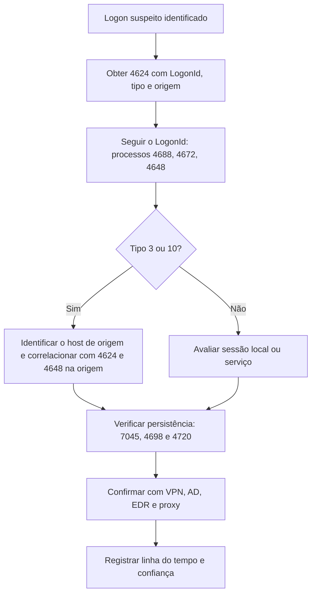

# Logs de Eventos e Autenticação no Windows

> **Objetivo pedagógico:** interpretar os principais canais e eventos do Windows (segurança, sistema, PowerShell, Sysmon, tarefas, RDP, Defender e WMI), compreender os tipos de logon e reconstruir autenticações, acessos remotos e alterações administrativas, reconhecendo as dependências de auditoria.

## 1. Canais e localização

Os logs ficam em `C:\Windows\System32\winevt\Logs\*.evtx`.

| Canal | Uso |
|---|---|
| Security | Autenticação, privilégios, processos, contas, objetos (depende da política de auditoria) |
| System | Serviços, drivers, reinícios, relógio, limpeza de log |
| Application | Eventos de aplicativos |
| Microsoft-Windows-PowerShell/Operational | Registro de módulos e de blocos de script |
| Microsoft-Windows-Sysmon/Operational | Telemetria detalhada (se o Sysmon estiver instalado) |
| Microsoft-Windows-TaskScheduler/Operational | Registro e execução de tarefas |
| Microsoft-Windows-TerminalServices-LocalSessionManager/Operational | Sessões RDP |
| Microsoft-Windows-TerminalServices-RemoteConnectionManager/Operational | Autenticação RDP |
| Microsoft-Windows-RDPClient/Operational | Conexões RDP de saída |
| Microsoft-Windows-Windows Defender/Operational | Detecções e alterações do antivírus |
| Microsoft-Windows-WMI-Activity/Operational | Atividade WMI e assinaturas |
| Microsoft-Windows-Bits-Client/Operational | Transferências BITS |
| Microsoft-Windows-DriverFrameworks-UserMode/Operational | Conexão de dispositivos USB |

## 2. Dependência de auditoria

Muitos eventos só existem se a política de auditoria estiver habilitada. Verifique antes de concluir pela ausência de atividade.

```powershell
auditpol /get /category:*
# Linha de comando em eventos de criação de processo (4688) depende de política específica:
# Configuração do Computador > Modelos Administrativos > Sistema > Auditoria de Criação de Processo >
# "Incluir linha de comando em eventos de criação de processo"
```

Ausência de evento não prova ausência de atividade; ela pode indicar auditoria desabilitada, log rotacionado ou log apagado.

## 3. Eventos de autenticação e sessão (Security)

| Evento | Significado | Pontos de atenção |
|---|---|---|
| 4624 | Logon bem-sucedido | Campos: tipo de logon, conta, IP de origem, processo, ID de logon |
| 4625 | Logon com falha | Códigos `Status` e `SubStatus` indicam a causa |
| 4634 e 4647 | Logoff e logoff iniciado pelo usuário | Fecha a sessão do `LogonId` |
| 4648 | Logon com credenciais explícitas | Usado em `runas`, tarefas e movimentação lateral |
| 4672 | Privilégios especiais atribuídos | Logon com privilégios administrativos |
| 4768, 4769 e 4771 | Kerberos: TGT, ticket de serviço e falha de pré-autenticação | Em controladores de domínio |
| 4776 | Validação de credenciais NTLM | Em controladores de domínio |
| 4740 | Bloqueio de conta | |
| 4720, 4722, 4724 e 4726 | Criação, ativação, redefinição de senha e exclusão de conta | |
| 4728, 4732 e 4756 | Inclusão de membro em grupo (global, local e universal) | Verificar grupos privilegiados |
| 1102 | Log de auditoria apagado | Indício de anti-forense |
| 4616 | Alteração da hora do sistema | Indício de manipulação do relógio |

### 3.1 Tipos de logon (campo `LogonType` do evento 4624)

| Tipo | Nome | Típico |
|---|---|---|
| 2 | Interactive | Console local |
| 3 | Network | SMB, acesso a compartilhamentos, WinRM |
| 4 | Batch | Tarefas agendadas |
| 5 | Service | Serviços |
| 7 | Unlock | Desbloqueio de estação |
| 8 | NetworkCleartext | Credenciais em texto claro na rede |
| 9 | NewCredentials | `runas /netonly` e uso de credenciais alternativas |
| 10 | RemoteInteractive | RDP |
| 11 | CachedInteractive | Logon com credenciais em cache |

### 3.2 Causas de falha comuns (evento 4625)

| Status e SubStatus | Significado |
|---|---|
| `0xC000006D` | Falha de logon |
| `0xC000006A` | Senha incorreta |
| `0xC0000064` | Usuário inexistente |
| `0xC0000234` | Conta bloqueada |
| `0xC0000072` | Conta desabilitada |

## 4. Eventos de execução, serviços e tarefas

| Evento | Canal | Significado |
|---|---|---|
| 4688 e 4689 | Security | Criação e término de processo |
| 4697 | Security | Serviço instalado |
| 7045 | System | Serviço instalado (nome, caminho e conta) |
| 7036 e 7040 | System | Mudança de estado e do tipo de início de serviço |
| 4698, 4699, 4700, 4701 e 4702 | Security | Tarefa criada, excluída, habilitada, desabilitada e atualizada |
| 106, 140, 141, 200 e 201 | TaskScheduler/Operational | Tarefa registrada, atualizada, removida, ação iniciada e concluída |
| 4104 e 4103 | PowerShell/Operational | Bloco de script e registro de módulo (a depender da política) |
| 1116, 1117, 5001 e 5007 | Defender/Operational | Detecção, ação, proteção em tempo real desabilitada, configuração alterada |
| 5857, 5860 e 5861 | WMI-Activity/Operational | Provedor WMI, consumidor temporário e assinatura permanente |
| 3 e 59 | Bits-Client/Operational | Job BITS criado e iniciado |

### 4.1 Sysmon (quando instalado)

| ID | Evento |
|---|---|
| 1 | Criação de processo (com hashes e linha de comando) |
| 3 | Conexão de rede |
| 7 | Imagem carregada (DLL) |
| 8 | CreateRemoteThread |
| 10 | Acesso a processo (por exemplo, a LSASS) |
| 11 | Arquivo criado |
| 12, 13 e 14 | Operações de registro |
| 22 | Consulta DNS |
| 23 | Arquivo excluído |

## 5. RDP (acesso remoto interativo)

| Fonte | Evento | Observação |
|---|---|---|
| Security | 4624 tipo 10 (e 4778 e 4779, quando habilitados) | Logon interativo remoto, com IP de origem |
| TerminalServices-RemoteConnectionManager/Operational | 1149 | Autenticação do usuário aceita (antes da sessão ser criada) |
| TerminalServices-LocalSessionManager/Operational | 21, 22, 23, 24 e 25 | Logon, início do shell, logoff, desconexão e reconexão |
| RDPClient/Operational | 1024 | Tentativa de conexão de saída (no cliente) |
| NTUSER.DAT (Terminal Server Client) | Servers | Hosts acessados pelo usuário |

## 6. Sistema, inicialização e desligamento

| Evento | Significado |
|---|---|
| 6005 e 6006 | Serviço de log iniciado e parado (aproximam inicialização e desligamento) |
| 6008 | Desligamento inesperado |
| 41 (Kernel-Power) | Reinício sem desligamento limpo |
| 1074 | Desligamento ou reinício iniciado por processo ou usuário |
| 104 | Log do sistema apagado |
| 1 (Kernel-General) | Hora do sistema alterada |

## 7. Detecção de técnicas por eventos

| Técnica | Indício em eventos |
|---|---|
| Força bruta e password spraying | Muitos 4625 de uma origem ou contra muitos usuários, seguidos de 4624 |
| Movimentação lateral por SMB | 4624 tipo 3 de origem incomum, seguido de 5140 e 5145 e 7045 (serviço remoto) |
| PsExec | 7045 com `PSEXESVC` e criação de arquivo no ADMIN$ |
| RDP lateral | 4624 tipo 10, 1149 e 21 |
| Kerberoasting | 4769 com tipo de criptografia `0x17` (RC4) para contas de serviço |
| Credenciais explícitas | 4648 seguido de conexões a outros hosts |
| Criação de conta persistente | 4720 e 4732 em grupos privilegiados |
| DCSync | 4662 em controlador de domínio com GUIDs de replicação (por exemplo, `1131f6aa-9c07-11d1-f79f-00c04fc2dcd2`), quando a auditoria do serviço de diretório está habilitada |
| Acesso a LSASS | Sysmon 10 com `TargetImage` LSASS |
| Antivírus desabilitado | Defender 5001 e 5007 |
| Limpeza de logs | 1102 e 104 |

## 8. Consulta e análise

```powershell
# Logons bem-sucedidos nos últimos 7 dias (tipo 10 = RDP)
Get-WinEvent -FilterHashtable @{LogName='Security'; Id=4624; StartTime=(Get-Date).AddDays(-7)} |
  ForEach-Object {
    $x = [xml]$_.ToXml()
    $d = @{}; $x.Event.EventData.Data | ForEach-Object { $d[$_.Name] = $_.'#text' }
    [pscustomobject]@{Hora=$_.TimeCreated.ToUniversalTime(); Tipo=$d.LogonType; Conta=$d.TargetUserName; Origem=$d.IpAddress; LogonId=$d.TargetLogonId}
  } | Where-Object { $_.Tipo -eq '10' }

# Exportar o log para análise offline
wevtutil epl Security E:\saida\Security.evtx

# Serviços instalados
Get-WinEvent -FilterHashtable @{LogName='System'; Id=7045} | Select-Object TimeCreated, Message
```

```powershell
# Análise offline com EvtxECmd e geração de CSV
EvtxECmd.exe -d E:\coleta\logs --csv E:\saida --csvf evtx.csv

# Triagem com regras Sigma (Hayabusa)
hayabusa csv-timeline -d E:\coleta\logs -o E:\saida\hayabusa.csv
```

## 9. Fluxo de investigação de um logon suspeito



## 10. Exemplo prático: RDP seguido de instalação de serviço

| Hora (UTC) | Evento | Interpretação |
|---|---|---|
| 02:11:03 | 4625 (várias) de IP externo | Tentativas de autenticação |
| 02:14:20 | 4624 tipo 10, conta `svc_backup`, IP externo | Logon RDP com credencial válida |
| 02:14:22 | 1149 | Autenticação RDP aceita |
| 02:14:35 | 21 e 22 | Sessão iniciada e shell carregado |
| 02:16:10 | 4688 `powershell.exe -enc ...` | Execução de comando codificado |
| 02:17:44 | 7045 serviço `SysHelper` com `ImagePath` em pasta temporária | Persistência |
| 02:31:05 | 24 | Sessão desconectada |
| Conclusão | Acesso RDP com credencial comprometida e instalação de serviço; confiança alta com corroboração de VPN, firewall e EDR |

## 11. Casos de uso corporativos

- Investigação de acessos indevidos a servidores com RDP exposto.
- Revisão de criação de contas privilegiadas e de alterações em grupos.
- Resposta a incidentes de ransomware com análise de logons e serviços instalados.

## 12. Normas e frameworks relevantes

- MITRE ATT&CK: T1078 (Valid Accounts), T1110 (Brute Force), T1021.001 e .002 (RDP e SMB), T1543.003, T1558.003 (Kerberoasting), T1003.006 (DCSync), T1070.001
- CIS Controls v8.1, controle 8 e safeguards 8.2 e 8.5 (logs detalhados)
- ISO/IEC 27002:2022, controles 8.15 e 8.16
- NIST SP 800-92

## 13. Referências

- Microsoft Learn. Windows security auditing: Eventos de segurança (4624, 4625, 4648, 4672, 4688, 4697, 4698, 4720 e outros).
- Microsoft. Documentação do Sysmon (Sysinternals).
- Kent, K.; Souppaya, M. NIST SP 800-92. 2006.
- Yamato Security. Hayabusa. Documentação.
- Zimmerman, E. EvtxECmd. Documentação.
- Carvey, H. Windows Forensic Analysis Toolkit. 4. ed. 2014.
- SANS Institute. FOR508 e FOR500.
