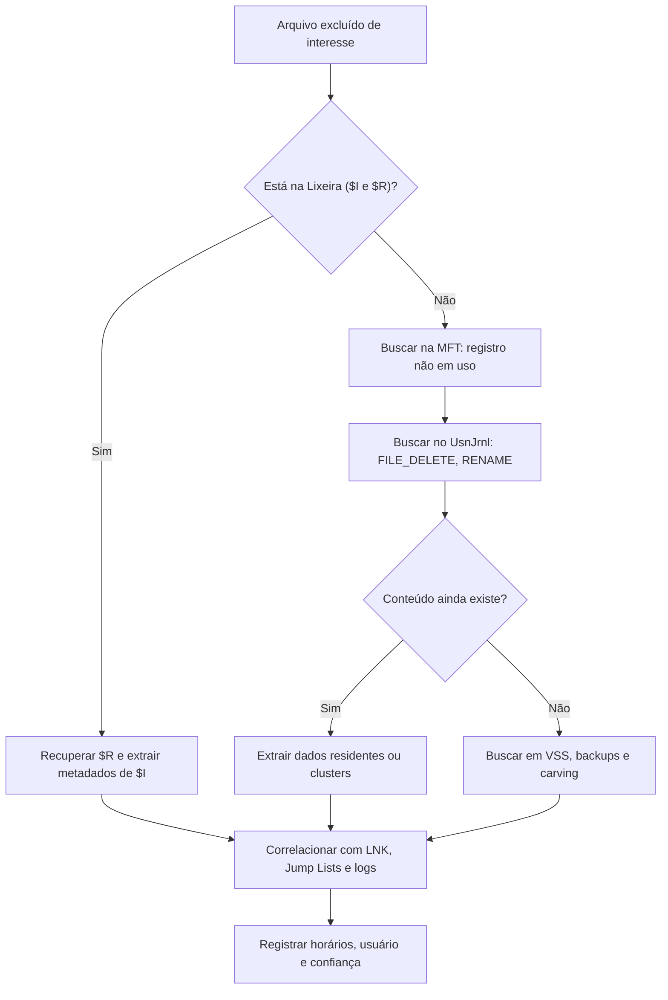

# NTFS, Lixeira e Volume Shadow Copies

> **Objetivo pedagógico:** analisar o sistema de arquivos NTFS (MFT, USN Journal, `$LogFile`, índices e fluxos alternativos), investigar exclusões usando a Lixeira, a MFT e o carving, e aproveitar as Volume Shadow Copies para comparar estados anteriores do sistema.

## 1. Metadados do NTFS

| Estrutura | Local | Conteúdo e uso forense |
|---|---|---|
| `$MFT` | Raiz do volume | Um registro por arquivo e pasta, com atributos, nomes, carimbos e, para arquivos pequenos, o próprio conteúdo (dados residentes) |
| `$UsnJrnl:$J` | `$Extend\$UsnJrnl` | Registro de alterações (criação, exclusão, renomeação, sobrescrita) com horário e motivo |
| `$LogFile` | Raiz do volume | Transações recentes do sistema de arquivos |
| `$I30` | Dentro de cada diretório | Índice de nomes; o espaço remanescente (slack) pode conter nomes de arquivos excluídos |
| `$Bitmap` | Raiz do volume | Mapa de clusters alocados |
| `$Secure` | Raiz do volume | Descritores de segurança (permissões) |

### 1.1 Atributos do registro MFT

| Código | Atributo | Conteúdo |
|---|---|---|
| 0x10 | `$STANDARD_INFORMATION` | Carimbos (Criação, Modificação, Alteração da MFT, Acesso) e flags |
| 0x30 | `$FILE_NAME` | Nome do arquivo, referência ao diretório pai e carimbos |
| 0x80 | `$DATA` | Conteúdo do arquivo (residente ou não residente) e fluxos de dados alternativos |
| 0x90, 0xA0 e 0xB0 | `$INDEX_ROOT`, `$INDEX_ALLOCATION` e `$BITMAP` | Estrutura de índices de diretórios |

### 1.2 Estados de um registro

| Estado | Significado |
|---|---|
| Em uso | Arquivo ou pasta existente |
| Não em uso | Registro livre; pode conter metadados de um arquivo excluído, até ser reutilizado |
| Sequência | O número de sequência é incrementado quando o registro é reutilizado, ajudando a distinguir arquivos diferentes que usaram o mesmo número |

## 2. USN Journal

| Item | Descrição |
|---|---|
| Função | Registra as operações do sistema de arquivos para fins de sincronização e de backup |
| Campos úteis | Nome do arquivo, referência (número e sequência) do arquivo e do pai, horário, razões da alteração |
| Razões comuns | `FILE_CREATE`, `FILE_DELETE`, `RENAME_OLD_NAME`, `RENAME_NEW_NAME`, `DATA_OVERWRITE`, `DATA_EXTEND`, `DATA_TRUNCATION`, `SECURITY_CHANGE`, `CLOSE` |
| Limitação | O journal tem tamanho limitado e rotaciona; atividade intensa reduz a janela temporal |
| Uso | Reconstruir criação, renomeação e exclusão de arquivos, inclusive de ferramentas apagadas |

```powershell
# Sistema ao vivo
fsutil usn queryjournal C:
fsutil usn readjournal C: csv > E:\saida\usn_ao_vivo.csv

# Análise offline
MFTECmd.exe -f "E:\coleta\$J" --csv E:\saida --csvf usn.csv
MFTECmd.exe -f "E:\coleta\$MFT" --csv E:\saida --csvf mft.csv
```

## 3. Dados residentes e arquivos excluídos

Arquivos pequenos (de algumas centenas de bytes) podem ficar dentro do próprio registro MFT, preservando o conteúdo mesmo após a exclusão, enquanto o registro não for reutilizado. Em arquivos maiores, o conteúdo está em clusters que podem ser sobrescritos.

| Situação | Possibilidade de recuperação |
|---|---|
| Arquivo recém-excluído, registro MFT íntegro | Alta: metadados e, possivelmente, o conteúdo |
| Registro reutilizado | Metadados perdidos, mas o conteúdo pode existir em clusters não alocados |
| Clusters sobrescritos | Conteúdo perdido; metadados podem restar em `$UsnJrnl`, `$LogFile` e `$I30` |
| SSD com TRIM | Menor probabilidade de recuperar conteúdo não alocado |
| Arquivo pequeno residente | Pode ser recuperado do registro |

## 4. Fluxos de dados alternativos (ADS)

| Item | Descrição |
|---|---|
| Conceito | Um arquivo NTFS pode ter mais de um fluxo de dados, nomeados (`arquivo.txt:fluxo`) |
| Uso legítimo | `Zone.Identifier` (Mark-of-the-Web) |
| Uso malicioso | Ocultar conteúdo em fluxos alternativos |
| Detecção | `dir /r`, `Get-Item -Stream *` e análise da MFT |

```powershell
Get-ChildItem C:\Users -Recurse -Force -ErrorAction SilentlyContinue |
  Get-Item -Stream * -ErrorAction SilentlyContinue |
  Where-Object { $_.Stream -ne ':$DATA' -and $_.Stream -ne 'Zone.Identifier' } |
  Select-Object FileName,Stream,Length
```

## 5. Lixeira (Recycle Bin)

| Item | Descrição |
|---|---|
| Local | `C:\$Recycle.Bin\<SID>\` |
| Arquivos | `$I<id>.<ext>` (metadados: caminho original, tamanho, horário da exclusão) e `$R<id>.<ext>` (conteúdo) |
| Associação ao usuário | A pasta com o SID identifica quem enviou o arquivo à Lixeira |
| Limitações | Exclusões com Shift+Delete, por linha de comando e por aplicativos não passam pela Lixeira; a Lixeira pode ser esvaziada |
| Recuperação | Se esvaziada, buscar os metadados na MFT e em `$UsnJrnl`, e o conteúdo por carving |

```powershell
# Análise de $I (parsers da comunidade, por exemplo, RBCmd)
RBCmd.exe -d "E:\coleta\`$Recycle.Bin" --csv E:\saida
```

## 6. Volume Shadow Copies (VSS)

| Item | Descrição |
|---|---|
| Função | Cópias pontuais do volume (pontos de restauração e backups), em `System Volume Information` |
| Valor | Estados anteriores de arquivos, de hives e de logs, inclusive o que foi apagado ou alterado depois |
| Listagem | `vssadmin list shadows` |
| Montagem | Via `mklink /d` apontando para o dispositivo da cópia de sombra |
| Ameaças | Ransomware e atacantes apagam as cópias (`vssadmin delete shadows`, `wmic shadowcopy delete`) |
| Limitação | Nem sempre existem; em estações são comuns apenas pontos de restauração |

```cmd
vssadmin list shadows
mklink /d C:\shadow_copy1 \\?\GLOBALROOT\Device\HarddiskVolumeShadowCopy1\
```

```powershell
# Em análise, ferramentas como KAPE e o libvshadow (vshadowinfo e vshadowmount) permitem acessar as cópias de imagens forenses
```

Quando analisar uma imagem forense, processe também as VSS e compare com o estado atual para identificar arquivos criados, modificados e excluídos no intervalo.

## 7. Hibernação, paginação e outros

| Arquivo | Valor |
|---|---|
| `hiberfil.sys` | Imagem de memória no momento da hibernação; pode conter processos e dados já ausentes da memória atual |
| `pagefile.sys` e `swapfile.sys` | Fragmentos de memória e de aplicativos |
| Crash dumps (`MEMORY.DMP`, `Minidump`) | Estado da memória no momento da falha |

## 8. Fluxo de investigação de exclusão



## 9. Exemplo prático: exclusão de ferramenta após uso

| Fonte | Evidência |
|---|---|
| `$UsnJrnl` | `FILE_CREATE` de `C:\Users\U\AppData\Local\Temp\tool.exe` às 13:21:48Z; `FILE_DELETE` às 13:58:10Z |
| `$MFT` | Registro não em uso com o nome e carimbos do arquivo |
| Prefetch | `TOOL.EXE-xxxx.pf` mostra execução às 13:22:30Z |
| Amcache | Entrada com SHA-1 do binário (útil para consulta de inteligência) |
| VSS | Cópia de sombra das 03:00Z do dia seguinte não contém o arquivo; a das 03:00Z do dia anterior, também não: indica ciclo curto entre criação e exclusão |
| Conclusão | Ferramenta criada, executada e excluída em 37 minutos; confiança alta quanto ao ciclo, com o hash obtido do Amcache |

## 10. Casos de uso corporativos

- Investigação de exclusão em massa de arquivos por colaborador em desligamento.
- Recuperação de evidências após ação de ransomware que apagou cópias de sombra.
- Reconstrução de atividade de ferramentas maliciosas apagadas.

## 11. Normas e frameworks relevantes

- MITRE ATT&CK: T1070.004 (File Deletion), T1490 (Inhibit System Recovery), T1564.004 (NTFS File Attributes), T1485 (Data Destruction)
- NIST SP 800-86; ISO/IEC 27042:2015
- ISO/IEC 27002:2022, controle 8.13 (cópia de segurança)

## 12. Referências

- Carrier, B. File System Forensic Analysis. Addison-Wesley, 2005.
- Russon, R.; Fledel, Y. NTFS Documentation. 2004.
- Microsoft. Documentação do NTFS, do USN Journal e do Volume Shadow Copy Service.
- Zimmerman, E. Documentação do MFTECmd e do RBCmd.
- Libyal. Documentação do libvshadow e do libfsntfs.
- SANS Institute. FOR500.
