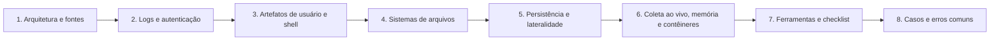

# 08 Forense em Linux

## Objetivo

Investigar sistemas Linux, inclusive servidores em produção e ambientes com contêineres, por meio de logs, autenticação, históricos, sistemas de arquivos, persistência, movimentação lateral, memória e orquestradores, reconstruindo acessos, execuções, alterações e tentativas de ocultação.

## Trilha de estudo recomendada

## Conteúdo da pasta

| Ordem | Arquivo | Objetivo |
|---|---|---|
| 1 | [arquitetura-e-fontes-de-evidencia-linux.md](arquitetura-e-fontes-de-evidencia-linux.md) | FHS, contas, distribuições, tempo, armazenamento e mapa de perguntas |
| 2 | [logs-e-autenticacao-no-linux.md](logs-e-autenticacao-no-linux.md) | syslog, journald, auditd, wtmp, SSH, sudo e logs web |
| 3 | [artefatos-de-usuario-shell-e-execucao-linux.md](artefatos-de-usuario-shell-e-execucao-linux.md) | Históricos, SSH, desktop, execução e carimbos |
| 4 | [sistemas-de-arquivos-e-recuperacao-linux.md](sistemas-de-arquivos-e-recuperacao-linux.md) | ext4, XFS, Btrfs, TSK, recuperação, LUKS e swap |
| 5 | [persistencia-escalada-e-movimento-lateral-linux.md](persistencia-escalada-e-movimento-lateral-linux.md) | Persistência, escalada, SSH, credenciais, evasão e rootkits |
| 6 | [coleta-ao-vivo-memoria-e-containers-linux.md](coleta-ao-vivo-memoria-e-containers-linux.md) | UAC, AVML, LiME, Volatility 3, Docker e Kubernetes |
| 7 | [ferramentas-triagem-modelos-e-checklist-linux.md](ferramentas-triagem-modelos-e-checklist-linux.md) | Ferramentas, triagem offline, modelos e checklist |
| 8 | [casos-de-uso-e-erros-comuns-em-linux.md](casos-de-uso-e-erros-comuns-em-linux.md) | Seis cenários, erros comuns e exercícios |

## Princípios

- Capturar a memória e os dados voláteis antes de desligar ou reiniciar
- Usar binários confiáveis e analisar imagens em modo somente leitura
- Não confiar nas ferramentas de um sistema potencialmente comprometido
- Entender o significado de cada carimbo (mtime, atime, ctime e crtime) e de cada log
- Corroborar conclusões com fontes independentes (logs remotos, auditd e memória)
- Preservar contêineres antes de reiniciar ou recriar
- Normalizar horários para UTC e declarar o fuso e a margem de erro
- Registrar ferramentas, versões, comandos e hashes para reprodutibilidade

## Relação com outras pastas

- 03-coleta-de-evidencias e 04-hash-e-integridade: aquisição e verificação
- 05-timeline-analysis: linha do tempo e detecção de manipulação
- 06-evidencias-digitais: validade e apresentação das evidências
- 07-windows-forensics: comparação de artefatos e de técnicas entre plataformas
- Pastas de memória, rede, malware, nuvem e ransomware: aprofundamentos

## Referências

- Nikkel, B. Practical Linux Forensics. No Starch Press (2021)
- Polstra, P. Linux Forensics (2015)
- Carrier, B. File System Forensic Analysis (2005)
- Ligh, M. et al. The Art of Memory Forensics (2014)
- SANS Institute. FOR577: Linux Incident Response and Threat Hunting
- MITRE ATT&CK (Linux e Containers)
- NIST SP 800-86 (2006); NIST SP 800-92 (2006); NIST SP 800-190 (2017)
- CIS Benchmarks (Linux, Docker, Kubernetes); CIS Controls v8.1
- Documentação do UAC, AVML, LiME, Volatility 3, The Sleuth Kit, Plaso, systemd, auditd e OpenSSH
- ISO/IEC 27037:2012; ISO/IEC 27042:2015
