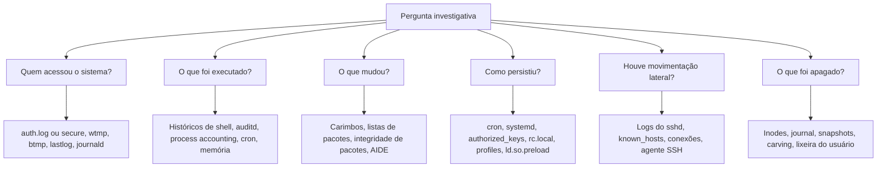

# Arquitetura e Fontes de Evidência do Linux

> **Objetivo pedagógico:** conhecer a organização do Linux relevante à forense (hierarquia de diretórios, contas, serviços, tempo e armazenamento), compreender as diferenças entre distribuições e saber qual fonte responde a cada pergunta investigativa.

## 1. Hierarquia de diretórios (FHS)

O Filesystem Hierarchy Standard (FHS) descreve a organização típica dos diretórios.

| Diretório | Conteúdo | Valor forense |
|---|---|---|
| `/etc` | Configuração do sistema | Contas, serviços, SSH, cron, sudoers, PAM, rede |
| `/var/log` | Logs | Autenticação, sistema, serviços, auditoria |
| `/var/spool` | Filas | Tarefas do cron e do `at`, e-mail |
| `/var/lib` | Dados de serviços | Bancos de pacotes, contêineres, dados de aplicativos |
| `/home` e `/root` | Perfis dos usuários | Históricos, chaves SSH, configurações, arquivos |
| `/tmp`, `/var/tmp` e `/dev/shm` | Áreas temporárias | Ferramentas e artefatos de atacantes; `/dev/shm` fica em memória |
| `/proc` e `/sys` | Sistemas de arquivos virtuais | Processos, módulos, rede e kernel em tempo real; voláteis |
| `/boot` | Kernel, initramfs e carregador | Adulteração de inicialização |
| `/usr`, `/bin`, `/sbin` e `/lib` | Binários e bibliotecas | Integridade e adulteração |
| `/usr/local` e `/opt` | Software instalado manualmente | Ferramentas e aplicativos não gerenciados por pacotes |
| `/srv` e `/var/www` | Dados de serviços (web, FTP) | Webroot e web shells |
| `/mnt` e `/media` | Pontos de montagem | Mídias e compartilhamentos |

## 2. Contas e privilégios

| Elemento | Local | Observação |
|---|---|---|
| Usuários | `/etc/passwd` | UID 0 é root; contas de sistema geralmente abaixo de 1000 |
| Senhas (hashes) | `/etc/shadow` | Tipo do hash e data da última alteração |
| Grupos | `/etc/group` e `/etc/gshadow` | Membros de grupos privilegiados (`sudo`, `wheel`, `docker`) |
| Sudo | `/etc/sudoers` e `/etc/sudoers.d/` | Permissões de elevação |
| Serviços de diretório | `/etc/nsswitch.conf`, SSSD, LDAP | Contas externas |
| Chaves SSH | `~/.ssh/` e `/etc/ssh/` | Acesso persistente |
| PAM | `/etc/pam.d/` | Autenticação e eventual adulteração |

## 3. Diferenças entre distribuições

| Tema | Debian e Ubuntu | RHEL, CentOS, Rocky e Alma | SUSE | Alpine |
|---|---|---|---|---|
| Log de autenticação | `/var/log/auth.log` | `/var/log/secure` | journald e `/var/log/messages` | Depende da configuração |
| Log geral | `/var/log/syslog` | `/var/log/messages` | `/var/log/messages` | `/var/log/messages` |
| Gerenciador de pacotes | `dpkg` e `apt` | `rpm`, `yum` e `dnf` | `zypper` e `rpm` | `apk` |
| Cron do usuário | `/var/spool/cron/crontabs/` | `/var/spool/cron/` | `/var/spool/cron/tabs/` | `/etc/crontabs/` |
| Inicialização | systemd | systemd | systemd | OpenRC |
| Auditoria | auditd opcional | auditd habilitado frequentemente | auditd opcional | Opcional |

Sempre confirme a distribuição e a versão (`/etc/os-release`) antes de definir os caminhos de coleta.

## 4. Inicialização e serviços

| Elemento | Local | Observação |
|---|---|---|
| Carregador | GRUB (`/boot/grub` ou `/boot/grub2`) | Parâmetros de kernel e adulteração |
| Unidades systemd | `/etc/systemd/system`, `/usr/lib/systemd/system` (ou `/lib/systemd/system`), `~/.config/systemd/user` | Serviços e timers |
| Scripts legados | `/etc/rc.local`, `/etc/init.d/`, `/etc/rc*.d/` | Persistência |
| Módulos do kernel | `/lib/modules/`, `/etc/modules-load.d/` | Rootkits |
| `cloud-init` | `/var/lib/cloud/`, `/var/log/cloud-init.log` | Origem e configuração em nuvem |

## 5. Tempo

| Item | Local ou comando | Observação |
|---|---|---|
| Fuso | `/etc/localtime` (vínculo) e `/etc/timezone` (Debian) | Define horários locais em logs tradicionais |
| Sincronização | `timedatectl`, `chronyc tracking`, `/var/log/chrony` | Verificar o desvio do relógio |
| Relógio de hardware | `hwclock` | UTC ou hora local |
| Carimbos de arquivos | `stat` | Modificação, acesso, mudança de inode e, em sistemas suportados, criação (Birth) |

Em sistemas de arquivos Linux os carimbos são armazenados em UTC (época Unix); a hora local aparece apenas na exibição ou em logs tradicionais.

## 6. Armazenamento

| Tecnologia | Observação forense |
|---|---|
| ext4 | Sistema de arquivos mais comum; carimbos com nanossegundos; criação (crtime) disponível |
| XFS | Padrão em famílias RHEL; hora de criação nas versões com metadados v5 |
| Btrfs e ZFS | Snapshots e cópia na escrita; estados anteriores podem existir |
| LVM | Volumes lógicos sobre partições; ativar e montar em modo somente leitura |
| LUKS | Criptografia de disco; preservar o cabeçalho e as chaves; capturar a memória se o volume estiver aberto |
| RAID por software (`md`) | Registrar a configuração e a ordem dos discos |
| Swap | Fragmentos de memória; partições e arquivos de troca |

## 7. Mapa: pergunta e fonte



## 8. Quadro rápido: pergunta e fonte principal

| Pergunta | Fontes principais | Corroboração |
|---|---|---|
| Qual a distribuição e a data de instalação? | `/etc/os-release`, logs do instalador, `tune2fs -l` (data de criação do sistema de arquivos) | Pacotes mais antigos |
| Quem fez logon por SSH e quando? | `auth.log` ou `secure`, `wtmp`, journald | Logs de VPN e de firewall |
| Quais comandos foram executados? | `.bash_history`, auditd, `acct` | Memória, logs de aplicação |
| Quais contas foram criadas? | `/etc/passwd`, `/etc/shadow`, `auth.log` | Carimbos dos arquivos de conta |
| Quais pacotes foram instalados? | `dpkg.log`, `apt/history.log`, `dnf.log` | Bancos de pacotes |
| Houve persistência? | Cron, systemd, SSH, profiles | Carimbos e comparação com linha de base |
| Binários foram alterados? | `debsums -c`, `rpm -Va` | Hashes de referência |
| Qual o conteúdo da memória? | Captura de memória | Processos e conexões |

## 9. Cuidados de coleta

| Situação | Procedimento |
|---|---|
| Sistema em produção | Capturar a memória e os dados voláteis primeiro; usar binários confiáveis |
| `/proc` e `/sys` | Coletar durante a resposta ao vivo; não existem em imagens de disco |
| Montagem de imagens | `mount -o ro,noload,noexec,nodev` (ext4) e dispositivos de loop em modo somente leitura |
| LVM | Ativar volumes na estação de análise, de preferência dedicada, e montar em modo somente leitura |
| LUKS | Registrar o estado; obter a passphrase ou a chave por via autorizada, ou extrair da memória |

```bash
# Imagem em dispositivo de loop somente leitura, com partições
sudo losetup -r -P -f --show /mnt/analise/E001-IMG01-W1.dd

# Informações da distribuição e do kernel
cat /etc/os-release; uname -a; timedatectl
```

## 10. Exemplo prático: inventário inicial de um servidor

| Item | Fonte | Resultado a registrar |
|---|---|---|
| Distribuição e versão | `/etc/os-release` | Ubuntu 22.04 (exemplo) |
| Kernel | `uname -a` | Versão registrada |
| Fuso e sincronização | `timedatectl` | UTC; NTP sincronizado |
| Contas com UID 0 | `awk -F: '$3==0' /etc/passwd` | Somente `root` |
| Grupos privilegiados | `/etc/group` | Membros de `sudo` e `docker` |
| Serviços habilitados | `systemctl list-unit-files --state=enabled` | Lista para comparação |
| Auditoria | `systemctl status auditd` | Habilitada ou não |
| Criptografia | `lsblk -f` | LUKS e LVM identificados |

## 11. Casos de uso corporativos

- Triagem inicial de servidores web e de aplicação comprometidos.
- Planejamento de coleta em ambientes com diversas distribuições.
- Treinamento de analistas de SOC em Linux.

## 12. Normas e frameworks relevantes

- ISO/IEC 27037:2012 e NIST SP 800-86 (coleta e exame)
- MITRE ATT&CK (Enterprise, Linux)
- Filesystem Hierarchy Standard 3.0
- CIS Benchmarks para distribuições Linux; NIST SP 800-123 (segurança de servidores)
- ISO/IEC 27002:2022, controles 8.15 e 8.17

## 13. Referências

- Nikkel, B. Practical Linux Forensics. No Starch Press, 2021.
- Polstra, P. Linux Forensics. 2015.
- Linux Foundation. Filesystem Hierarchy Standard 3.0. 2015.
- SANS Institute. FOR577: Linux Incident Response and Threat Hunting.
- Pomeranz, H. Material de apoio sobre forense de Linux (SANS).
- Documentação do systemd, do coreutils e do util-linux.
