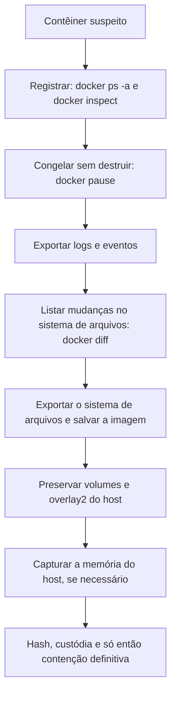

# Coleta ao Vivo, Memória e Contêineres no Linux

> **Objetivo pedagógico:** executar a resposta ao vivo em Linux com baixo impacto, capturar e analisar memória, e preservar evidências de contêineres (Docker e Kubernetes), reconhecendo a natureza efêmera desses ambientes.

## 1. Coleta ao vivo

Siga a ordem de volatilidade e use binários confiáveis a partir de mídia externa (ver pasta 03). Prefira ferramentas de coleta direcionada e com registro.

### 1.1 UAC (Unix-like Artifacts Collector)

O UAC coleta artefatos de Linux, macOS e outros Unix sem instalação, usando perfis predefinidos.

```bash
# Coleta de triagem de resposta a incidentes com saída em mídia externa
sudo ./uac -p ir_triage /mnt/evidencias/DFL-2026-001/E003

# Cálculo de hash do pacote gerado
sha256sum /mnt/evidencias/DFL-2026-001/E003/*.tar.gz > /mnt/evidencias/DFL-2026-001/E003_hashes.sha256
```

Confirme os perfis e as opções na versão utilizada (`./uac --help`) e registre o perfil, a versão e o horário.

### 1.2 Conjunto manual mínimo

```bash
D=/mnt/evidencias/DFL-2026-001/E003
mkdir -p "$D"
{ date -u; date; uname -a; uptime; cat /etc/os-release; } > "$D/00_sistema.txt"
who -a                                   > "$D/10_sessoes.txt"
last -Faiw                               > "$D/11_last.txt"
ps -eo pid,ppid,user,lstart,etime,cmd --forest > "$D/20_processos.txt"
ss -tunap                                > "$D/30_sockets.txt"
lsof -nP                                 > "$D/33_lsof.txt"
ip addr; ip route; ip neigh              > "$D/31_rede.txt"
mount; df -h; lsblk -f                   > "$D/40_discos.txt"
lsmod                                    > "$D/41_modulos.txt"
systemctl list-units --type=service --all > "$D/50_servicos.txt"
systemctl list-timers --all              > "$D/51_timers.txt"
iptables-save 2>/dev/null                > "$D/60_firewall.txt"
( cd "$D" && sha256sum * > ../E003_hashes.sha256 )
```

### 1.2.1 Dados do `/proc` por processo suspeito

```bash
PID=1234
ls -l /proc/$PID/exe /proc/$PID/cwd
tr '\0' ' ' < /proc/$PID/cmdline; echo
tr '\0' '\n' < /proc/$PID/environ
cat /proc/$PID/maps
ls -l /proc/$PID/fd
# Copiar o binário de um processo cujo arquivo foi excluído
cp /proc/$PID/exe /mnt/evidencias/DFL-2026-001/E003/proc_${PID}_exe.bin
sha256sum /mnt/evidencias/DFL-2026-001/E003/proc_${PID}_exe.bin
```

## 2. Captura de memória

| Ferramenta | Característica | Observações |
|---|---|---|
| AVML (Microsoft) | Executável em espaço de usuário, sem módulo de kernel | Boa opção para servidores em nuvem e em produção |
| LiME | Módulo de kernel que exige compatibilidade com o kernel em execução | Compile antes, em sistema equivalente |
| Snapshot de VM com memória | Pelo hipervisor | Não executa nada no convidado |
| Dump de processo | `gcore` ou leitura de `/proc/<pid>/mem` | Útil para um processo específico |

```bash
# AVML
sudo ./avml /mnt/evidencias/DFL-2026-001/E003-MEM01.lime

# LiME
sudo insmod ./lime-$(uname -r).ko "path=/mnt/evidencias/DFL-2026-001/E003-MEM01.lime format=lime"

sha256sum /mnt/evidencias/DFL-2026-001/E003-MEM01.lime > /mnt/evidencias/DFL-2026-001/E003-MEM01.sha256
```

Registre o tamanho da RAM, a versão do kernel (`uname -a`) e o horário. Capture também a versão exata do kernel e do banner para obter os símbolos.

## 3. Análise de memória com Volatility 3

O Volatility 3 em Linux precisa de símbolos (tabelas ISF) compatíveis com o kernel da captura, que podem ser gerados com o dwarf2json a partir dos símbolos de depuração do kernel.

```bash
# Identificar o banner do kernel
vol -f E003-MEM01.lime banners.Banners

# Plugins comuns (verifique os nomes disponíveis com: vol --help)
vol -f E003-MEM01.lime linux.pslist.PsList
vol -f E003-MEM01.lime linux.pstree.PsTree
vol -f E003-MEM01.lime linux.psaux.PsAux
vol -f E003-MEM01.lime linux.sockstat.Sockstat
vol -f E003-MEM01.lime linux.lsof.Lsof
vol -f E003-MEM01.lime linux.bash.Bash
vol -f E003-MEM01.lime linux.lsmod.Lsmod
vol -f E003-MEM01.lime linux.check_syscall.Check_syscall
vol -f E003-MEM01.lime linux.malfind.Malfind
```

| Pergunta | Plugin típico |
|---|---|
| Quais processos existiam e quem os iniciou? | `linux.pslist`, `linux.pstree`, `linux.psaux` |
| Quais conexões existiam? | `linux.sockstat` |
| Que comandos foram digitados em shells ativos? | `linux.bash` |
| Quais módulos estavam carregados? | `linux.lsmod` e `linux.check_syscall` (hooks de syscalls) |
| Há código injetado ou regiões executáveis suspeitas? | `linux.malfind` |
| Quais arquivos os processos mantinham abertos? | `linux.lsof` |

## 4. Docker

### 4.1 Onde ficam os dados

| Elemento | Local |
|---|---|
| Contêineres | `/var/lib/docker/containers/<id>/` (configuração e logs em JSON, no driver padrão) |
| Camadas do sistema de arquivos | `/var/lib/docker/overlay2/<id>/` (`diff`, `merged`, `lower`, `work`) |
| Imagens | `/var/lib/docker/image/` |
| Volumes | `/var/lib/docker/volumes/` |
| Socket do daemon | `/var/run/docker.sock` (acesso a ele equivale a privilégios elevados) |

### 4.2 Procedimento de preservação



```bash
ID=<id_do_container>
docker ps -a --no-trunc > ps.txt
docker inspect $ID > inspect.json
docker pause $ID                                  # congela os processos, preservando a memória
docker logs --timestamps $ID > container.log 2>&1
docker events --since 24h --until 0s > events.txt # eventos do daemon (quando disponíveis)
docker diff $ID > diff.txt                        # A = adicionado, C = alterado, D = removido
docker export $ID -o container_fs.tar            # sistema de arquivos do contêiner
docker image inspect <imagem> > image_inspect.json
docker save <imagem> -o imagem.tar
sha256sum ps.txt inspect.json container.log events.txt diff.txt container_fs.tar imagem.tar > hashes_docker.sha256
```

Pontos de atenção: contêineres são efêmeros e podem ser recriados por orquestradores, apagando o estado; faça a preservação antes de reiniciar ou excluir. `docker commit` cria uma nova imagem a partir do estado atual e pode ser usado com cautela, registrando-se o procedimento.

### 4.3 Indícios de risco em contêineres

| Indício | Interpretação |
|---|---|
| Contêiner privilegiado (`--privileged`) ou com `docker.sock` montado | Possibilidade de escape para o host (T1611) |
| Montagem de `/`, `/etc` ou `/var/run` do host | Acesso amplo ao host |
| Capabilities elevadas (`SYS_ADMIN`) | Risco de escape |
| Imagem de origem desconhecida ou com mineradores | Implantação maliciosa (T1610) |
| Comandos de administração executados via `docker exec` | T1609 |
| Daemon exposto por TCP sem TLS | Acesso remoto não autenticado |

## 5. Kubernetes

| Fonte | Comando ou local | Observação |
|---|---|---|
| Estado dos pods e eventos | `kubectl get pods -A -o wide`, `kubectl get events -A`, `kubectl describe pod` | Registrar a data e o contexto |
| Logs de contêineres | `kubectl logs <pod> -c <contêiner> --timestamps` (e `--previous`) | Logs do nó podem ser rotacionados |
| Configuração e segredos | `kubectl get <recurso> -o yaml` | Tratar segredos com cuidado e sob autorização |
| Logs de auditoria da API | Definidos na configuração do API server | Quem fez o quê no cluster |
| Nós | Logs do kubelet, do runtime (containerd) e do sistema | Coletar do nó afetado |
| Depuração | `kubectl debug` (contêiner efêmero) | Evite alterar o estado do pod original sem registro |

```bash
kubectl get pods -A -o wide > pods.txt
kubectl get events -A --sort-by=.lastTimestamp > events.txt
kubectl describe pod <pod> -n <namespace> > pod_describe.txt
kubectl logs <pod> -n <namespace> --all-containers --timestamps > pod_logs.txt
kubectl logs <pod> -n <namespace> --previous --all-containers --timestamps > pod_logs_previous.txt 2>&1
```

Em ambientes gerenciados, preserve também os snapshots dos discos dos nós e os logs do plano de controle do provedor (ver pasta de forense em nuvem).

## 6. Exemplo prático: contêiner com minerador

| Etapa | Ação |
|---|---|
| 1 | Alerta de CPU elevada em um nó; identificar o contêiner pelo consumo (`docker stats`) |
| 2 | `docker inspect` mostra imagem desconhecida e `--privileged` |
| 3 | `docker pause`, logs, `docker diff` (processo binário em `/tmp` adicionado) |
| 4 | `docker export` e `docker save`, com hash |
| 5 | Captura de memória do nó com AVML |
| 6 | Análise: conexões a pool de mineração e binário empacotado; origem pela imagem do registro público |
| 7 | Contenção: encerrar o contêiner, bloquear a imagem e revisar o acesso ao daemon |
| Conclusão | Implantação indevida por daemon Docker exposto; técnicas T1610 e T1496; confiança alta |

## 7. Casos de uso corporativos

- Resposta a incidentes em servidores de produção sem parada de serviço.
- Investigação de contêineres comprometidos em clusters Kubernetes.
- Preparação do kit de coleta de Linux para equipes de SOC.

## 8. Normas e frameworks relevantes

- RFC 3227; ISO/IEC 27037:2012; NIST SP 800-86
- NIST SP 800-190: Application Container Security Guide
- CIS Benchmarks para Docker e para Kubernetes
- MITRE ATT&CK: Containers Matrix (T1610, T1611, T1609, T1613) e T1496
- ISO/IEC 27002:2022, controle 5.28

## 9. Referências

- Brezinski, D.; Killalea, T. RFC 3227. 2002.
- Souppaya, M.; Morello, J.; Scarfone, K. NIST SP 800-190. 2017.
- Ligh, M. et al. The Art of Memory Forensics. Wiley, 2014.
- Documentação do UAC (tclahr/uac), do AVML, do LiME, do Volatility 3 e do dwarf2json.
- Documentação do Docker, do Kubernetes e do containerd.
- SANS Institute. FOR577 e FOR509 (nuvem).
