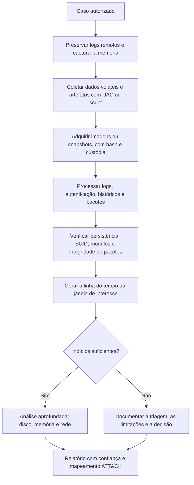

# Ferramentas, Triagem, Modelos e Checklist de Linux

> **Objetivo pedagógico:** executar uma triagem forense de Linux reprodutível com as ferramentas adequadas, registrar achados em modelos padronizados e verificar a completude do trabalho por meio de uma lista de verificação.

## 1. Ferramentas por finalidade

| Finalidade | Ferramentas |
|---|---|
| Coleta de triagem | UAC, Velociraptor, scripts próprios e versionados |
| Aquisição de disco | dc3dd, ewfacquire, FTK Imager (ver pasta 03) |
| Aquisição de memória | AVML, LiME |
| Análise de memória | Volatility 3 |
| Sistema de arquivos | The Sleuth Kit (`mmls`, `fsstat`, `fls`, `icat`, `istat`, `tsk_recover`), debugfs, Autopsy |
| Carving | PhotoRec, foremost, scalpel, bulk_extractor |
| Linha do tempo | Plaso (log2timeline e psort), Timesketch, mactime |
| Consulta de estado | osquery |
| Detecção por assinaturas | YARA, ClamAV |
| Verificação de integridade | `debsums`, `rpm -V`, AIDE (se houver linha de base) |
| Auditoria de configuração | Lynis, CIS-CAT e benchmarks CIS |
| Análise de binários | `file`, `strings`, `readelf`, `objdump`, Ghidra, entre outros |
| Pesquisa de rootkits | chkrootkit e rkhunter (com cautela e preferencialmente em análise offline) |

Observações:

- Registre nome, versão, origem e hash da ferramenta e valide-a em ambiente de testes.
- Evite o `ldd` em binários suspeitos (pode executar o código); use `readelf -d` ou `objdump -p`.
- Ferramentas como chkrootkit e rkhunter produzem falsos positivos e podem ser enganadas por rootkits; trate o resultado como indício.

## 2. Fluxo de triagem em Linux



## 3. Comandos de triagem offline (imagem montada em `/mnt/analise`)

```bash
A=/mnt/analise
S=/mnt/saida

# Sistema e contas
cat $A/etc/os-release; cat $A/etc/passwd | awk -F: '$3==0'; cat $A/etc/group | grep -E "sudo|wheel|docker"

# Persistência
ls -la $A/etc/cron* $A/var/spool/cron* 2>/dev/null > $S/cron.txt
ls -la $A/etc/systemd/system $A/usr/lib/systemd/system 2>/dev/null > $S/systemd.txt
cat $A/etc/ld.so.preload 2>/dev/null
find $A/home $A/root -name authorized_keys -exec ls -l {} \; -exec cat {} \; > $S/authorized_keys.txt

# SUID e arquivos recentes
find $A -xdev \( -perm -4000 -o -perm -2000 \) -type f -ls > $S/suid.txt
find $A -xdev -type f -newermt "2026-10-26" ! -newermt "2026-10-29" -printf '%TY-%Tm-%Td %TH:%TM:%TS %u %p\n' | sort > $S/recentes.txt

# Logs
zgrep -h -E "Accepted|Failed|sudo:|useradd|new user" $A/var/log/auth.log* > $S/auth_resumo.txt 2>/dev/null
journalctl -D $A/var/log/journal --utc -o short-iso --since "2026-10-20" --until "2026-10-31" > $S/journal.txt 2>/dev/null

# Hash dos resultados
( cd $S && sha256sum * > ../saida_hashes.sha256 )
```

Observação: os comandos de arquivos voltados para o sistema do analista leem a imagem; não confunda `/etc/passwd` do analista com o da imagem.

## 4. Dez perguntas e como respondê-las

| Pergunta | Onde responder |
|---|---|
| 1. Qual a distribuição, o kernel, o fuso e a data de instalação? | `/etc/os-release`, `uname`, `timedatectl`, `tune2fs -l` |
| 2. Quais contas existem e quais fizeram logon? | `/etc/passwd`, `auth.log` ou `secure`, `wtmp`, `lastlog` |
| 3. Que comandos foram executados? | Históricos, auditd, process accounting, memória |
| 4. Como o acesso ocorreu? | `sshd` no auth.log, VPN, firewall, web logs |
| 5. Houve elevação de privilégio? | `sudo`, `su`, SUID, sudoers |
| 6. Há persistência? | Cron, systemd, SSH, profiles, `ld.so.preload`, módulos |
| 7. Houve movimentação lateral? | `known_hosts`, `ssh`, `scp`, conexões, agente SSH |
| 8. O que foi baixado, criado ou apagado? | Carimbos, journal, inodes, TSK, auditd |
| 9. Binários do sistema foram alterados? | `debsums -c`, `rpm -Va`, hashes de referência |
| 10. Houve tentativa de ocultação? | Logs truncados, histórico apagado, `touch`, LD_PRELOAD |

## 5. Modelo A: Inventário do host

| Campo | Preenchimento |
|---|---|
| Caso e host | |
| Nome, domínio e IPs | |
| Distribuição, versão e kernel | |
| Data de instalação | |
| Fuso e sincronização | |
| Armazenamento (sistemas de arquivos, LVM, LUKS, RAID) | |
| Auditoria (auditd, journald persistente) | |
| Antimalware e EDR | |
| Contas com UID 0 e grupos privilegiados | |
| Origem e hash das coletas | |

## 6. Modelo B: Registro de achados

| ID | Fonte e caminho | Hash | Achado | Horário (UTC) | Usuário | Interpretação | Confiança | Corroboração | Técnica ATT&CK |
|---|---|---|---|---|---|---|---|---|---|
| L-001 | | | | | | | | | |
| L-002 | | | | | | | | | |

## 7. Modelo C: Inventário de persistências

| ID | Mecanismo | Local | Entrada | Binário e hash | Pacote associado? | Criado em (UTC) | Avaliação | Ação |
|---|---|---|---|---|---|---|---|---|
| P-001 | Cron | | | | | | | |
| P-002 | systemd | | | | | | | |

## 8. Modelo D: Mapa de acessos SSH

| Conta | Origem (IP e host) | Método (senha ou chave, com impressão) | Primeiro e último acesso (UTC) | Comandos e ações relevantes | Observações |
|---|---|---|---|---|---|
| | | | | | |

## 9. Checklist operacional de Linux

**Caso:** DFL-AAAA-NNN
**Host:** ____________________
**Analista:** ____________________
**Data e hora (UTC):** ____________________

### 9.1 Preparação e coleta

- [ ] Autorização e escopo registrados
- [ ] Logs remotos e de retenção curta preservados
- [ ] Memória capturada e hash calculado
- [ ] Dados voláteis e artefatos coletados (UAC ou script), com hash
- [ ] Imagens ou snapshots adquiridos, com hash e custódia
- [ ] Cabeçalho LUKS e configuração de LVM e RAID registrados
- [ ] Contêineres preservados (pause, logs, diff, export), quando existirem

### 9.2 Identificação do sistema

- [ ] Distribuição, versão, kernel, data de instalação e fuso
- [ ] Contas, UID 0 e grupos privilegiados
- [ ] Configuração de logs, journald e auditd
- [ ] Serviços, módulos e pacotes de interesse

### 9.3 Autenticação e execução

- [ ] `auth.log` ou `secure`, `wtmp`, `btmp` e `lastlog` analisados
- [ ] journald e auditd analisados
- [ ] Históricos de shell e de ferramentas
- [ ] SSH: `authorized_keys`, `known_hosts`, `config` e `sshd_config`
- [ ] `sudo`, `su` e criação de contas

### 9.4 Persistência e movimentação

- [ ] Cron, `at`, systemd, rc, profiles e autostart
- [ ] SUID, SGID, capabilities e sudoers
- [ ] `ld.so.preload`, módulos de kernel e PAM
- [ ] Web shells e diretórios web
- [ ] Movimentação lateral por SSH e uso de credenciais

### 9.5 Sistema de arquivos e integridade

- [ ] Linha do tempo (mactime ou Plaso) da janela de interesse
- [ ] Arquivos excluídos, journal e snapshots
- [ ] Integridade de pacotes (`debsums` ou `rpm -Va`)
- [ ] Indícios de alteração de carimbos

### 9.6 Qualidade e relato

- [ ] Horários normalizados para UTC e fuso documentado
- [ ] Conclusões corroboradas por duas fontes independentes
- [ ] Hipóteses alternativas e limitações registradas
- [ ] Ferramentas, versões e comandos documentados
- [ ] Mapeamento para MITRE ATT&CK
- [ ] Revisão por pares realizada

## 10. Resultado da verificação

| Resultado | Condição |
|---|---|
| Conforme | Todos os itens aplicáveis marcados |
| Conforme com ressalvas | Pendências sem impacto nas conclusões, com plano de ação |
| Não conforme | Conclusões sem corroboração, coleta sem hash ou ferramentas sem registro; comunicar o líder |

**Assinatura do analista:** ____________________
**Assinatura do revisor:** ____________________

## 11. Casos de uso corporativos

- Padronização da triagem de servidores Linux no SOC.
- Treinamento de analistas com checklist e modelos.
- Auditoria da qualidade de investigações por amostragem.

## 12. Normas e frameworks relevantes

- ISO/IEC 27037:2012; ISO/IEC 27041:2015; NIST SP 800-86
- NIST CFTT; MITRE ATT&CK (Linux)
- CIS Benchmarks e CIS Controls v8.1, controles 8 e 17

## 13. Referências

- Documentação do UAC, do Volatility 3, do The Sleuth Kit, do Plaso, do osquery, do YARA e do Lynis.
- Nikkel, B. Practical Linux Forensics. No Starch Press, 2021.
- Kent, K. et al. NIST SP 800-86. 2006.
- SANS Institute. FOR577 e FOR508.
