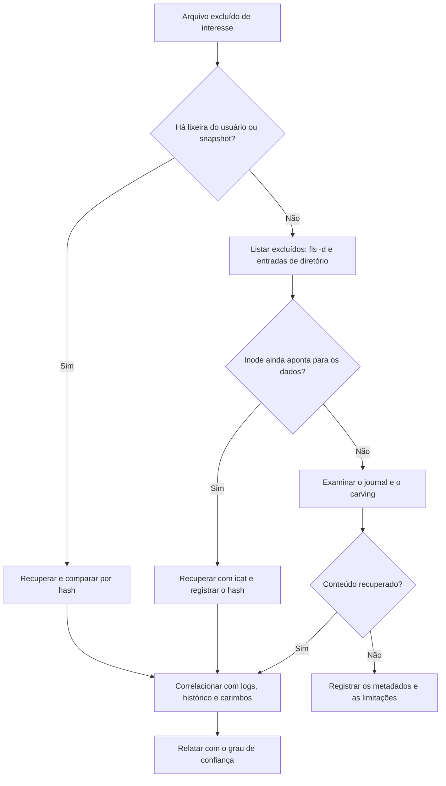

# Sistemas de Arquivos e Recuperação no Linux

> **Objetivo pedagógico:** analisar os principais sistemas de arquivos Linux (ext4, XFS, Btrfs e ZFS), usar o The Sleuth Kit e outras ferramentas para listar, recuperar e comparar arquivos, e aproveitar snapshots, journal, swap e volumes criptografados na investigação.

## 1. ext4

| Elemento | Descrição | Valor forense |
|---|---|---|
| Superbloco | Metadados do sistema de arquivos | Data de criação, UUID, última montagem, contagem de montagens |
| Grupos de blocos | Organização de inodes e blocos | Localização de metadados |
| Inodes | Metadados de cada arquivo (proprietário, permissões, carimbos, ponteiros) | Carimbos mtime, atime, ctime e crtime |
| Extents | Mapeamento de blocos de dados | Cada arquivo grande é descrito por um extent tree |
| Journal | Registro de transações de metadados | Pode conter blocos antigos; a reprodução do journal na montagem altera a imagem |
| Diretórios | Entradas com nome e número de inode | Entradas excluídas podem restar no espaço do diretório |

```bash
# Informações do sistema de arquivos (sem alterar a imagem)
tune2fs -l /dev/loop0p1
dumpe2fs -h /dev/loop0p1

# Detalhes de um inode
debugfs -R "stat <12345>" /dev/loop0p1
# Listar entradas, inclusive excluídas (marcadas entre <>)
debugfs -R "ls -d /home/u" /dev/loop0p1
```

Atenção: nunca execute `e2fsck` na evidência original ou na imagem principal; ele altera o sistema de arquivos. Monte em modo somente leitura, sem reproduzir o journal (`noload`).

## 2. Análise com The Sleuth Kit

```bash
# Estrutura de partições e deslocamentos
mmls /mnt/analise/E001-IMG01-W1.dd

# Informações do sistema de arquivos (use o deslocamento em setores)
fsstat -o 2048 /mnt/analise/E001-IMG01-W1.dd

# Listar arquivos, recursivamente, com caminho completo; -d mostra apenas excluídos
fls -r -p -o 2048 /mnt/analise/E001-IMG01-W1.dd > fls_todos.txt
fls -r -p -d -o 2048 /mnt/analise/E001-IMG01-W1.dd > fls_excluidos.txt

# Metadados e conteúdo de um inode
istat -o 2048 /mnt/analise/E001-IMG01-W1.dd 12345
icat  -o 2048 /mnt/analise/E001-IMG01-W1.dd 12345 > recuperado.bin

# Recuperar arquivos excluídos em lote (quando os metadados existem)
tsk_recover -e -o 2048 /mnt/analise/E001-IMG01-W1.dd /mnt/saida/recuperados

# Linha do tempo do sistema de arquivos (body file e mactime em UTC)
fls -r -m / -o 2048 /mnt/analise/E001-IMG01-W1.dd > body.txt
mactime -b body.txt -d -z UTC 2026-10-20..2026-10-31 > mactime.csv
```

Registre o deslocamento da partição, as ferramentas e as versões, e calcule o hash dos arquivos recuperados.

## 3. Montagem segura de imagens

```bash
# Dispositivo de loop somente leitura, com partições
sudo losetup -r -P -f --show /mnt/analise/E001-IMG01-W1.dd      # exemplo de saída: /dev/loop0

# Imagem E01
mkdir -p /mnt/ewf && ewfmount /mnt/analise/E001-IMG01-W1.E01 /mnt/ewf
sudo losetup -r -P -f --show /mnt/ewf/ewf1

# Montagem somente leitura (ext4: não reproduzir o journal)
sudo mount -o ro,noload,noexec,nodev /dev/loop0p1 /mnt/evid

# XFS: somente leitura, sem recuperar o log
sudo mount -o ro,norecovery,noexec,nodev /dev/loop0p1 /mnt/evid
```

Verifique se a imagem permanece com o mesmo hash depois da análise.

## 4. Recuperação de arquivos excluídos

| Situação | Possibilidade |
|---|---|
| Arquivo excluído, inode e blocos preservados | Recuperável por `icat` |
| ext4: ao excluir, o mapeamento de extents no inode costuma ser zerado | Os blocos de dados podem existir, mas o vínculo é perdido: usar o journal e o carving |
| Blocos reutilizados por novos arquivos | Conteúdo perdido |
| Arquivos pequenos | Podem existir em blocos livres, sujeitos ao carving |
| Journal | Pode conter cópias antigas de blocos de metadados (inode e diretório), o que permite reconstruir ponteiros |
| SSD com TRIM | Blocos liberados podem ser apagados; menor chance de recuperação |
| Snapshots e backups | Fonte confiável de estados anteriores |

```bash
# Examinar o journal do ext4 (TSK)
jls -o 2048 /mnt/analise/E001-IMG01-W1.dd
jcat -o 2048 /mnt/analise/E001-IMG01-W1.dd <bloco_do_journal> <bloco>

# Carving por assinaturas (não depende de metadados)
photorec /d /mnt/saida/carving /mnt/analise/E001-IMG01-W1.dd
# Alternativas: foremost e scalpel
```

O carving recupera conteúdo sem nome e sem carimbos; correlacione com outros indícios antes de atribuir autoria.

## 5. XFS

| Aspecto | Observação |
|---|---|
| Estrutura | Alocação por grupos, inodes dinâmicos e log de metadados |
| Carimbos | Criação disponível nas versões com metadados v5 |
| Ferramentas | `xfs_info`, `xfs_db` (leitura) e `xfs_repair` (não usar na evidência) |
| Recuperação | Menos documentada que ext4; use TSK e carving; verifique o log |

## 6. Btrfs, ZFS e snapshots

| Tecnologia | Característica | Uso forense |
|---|---|---|
| Btrfs | Cópia na escrita (CoW), subvolumes e snapshots | Estados anteriores e blocos antigos; `btrfs subvolume list` |
| ZFS | CoW e snapshots (`zfs list -t snapshot`) | Comparar o estado do sistema ao longo do tempo |
| LVM | Snapshots de volumes lógicos | Estado anterior de volumes |
| Backups e snapshots de plataforma | VMs e nuvem | Corroborar e recuperar |

Em sistemas CoW, versões antigas de arquivos podem permanecer em blocos não sobrescritos, e snapshots funcionam de forma análoga às Volume Shadow Copies do Windows.

```bash
btrfs subvolume list /mnt/evid
zfs list -t snapshot
lvs -a -o +devices
```

## 7. LUKS e volumes criptografados

| Item | Procedimento |
|---|---|
| Identificação | `cryptsetup luksDump <dispositivo>` e `lsblk -f` |
| Cabeçalho | Fazer backup do cabeçalho LUKS e registrar o hash |
| Chaves | Obter a senha ou o arquivo-chave por via autorizada; verificar o TPM e o gerenciamento corporativo |
| Memória | Em sistema com volume aberto, a chave mestra pode ser extraída da memória (ferramentas específicas) |
| Imagem | Preferir a aquisição do volume aberto (lógico ou físico do dispositivo mapeado) quando o sistema está ligado |

```bash
cryptsetup luksDump /dev/sdb2
cryptsetup luksHeaderBackup /dev/sdb2 --header-backup-file /mnt/evidencias/E001-luks-header.img
sha256sum /mnt/evidencias/E001-luks-header.img
```

## 8. Swap, hibernação e áreas temporárias

| Fonte | Valor |
|---|---|
| Partição ou arquivo de swap | Fragmentos de memória e de processos (`strings`, YARA, carving) |
| Imagem de hibernação (`/swapfile` ou partição de swap) | Estado da memória no momento da hibernação |
| `/tmp`, `/var/tmp` e `/dev/shm` | Ferramentas e dados temporários; `/dev/shm` só ao vivo |
| `core dumps` (`/var/lib/systemd/coredump`, `/var/crash`) | Memória de processos que falharam |

```bash
strings -a -td swapfile.img | grep -i -E "password|BEGIN (RSA|OPENSSH)|http" | head
```

## 9. Fluxo de investigação de exclusão



## 10. Exemplo prático: binário excluído após o uso

| Fonte | Evidência |
|---|---|
| `fls -d` | Entrada excluída `/tmp/.x` no diretório, com inode associado |
| `istat` | Carimbos: crtime 02:16:40Z; ctime (exclusão) 02:41:05Z; blocos zerados |
| Journal | Cópia antiga do inode com extents preenchidos |
| `icat` do bloco recuperado | Binário ELF com hash registrado |
| auditd e auth.log | Download por `curl` às 02:16Z e execução às 02:17Z |
| Conclusão | Binário baixado, executado e excluído em 25 minutos; conteúdo recuperado por journal; confiança alta |

## 11. Casos de uso corporativos

- Recuperação de arquivos apagados por colaborador em servidor Linux.
- Reconstrução de ferramentas de atacante removidas do sistema.
- Uso de snapshots para comparar estados antes e depois de um incidente.

## 12. Normas e frameworks relevantes

- ISO/IEC 27037:2012; NIST SP 800-86; ISO/IEC 27042:2015
- MITRE ATT&CK: T1070.004 (File Deletion), T1485 (Data Destruction), T1561 (Disk Wipe)
- NIST CFTT (validação de ferramentas)

## 13. Referências

- Carrier, B. File System Forensic Analysis. Addison-Wesley, 2005.
- Nikkel, B. Practical Linux Forensics. No Starch Press, 2021.
- Documentação do ext4 (kernel.org), do XFS, do Btrfs e do OpenZFS.
- Documentação do The Sleuth Kit, do libewf e do cryptsetup.
- SANS Institute. FOR577 e FOR500.
