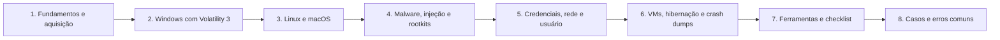

# 09 Forense de Memória

## Objetivo

Capturar, validar e analisar a memória volátil de sistemas Windows, Linux e macOS, de máquinas virtuais e de outras fontes (hibernação, paginação e crash dumps), identificando processos, conexões, injeção de código, rootkits, credenciais e atividade do usuário, com preservação da integridade e tratamento responsável de dados sensíveis.

## Trilha de estudo recomendada

## Conteúdo da pasta

| Ordem | Arquivo | Objetivo |
|---|---|---|
| 1 | [fundamentos-de-memoria-e-aquisicao-avancada.md](fundamentos-de-memoria-e-aquisicao-avancada.md) | Estruturas, proteções modernas, aquisição, formatos e smearing |
| 2 | [analise-de-memoria-windows-com-volatility3.md](analise-de-memoria-windows-com-volatility3.md) | Processos, módulos, rede, registro e extração no Windows |
| 3 | [analise-de-memoria-linux-e-macos.md](analise-de-memoria-linux-e-macos.md) | Símbolos, plugins e limitações em Linux e macOS |
| 4 | [memoria-malware-injecao-e-rootkits.md](memoria-malware-injecao-e-rootkits.md) | Injeção, hollowing, beacons, hooks e rootkits |
| 5 | [credenciais-rede-e-artefatos-de-usuario-em-memoria.md](credenciais-rede-e-artefatos-de-usuario-em-memoria.md) | Rede, atividade do usuário, credenciais e chaves, com tratamento seguro |
| 6 | [memoria-de-vms-hibernacao-e-crash-dumps.md](memoria-de-vms-hibernacao-e-crash-dumps.md) | Hiberfil, pagefile, crash dumps, VMs e dumps de processos |
| 7 | [ferramentas-fluxo-modelos-e-checklist-de-memoria.md](ferramentas-fluxo-modelos-e-checklist-de-memoria.md) | Ambiente, fluxo, modelos e checklist |
| 8 | [casos-de-uso-e-erros-comuns-em-memoria.md](casos-de-uso-e-erros-comuns-em-memoria.md) | Sete cenários, erros comuns e exercícios |

## Princípios

- Capturar a memória antes de desligar, reiniciar ou executar outras ações
- Usar ferramentas leves a partir de mídia externa e registrar impacto, versão e hash
- Validar a imagem e os símbolos antes de analisar
- Comparar visões diferentes dos mesmos dados (listas e varreduras) para detectar ocultação
- Tratar RWX como indício, e não como prova; considerar a linha de base e os falsos positivos
- Corroborar achados com disco, logs e rede
- Extrair credenciais apenas com autorização e necessidade, com minimização e contenção
- Declarar limitações: smearing, compressão de memória, VBS e Credential Guard

## Relação com outras pastas

- 03-coleta-de-evidencias: coleta ao vivo e ordem de volatilidade
- 04-hash-e-integridade: hash e verificação das imagens de memória
- 05-timeline-analysis: horários de criação de processos e correlação
- 07-windows-forensics e 08-linux-forensics: artefatos de disco que corroboram a memória
- Pastas de malware, ransomware e threat hunting: análise do material extraído e geração de detecções

## Referências

- Ligh, M.; Case, A.; Levy, J.; Walters, A. The Art of Memory Forensics. Wiley (2014)
- Russinovich, M.; Solomon, D.; Ionescu, A. Windows Internals. 7. ed. (2017)
- Nikkel, B. Practical Linux Forensics (2021)
- Sikorski, M.; Honig, A. Practical Malware Analysis (2012)
- Volatility Foundation. Documentação do Volatility 3 (plugins, símbolos e imagens de exemplo)
- SANS Institute. FOR526: Memory Forensics In-Depth; FOR508; FOR577
- MITRE ATT&CK (T1055, T1003, T1014, T1620) e MITRE D3FEND
- RFC 3227; NIST SP 800-86; ISO/IEC 27037:2012; ISO/IEC 27042:2015
- NIST SP 800-83 Rev. 1; NIST SP 800-190
