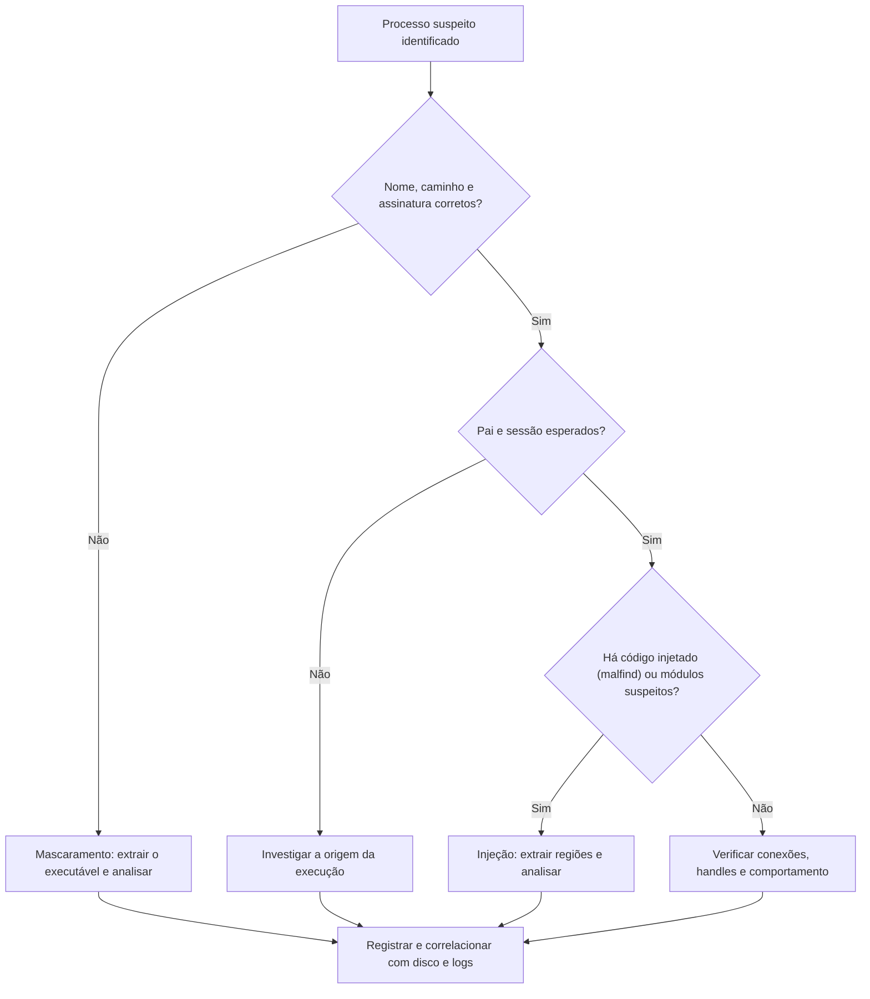

# Análise de Memória Windows com Volatility 3

> **Objetivo pedagógico:** analisar imagens de memória do Windows com o Volatility 3 de forma metódica, identificando processos anômalos, módulos suspeitos, conexões, artefatos de registro e arquivos, e extraindo evidências para análise adicional.

## 1. Preparação

| Item | Orientação |
|---|---|
| Ambiente | Estação de análise isolada, Python atualizado e Volatility 3 em versão registrada |
| Símbolos | O Volatility 3 obtém os símbolos (PDB) dos servidores da Microsoft; sem internet, use os pacotes de símbolos offline (por exemplo, `windows.zip` da Volatility Foundation) na pasta `symbols` |
| Cópia de trabalho | Analise uma cópia da imagem de memória com hash verificado |
| Saída | Use `-o <diretório>` para arquivos extraídos e `-r csv`, `-r json` ou `-r pretty` para renderizar os resultados |

```bash
# Identificação do sistema (valida símbolos e a imagem)
vol -f mem.raw windows.info.Info

# Resultados em CSV para registro
vol -r csv -f mem.raw windows.pslist.PsList > pslist.csv
```

Confira a lista de plugins disponíveis na sua versão (`vol --help`).

## 2. Processos

| Plugin | Função |
|---|---|
| `windows.pslist.PsList` | Processos pela lista encadeada (`ActiveProcessLinks`) |
| `windows.psscan.PsScan` | Varredura de estruturas `EPROCESS` na memória, incluindo processos ocultos ou encerrados |
| `windows.pstree.PsTree` | Árvore de processos |
| `windows.cmdline.CmdLine` | Linha de comando de cada processo |
| `windows.envars.Envars` | Variáveis de ambiente |
| `windows.getsids.GetSIDs` e `windows.privileges.Privs` | Contas e privilégios do processo |
| `windows.sessions.Sessions` | Sessões |

Visão cruzada: um processo presente em `psscan` e ausente em `pslist` indica ocultação por manipulação de listas (DKOM) ou término recente. Se disponível na sua versão, `windows.psxview` compara várias fontes.

```bash
vol -f mem.raw windows.pslist.PsList
vol -f mem.raw windows.psscan.PsScan
vol -f mem.raw windows.pstree.PsTree
vol -f mem.raw windows.cmdline.CmdLine
```

### 2.1 Linha de base de processos normais

| Processo | Pai esperado | Observações |
|---|---|---|
| `System` (PID 4) | Nenhum | Processo do kernel |
| `smss.exe` | `System` | Instância principal |
| `csrss.exe` | `smss.exe` (que termina) | Parece sem pai; uma por sessão |
| `wininit.exe` | `smss.exe` (que termina) | Uma instância |
| `winlogon.exe` | `smss.exe` (que termina) | Uma por sessão interativa |
| `services.exe` | `wininit.exe` | Uma instância |
| `lsass.exe` | `wininit.exe` | **Uma instância**; qualquer outra é suspeita |
| `svchost.exe` | `services.exe` | Com argumento `-k`; caminho em `System32` |
| `explorer.exe` | `userinit.exe` (que termina) | Um por sessão interativa |
| `taskhostw.exe` e `RuntimeBroker.exe` | `svchost.exe` | |

### 2.2 Anomalias a procurar

| Anomalia | Interpretação |
|---|---|
| Nome parecido com o de processo legítimo (`scvhost.exe`, `lsasss.exe`) | Mascaramento |
| Processo do sistema em caminho incomum (por exemplo, `svchost.exe` fora de `System32`) | Mascaramento ou substituição |
| Pai inesperado (por exemplo, `svchost.exe` com pai `explorer.exe`; `cmd.exe` filho de `winword.exe`) | Execução maliciosa |
| Múltiplas instâncias de processos de instância única | Falsificação |
| Processos sem pai e sem justificativa | Estrutura quebrada ou manipulada |
| Linhas de comando com PowerShell codificado, `-nop`, `-w hidden` ou `rundll32` com argumentos estranhos | Execução ofuscada |
| Horário de criação incompatível com a inicialização | Processo posterior ou injetado |



## 3. Módulos, drivers e injeção

| Plugin | Função |
|---|---|
| `windows.dlllist.DllList` | DLLs carregadas por processo; verifique caminhos incomuns |
| `windows.modules.Modules` e `windows.modscan.ModScan` | Drivers e módulos de kernel (lista e varredura) |
| `windows.driverscan.DriverScan` | Objetos de driver |
| `windows.malfind.Malfind` | Regiões com permissões de execução e escrita e conteúdo suspeito (por exemplo, cabeçalho MZ sem arquivo mapeado) |
| `windows.vadinfo.VadInfo` | Descrição das regiões de memória por processo |
| `windows.ssdt.SSDT` e `windows.callbacks.Callbacks` | Hooks e callbacks de kernel |

```bash
vol -f mem.raw windows.dlllist.DllList --pid 4321
vol -f mem.raw windows.malfind.Malfind
vol -f mem.raw windows.malfind.Malfind --pid 4321 --dump -o ./saida
vol -f mem.raw windows.vadinfo.VadInfo --pid 4321
vol -f mem.raw windows.modules.Modules
vol -f mem.raw windows.modscan.ModScan
vol -f mem.raw windows.ssdt.SSDT
```

Veja o arquivo de malware, injeção e rootkits para a interpretação detalhada.

## 4. Rede e handles

| Plugin | Função |
|---|---|
| `windows.netscan.NetScan` | Varredura de estruturas de rede (inclui conexões encerradas recentemente) |
| `windows.netstat.NetStat` | Conexões via estruturas ativas (em versões recentes) |
| `windows.handles.Handles` | Objetos abertos por processo (arquivos, chaves, mutexes, pipes) |
| `windows.mutantscan.MutantScan` | Mutexes (úteis como indicadores de malware) |
| `windows.filescan.FileScan` | Objetos de arquivo em memória, inclusive de arquivos apagados |

```bash
vol -f mem.raw windows.netscan.NetScan
vol -f mem.raw windows.handles.Handles --pid 4321
vol -f mem.raw windows.mutantscan.MutantScan
vol -f mem.raw windows.filescan.FileScan > filescan.txt
```

## 5. Registro e persistência em memória

```bash
vol -f mem.raw windows.registry.hivelist.HiveList
vol -f mem.raw windows.registry.printkey.PrintKey --key "Software\Microsoft\Windows\CurrentVersion\Run"
vol -f mem.raw windows.registry.userassist.UserAssist
vol -f mem.raw windows.svcscan.SvcScan
```

| Fonte | Valor |
|---|---|
| `HiveList` e `PrintKey` | Hives e chaves carregadas, incluindo as de persistência |
| `UserAssist` | Programas executados por usuário |
| `SvcScan` | Serviços e caminhos dos binários |

## 6. Extração de artefatos

```bash
# Despejar o executável de um processo
vol -f mem.raw -o ./saida windows.pslist.PsList --pid 4321 --dump

# Espaço de memória do processo
vol -f mem.raw -o ./saida windows.memmap.Memmap --pid 4321 --dump

# Arquivos em cache (por processo ou por endereço)
vol -f mem.raw -o ./saida windows.dumpfiles.DumpFiles --pid 4321

# Strings e varredura com YARA
strings -a -td mem.raw > ascii.txt
strings -a -el -td mem.raw > unicode.txt
vol -f mem.raw yarascan.YaraScan --yara-file regras.yar
```

Depois da extração: calcule o hash dos arquivos, registre o processo e o endereço de origem, consulte inteligência de ameaças somente pelo hash e analise em ambiente isolado (ver pasta de malware).

## 7. Fluxo de triagem de uma imagem

| Etapa | Plugins | Pergunta |
|---|---|---|
| 1 | `windows.info.Info` | A imagem é válida e qual o sistema? |
| 2 | `pslist`, `psscan`, `pstree`, `cmdline` | Há processos anômalos ou ocultos? |
| 3 | `netscan` e `handles` | Quais conexões e objetos? |
| 4 | `malfind`, `dlllist` e `vadinfo` | Há injeção ou DLLs suspeitas? |
| 5 | `modules`, `modscan`, `ssdt` e `callbacks` | Há rootkits ou hooks? |
| 6 | `hivelist`, `printkey` e `svcscan` | Há persistência? |
| 7 | `filescan` e `dumpfiles` | Quais arquivos e executáveis extrair? |
| 8 | Strings e YARA | Há indicadores textuais (URLs, comandos, chaves)? |

## 8. Exemplo prático: interpretação de achados

| Plugin | Observação | Interpretação |
|---|---|---|
| `pstree` | `winword.exe` com filho `cmd.exe`, que cria `powershell.exe` | Cadeia típica de documento malicioso (T1204, T1059.001) |
| `cmdline` | `powershell.exe -nop -w hidden -enc ...` | Comando codificado |
| `malfind` | Região RWX em `svchost.exe` (PID 1840) com cabeçalho MZ sem arquivo mapeado | Injeção de PE |
| `netscan` | `svchost.exe` (PID 1840) com conexão ESTABLISHED a IP externo na porta 443 | Provável comunicação C2 |
| `dumpfiles` e `malfind --dump` | Regiões extraídas e hash registrado | Material para análise de malware |
| Conclusão | Cadeia de execução do documento até injeção em `svchost.exe` e comunicação externa; técnicas T1204, T1059.001, T1055 e T1071; confiança alta, a ser corroborada com disco e logs |

## 9. Casos de uso corporativos

- Triagem de memória de estações suspeitas de infostealer ou de acesso remoto.
- Identificação de processos ocultos em servidores críticos.
- Extração de binários injetados para a equipe de análise de malware.

## 10. Normas e frameworks relevantes

- MITRE ATT&CK: T1055, T1059.001, T1204, T1071, T1014 (Rootkit), T1036 (Masquerading)
- NIST SP 800-86; ISO/IEC 27042:2015
- ISO/IEC 27002:2022, controle 5.28

## 11. Referências

- Ligh, M. et al. The Art of Memory Forensics. Wiley, 2014.
- Volatility Foundation. Documentação do Volatility 3.
- SANS Institute. FOR508 e FOR526. Pôster Find Evil.
- Russinovich, M. et al. Windows Internals. 7. ed. 2017.
- MITRE ATT&CK. https://attack.mitre.org
