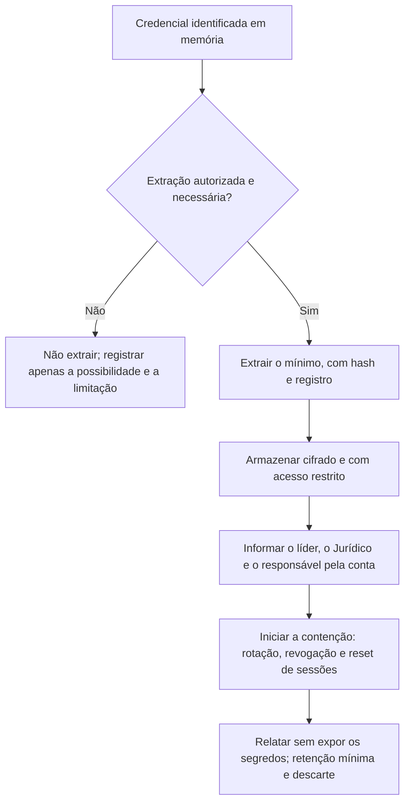

# Credenciais, Rede e Artefatos de Usuário em Memória

> **Objetivo pedagógico:** extrair da memória as informações de rede, de atividade do usuário e, quando autorizado, de credenciais e chaves, tratando esses dados sensíveis com minimização, controle de acesso e base legal, e definindo as ações de contenção decorrentes.

## 1. Categorias de informação

| Categoria | Exemplos | Sensibilidade |
|---|---|---|
| Rede | Conexões, portas, processos e destinos | Média |
| Atividade do usuário | Comandos, consoles, documentos abertos, URLs | Média a alta |
| Configuração e persistência | Chaves de registro em memória, serviços, mutexes | Média |
| Credenciais | Hashes NTLM, tickets Kerberos, senhas, tokens, cookies de sessão | Muito alta |
| Chaves de criptografia | Chaves de disco, de arquivo e de comunicação | Muito alta |
| Dados pessoais e confidenciais | Mensagens, documentos, dados de clientes | Alta |

## 2. Rede em memória

```bash
vol -f mem.raw windows.netscan.NetScan > netscan.csv
vol -f mem.raw windows.netstat.NetStat
```

| Campo | Uso |
|---|---|
| Processo e PID | Atribuir a conexão a um programa |
| Endereços locais e remotos, portas e estado | Identificar comunicação externa e movimentação lateral |
| Horário de criação (quando disponível) | Linha do tempo |
| Conexões encerradas recentemente | O `netscan` pode recuperar estruturas residuais |

Correlacione com proxy, DNS e firewall, e use somente indicadores relevantes ao caso.

## 3. Atividade do usuário

| Artefato | Como obter | Valor |
|---|---|---|
| Linhas de comando de processos | `windows.cmdline.CmdLine` | Execução e parâmetros |
| Histórico de consoles | `windows.cmdscan.CmdScan` e `windows.consoles.Consoles` | Comandos digitados em `cmd.exe` e consoles, inclusive saídas |
| Programas executados | `windows.registry.userassist.UserAssist` | Atividade do usuário |
| Variáveis de ambiente | `windows.envars.Envars` | Caminhos, perfis, tokens passados por variável |
| Arquivos abertos | `windows.handles.Handles`, `windows.filescan.FileScan` | Arquivos e pastas em uso ou recentes |
| Conteúdo de aplicativos | Strings e YARA | Texto de documentos, mensagens, URLs, formulários |
| Navegadores | Strings e análise do processo | URLs, páginas, cookies e dados de sessão |
| Linux: shells | `linux.bash.Bash` | Comandos em shells ativos |

```bash
vol -f mem.raw windows.cmdscan.CmdScan
vol -f mem.raw windows.consoles.Consoles
vol -f mem.raw windows.envars.Envars --pid 4321

# Busca por URLs e comandos em strings
strings -a -td mem.raw > ascii.txt
strings -a -el -td mem.raw > unicode.txt
grep -i -E "https?://" ascii.txt unicode.txt | head -200
```

Observação: a presença de uma string em memória indica que o dado existiu na memória do sistema, mas não prova, por si só, a autoria, o momento nem a intenção; corrobore com outras fontes.

## 4. Credenciais e chaves: tratamento seguro

A extração de credenciais é uma operação sensível, com impacto de privacidade e de segurança. Antes de executá-la:

| Cuidado | Descrição |
|---|---|
| Autorização e base legal | Confirme que o escopo e a autorização do caso preveem a extração e que o DPO e o Jurídico foram consultados |
| Necessidade | Extraia apenas se for necessária à finalidade (por exemplo, confirmar o roubo de credenciais) |
| Minimização | Evite expor senhas em texto claro em relatórios; prefira indicar "credenciais de X comprometidas" |
| Armazenamento | Cifre, restrinja o acesso e registre quem acessou |
| Retenção | Defina prazo curto e descarte seguro |
| Contenção | Se credenciais forem encontradas em memória acessível ao atacante, trate-as como comprometidas e inicie a rotação |

### 4.1 O que é possível extrair (Windows)

| Fonte | Ferramenta típica | Observações |
|---|---|---|
| Hashes de contas locais | `windows.hashdump.Hashdump` | Requer hives do SAM e do SYSTEM em memória |
| Segredos do LSA | `windows.lsadump.Lsadump` | Segredos do LSA |
| Credenciais de domínio em cache | `windows.cachedump.Cachedump` | Hashes de credenciais em cache |
| Memória do LSASS | Dump do processo e análise com ferramentas especializadas (por exemplo, pypykatz) | Pode revelar hashes NTLM, tickets Kerberos e, em configurações antigas, senhas em texto claro |
| Credenciais de navegadores | Análise da memória do processo | Senhas e cookies de sessão em uso |
| Chaves de disco | Ferramentas especializadas | Chaves de BitLocker e de outros produtos podem estar presentes em memória |

Proteções como Credential Guard, o isolamento do LSA (`LsaIso`) e a desativação do WDigest reduzem muito o que pode ser extraído do LSASS. Registre a presença dessas proteções.

```bash
vol -f mem.raw windows.hashdump.Hashdump
vol -f mem.raw windows.lsadump.Lsadump
vol -f mem.raw windows.cachedump.Cachedump
```

### 4.2 Linux e outros

| Fonte | Observação |
|---|---|
| Agente SSH e chaves privadas | Chaves podem estar na memória do `ssh-agent` e de processos SSH |
| Variáveis de ambiente | Tokens e senhas passados por ambiente |
| Credenciais de nuvem | Tokens em memória de CLIs e aplicativos |
| Gerenciadores de senhas | Podem manter segredos descriptografados em memória enquanto desbloqueados |
| Cookies e tokens de sessão (T1539) | Navegadores e aplicativos |

## 5. Fluxo de tratamento de credenciais encontradas



## 6. Chaves de criptografia e ransomware

| Situação | Observação |
|---|---|
| Disco criptografado (BitLocker, LUKS, VeraCrypt) | Se o sistema estava ligado com o volume aberto, a chave mestra pode estar na memória; ferramentas especializadas ou plugins da comunidade podem extraí-la |
| Ransomware | Em alguns casos, as chaves ou seus componentes permanecem na memória do processo enquanto o sistema não é reiniciado; ferramentas como o WannaKey e o Wanakiwi recuperaram chaves do WannaCry em sistemas antigos (Windows XP e 7) quando a memória não havia sido sobrescrita |
| Regra prática | Capture a memória o mais cedo possível e antes de reiniciar; a chance de recuperação diminui com o tempo e com o uso do sistema |

## 7. Exemplo prático: confirmação de roubo de credenciais

| Etapa | Evidência |
|---|---|
| 1 | `pstree` mostra `rundll32.exe` com pai `cmd.exe` e `cmdline` contendo `comsvcs.dll, MiniDump` e o PID do LSASS |
| 2 | `handles` mostra o processo com um handle para `lsass.exe` e um arquivo `.dmp` em pasta temporária |
| 3 | `filescan` e `dumpfiles` recuperam fragmentos do arquivo de dump |
| 4 | Credential Guard desabilitado no host (registro) |
| 5 | Decisão: não extrair as senhas; registrar que as credenciais em memória foram expostas |
| 6 | Contenção: redefinição das credenciais das contas com sessão no host e revisão de logons posteriores |
| Conclusão | Dump do LSASS (T1003.001) confirmado por processo, linha de comando e arquivo; confiança alta; extração dos segredos desnecessária |

## 8. Casos de uso corporativos

- Confirmação de dump de credenciais para definir o escopo da redefinição de senhas.
- Reconstrução de atividade de usuário a partir de consoles e linhas de comando.
- Tentativa de recuperação de chave de volume criptografado em investigação autorizada.

## 9. Normas e frameworks relevantes

- MITRE ATT&CK: T1003 (OS Credential Dumping, incluindo .001 LSASS Memory), T1555.003, T1539, T1558, T1552
- LGPD, arts. 6º (necessidade e segurança), 7º e 46
- ISO/IEC 27002:2022, controles 5.17 (informações de autenticação), 8.2 (acessos privilegiados) e 5.28
- NIST SP 800-86; NIST SP 800-63B (diretrizes de autenticação), para a rotação de credenciais

## 10. Referências

- Ligh, M. et al. The Art of Memory Forensics. Wiley, 2014.
- Volatility Foundation. Documentação do Volatility 3 (hashdump, lsadump, cachedump, cmdscan e consoles).
- MITRE ATT&CK. T1003. https://attack.mitre.org
- Microsoft Learn. Documentação do Credential Guard.
- Brasil. Lei nº 13.709/2018 (LGPD).
- Documentação do pypykatz e do projeto Wanakiwi.
