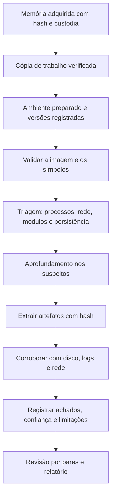

# Ferramentas, Fluxo, Modelos e Checklist de Memória

> **Objetivo pedagógico:** padronizar o ambiente de análise, o fluxo de trabalho, os registros e a verificação de qualidade das análises de memória, de modo que sejam reproduzíveis, rastreáveis e defensáveis.

## 1. Ferramentas por finalidade

| Finalidade | Ferramentas |
|---|---|
| Aquisição (Windows) | WinPmem, DumpIt, Magnet RAM Capture, FTK Imager, Belkasoft RAM Capturer |
| Aquisição (Linux) | AVML, LiME |
| Aquisição em VMs | Snapshot no hipervisor, `virsh dump`, `VBoxManage debugvm` |
| Análise principal | Volatility 3 |
| Análise de arquivos e memória como sistema de arquivos | MemProcFS |
| Dumps e crash dumps | WinDbg, procdump, Comae Toolkit |
| Varredura por padrões | YARA, `strings`, bulk_extractor |
| Análise de executáveis extraídos | PE-bear, Detect It Easy, Ghidra, FLARE VM e REMnux |
| Extração de credenciais (uso restrito) | pypykatz (somente quando autorizado) |
| Registro | Planilhas, diário de análise, scripts versionados |

Registre nome, versão, origem e hash das ferramentas; valide-as em ambiente de teste e mantenha uma cópia dos símbolos usados.

## 2. Ambiente de análise

| Requisito | Orientação |
|---|---|
| Estação isolada | Sem acesso a redes de produção; internet limitada aos símbolos, quando necessário |
| Recursos | Memória e disco suficientes (a análise de grandes imagens exige espaço de trabalho) |
| Versionamento | Volatility 3 e plugins em versões registradas; ambientes virtuais Python |
| Símbolos | Cache de símbolos preservado e documentado (Windows, Linux e macOS) |
| Segurança | Material extraído de malware manuseado em laboratório isolado |
| Armazenamento | Imagens e extrações em repositório com controle de acesso e hash |

```bash
# Exemplo de ambiente isolado com versões registradas
python3 -m venv ~/venv-vol3
source ~/venv-vol3/bin/activate
pip install volatility3
vol --help | head -n 20
pip freeze > versoes_ambiente.txt
sha256sum versoes_ambiente.txt
```

## 3. Fluxo de trabalho padronizado



## 4. Dez perguntas e como respondê-las

| Pergunta | Onde responder |
|---|---|
| 1. A imagem é válida e qual o sistema? | `windows.info.Info`, `banners.Banners` |
| 2. Há processos anômalos ou ocultos? | `pslist`, `psscan`, `pstree`, `cmdline` |
| 3. Há injeção ou código sem arquivo? | `malfind`, `vadinfo`, `dlllist` |
| 4. Há comunicação suspeita? | `netscan`, `netstat`, `sockstat` |
| 5. Há rootkits ou hooks? | `modules` e `modscan`, `ssdt`, `callbacks`, `check_syscall` |
| 6. Que comandos e atividades do usuário existiram? | `cmdscan`, `consoles`, `bash`, `userassist` |
| 7. Há persistência em memória? | `hivelist`, `printkey`, `svcscan` |
| 8. Que arquivos e executáveis extrair? | `filescan`, `dumpfiles`, `--dump` |
| 9. Há credenciais ou chaves expostas? | Plugins de credenciais (somente se autorizado) |
| 10. O que os dados externos (disco e rede) confirmam? | Prefetch, MFT, logs, proxy |

## 5. Modelo A: Registro de Aquisição de Memória

| Campo | Preenchimento |
|---|---|
| Identificador | DFL-AAAA-NNN-ENNN-MEMNN |
| Caso e host | |
| Data e hora (UTC) de início e fim | |
| Analista | |
| Ferramenta, versão e parâmetros | |
| Método (ao vivo, VM, hibernação, crash dump, dump de processo) | |
| Destino e mídia | |
| Tamanho da RAM e do arquivo | |
| Hash SHA-256 | |
| Teste de abertura (comando e resultado) | |
| Proteções observadas (VBS, Credential Guard, BitLocker, compressão de memória) | |
| Limitações e intercorrências | |

## 6. Modelo B: Inventário de Processos

| PID | PPID | Nome | Caminho | Linha de comando | Início (UTC) | Usuário e sessão | Avaliação (normal, suspeito, malicioso) | Observações |
|---|---|---|---|---|---|---|---|---|
| | | | | | | | | |

## 7. Modelo C: Registro de Achados de Memória

| ID | Plugin e comando | Evidência (processo, PID e endereço) | Hash do material extraído | Interpretação | Confiança | Corroboração | Técnica ATT&CK |
|---|---|---|---|---|---|---|---|
| M-001 | | | | | | | |
| M-002 | | | | | | | |

## 8. Modelo D: Indicadores extraídos

| Tipo | Valor | Origem (processo e região) | Primeira observação (UTC) | Confiança | Uso (bloqueio, caça, relatório) |
|---|---|---|---|---|---|
| Domínio ou IP | | | | | |
| Hash | | | | | |
| Mutex ou pipe | | | | | |
| Chave de registro | | | | | |

## 9. Checklist operacional de memória

**Caso:** DFL-AAAA-NNN
**Imagem de memória:** ____________________
**Analista:** ____________________
**Data e hora (UTC):** ____________________

### 9.1 Aquisição e preservação

- [ ] Captura feita antes de desligar ou reiniciar
- [ ] Ferramenta, versão e parâmetros registrados
- [ ] Hash SHA-256 calculado e registrado
- [ ] Tamanho do arquivo comparado com a RAM
- [ ] Teste de abertura realizado
- [ ] Proteções do sistema (VBS, Credential Guard e BitLocker) registradas
- [ ] Custódia iniciada e armazenamento seguro

### 9.2 Preparação da análise

- [ ] Cópia de trabalho com hash verificado
- [ ] Ambiente isolado e versões registradas
- [ ] Símbolos corretos instalados e origem documentada

### 9.3 Triagem

- [ ] Processos listados (`pslist`, `psscan`, `pstree`) e comparados
- [ ] Linhas de comando e árvore revisadas contra a linha de base
- [ ] Conexões e handles analisados
- [ ] Módulos, drivers e hooks verificados
- [ ] Persistência em memória verificada

### 9.4 Aprofundamento

- [ ] `malfind` e `vadinfo` avaliados, com falsos positivos considerados
- [ ] Regiões e executáveis extraídos com hash
- [ ] Strings e YARA aplicados
- [ ] Credenciais tratadas conforme autorização, minimização e contenção

### 9.5 Corroboração e relato

- [ ] Achados corroborados com disco, logs, rede e EDR
- [ ] Horários normalizados para UTC
- [ ] Mapeamento para MITRE ATT&CK
- [ ] Limitações (smearing, compressão, proteções) declaradas
- [ ] Revisão por pares realizada
- [ ] Indicadores entregues às equipes de detecção e de resposta

## 10. Resultado da verificação

| Resultado | Condição |
|---|---|
| Conforme | Todos os itens aplicáveis marcados |
| Conforme com ressalvas | Pendências sem impacto nas conclusões, com plano de ação |
| Não conforme | Captura sem hash, análise sem símbolos válidos, conclusões sem corroboração ou extração de credenciais sem autorização; comunicar o líder e o Jurídico |

**Assinatura do analista:** ____________________
**Assinatura do revisor:** ____________________

## 11. Casos de uso corporativos

- Padronização das análises de memória do SOC e do time de DFIR.
- Treinamento com imagens de laboratório e este checklist.
- Auditoria da qualidade técnica de investigações que envolvam memória.

## 12. Normas e frameworks relevantes

- ISO/IEC 27037:2012; ISO/IEC 27041:2015 (validação do método); ISO/IEC 27042:2015
- NIST SP 800-86; NIST CFTT
- MITRE ATT&CK; MITRE D3FEND
- ISO/IEC 27002:2022, controle 5.28

## 13. Referências

- Ligh, M. et al. The Art of Memory Forensics. Wiley, 2014.
- Volatility Foundation. Documentação do Volatility 3.
- Ulf Frisk. Documentação do MemProcFS.
- SANS Institute. FOR526: Memory Forensics In-Depth; FOR508.
- Kent, K. et al. NIST SP 800-86. 2006.
