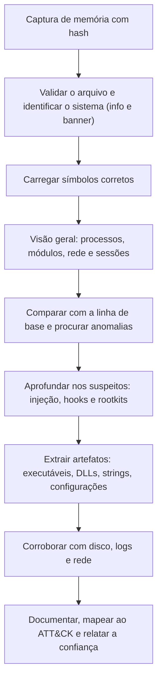

# Fundamentos de Memória e Aquisição Avançada

> **Objetivo pedagógico:** compreender o que a memória volátil contém, como ela é organizada (física e virtual), como estruturas do sistema operacional permitem reconstruir processos e conexões, e como adquiri-la com validade técnica, considerando proteções modernas, formatos e limitações.

## 1. Por que a memória é decisiva

A memória RAM guarda o estado em execução do sistema: processos, módulos carregados, conexões, chaves de criptografia, credenciais, comandos digitados e código que nunca chegou ao disco. Ela é a fonte preferencial para malware sem arquivo (fileless), injeção de código, rootkits e atividade de curta duração.

| Dado em memória | Exemplo forense |
|---|---|
| Processos e threads | Processo oculto, relação pai e filho anômala |
| Módulos e drivers carregados | DLL injetada, driver malicioso |
| Regiões de memória executáveis | Shellcode, PE injetado |
| Conexões e sockets | Comunicação com C2 |
| Linhas de comando e variáveis de ambiente | Comandos codificados, caminhos |
| Chaves e credenciais | Chaves de disco, hashes, tokens |
| Conteúdo de aplicativos | Documentos, mensagens, URLs |
| Registros carregados | Hives do registro em memória |

## 2. Organização da memória

| Conceito | Descrição | Relevância |
|---|---|---|
| Memória física | Páginas de RAM identificadas por endereço físico | O que a captura realmente grava |
| Memória virtual | Cada processo vê um espaço de endereços próprio, mapeado por tabelas de páginas | A análise traduz endereços virtuais para físicos |
| Espaço de usuário e de kernel | Código de aplicativos e código do sistema | Rootkits atuam no kernel |
| Paginação (page file) | Páginas inativas podem estar em disco | Parte do conteúdo pode estar fora da RAM |
| Compressão de memória (Windows 10 e posteriores) | O sistema comprime páginas inativas em memória | Algumas páginas ficam inacessíveis aos plugins |

### 2.1 Estruturas do Windows

| Estrutura | Papel |
|---|---|
| `EPROCESS` | Representa um processo; encadeadas em `ActiveProcessLinks` |
| `ETHREAD` | Representa uma thread |
| `PEB` | Bloco com informações do processo (linha de comando, módulos, variáveis) |
| `VAD` (Virtual Address Descriptors) | Árvore que descreve as regiões de memória de cada processo |
| Tabela de handles | Objetos abertos pelo processo (arquivos, chaves, mutexes) |
| Token | Identidade e privilégios do processo |

### 2.2 Estruturas do Linux

| Estrutura | Papel |
|---|---|
| `task_struct` | Representa processos e threads |
| `mm_struct` e VMAs | Espaço de endereços e regiões de memória |
| Lista de módulos | Módulos de kernel carregados |
| Tabela de syscalls | Verificação de hooks |
| `files_struct` | Arquivos abertos |

## 3. Proteções modernas que afetam a análise

| Proteção | Efeito |
|---|---|
| Virtualization-Based Security (VBS) e Credential Guard | Segredos do LSASS ficam isolados (processo `LsaIso`), dificultando a extração de credenciais |
| HVCI e Secure Boot | Dificultam o carregamento de drivers de captura não assinados e de rootkits |
| Compressão de memória | Parte do conteúdo não aparece nas varreduras |
| ASLR e CFG | Endereços aleatórios; exigem símbolos corretos |
| Kernel DMA Protection | Limita a aquisição por DMA |
| BitLocker e criptografia de disco | A memória pode ser a única fonte da chave |
| macOS com SIP, T2 e Apple Silicon | Restringem a captura completa por ferramentas livres |

Documente a presença dessas proteções no relatório, pois influenciam o que é possível extrair.

## 4. Aquisição: princípios

| Princípio | Aplicação |
|---|---|
| Primeiro a memória | Capture-a antes de desligar, reiniciar ou executar outras ações no sistema |
| Menor pegada | Use ferramentas leves, a partir de mídia externa confiável |
| Gravar fora da evidência | Destino em mídia externa com espaço superior ao da RAM |
| Registro completo | Ferramenta, versão, parâmetros, horário (UTC), tamanho da RAM e hash |
| Teste de abertura | Verifique se o arquivo é aceito pelo analisador (por exemplo, `windows.info.Info`) |
| Declaração de limitações | Impacto da ferramenta e eventuais "borrões" (smearing) |

### 4.1 Smearing

Como o sistema continua em execução durante a captura, páginas mudam enquanto são lidas. O resultado pode conter inconsistências (estruturas parcialmente atualizadas). Isso é esperado; declare no relatório e use mais de uma fonte para confirmar achados críticos.

## 5. Ferramentas de aquisição

| Plataforma | Ferramentas | Observações |
|---|---|---|
| Windows | WinPmem, DumpIt, Magnet RAM Capture, FTK Imager (Capture Memory), Belkasoft RAM Capturer | Siga a documentação da versão utilizada |
| Linux | AVML, LiME | LiME exige módulo compatível com o kernel |
| macOS | Soluções comerciais e procedimentos específicos | Restrições de SIP, T2 e Apple Silicon |
| Máquinas virtuais | Snapshot com memória no hipervisor | Não executa nada no convidado |
| Nuvem | Snapshot de disco e, quando possível, agente de captura | Memória só se capturada dentro da instância |

```powershell
# Exemplo de registro do contexto antes de capturar (Windows)
Get-Date -Format "o"
Get-CimInstance Win32_ComputerSystem | Select-Object TotalPhysicalMemory
Get-CimInstance Win32_OperatingSystem | Select-Object Caption,Version,BuildNumber,LastBootUpTime
```

```bash
# Verificação após a captura
ls -l DFL-2026-001-E001-MEM01.raw
sha256sum DFL-2026-001-E001-MEM01.raw > DFL-2026-001-E001-MEM01.sha256

# Teste de abertura com Volatility 3
vol -f DFL-2026-001-E001-MEM01.raw windows.info.Info
```

Compare o tamanho do arquivo com a RAM instalada. Em sistemas com regiões reservadas, o tamanho pode diferir ligeiramente, e isso deve ser anotado.

## 6. Formatos de memória

| Formato | Origem | Observação |
|---|---|---|
| RAW (bruto) | WinPmem, DumpIt e outros | Cópia linear da memória física |
| LiME | LiME e AVML | Contém cabeçalhos com os intervalos de memória |
| ELF core | Algumas ferramentas | Intervalos descritos em seções |
| Crash dump (`.dmp`) | Falha do Windows ou captura por ferramentas | Formato nativo do Windows |
| Hibernação (`hiberfil.sys`) | Windows | Exige conversão (ver arquivo de VMs, hibernação e crash dumps) |
| `.vmem`, `.vmss` e `.vmsn` | VMware | Memória do convidado e metadados |
| Dump de processo | `procdump`, `gcore` | Apenas um processo |

## 7. Fluxo geral de análise de memória



## 8. Exemplo prático: registro de uma captura

| Campo | Preenchimento |
|---|---|
| Identificador | DFL-2026-001-E001-MEM01 |
| Origem | DFL-2026-001-E001 (notebook, 16 GB de RAM) |
| Data e hora (UTC) | 2026-10-30T13:52:40Z a 13:55:10Z |
| Analista | Analista A |
| Ferramenta e versão | Registrar o nome e a versão exatos |
| Destino | Mídia externa criptografada, 64 GB livres |
| Tamanho do arquivo | Registrar em bytes |
| Hash SHA-256 | Registrar o valor calculado |
| Teste de abertura | `windows.info.Info` reconhece Windows 11 build registrado |
| Proteções observadas | VBS e Credential Guard ativos; BitLocker ativo |
| Limitações | Smearing possível; compressão de memória ativa |

## 9. Casos de uso corporativos

- Captura de memória de servidor comprometido sem interrupção do serviço.
- Preservação de memória antes da contenção de uma estação com suspeita de infostealer.
- Planejamento de coleta de memória em ambientes com Credential Guard e BitLocker.

## 10. Normas e frameworks relevantes

- RFC 3227 (ordem de volatilidade); ISO/IEC 27037:2012; NIST SP 800-86
- ISO/IEC 27002:2022, controle 5.28
- MITRE ATT&CK: T1055 (Process Injection), T1003 (OS Credential Dumping), T1620 (Reflective Code Loading)
- NIST CFTT (validação de ferramentas de aquisição de memória)

## 11. Referências

- Ligh, M.; Case, A.; Levy, J.; Walters, A. The Art of Memory Forensics. Wiley, 2014.
- Russinovich, M.; Solomon, D.; Ionescu, A. Windows Internals. 7. ed. Microsoft Press, 2017.
- Brezinski, D.; Killalea, T. RFC 3227. 2002.
- Volatility Foundation. Documentação do Volatility 3.
- SANS Institute. FOR526: Memory Forensics In-Depth.
- Microsoft Learn. Documentação de VBS, Credential Guard e HVCI.
